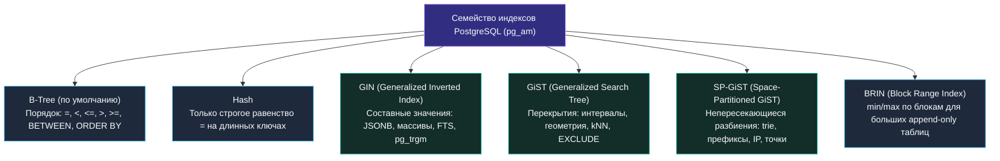
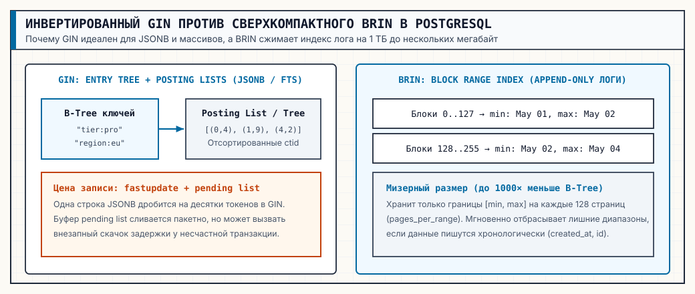

*Как устроена абстракция методов доступа `pg_am`, чем отличаются B-Tree, Hash, GIN, GiST, SP-GiST и BRIN, почему Visibility Map отменяет лишние прыжки в кучу и какой индекс выбрать для таблиц `LedgerPulse`.*

> «Память часто была самым дорогим компонентом компьютера. Когда на счету был каждый байт, этот дефицит навязывал программистам особую дисциплину: приходилось постоянно отдавать себе отчёт, сколько памяти занимает программа...»  
> — Брайан Керниган, *UNIX: A History and a Memoir*

Когда приложение отправляет запрос `SELECT * FROM accounts WHERE external_id = $1`, а индекса на `external_id` нет, исполнитель запускает **Sequential Scan**: читает с диска каждую 8-КБ страницу кучи, проверяет `t_xmin` и `t_xmax` каждого кортежа и сравнивает строки. На таблице в 20 ГБ это означает перекачку 20 ГБ через контроллер SSD и вымывание горячего кэша `shared_buffers` ради одной 100-байтовой записи.

Но одного `B-Tree` недостаточно, когда в `LedgerPulse` появляются запросы к вложенному `metadata JSONB`, запрет пересекающихся периодов лимитов `tstzrange`, поиск по длинным префиксам URL и многомиллиардная лента проводок `ledger_entries`, для которой `B-Tree` сам начинает весить десятки гигабайт. В ответ на это PostgreSQL предлагает целое семейство из шести встроенных индексных движков.

---

## Физическая природа индекса и интерфейс `pg_am`

Внутри PostgreSQL индекс — такое же полноценное отношение (**Relation**), как и таблица: у него есть свой `OID`, собственные файлы в `base/` и своя нарезка на **8-КБ страницы**. Но фундаментальное правило остаётся неизменным для всех типов индексов:

**Индекс в PostgreSQL никогда не хранит полные строки таблицы и не содержит метаданных MVCC (`t_xmin`, `t_xmax`).**

В этом главное отличие от кластерного индекса MySQL InnoDB, где листовые страницы первичного ключа сами служат таблицей. В PostgreSQL индекс упорядочивает или группирует ключи и сопоставляет им физические указатели **`CTID`** `(BlockNumber, OffsetNumber)` на кортежи в куче (см. [[2. Движок хранения PostgreSQL — 8 КБ страницы, Heap, TOAST и Visibility Map]]).

Отсюда вытекает важное следствие: найдя подходящий `CTID` в индексе, движок не знает, жива ли эта версия строки для снимка текущей транзакции (см. [[3. MVCC в PostgreSQL — xmin, xmax, ctid, HOT и переполнение XID]]). Он либо совершает случайный прыжок на страницу кучи (**`Index Scan`**), либо проверяет карту видимости `_vm`: если на странице установлен бит `all_visible = 1` и все запрошенные столбцы есть в самом индексе (ключ + `INCLUDE`), запускается **`Index-Only Scan`** без единого чтения таблицы (подробнее в [[6. Покрывающие (Covering) индексы, INCLUDE и Index-Only Scan]]).

Благодаря расширяемому интерфейсу методов доступа (`Access Method`, каталог `pg_am`) ядро отделяет исполнителя от конкретной структуры данных. Это позволяет держать под одной крышей шесть встроенных типов индексов (и подключать внешние через расширения вроде `pgvector`):



---

## `B-Tree`: рабочая лошадка (Lehman & Yao B-link tree)

Когда вы пишете `CREATE INDEX idx_name ON accounts (owner_name);` без `USING`, PostgreSQL создаёт сбалансированное дерево **Lehman & Yao B-link tree** (подробный разбор алгоритма вставки и разделения страниц приведён в [[2. B-Tree индекс под капотом — страницы, ветвление и page split]]).

Почему B-Tree вытеснил классические бинарные деревья из дисковых СУБД? В AVL-дереве каждый узел имеет 2 потомка, поэтому для миллиарда ключей глубина превышает 30 уровней — 30 случайных чтений по ~100 мкс на NVMe. В PostgreSQL узлом выступает целая **8-КБ страница**, вмещающая сотни ключей и ссылок (*высокий коэффициент ветвления — fanout*). На миллиарде строк глубина дерева редко превышает **3–4 уровня** (`Root Page` → `Branch Pages` → `Leaf Pages`), причём верхние уровни почти всегда уже лежат в `shared_buffers` (~100 нс).

Листовые страницы B-Tree связаны двусвязным списком через область `Special Space` на каждой 8-КБ странице, что делает сканирование интервалов (`BETWEEN`, `>= ... AND < ...`) и сортировку (`ORDER BY ... LIMIT`) последовательным проходом по листьям. Начиная с PostgreSQL 13, B-Tree также выполняет **дедупликацию одинаковых ключей**, сжимая повторяющиеся значения в компактные списки `CTID`.

> [!tip] Собеседование [Middle]
> **Вопрос:** На таблицу добавили 5 новых B-Tree индексов. Как это повлияет на `UPDATE` одной неиндексируемой колонки?  
> **Ответ:** Если новая версия строки помещается на ту же 8-КБ страницу Heap, срабатывает HOT-обновление: старая строка ссылается на новую внутри страницы, и ни один из 5 индексов не затрагивается. Но как только свободного места на странице не хватает, строка переезжает на другую страницу и получает новый `CTID`. PostgreSQL обязан вставить новую пару `(key, CTID)` во **все 5 индексов**, порождая **Write Amplification (усиление записи)** — всплеск случайного I/O и записей в WAL. Кроме того, при частых удалениях и перекосе ключей B-Tree со временем раздувается (**Index Bloat**); в продакшене такие индексы перестраивают без блокировки чтения и записи командой `REINDEX INDEX CONCURRENTLY`.

---

## `Hash`: только точечное равенство `=`

Хэш-индекс отображает значение ключа в 32-битный хеш-код и раскладывает пары `(hash, CTID)` по страницам-корзинам (*buckets* и *overflow pages*). Долгое время его избегали из-за отсутствия журналирования, но начиная с **PostgreSQL 10** `Hash`-индексы полностью пишутся в WAL, переживают сбои и реплицируются (см. [[3. Hash-индекс — устройство, границы и сравнение с B-Tree]]).

**Когда оправдан:** для длинных ключей (URL, токены длиной 100–500 байт), где хранение самих строк в узлах B-Tree раздувает дерево, а запросы проверяют исключительно строгое равенство `WHERE token_hash = $1`. Поиск по равенству в `Hash` нередко компактнее и чуть быстрее за счёт меньшего числа уровней.

**Жёсткие ограничения:** `Hash` не поддерживает диапазоны (`<`, `>`, `BETWEEN`), сортировку `ORDER BY`, составные многоколоночные ключи и ограничение `UNIQUE` (кроме косвенной проверки, штатный `UNIQUE` в PostgreSQL опирается только на B-Tree).

---

## `GIN`: обобщённый инвертированный индекс

**GIN (*Generalized Inverted Index*)** создан для составных значений, которые раскладываются на набор отдельных элементов: ключи и значения `JSONB`, элементы массивов, лексемы полнотекстового поиска (`tsvector`) и триграммы (`pg_trgm`). Его логика совпадает с предметным указателем в конце учебника (детали также разбираются в [[8. Индексы для JSONB, массивов и диапазонов — GIN и GiST]]).

Внутренняя структура GIN состоит из четырёх элементов:

1. **`Entry Tree`:** B-Tree по отсортированным уникальным элементам (ключам).
2. **`Posting List` / `Posting Tree`:** для редкого элемента в листе `Entry Tree` хранится компактный отсортированный список `CTID` (*Posting List*); для частого элемента, встречающегося в миллионах строк, список выносится в отдельное B-Tree дерево из `CTID` (*Posting Tree*).
3. **`gin_pending_list`:** при включённом по умолчанию `fastupdate = on` новые вставки складываются в неупорядоченный временный буфер и сливаются в основное дерево пакетом. Это ускоряет одиночные `INSERT`, но при переполнении `gin_pending_list_limit` (4 МБ по умолчанию) очередной несчастный пользовательский запрос или `autovacuum` получает паузу на массовый сброс.

В схеме `LedgerPulse` для поля `accounts.metadata JSONB` используется индекс с классом операторов `jsonb_path_ops`:

```sql
CREATE INDEX IF NOT EXISTS idx_accounts_metadata_gin
    ON accounts USING GIN (metadata jsonb_path_ops);
```

По умолчанию `jsonb_ops` индексирует каждый ключ и каждое значение по отдельности, поддерживая `?`, `?|`, `?&` и `@>`, но заметно раздувает индекс. Класс `jsonb_path_ops` хеширует полные пути от корня до значения в 32-битные хеши: он поддерживает только `@>` (и `jsonpath`-операторы `@?`, `@@`), зато весит в 2–5 раз меньше. При чтении GIN всегда работает через `Bitmap Index Scan` → `Bitmap Heap Scan` (см. [[4. Bitmap-индекс и Bitmap Index Scan]]), собирая битовую карту страниц в RAM и перепроверяя редкие коллизии хешей на шаге `Recheck Cond`.

---

## `GiST` и `SP-GiST`: деревья для интервалов, пространства и префиксов

Оба семейства решают задачи за пределами одномерного порядка `B-Tree`, но делают это с разной геометрией разбиения данных.

### `GiST` (Generalized Search Tree)

**GiST** — сбалансированный каркас для произвольных поисковых деревьев, наиболее известный реализацией **R-Tree**. Узлы GiST хранят обобщённые предикаты — *ограничивающие области* (bounding boxes или охватывающие интервалы), которые **могут перекрываться** между соседними ветвями. За счёт этого поиск иногда спускается в несколько поддеревьев, а часть предикатов требует перепроверки кортежа на странице кучи (`Recheck Cond`).

Сильнейшие сценарии GiST:

* **Геопространственные данные** в расширении PostGIS (о нём пойдёт речь в главе 8 этого модуля) и поиск ближайших соседей kNN (`ORDER BY location <-> point(...) LIMIT 10`).
* **Диапазоны (`tstzrange`, `int8range`) и защита от пересечений:** в `LedgerPulse` для таблицы лимитов `account_limits` можно гарантировать на уровне БД, что два активных периода действия лимита по одному счёту никогда не пересекутся:

```sql
CREATE EXTENSION IF NOT EXISTS btree_gist;

CREATE TABLE account_limits (
    id           BIGINT GENERATED ALWAYS AS IDENTITY PRIMARY KEY,
    account_id   BIGINT      NOT NULL REFERENCES accounts(id),
    daily_limit  BIGINT      NOT NULL CHECK (daily_limit > 0),
    valid_during TSTZRANGE   NOT NULL,
    EXCLUDE USING gist (
        account_id WITH =,
        valid_during WITH &&
    )
);
```

Ограничение `EXCLUDE USING gist` проверяет равенство `account_id` и пересечение интервалов `&&` атомарно в рамках транзакции, чего не умеет обычный `UNIQUE`.

### `SP-GiST` (Space-Partitioned GiST)

**SP-GiST** — **несбалансированное** дерево разбиения пространства. Если в GiST ограничивающие области разных веток могут перекрываться, то SP-GiST строго делит пространство на **непересекающиеся (disjoint) области**. Под этой общей обёрткой в PostgreSQL реализованы структуры из учебников по алгоритмам:

* **Префиксные деревья (Radix Tree / Trie)** для длинных строк (`text_ops`): хранит общий префикс один раз во внутреннем узле, не дублируя длинные одинаковые начала URL, телефонных номеров или путей вроде `/api/v2/ledger/accounts/...`.
* **Квадродеревья (Quadtree) и k-d деревья** для двумерных точек (`point_ops`, `box_ops`), особенно при сильном перекосе плотности данных.
* **Префиксный поиск по IP-сетям (`inet_ops`):** быстрая проверка вхождения адреса в подсеть (`<<`, `>>`, `&&`).
* **Диапазоны (`range_ops`)** при неравномерном распределении длин интервалов.

```sql
-- Пример SP-GiST для быстрого префиксного поиска по длинным путям/идентификаторам
CREATE INDEX idx_tx_reference_spgist
    ON transactions USING spgist (reference_id);
```

SP-GiST уходит в глубину там, где данных больше, и остаётся мелким на пустых участках (поэтому дерево несбалансированное). При этом `SP-GiST` поддерживает `Index-Only Scan` для классов операторов, умеющих восстанавливать исходное значение из пути (например, `text_ops`, `inet_ops`, `point_ops`).

---

## `BRIN`: гигантские таблицы в нескольких килобайтах



**BRIN (*Block Range Index*)** ломает привычное представление об индексах: он **не хранит указатели на отдельные строки**. Вместо этого BRIN разбивает файл таблицы на последовательные диапазоны физических страниц (по умолчанию `pages_per_range = 128`, то есть 1 МБ данных Heap) и записывает для каждого диапазона лишь минимальное и максимальное значение колонки (`min`, `max`).

Представьте таблицу `ledger_entries` в `LedgerPulse` на **500 ГБ** (около 65 миллионов 8-КБ страниц), куда проводки дописываются строго последовательно по `created_at`:

* Обычный `B-Tree` по `created_at` займёт **15–20 ГБ** на диске и будет активно вымывать `shared_buffers`.
* `BRIN` с `pages_per_range = 128` сохранит всего около 512 000 записей `(min, max)` — его размер составит **~24 МБ** (в 700 раз меньше), а на таблице в 50 ГБ он займёт ~2.4 МБ и целиком поместится в L3-кэш процессора.

```sql
CREATE INDEX idx_ledger_entries_created_brin
    ON ledger_entries USING brin (created_at)
    WITH (pages_per_range = 64, autosummarize = on);
```

> [!warning] Ловушка BRIN: разрушение физической корреляции
> Эффективность `BRIN` на 100% зависит от **физической корреляции** между значением колонки и порядком расположения строк на диске (`pg_stats.correlation` около `+1.0` или `-1.0`).
>
> Если таблица подвергается частым `UPDATE` без HOT или строки вставляются со случайными датами из прошлого, в каждом мегабайтном диапазоне страниц оказываются и 2020-й, и 2026-й годы. Диапазон `[min, max]` расширяется на всю историю, `BRIN` перестаёт отсекать блоки и сканирует всю таблицу целиком.
>
> Для данных с умеренным разбросом или несколькими кластерами значений (например, мультитенантная вставка по нескольким временным окнам) начиная с **PostgreSQL 14** появился класс операторов `minmax-multi` (`timestamp_minmax_multi_ops`), который хранит несколько узких интервалов на блок вместо одного раздутого `[min, max]`, а также `bloom`-сумматоры для точечного равенства по неупорядоченным колонкам с низкой кардинальностью на блок.

---

## Сводная матрица выбора индекса

| Индекс | Внутренняя структура | Главные операторы | `Index-Only Scan` | Скорость записи | Кейс в `LedgerPulse` |
|---|---|---|---|---|---|
| **`B-Tree`** | Сбалансированное B-link дерево | `=`, `<`, `<=`, `>`, `>=`, `BETWEEN`, `IS NULL`, `LIKE 'abc%'` | Да (включая `INCLUDE`) | Средняя | Ключи `id`, `external_id`, лента `(account_id, created_at DESC)` |
| **`Hash`** | Хэш-корзины (с WAL с PG 10) | Только `=` | Нет | Высокая | Точный поиск по длинным токенам и URL без диапазонов |
| **`GIN`** | `Entry B-Tree` + `Posting List/Tree` | `@>`, `?`, `?|`, `?&`, `@@` | Нет | Низкая (смягчается `fastupdate`) | Фильтрация `accounts.metadata JSONB`, массивы тегов, FTS |
| **`GiST`** | Сбалансированное R-Tree (с перекрытием) | `&&`, `@>`, `<@`, `<->` (kNN), `=` (`btree_gist`) | Для части классов | Средняя | `EXCLUDE USING gist` для периодов `account_limits`, PostGIS |
| **`SP-GiST`** | Несбалансированные trie / quadtree / k-d tree | `^@` (префикс), `<<`, `>>`, `<->`, `&&` | Для части классов | Средняя/высокая | Длинные префиксы `reference_id`, IP-подсети, перекошенные точки |
| **`BRIN`** | Сводки `(min, max)` по диапазонам страниц | `=`, `<`, `<=`, `>`, `>=`, `BETWEEN` | Нет (только `Bitmap`) | Очень высокая (почти ноль) | Многомиллиардный журнал `ledger_entries (created_at)` в append-only |

---

## Практика: защита интервалов в Go 1.24 и замеры `BRIN` vs `B-Tree`

Проверим на реальном примере в Go 1.24, как работает ограничение `EXCLUDE USING gist` при попытке создать пересекающийся лимит счёта. PostgreSQL при конфликте интервалов возвращает код ошибки **SQLSTATE `23P01`** (`exclusion_violation`):

```go
package main

import (
	"context"
	"database/sql"
	"errors"
	"fmt"
	"time"

	"github.com/jackc/pgx/v5/pgconn"
)

var ErrLimitPeriodOverlap = errors.New("account limit period overlaps with an existing limit")

func CreateAccountLimit(ctx context.Context, db *sql.DB, accountID, dailyLimit int64, from, to time.Time) error {
	// Формируем полуоткрытый интервал [from, to) с помощью функции tstzrange.
	_, err := db.ExecContext(ctx, `
		INSERT INTO account_limits (account_id, daily_limit, valid_during)
		VALUES ($1, $2, tstzrange($3, $4, '[)'))`,
		accountID, dailyLimit, from, to,
	)
	if err != nil {
		var pgErr *pgconn.PgError
		if errors.As(err, &pgErr) && pgErr.Code == "23P01" {
			return fmt.Errorf("%w: account_id=%d", ErrLimitPeriodOverlap, accountID)
		}
		return fmt.Errorf("insert account limit: %w", err)
	}
	return nil
}
```

А теперь сравним размеры и план `EXPLAIN (ANALYZE, BUFFERS)` на 1 миллионе последовательно вставленных строк `ledger_entries` для `B-Tree` и `BRIN` по колонке `created_at`:

```sql
SELECT
    pg_size_pretty(pg_relation_size('idx_ledger_created_btree')) AS btree_size,
    pg_size_pretty(pg_relation_size('idx_ledger_created_brin'))  AS brin_size;
```

```text
 btree_size | brin_size
------------+-----------
 21 MB      | 24 kB
```

Разница в размере на одном миллионе строк — **почти в 900 раз** (`21 MB` против `24 kB`). Посмотрим на план выборки за 2-часовое окно:

```sql
EXPLAIN (ANALYZE, BUFFERS)
SELECT count(*), sum(amount)
FROM ledger_entries
WHERE created_at >= '2026-05-01 10:00:00+00'
  AND created_at <  '2026-05-01 12:00:00+00';
```

```text
Aggregate  (cost=1452.10..1452.11 rows=1 width=16) (actual time=4.120..4.121 rows=1 loops=1)
  Buffers: shared hit=128
  ->  Bitmap Heap Scan on ledger_entries  (cost=16.50..1440.10 rows=2400 width=8) (actual time=0.215..3.480 rows=2380 loops=1)
        Recheck Cond: ((created_at >= '2026-05-01 10:00:00+00') AND (created_at < '2026-05-01 12:00:00+00'))
        Rows Removed by Index Recheck: 1640
        Heap Blocks: lossy=48
        Buffers: shared hit=128
        ->  Bitmap Index Scan on idx_ledger_created_brin  (cost=0.00..15.90 rows=2400 width=0) (actual time=0.088..0.089 rows=480 loops=1)
              Index Cond: ((created_at >= '2026-05-01 10:00:00+00') AND (created_at < '2026-05-01 12:00:00+00'))
              Buffers: shared hit=3
Planning Time: 0.112 ms
Execution Time: 4.185 ms
```

Обратите внимание на две детали в плане: индексный этап `Bitmap Index Scan` прочитал всего **3 страницы** (`24 КБ`) за `0.089 мс` и пометил 48 блоков Heap как `lossy=48`, после чего `Bitmap Heap Scan` отфильтровал лишние строки шагом `Rows Removed by Index Recheck: 1640`. Для точечного OLTP-запроса по `id` на 1 строку `BRIN` не подходит (он всё равно прочитает минимум 1 мегабайтный диапазон блоков), а для временных окон на огромных append-only таблицах он экономит гигабайты RAM и ускоряет вставку.

---

## Упражнения

### Упражнение 1 (Базовое)
Для пяти запросов в `LedgerPulse` выберите оптимальный тип индекса (`B-Tree`, `Hash`, `GIN`, `GiST`, `SP-GiST`, `BRIN`) и обоснуйте выбор одной-двумя фразами:
1. `SELECT id, balance FROM accounts WHERE external_id = $1;`
2. `SELECT id FROM accounts WHERE metadata @> '{"tier": "vip", "kyc": "verified"}';`
3. `SELECT sum(amount) FROM ledger_entries WHERE created_at BETWEEN $1 AND $2;` (таблица 800 ГБ, только вставки с текущим временем).
4. Предотвращение пересечения периодов действия тарифов `(account_id, valid_during)` в таблице `account_tariffs`.
5. Быстрый поиск по префиксу длинных иерархических путей `event_path ^@ '/payments/eu/sepa/'` или IP-подсетей `client_ip << '10.24.0.0/16'`.

> [!solution] Показать решение
> 1. **`B-Tree`** (под `UNIQUE`-ограничение или с `INCLUDE (balance)` для `Index-Only Scan`). `Hash` здесь проигрывает, так как не гарантирует уникальность `external_id` и не поддерживает покрывающие столбцы.
> 2. **`GIN`** с классом операторов `jsonb_path_ops` — компактно индексирует пути `JSONB` и ускоряет оператор включения `@>`.
> 3. **`BRIN`** на `created_at` (возможно, с `pages_per_range = 64`) — физическая корреляция близка к `1.0`, индекс займёт мегабайты вместо десятков гигабайт у B-Tree и не создаст штрафа при вставках.
> 4. **`GiST`** в сочетании с `btree_gist` и ограничением `EXCLUDE USING gist (account_id WITH =, valid_during WITH &&)` — единственный встроенный индекс, позволяющий атомарно запретить пересекающиеся интервалы внутри одного счёта.
> 5. **`SP-GiST`** (`text_ops` или `inet_ops`) — префиксное дерево хранит общий префикс `/payments/eu/sepa/` без дублирования в промежуточных узлах и нативно ускоряет проверку вхождения IP-адреса в подсеть.

### Упражнение 2 (Практическое)
Напишите миграцию для таблицы `account_limits` с `EXCLUDE USING gist` и функцию в Go 1.24, которая обновляет период старого лимита (обрезая его правую границу до момента `now()`) и вставляет новый лимит с интервалом `[now(), 'infinity')` в одной транзакции. Объясните, почему без такого обновления при вставке нового лимита вы получите ошибку `23P01`.

> [!solution] Показать решение
> Если у счёта уже действует открытый интервал `[2026-01-01, infinity)`, любой новый интервал `[2026-05-01, infinity)` пересекается с ним на участке `[2026-05-01, infinity)`, и оператор `&&` вернёт `true`, вызвав `SQLSTATE 23P01`. Поэтому в одной транзакции сначала закрываем старый интервал, затем вставляем новый:
>
> ```go
> func RotateAccountLimit(ctx context.Context, db *sql.DB, accountID, newDailyLimit int64, effectiveAt time.Time) error {
> 	tx, err := db.BeginTx(ctx, nil)
> 	if err != nil {
> 		return fmt.Errorf("begin tx: %w", err)
> 	}
> 	defer func() { _ = tx.Rollback() }()
>
> 	// Закрываем текущий активный интервал (upper_inf(valid_during)) на отметке effectiveAt.
> 	if _, err := tx.ExecContext(ctx, `
> 		UPDATE account_limits
> 		SET valid_during = tstzrange(lower(valid_during), $2, '[)')
> 		WHERE account_id = $1
> 		  AND valid_during @> $2::timestamptz`,
> 		accountID, effectiveAt,
> 	); err != nil {
> 		return fmt.Errorf("close previous limit: %w", err)
> 	}
>
> 	if _, err := tx.ExecContext(ctx, `
> 		INSERT INTO account_limits (account_id, daily_limit, valid_during)
> 		VALUES ($1, $2, tstzrange($3, 'infinity', '[)'))`,
> 		accountID, newDailyLimit, effectiveAt,
> 	); err != nil {
> 		return fmt.Errorf("insert new limit: %w", err)
> 	}
>
> 	return tx.Commit()
> }
> ```

### Упражнение 3 (\*)
Сгенерируйте две таблицы по 500 000 строк: `events_ordered` (временная метка `ts` растёт монотонно) и `events_shuffled` (те же временные метки перемешаны в случайном порядке через `ORDER BY random()`). Создайте на обеих таблицах `BRIN` по `ts`, выполните `ANALYZE`, проверьте `correlation` в `pg_stats` и сравните `EXPLAIN (ANALYZE, BUFFERS)` для выборки 1-часового окна. Объясните, почему в `events_shuffled` число прочитанных страниц вырастает до размера всей таблицы, и поможет ли здесь `timestamp_minmax_multi_ops`.

> [!solution] Показать решение
> ```sql
> CREATE TABLE events_ordered AS
> SELECT g AS id, timestamp '2026-01-01' + (g || ' seconds')::interval AS ts
> FROM generate_series(1, 500000) AS g;
>
> CREATE TABLE events_shuffled AS
> SELECT id, ts FROM events_ordered ORDER BY random();
>
> CREATE INDEX idx_ord_brin ON events_ordered USING brin (ts);
> CREATE INDEX idx_shf_brin ON events_shuffled USING brin (ts);
> ANALYZE events_ordered, events_shuffled;
>
> SELECT tablename, correlation
> FROM pg_stats
> WHERE tablename IN ('events_ordered', 'events_shuffled') AND attname = 'ts';
> ```
> У `events_ordered` значение `correlation` будет равно **`1.0`**, а у `events_shuffled` — около **`0.0`**.
>
> При выборке 1-часового окна (3 600 строк) из `events_ordered` `BRIN` отсекает ~99% мегабайтных диапазонов и читает лишь 1–2 блока Heap (`shared hit` около 20–30 страниц). В `events_shuffled` в каждом 128-страничном диапазоне присутствуют случайные метки от января до середины февраля, поэтому `min` и `max` каждого диапазона покрывают искомый час. `Bitmap Heap Scan` вынужден прочитать **100% страниц таблицы** (все ~2 213 блоков).
>
> Оператор `timestamp_minmax_multi_ops` (PostgreSQL 14+) хранит до нескольких десятков раздельных мини-интервалов в сводке блока и отлично спасает, если данные группируются в несколько потоков (например, 5–10 разных дат/шардов на блок), но при **полностью равномерном хаосе** (`random()`) даже мульти-интервалы в каждом блоке сольются в сплошное покрытие — для полностью случайного порядка нужен `B-Tree` или партиционирование по дате.

---

Мы собрали карту всех шести индексных структур PostgreSQL и увидели, как `GIN` ускоряет работу с `JSONB`. Но как именно `JSONB` устроен внутри 8-КБ страниц и TOAST, чем он отличается от текстового `JSON` на уровне байтов и какие нюансы есть у операторов `@>`, `?` и `jsonpath`? Об этом пойдёт речь в следующей главе этого модуля.
