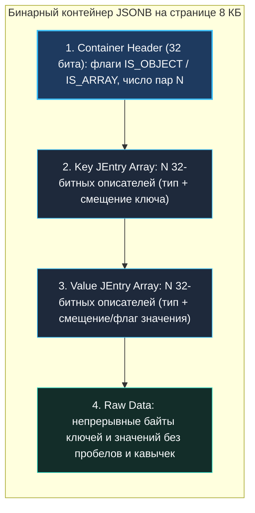

*Как бинарный контейнер `JSONB` устроен внутри 8-килобайтных страниц Heap и чанков `TOAST`, зачем ему 32-битные заголовки `JEntry` и бинарный поиск по ключам, как сжать GIN-индекс через `jsonb_path_ops`, почему `jsonb_set` раздувает таблицу под MVCC и как избежать двойного парсинга в Go 1.24.*

> «Память часто была самым дорогим компонентом компьютера. Когда на счету был каждый байт, этот дефицит навязывал программистам особую дисциплину: приходилось постоянно отдавать себе отчёт, сколько памяти занимает программа…»  
> — Брайан Керниган, *UNIX: A History and a Memoir*

В таблице `accounts` схемы `LedgerPulse` рядом со строгими финансовыми колонками (`balance BIGINT`, `currency CHAR(3)`, `status TEXT`) живёт столбец `metadata JSONB NOT NULL DEFAULT '{}'::jsonb`. В [[8. JSON и JSONB в SQL]] мы разобрали синтаксис запросов к нему, а в [[8. Индексы для JSONB, массивов и диапазонов — GIN и GiST]] — базовую работу GIN-индекса.

Но как только в `LedgerPulse` начинают приходить сырые вебхуки от платёжных шлюзов, флаги комплаенса и динамические лимиты тарифов, одного синтаксиса мало. Попытка вынести такие документы в отдельный NoSQL-кластер (о документных базах мы поговорим в Модуле 9 этого тома) усложняет эксплуатацию и разрушает сквозную ACID-согласованность между проводкой в `ledger_entries` и метаданными счёта. PostgreSQL закрывает эту потребность встроенным типом `JSONB`, но за удобство легко расплатиться деградацией кэша, раздуванием диска и лишними аллокациями в Go.

---

## `json` против `jsonb`: почему текст проигрывает бинарному дереву

В 2012 году PostgreSQL 9.2 добавил текстовый тип `json`, но он годился лишь для валидации синтаксиса при записи. Прорыв случился в 2014 году с выходом PostgreSQL 9.4: в ядре появился `jsonb` (*Binary JSON*).

> [!tip] Собеседование [Middle]
> **Вопрос:** В чём принципиальная разница между типами `json` и `jsonb` на уровне хранения и выполнения запросов, и когда всё же оправдан `json`?
>
> **Ответ:** Тип `json` сохраняет байт-в-байт точную копию входной строки — с пробелами, табуляциями, исходным порядком ключей и даже их дубликатами. При каждом обращении `data->>'key'` движок заново прогоняет синтаксический парсер по всей строке.
> Тип `jsonb` переносит стоимость разбора на этап `INSERT`/`UPDATE`: проверяет синтаксис, вырезает пробелы, отбрасывает дубликаты ключей (оставляя только последнее значение), сортирует ключи и упаковывает документ в бинарный контейнер со смещениями. На чтении повторный парсинг не нужен, а по ключам работает бинарный поиск и GIN-индексы. Выбирайте `jsonb` в 99% задач; текстовый `json` нужен лишь тогда, когда критично сохранить точную побайтовую форму документа — например, для проверки криптографической подписи сырого вебхука.

| Свойство | `json` (текст) | `jsonb` (бинарный контейнер) |
|---|---|---|
| **Хранение на странице** | Исходная строка UTF-8 | Заголовки `JEntry` + массив байтов |
| **Пробелы и порядок ключей** | Сохраняются полностью | Удаляются; ключи упорядочены |
| **Дубликаты ключей** | Сохраняются все | Остаётся последнее значение |
| **Цена записи (`INSERT`)** | Ниже (только проверка грамматики) | Выше (парсинг, сортировка, сборка контейнера) |
| **Цена чтения (`->`, `->>`)** | $O(N)$ — полный разбор строки | $O(\log K)$ — бинарный поиск по смещениям |
| **Индексация GIN** | Не поддерживается | `jsonb_ops`, `jsonb_path_ops` |

---

## Внутреннее устройство `JSONB` на 8-килобайтной странице

Чтобы понять, почему `jsonb` так быстро читает вложенные поля, посмотрим на его байтовую раскладку в C-структурах ядра (`src/include/utils/jsonb.h`). PostgreSQL не хранит внутри `jsonb` кавычки, двоеточия и запятые. Документ компилируется в плоский бинарный контейнер `JsonbContainer`:

1. **Заголовок контейнера (`header`, 32 бита):** битовые флаги типа (`JB_FOBJECT` для объекта, `JB_FARRAY` для массива, `JB_FSCALAR` для скаляра) и число элементов `N`.
2. **Таблица метаописателей `JEntry`:** плоский массив 32-битных машинных слов. Для объекта сначала идут `N` элементов `Key JEntry`, а сразу за ними — `N` элементов `Value JEntry`. Каждое слово кодирует тип элемента (строка, `numeric`, `bool`, `null`, вложенный контейнер) и либо длину элемента, либо байтовое смещение до конца данных.
3. **Область данных (`Raw Data`):** непрерывный блок байтов без разделителей: сначала байты всех ключей подряд, затем байты всех значений.



Когда Go-сервис отправляет запрос `SELECT metadata->'limits'->>'daily' FROM accounts WHERE id = $1`, PostgreSQL не сканирует текст от начала до конца. При записи ключи внутри `Key JEntry Array` отсортированы сначала по длине, а затем лексикографически. Исполнитель выполняет **бинарный поиск за $O(\log K)$** прямо по таблице `JEntry` в оперативной памяти (~100 нс), вычисляет точный диапазон байтов нужного ключа в `Raw Data` и считывает соответствующее значение по индексу в `Value JEntry Array`.

### Физика `TOAST`: скрытая цена больших документов

Если строка таблицы `accounts` целиком превышает порог около **2 КБ**, в дело вступает подсистема **TOAST** из [[2. Движок хранения PostgreSQL — 8 КБ страницы, Heap, TOAST и Visibility Map]]. Слишком крупный `JSONB` сжимается алгоритмом `pglz` или `LZ4` (начиная с PostgreSQL 14), нарезается на чанки примерно по 2 КБ и отправляется в отдельную таблицу `pg_toast.pg_toast_<OID>`, оставляя в основной Heap-странице 18-байтный указатель.

Здесь бэкенд сталкивается с жёстким законом локальности данных:
* Пока `metadata` меньше ~1–2 КБ и помещается в самой странице Heap, чтение поля обходится одним обращением к `shared_buffers`.
* Как только вы кладёте в `JSONB` сырой ответ провайдера на 200 КБ, выборка одного короткого флага `metadata->>'tier'` вынуждает PostgreSQL сходить в `pg_toast` серией случайных чтений (на NVMe SSD одно чтение страницы стоит ~100 мкс против ~100 нс в RAM) и распаковать в памяти **весь** 200-килобайтный буфер.

> [!warning] Граница размера документа
> Держите операционный `JSONB` компактным (до 1–2 КБ), чтобы он оставался внутри основной страницы Heap. Многосот-килобайтные полезные нагрузки вебхуков и дампы ответов выносите в отдельную архивную таблицу или объектное хранилище, оставляя в рабочей строке лишь идентификатор объекта.

---

## Операторы навигации, фильтрации и `JSONPath`

PostgreSQL даёт два семейства средств работы с `JSONB`: компактные операторы и стандартный язык путей `SQL/JSON Path` (появился в PostgreSQL 12).

| Оператор | Назначение | Тип результата | Пример в `LedgerPulse` |
|---|---|---|---|
| `->` | Элемент объекта по ключу или массива по индексу | `jsonb` | `metadata->'limits'->'daily'` |
| `->>` | Извлечение поля в скалярную строку | `text` | `metadata->>'tier'` |
| `#>` / `#>>` | Навигация по массиву ключей пути | `jsonb` / `text` | `metadata #>> '{limits,daily}'` |
| `@>` / `<@` | Проверка включения поддокумента (*contains*) | `boolean` | `metadata @> '{"tier": "vip"}'` |
| `?` / `?| ` / `?&` | Наличие ключа, любого из ключей, всех ключей | `boolean` | `metadata ? 'kyc_level'` |
| `@?` / `@@` | Предикат `SQL/JSON Path` | `boolean` | `metadata @? '$.limits.daily ? (@ > 100000)'` |

Практические запросы к таблице счетов `LedgerPulse` выглядят так:

```sql
-- 1. Точечное извлечение вложенного поля по массиву пути
SELECT id, metadata #>> '{compliance, risk_level}' AS risk_level
FROM accounts
WHERE external_id = 'acc_9042';

-- 2. Поиск по включению (поддерживается индексом GIN jsonb_path_ops)
SELECT id, external_id
FROM accounts
WHERE metadata @> '{"tier": "vip", "compliance": {"kyc_passed": true}}'::jsonb;

-- 3. Фильтрация с JSONPath (проверка числового условия внутри вложенного объекта)
SELECT id, external_id
FROM accounts
WHERE metadata @@ '$.limits.daily_cents > 5000000';
```

Начиная с PostgreSQL 14 появился также удобный субскриптинг в стиле карт: `metadata['limits']['daily']`, который под капотом транслируется в доступ через `->` и допускает присваивание в `UPDATE`.

---

## Индексация `JSONB`: `GIN` (`jsonb_ops` против `jsonb_path_ops`) и B-Tree

Классический индекс B-Tree из [[4. Семейство индексов PostgreSQL — B-Tree, GIN, GiST, SP-GiST, BRIN и Hash]] упорядочивает колонку целиком как неделимый байтовый ключ. Оператор `metadata @> '{"tier": "vip"}'` для B-Tree непрозрачен.

Задачу решает **GIN (*Generalized Inverted Index*)**: он раскладывает документ на атомарные элементы и строит B-Tree по уникальным элементам (`Entry Tree`), прикрепляя к каждому отсортированный список адресов строк `ctid` (`Posting List` или `Posting Tree`). В `JSONB` доступны два класса операторов GIN:

1. **`jsonb_ops` (класс по умолчанию):**
   Индексирует каждый ключ и каждое значение отдельно, кодируя тип (ключ, строка, число, булево). Поддерживает операторы `@>`, `?`, `?|`, `?&`, `@?`, `@@`. Цена гибкости — большой размер индекса и заметное замедление `INSERT`/`UPDATE`.
2. **`jsonb_path_ops`:**
   Не хранит ключи по отдельности, а вычисляет 32-битный хеш от **полного пути до значения** (например, цепочка `compliance.kyc_passed.true`). Индекс получается в 2–3 раза компактнее `jsonb_ops`, строится быстрее и меньше вымывает `shared_buffers`. Ограничение одно: поддерживаются только оператор включения `@>` и предикаты `jsonpath` (`@?`, `@@`), а операторы существования ключа (`?`, `?|`, `?&`) с ним не работают.

Именно поэтому в миграции `002_indexes.sql` проекта `LedgerPulse` используется `jsonb_path_ops`:

```sql
CREATE INDEX IF NOT EXISTS idx_accounts_metadata_gin
    ON accounts USING GIN (metadata jsonb_path_ops);
```

Посмотрим на разницу в плане выполнения (`EXPLAIN (ANALYZE, BUFFERS)`) на таблице `accounts` с 500 000 записей, где только 420 счетов имеют тариф `"vip"`:

```sql
-- Запрос 1: оператор ->> не использует GIN
EXPLAIN (ANALYZE, BUFFERS)
SELECT id, external_id FROM accounts WHERE metadata->>'tier' = 'vip';
```

```text
Seq Scan on accounts  (cost=0.00..15824.00 rows=2500 width=24) (actual time=0.041..118.420 rows=420 loops=1)
  Filter: ((metadata ->> 'tier'::text) = 'vip'::text)
  Rows Removed by Filter: 499580
  Buffers: shared hit=9574
```

Движок прочитал все 9 574 страницы таблицы (~75 МБ). Теперь перепишем условие на `@>`:

```sql
-- Запрос 2: оператор @> уходит в Bitmap Index Scan по GIN
EXPLAIN (ANALYZE, BUFFERS)
SELECT id, external_id FROM accounts WHERE metadata @> '{"tier": "vip"}'::jsonb;
```

```text
Bitmap Heap Scan on accounts  (cost=24.25..1490.80 rows=420 width=24) (actual time=0.285..1.140 rows=420 loops=1)
  Recheck Cond: (metadata @> '{"tier": "vip"}'::jsonb)
  Heap Blocks: exact=398
  Buffers: shared hit=406
  ->  Bitmap Index Scan on idx_accounts_metadata_gin  (cost=0.00..24.15 rows=420 width=0) (actual time=0.190..0.191 rows=420 loops=1)
        Index Cond: (metadata @> '{"tier": "vip"}'::jsonb)
        Buffers: shared hit=8
```

Число прочитанных 8-КБ блоков упало с 9 574 до 406, а время — в 100 раз (со 118 мс до 1.14 мс). Обратите внимание на строку `Recheck Cond`: при использовании `jsonb_path_ops` 32-битные хеши теоретически могут дать коллизию, поэтому после выборки кандидатов по индексу PostgreSQL перепроверяет точное условие на кортежах Heap (см. [[4. Bitmap-индекс и Bitmap Index Scan]]).

Если же приложению нужен диапазонный фильтр (`>`, `<`, `BETWEEN`) по одному конкретному ключу внутри `JSONB`, GIN не поможет — создавайте частичный функциональный B-Tree индекс ([[7. Частичные (Partial) индексы и индексы по выражениям]]):

```sql
CREATE INDEX idx_accounts_daily_limit
    ON accounts (((metadata->'limits'->>'daily_cents')::bigint))
    WHERE metadata->'limits' ? 'daily_cents';
```

---

## Интеграция с Go 1.24: `json.RawMessage` и строгие типы

При работе с `JSONB` в Go-сервисах часто возникает паразитный двойной маршалинг: PostgreSQL отдаёт байты JSON, сервис парсит их в `map[string]any`, а HTTP-слой тут же снова сериализует карту в JSON. Чтобы избежать лишних аллокаций в куче Go, используют два паттерна поверх `database/sql` (и `pgx`).

### Паттерн 1: сквозной проброс через `json.RawMessage`

Если Go-сервису не нужно разбирать содержимое метаданных (например, эндпоинт отдаёт карточку счёта внешнему клиенту), читайте колонку прямо в `json.RawMessage`:

```go
package repository

import (
	"context"
	"database/sql"
	"encoding/json"
	"fmt"
)

type AccountView struct {
	ID         int64           `json:"id"`
	ExternalID string          `json:"external_id"`
	Metadata   json.RawMessage `json:"metadata"`
}

func GetAccountView(ctx context.Context, db *sql.DB, id int64) (AccountView, error) {
	const query = `SELECT id, external_id, metadata FROM accounts WHERE id = $1`

	var acc AccountView
	err := db.QueryRowContext(ctx, query, id).Scan(&acc.ID, &acc.ExternalID, &acc.Metadata)
	if err != nil {
		return AccountView{}, fmt.Errorf("select account %d: %w", id, err)
	}
	return acc, nil
}
```

Тип `json.RawMessage` — это алиас к `[]byte`: пакет `encoding/json` при отдаче HTTP-ответа скопирует готовый срез байтов без повторного разбора.

### Паттерн 2: типобезопасный маппинг через `driver.Valuer` и `sql.Scanner`

Когда бизнес-логика проверяет конкретные поля метаданных внутри Go, опишите структуру и реализуйте стандартные интерфейсы `driver.Valuer` и `sql.Scanner`:

```go
package repository

import (
	"database/sql/driver"
	"encoding/json"
	"errors"
	"fmt"
)

type AccountMetadata struct {
	Tier       string `json:"tier"`
	DailyLimit int64  `json:"daily_limit_cents"`
}

func (m AccountMetadata) Value() (driver.Value, error) {
	raw, err := json.Marshal(m)
	if err != nil {
		return nil, fmt.Errorf("marshal account metadata: %w", err)
	}
	return raw, nil
}

func (m *AccountMetadata) Scan(value any) error {
	if value == nil {
		*m = AccountMetadata{}
		return nil
	}
	switch v := value.(type) {
	case []byte:
		return json.Unmarshal(v, m)
	case string:
		return json.Unmarshal([]byte(v), m)
	default:
		return errors.New("account metadata: expected []byte or string")
	}
}
```

Обработка и `[]byte`, и `string`, и `nil` страхует код от сюрпризов разных драйверов PostgreSQL.

---

## Ловушки и антипаттерны в продакшене

> [!warning] Ловушка: точечные `jsonb_set` против MVCC
> Новички часто обновляют счётчики или метки времени внутри большого `JSONB`:
> ```sql
> UPDATE accounts
> SET metadata = jsonb_set(metadata, '{last_login}', '"2026-11-23T18:00:00Z"')
> WHERE id = $1;
> ```
> Вспомните [[3. MVCC в PostgreSQL — xmin, xmax, ctid, HOT и переполнение XID]]: PostgreSQL **не модифицирует кортежи на месте**. Если `metadata` весит 300 КБ, изменение 20-байтной строки даты создаст новую полную копию всех 300 КБ в новых чанках `TOAST`, запишет эти сотни килобайт в WAL и оставит 300 КБ мёртвых данных для `VACUUM`. Более того, если на `metadata` висит GIN-индекс, обновление этой колонки **блокирует оптимизацию HOT** (*Heap-Only Tuple*), вынуждая переписывать индексные записи.
>
> **Правило:** часто изменяемые поля (балансы, счётчики, статусы, даты активности) всегда выносите в отдельные скалярные колонки.

Два дополнительных антипаттерна, с которыми команды сталкиваются на росте нагрузки:
1. **Массивы сущностей внутри `JSONB`:** хранение списков вида `[{"entry_id": 10, "amount": 500}, ...]` внутри одного JSON-поля. Как только понадобится искать по `entry_id`, делать `JOIN` или обновлять один элемент, вы получите медленные развороты `jsonb_array_elements` и потерю ссылочной целостности. Для связей «один ко многим» нужна нормализованная дочерняя таблица.
2. **Жёсткие однородные схемы и потеря статистики:** `ANALYZE` собирает гистограммы распределения для обычных столбцов в `pg_statistic`, но не заглядывает внутрь ключей `JSONB`. Для фильтра `metadata @> '{"tier": "vip"}'` планировщик опирается на грубые эвристики, из-за чего в многотабличных `JOIN` может выбрать неверный порядок соединений.

---

## Упражнения

### Базовое
Напишите SQL-запрос к таблице `accounts` схемы `LedgerPulse`, который выбирает `id`, `external_id` и числовой дневной лимит (`daily_cents` из вложенного объекта `limits`) в виде `BIGINT` только для активных счетов с ключом `limits` в `metadata`.

> [!solution] Показать решение
> ```sql
> SELECT
>     id,
>     external_id,
>     (metadata #>> '{limits,daily_cents}')::bigint AS daily_cents
> FROM accounts
> WHERE status = 'active'
>   AND metadata ? 'limits';
> ```
> Оператор `#>>` сразу извлекает вложенное скалярное значение как `text`, после чего его можно безопасно привести к `bigint` (при условии, что в `limits.daily_cents` лежит валидное целое число).

### Практическое
В проекте `LedgerPulse` на таблице `accounts` создан индекс `idx_accounts_metadata_gin ON accounts USING GIN (metadata jsonb_path_ops)`. Разработчик написал запрос:
```sql
SELECT id FROM accounts WHERE metadata ? 'partner_id';
```
Индекс не сработал, и база ушла в `Seq Scan`. Объясните причину на уровне внутреннего устройства `jsonb_path_ops` и предложите два способа исправления (для частых и редких запросов с `?`).

> [!solution] Показать решение
> Класс операторов `jsonb_path_ops` индексирует 32-битные хеши **полных цепочек «путь + значение»**, а не отдельные имена ключей. Поэтому он ускоряет только оператор включения `@>` и предикаты `jsonpath` (`@?`, `@@`), но не поддерживает проверку наличия ключа `?`.
>
> **Способ 1 (если проверка наличия ключа редкая и узкая):** создать компактный частичный индекс только по факту наличия конкретного ключа:
> ```sql
> CREATE INDEX idx_accounts_has_partner
>     ON accounts (id)
>     WHERE metadata ? 'partner_id';
> ```
> **Способ 2 (если нужны произвольные проверки `?`, `?|`, `?&` по разным ключам):** пересоздать GIN с дефолтным классом `jsonb_ops`:
> ```sql
> CREATE INDEX CONCURRENTLY idx_accounts_metadata_ops
>     ON accounts USING GIN (metadata jsonb_ops);
> ```

### Со звёздочкой (*)
В `LedgerPulse` нужно регулярно проверять, сколько счетов имеют VIP-тариф (`tier = "vip"`) и одновременно дневной лимит выше 10 000 000 копеек (`limits.daily_cents > 10000000`). Объясните, как поведёт себя `idx_accounts_metadata_gin (jsonb_path_ops)` при запросе с `@@ '$.tier == "vip" && $.limits.daily_cents > 10000000'`, и спроектируйте более быстрый индекс под этот регулярный отчёт.

> [!solution] Показать решение
> При запросе через `@@` с неравенством `>` GIN с `jsonb_path_ops` сможет отфильтровать по хешу ветку `$.tier == "vip"`, но **не умеет выполнять диапазонные сравнения (`>`) по числам**: ему придётся вычитать из Heap все VIP-счета и проверять `daily_cents > 10000000` на фильтре.
>
> Оптимальное решение — **частичный функциональный B-Tree индекс**:
> ```sql
> CREATE INDEX idx_accounts_vip_daily_limit
>     ON accounts (((metadata #>> '{limits,daily_cents}')::bigint))
>     WHERE metadata @> '{"tier": "vip"}'::jsonb;
> ```
> И запрос, совпадающий с предикатом индекса:
> ```sql
> SELECT id, external_id
> FROM accounts
> WHERE metadata @> '{"tier": "vip"}'::jsonb
>   AND (metadata #>> '{limits,daily_cents}')::bigint > 10000000;
> ```
> Такой индекс на порядок компактнее полного GIN и выдаёт результат за один диапазон в B-Tree без лишних чтений Heap.

---

GIN-индексы отлично раскладывают ключи и пути `JSONB`-документов на плоские списки `ctid`. Но в реальных системах ту же задачу — разбить входные данные на атомарные элементы и пересечь списки страниц — приходится решать для обычного человеческого текста со склонениями и опечатками. Как PostgreSQL строит полноценный поиск по естественному языку без внешних кластеров — разберём в главе [[6. Полнотекстовый поиск (Full-Text Search) — tsvector, tsquery и pg_trgm]].
