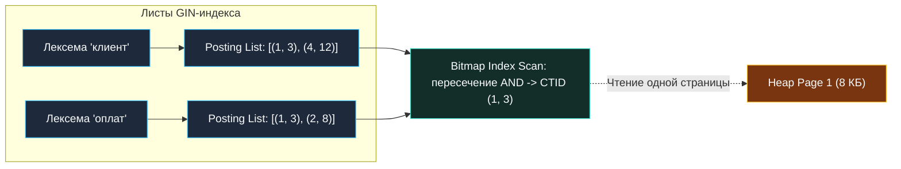

*Почему `LIKE '%query%'` срывается в последовательное чтение диска, как лингвистический конвейер строит `tsvector` и `tsquery`, как GIN хранит списки `ctid`, почему `ts_rank` провоцирует тысячи случайных чтений кучи и как триграммы `pg_trgm` ловят опечатки.*

> «(i) Пусть каждая программа хорошо делает одно дело. … (ii) Исходите из того, что вывод любой программы станет вводом для другой — пока неизвестной — программы.»  
> — Дуг Макилрой, предисловие к спецвыпуску *Bell Labs Technical Journal on Unix*, 1978

Когда в `LedgerPulse` появляется задача искать транзакции по полю `description` («перевод за аренду офиса», «комиссия эквайринга»), первое интуитивное решение выглядит обманчиво просто:

```sql
SELECT id, reference_id, description
FROM transactions
WHERE description LIKE '%перевод%';
```

Запрос с ведущим символом подстановки `%` ломает производительность и качество поиска по двум причинам:
1. **Деградация до $O(N)$ по I/O:** B-Tree индекс сортирует строки от первого символа к последнему. Ведущий `%` лишает планировщик префикса поиска, и движок запускает `Seq Scan`, методично читая каждую 8-килобайтную страницу Heap таблицы `transactions`.
2. **Лингвистическая слепота:** `LIKE` сравнивает байты буквально. Фильтр `LIKE '%перевод%'` найдёт слово «переводы», но пропустит «перевела» или «бежал» при запросе «бег», а `LIKE '%apple%'` не увидит слово «apples».

Второй соблазн — немедленно внедрить внешний поисковый кластер вроде Elasticsearch или OpenSearch. На раннем этапе это часто оборачивается преждевременным усложнением. Внешний движок порождает проблему **двойной записи (*Dual Write*)**: транзакция в PostgreSQL уже зафиксировалась, а событие обновления поискового индекса потерялось в сети или пришло с задержкой. Команде приходится поддерживать отдельный распределённый кластер на JVM, настраивать синхронизацию и мониторить рассинхронизацию данных.

В 95% прикладных сценариев бэкенда встроенного полнотекстового поиска (*Full-Text Search*, FTS) и расширения `pg_trgm` внутри PostgreSQL более чем достаточно. Они работают в рамках тех же ACID-транзакций и не требуют лишних сетевых прыжков.

---

## Конвейер нормализации: `tsvector` и `tsquery`

В ядре PostgreSQL полнотекстовый поиск опирается на два специализированных типа данных, превращающих произвольный текст в математически строгие множества основ слов.

### 1. `tsvector`: сжатый индексный вектор документа

PostgreSQL не ищет по сырым строкам `TEXT`. Документ заранее проходит нормализацию и сохраняется как **`tsvector`** — лексикографически отсортированный массив уникальных нормальных форм слов (**лексем**, *lexemes*) с указанием их порядковых позиций и опциональных весов (`A`, `B`, `C`, `D`):

```sql
SELECT to_tsvector('russian', 'Клиент быстро перевёл средства, пока другие клиенты ждали');
-- 'быстр':2 'друг':6 'ждал':8 'клиент':1,7 'перевел':3 'пок':5 'средств':4
```

Слова «Клиент» и «клиенты» склеились в общую лексему `'клиент'` с позициями `1,7`. За кулисами вызов `to_tsvector()` прогоняет строку через трёхэтапный C-конвейер в стиле Unix-фильтров:
1. **Парсер (*Parser*):** разрезает входной поток на типизированные токены — слова, числа, email, URL, пути файлов — и отбрасывает знаки препинания.
2. **Словарь стоп-слов (*Stop-words*):** удаляет служебные слова, предлоги и союзы («по», «в», «и», «за»), которые встречаются почти в каждой записи и лишь раздувают индекс.
3. **Стеммер Сноуболла (*Snowball Stemmer*):** по правилам морфологии выбранной конфигурации (`'russian'`, `'english'`) отсекает суффиксы и окончания, сводя словоформы к единой основе.


### 2. `tsquery`: булево дерево поискового запроса

Поисковый запрос пользователя тоже преобразуется в лексемы, но не в плоский вектор, а в дерево предикатов типа **`tsquery`**. В нём работают четыре базовых оператора:
* `&` — логическое И (*AND*)
* `|` — логическое ИЛИ (*OR*)
* `!` — логическое отрицание (*NOT*)
* `<->` (или `<N>`) — фразовый поиск (*followed by*): лексемы должны стоять подряд (или на расстоянии `N` позиций)

Сопоставление документа и запроса выполняет оператор **`@@`**:

```sql
SELECT to_tsvector('russian', 'Клиент оплатил счёт') @@ to_tsquery('russian', 'клиенты & оплата');
-- true (обе основы: 'клиент' и 'оплат' совпадают)
```

Если важно повысить приоритет заголовка или назначения платежа над длинным комментарием, лексемам назначают веса через `setweight(to_tsvector(...), 'A')` и объединяют векторы оператором `||`.

---

## Индексация через GIN и генерируемые столбцы

Вызывать `to_tsvector()` на лету при каждом `SELECT` — верный способ загрузить ядра CPU повторным стеммингом миллионов строк. Векторы необходимо материализовать и покрыть индексом **GIN** (см. [[4. Семейство индексов PostgreSQL — B-Tree, GIN, GiST, SP-GiST, BRIN и Hash]] и [[5. JSONB в PostgreSQL — бинарное хранение, операторы и индексы]]).

В листовых узлах `Entry Tree` индекса GIN лежат уникальные лексемы словаря всей таблицы, а рядом с каждой лексемой — отсортированный список физических адресов кортежей `ctid` (`Posting List` для редких слов или внутреннее B-Tree `Posting Tree` для частых).



> [!warning] Ловушка: функциональный индекс против `GENERATED ALWAYS`
> Часто индекс объявляют прямо по выражению:
> ```sql
> CREATE INDEX idx_tx_fts ON transactions USING GIN (to_tsvector('russian', description));
> ```
> У такого подхода два скрытых риска. Во-первых, если в выражении не указана явная конфигурация языка, функция перестаёт быть `IMMUTABLE` и PostgreSQL вообще откажется строить индекс. Во-вторых, при обновлении системных словарей функциональный индекс расходится с реальными данными, а планировщик хуже оценивает селективность.
>
> Начиная с **PostgreSQL 12**, промышленным стандартом стали **хранимые генерируемые столбцы (`GENERATED ALWAYS AS ... STORED`)**. Движок автоматически пересчитывает `search_vector` при каждом `INSERT` и `UPDATE`, хранит его в строке (или `TOAST` для длинных текстов), а `ANALYZE` собирает по нему статистику:

```sql
ALTER TABLE transactions
    ADD COLUMN search_vector tsvector
    GENERATED ALWAYS AS (
        setweight(to_tsvector('simple', reference_id), 'A') ||
        setweight(to_tsvector('russian', description), 'B')
    ) STORED;

CREATE INDEX idx_transactions_search_gin
    ON transactions USING GIN (search_vector);
```

Словарь `'simple'` для `reference_id` сохраняет точный код проводки без стемминга и отсечения стоп-слов, а `'russian'` обрабатывает человеческое описание.

---

## Ранжирование и физика случайных чтений Heap

Найти подходящие строки недостаточно: пользователь ждёт самые точные совпадения сверху. Для оценки релевантности в PostgreSQL встроены две функции:
* **`ts_rank(vector, query)`** — оценивает частоту появления лексем из запроса в документе (учитывая веса `A..D` и нормализацию по длине текста).
* **`ts_rank_cd(vector, query)`** — алгоритм *Cover Density*: дополнительно поощряет документы, где искомые слова стоят близко друг к другу в тексте.

Обе функции возвращают число `float4`. Но добавление сортировки `ORDER BY ts_rank(...) DESC` таит тяжёлую ловушку дискового ввода-вывода.

> [!tip] Собеседование [Senior/Staff]
> **Вопрос:** Запрос с фильтром `WHERE search_vector @@ websearch_to_tsquery('russian', $1)` отрабатывает за 2 мс. После добавления `ORDER BY ts_rank(search_vector, ...) DESC LIMIT 10` время ответа взлетает до 600 мс. Что происходит под капотом?
>
> **Ответ:** Индекс GIN экономит оперативную память в `shared_buffers`, поэтому хранит только связку `лексема -> список ctid`. В стандартном GIN **нет ни длин документов, ни позиционных массивов, ни весов лексем**.
> Когда запрос требует `ORDER BY ts_rank(...) LIMIT 10`, исполнитель не может отсортировать строки внутри индекса. Он вынужден пройти **все** совпавшие адреса `ctid`, совершить для каждого **прыжок в кучу (Heap Fetch)** — поднять 8-КБ страницу Heap (а при большом документе ещё и `TOAST`), извлечь тело `search_vector`, вычислить `ts_rank` на CPU и лишь потом отсортировать и отбросить лишнее. При 50 000 совпадений это до 50 000 случайных чтений (~100 мкс на NVMe при холодной памяти — секунды I/O).
>
> **Инженерное решение:**
> 1. Ограничивайте пул кандидатов перед ранжированием (например, отбирая топ-500 свежих транзакций через CTE или по окну времени).
> 2. Для огромных текстов, где ранжировать нужно по всей базе, используют стороннее расширение `RUM`, которое сохраняет позиции и веса прямо в листьях индекса ценой большего размера на диске и более медленной записи.

Посмотрим на план с ограничением пула кандидатов в `EXPLAIN (ANALYZE, BUFFERS)`:

```sql
WITH candidates AS (
    SELECT id, reference_id, description, search_vector
    FROM transactions
    WHERE search_vector @@ websearch_to_tsquery('russian', 'комиссия эквайринг')
    ORDER BY created_at DESC
    LIMIT 500
)
SELECT id, reference_id, ts_rank_cd(search_vector, websearch_to_tsquery('russian', 'комиссия эквайринг')) AS rank
FROM candidates
ORDER BY rank DESC
LIMIT 10;
```

Если совпадений много, вместо 50 000 обращений к куче исполнитель остановит сканирование, собрав первые 500 свежих записей, и вызовет `ts_rank_cd` ровно 500 раз в памяти.

---

## Расширение `pg_trgm`: опечатки, артикулы и быстрый `LIKE`

У стемминга `tsvector` есть слепые зоны. Если пользователь в `LedgerPulse` ищет контрагента по фрагменту email (`%@acmecorp.io%`), номеру карты, коду терминала или допустил опечатку (`каммисия` вместо `комиссия`), `tsvector` бессилен: он умеет искать только целые основы слов.

Здесь вступает стандартное поставляемое расширение **`pg_trgm` (*trigram*)**. Оно разрезает любую строку на перекрывающиеся тройки символов (**триграммы**), предварительно дополняя слово двумя пробелами в начале и одним в конце. Например, слово `'foo'` распадается на четыре триграммы: `'  f'`, `' fo'`, `'foo'`, `'oo '`.

```sql
CREATE EXTENSION IF NOT EXISTS pg_trgm;

-- GIN-индекс по триграммам на имени владельца счёта
CREATE INDEX idx_accounts_owner_trgm
    ON accounts USING GIN (owner_name gin_trgm_ops);

-- Запрос с ведущим % теперь использует Bitmap Index Scan по триграммам
EXPLAIN (ANALYZE, BUFFERS)
SELECT id, owner_name
FROM accounts
WHERE owner_name ILIKE '%acmecorp%';
```

Кроме ускорения `LIKE '%...%'`, `ILIKE` и регулярных выражений (`~`, `~*`), `pg_trgm` даёт **нечёткий поиск по опечаткам** через оператор схожести `%` и расстояние `<->`:

```sql
-- Настройка порога схожести (по умолчанию 0.3)
SET pg_trgm.similarity_threshold = 0.35;

-- Поиск с опечатками и сортировкой по степени совпадения
SELECT id, owner_name, similarity(owner_name, 'ОАО ТехноПласт') AS sim
FROM accounts
WHERE owner_name % 'ОАО ТехноПласт'
ORDER BY owner_name <-> 'ОАО ТехноПласт'
LIMIT 10;
```

Чтобы сортировка `ORDER BY col <-> $1 LIMIT 10` работала индексным сканированием KNN без полной сортировки в памяти, вместо `GIN` используют `GiST (owner_name gist_trgm_ops)`. Обратите внимание на ограничение триграмм: если подстрока в `LIKE` короче 3 символов (например, `'%ab%'`), `pg_trgm` не сможет извлечь ни одной полной триграммы и откатится в `Seq Scan`.

---

## Безопасная интеграция с Go 1.24

Классическая ошибка в Go-бэкенде — передавать пользовательскую поисковую строку напрямую в `to_tsquery()`:

```go
// АНТИПАТТЕРН: пользователь введёт "visa & (gold" или два пробела — SQL упадёт с syntax error
// Ещё хуже — наивная склейка strings.ReplaceAll(q, " ", " & ")
```

Функция `to_tsquery` требует строгого булева синтаксиса; любая незакрытая скобка, кавычка или слово с дефисом вызывают синтаксическую ошибку PostgreSQL.

Начиная с PostgreSQL 11, для пользовательского ввода используйте **`websearch_to_tsquery()`**. Она понимает привычный синтаксис поисковых систем:
* Пробелы автоматически становятся оператором `&` (*AND*).
* Фраза в двойных кавычках (`"возврат комиссии"`) превращается во фразовый поиск `<->`.
* Слово с префиксом минус (`-тест`) переводится в отрицание `!`.
* Слово `or` между терминами трактуется как `|`.
* Функция **никогда не возвращает ошибку синтаксиса**, даже если пользователь прислал произвольный набор спецсимволов.

Ниже — идиоматичный метод репозитория `LedgerPulse` на Go 1.24 с защитой от массового Random I/O при ранжировании:

```go
package repository

import (
	"context"
	"database/sql"
	"fmt"
	"strings"
)

type TxSearchResult struct {
	ID          int64
	ReferenceID string
	Description string
	Rank        float32
}

func SearchTransactions(ctx context.Context, db *sql.DB, userQuery string, limit int) ([]TxSearchResult, error) {
	cleaned := strings.TrimSpace(userQuery)
	if cleaned == "" {
		return nil, nil
	}
	if limit <= 0 || limit > 100 {
		limit = 20
	}

	const query = `
		WITH q AS (
			SELECT websearch_to_tsquery('russian', $1) AS tsq
		),
		candidates AS (
			SELECT t.id, t.reference_id, t.description, t.search_vector, q.tsq
			FROM transactions AS t
			CROSS JOIN q
			WHERE t.search_vector @@ q.tsq
			ORDER BY t.created_at DESC
			LIMIT 500
		)
		SELECT
			id,
			reference_id,
			description,
			ts_rank_cd(search_vector, tsq) AS rank
		FROM candidates
		ORDER BY rank DESC, id DESC
		LIMIT $2;
	`

	rows, err := db.QueryContext(ctx, query, cleaned, limit)
	if err != nil {
		return nil, fmt.Errorf("search transactions: %w", err)
	}
	defer rows.Close()

	var out []TxSearchResult
	for rows.Next() {
		var r TxSearchResult
		if err := rows.Scan(&r.ID, &r.ReferenceID, &r.Description, &r.Rank); err != nil {
			return nil, fmt.Errorf("scan search result: %w", err)
		}
		out = append(out, r)
	}
	if err := rows.Err(); err != nil {
		return nil, fmt.Errorf("iterate search results: %w", err)
	}
	return out, nil
}
```

Вынесение `websearch_to_tsquery` в отдельную CTE `q` гарантирует, что парсер запроса выполнится один раз, а не для каждой строки выборки.

---

## Упражнения

### Базовое
Добавьте в таблицу `transactions` хранимый генерируемый столбец `search_vector`, который объединяет `reference_id` с весом `'A'` (словарь `'simple'`) и `description` с весом `'B'` (словарь `'russian'`), и создайте на нём GIN-индекс.

> [!solution] Показать решение
> ```sql
> ALTER TABLE transactions
>     ADD COLUMN IF NOT EXISTS search_vector tsvector
>     GENERATED ALWAYS AS (
>         setweight(to_tsvector('simple', coalesce(reference_id, '')), 'A') ||
>         setweight(to_tsvector('russian', coalesce(description, '')), 'B')
>     ) STORED;
>
> CREATE INDEX CONCURRENTLY IF NOT EXISTS idx_transactions_search_gin
>     ON transactions USING GIN (search_vector);
> ```
> Использование `coalesce(..., '')` защищает конкатенацию от превращения всего `tsvector` в `NULL`, если бы какое-то из полей в будущей миграции стало допускать `NULL`.

### Практическое
Перепишите опасный запрос Go-сервиса, который падает при вводе спецсимволов и пытается искать в таблице `accounts` контрагента одновременно по частичному совпадению email в `external_id` и по опечаткам в `owner_name`:
```sql
SELECT id, external_id, owner_name
FROM accounts
WHERE external_id ILIKE '%' || $1 || '%'
   OR owner_name LIKE '%' || $1 || '%';
```
Предложите схему индексов через `pg_trgm` и укажите минимальную длину строки `$1`, при которой индексы начнут работать.

> [!solution] Показать решение
> ```sql
> CREATE EXTENSION IF NOT EXISTS pg_trgm;
>
> CREATE INDEX IF NOT EXISTS idx_accounts_ext_trgm
>     ON accounts USING GIN (external_id gin_trgm_ops);
>
> CREATE INDEX IF NOT EXISTS idx_accounts_owner_trgm
>     ON accounts USING GIN (owner_name gin_trgm_ops);
> ```
> Запрос лучше разделить на явную фильтрацию подстроки через `ILIKE` и нечёткое сравнение `%` (или сохранить оба `ILIKE` — PostgreSQL объединит результаты двух `Bitmap Index Scan` через `BitmapOr`):
> ```sql
> SELECT id, external_id, owner_name
> FROM accounts
> WHERE external_id ILIKE '%' || $1 || '%'
>    OR owner_name % $1
> ORDER BY similarity(owner_name, $1) DESC
> LIMIT 20;
> ```
> **Граница работы:** индекс по `gin_trgm_ops` для произвольной подстроки `%...%` активируется только тогда, когда из поисковой строки можно выделить хотя бы одну 3-символьную триграмму, то есть при длине запроса **от 3 символов**. Для строк из 1–2 символов Go-код должен либо требовать минимум 3 символа, либо использовать префиксный поиск без ведущего `%` по B-Tree с `text_pattern_ops`.

### Со звёздочкой (*)
Вы анализируете план запроса в `LedgerPulse`:
```sql
EXPLAIN (ANALYZE, BUFFERS)
SELECT id, description, ts_rank(search_vector, to_tsquery('russian', 'перевод'))
FROM transactions
WHERE search_vector @@ to_tsquery('russian', 'перевод')
ORDER BY 3 DESC
LIMIT 10;
```
В плане видно `Bitmap Heap Scan` с `Heap Blocks: exact=48210`, `Buffers: shared hit=12000 read=36500` и время `1840 ms`. Почему это произошло, даже несмотря на `LIMIT 10`, и как изменить SQL-запрос или архитектуру индекса, чтобы уложиться в 15 мс без потери релевантности?

> [!solution] Показать решение
> Слово `'перевод'` слишком частотно в финансовом реестре и встречается в 48 210 блоках. Чтобы выполнить `ORDER BY ts_rank(...) DESC LIMIT 10`, PostgreSQL вынужден вычислить `ts_rank` для **каждой** подходящей строки, а так как GIN не хранит позиций и весов внутри индекса, планировщик читает все 48 210 страниц Heap (включая 36 500 физических чтений с диска) до отсечения по `LIMIT 10`.
>
> **Вариант 1 (SQL + временной фильтр):** сузить окно поиска до свежих операций или отсечь редким условием (например, `status = 'posted' AND created_at >= now() - interval '30 days'`), либо предварительно отобрать `LIMIT 500` свежих записей в CTE перед вызовом `ts_rank`.
> **Вариант 2 (индекс `RUM`):** установить расширение `rum` (поверх GIN) и создать индекс `USING rum (search_vector rum_tsvector_ops)` — он сохраняет позиционную информацию и длину документа прямо в индексе, позволяя выполнять `ORDER BY search_vector <=> to_tsquery(...) LIMIT 10` по индексу без массовых чтений Heap.

---

Расширение `pg_trgm` показало, что в PostgreSQL можно добавлять новые индексные классы и операторы без перекомпиляции самой СУБД. Но триграммы — лишь малая часть модульной экосистемы: плагины способны перехватывать планировщик, собирать помиллисекундную телеметрию в разделяемой памяти и даже превращать PostgreSQL в хранилище временных рядов или векторный движок. Как устроен механизм расширений на уровне C-хуков и процессов ядра — разберём в главе [[7. Расширения PostgreSQL — pg_stat_statements, pgcrypto и экосистема]].
