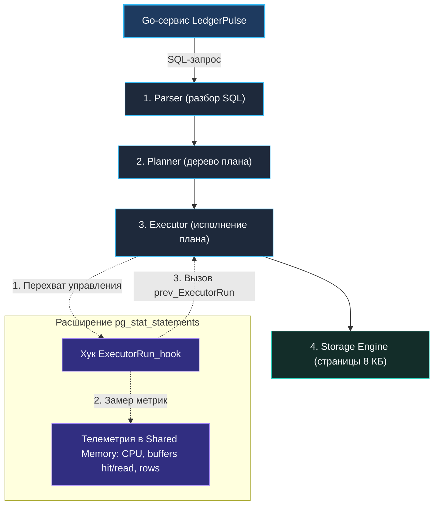
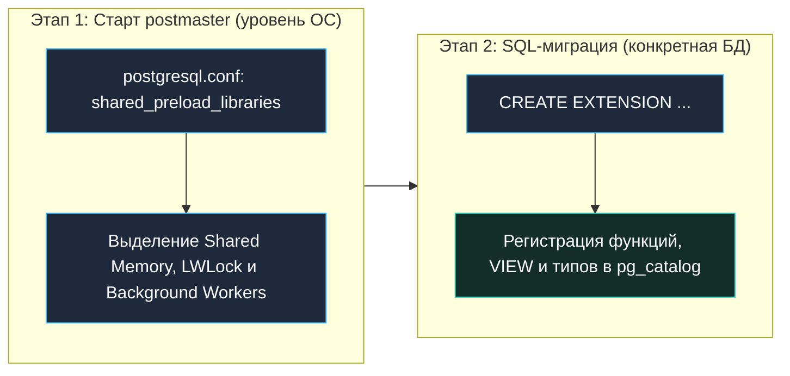
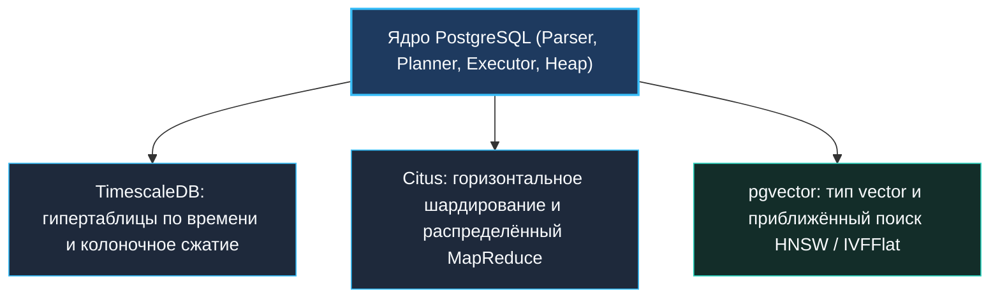

*Как устроена модульная архитектура C-плагинов и глобальная система хуков ядра, почему `shared_preload_libraries` требует перезапуска `postmaster`, как `pg_stat_statements` находит дорогие запросы, зачем нужен `pgcrypto` и как `TimescaleDB`, `Citus` и `pgvector` меняют саму модель СУБД.*

> «Блеск Unix заключался в выборе абстракции, достаточно общей, чтобы быть поразительно полезной, и при этом не слишком дорогой по производительности.»  
> — Брайан Керниган, *UNIX: A History and a Memoir*

В предыдущей главе [[6. Полнотекстовый поиск (Full-Text Search) — tsvector, tsquery и pg_trgm]] мы включили нечёткий поиск по опечаткам одной командой `CREATE EXTENSION pg_trgm`. При этом нам не пришлось пересобирать сервер или переписывать ядро СУБД.

Эта особенность заложена в фундамент проекта с самого начала. Когда в середине 1980-х годов Майкл Стоунбрейкер в Калифорнийском университете в Беркли проектировал систему POSTGRES, он отказался от закрытого набора типов и методов доступа. PostgreSQL изначально создавался как **расширяемый программный каркас для баз данных**. Новые типы, операторы, индексные деревья, фоновые процессы и перехватчики планировщика подключаются динамически — не меняя ни одной строчки исходного кода ядра.

Для Go-инженера это значит, что одна и та же инсталляция PostgreSQL способна закрыть наблюдаемость запросов (`pg_stat_statements`), криптографию (`pgcrypto`), временные ряды (`TimescaleDB`), векторный поиск (`pgvector`) и горизонтальное шардирование (`Citus`) без размножения разрозненных хранилищ.

---

## Архитектура C-плагинов и система хуков

Ядро PostgreSQL написано на языке C. Архитектура позволяет динамически загружать скомпилированные разделяемые библиотеки (`.so` в Linux, `.dll` в Windows) прямо в виртуальное адресное пространство серверных процессов — как в главный управляющий процесс `postmaster`, так и в форкнутые бэкенды клиентских сессий (см. [[1. Архитектура PostgreSQL — процессы, общая память и бэкенды]]).

После загрузки в память расширение встраивается в конвейер обработки SQL через **систему хуков (*Hook System*)**.

### Как устроены хуки в памяти

В ключевых модулях ядра — синтаксическом анализаторе (`post_parse_analyze_hook`), планировщике (`planner_hook`) и исполнителе (`ExecutorStart_hook`, `ExecutorRun_hook`, `ExecutorEnd_hook`) — объявлены глобальные указатели на функции. По умолчанию они равны `NULL`, и ядро вызывает свои стандартные функции напрямую.

При инициализации расширение выполняет цепочку из трёх шагов:
1. Считывает текущий адрес из глобального указателя хука и сохраняет его в своей статической переменной (`prev_ExecutorRun`).
2. Подменяет глобальный указатель адресом собственной C-функции.
3. Внутри своего перехватчика делает нужную работу (например, запускает таймер), затем вызывает сохранённый `prev_ExecutorRun`, чтобы не разорвать цепочку с другими расширениями, и после возврата фиксирует результат.



> [!warning] Обратная сторона нативной скорости: цена `SIGSEGV`
> Поскольку C-расширение работает в том же пространстве пользователя (Ring 3) и том же адресном пространстве, что и рабочий процесс PostgreSQL, оно читает буферы `shared_buffers` прямо из RAM (~100 нс) без системных вызовов и межпроцессного обмена.
> Но у общей памяти есть жёсткая цена. Ошибка разыменования `NULL`-указателя или выход за границы буфера в стороннем C-модуле заставит ядро Linux послать процессу сигнал `SIGSEGV`. Рабочий процесс упадёт, клиент в Go получит `connection reset by peer`, а `postmaster` **принудительно оборвёт все остальные активные подключения**, чтобы очистить разделяемую память и провести восстановление по журналу WAL ([[8. WAL — журнал упреждающей записи и долговечность на диске]]). Поэтому в продакшен допускайте только зрелые расширения из проверенных дистрибутивов (или написанные с жёсткой изоляцией памяти, например на базе Rust-фреймворка `pgrx`).

---

## Два этапа жизненного цикла расширения

Начинающие инженеры регулярно путают системную загрузку бинарного модуля при старте СУБД и регистрацию SQL-объектов в конкретной базе данных. Это две независимые фазы.



### Этап 1: `shared_preload_libraries` (требует рестарта)

Если расширению нужен общий сегмент разделяемой памяти для координации всех бэкендов или собственные фоновые процессы (*Background Workers*), оно обязано загрузиться в момент старта `postmaster`:

```ini
# postgresql.conf
shared_preload_libraries = 'pg_stat_statements, timescaledb'
```

Изменение `shared_preload_libraries` требует физического перезапуска экземпляра PostgreSQL.

### Этап 2: `CREATE EXTENSION` (на уровне конкретной БД)

Даже если `.so`-библиотека уже загружена в память `postmaster`, логическая база `ledgerpulse` не видит её функций и представлений, пока администратор не выполнит DDL:

```sql
CREATE EXTENSION IF NOT EXISTS pg_stat_statements;
```

Команда находит управляющий файл `.control` в каталоге расширений ОС, прогоняет SQL-скрипт установки и записывает определения функций, операторов, типов и системных `VIEW` в каталог `pg_catalog` текущей базы.

> [!tip] Собеседование [Middle]
> **Вопрос:** Разработчик накатил миграцию `CREATE EXTENSION pg_stat_statements;` в новой базе данных, но запрос `SELECT * FROM pg_stat_statements;` падает с ошибкой: `pg_stat_statements must be loaded via shared_preload_libraries`. Почему так произошло, если `CREATE EXTENSION` прошёл успешно?
>
> **Ответ:** Команда `CREATE EXTENSION` лишь регистрирует SQL-интерфейс в `pg_catalog` — создаёт представление и связывает его с именами C-функций. Но чтобы собирать статистику со всех параллельных процессов кластера, модулю `pg_stat_statements` нужна глобальная хеш-таблица в **разделяемой памяти (Shared Memory)**, защищённая быстрыми блокировками (`LWLock` и спинлоками). Выделить общий сегмент памяти ОС можно только при старте главного процесса `postmaster`. Без записи в `shared_preload_libraries` и перезапуска сервера хеш-таблица физически не существует.

---

## Базовый набор для продакшена

Среди сотен расширений выделяется тройка проверенных инструментов, которые присутствуют почти в любом промышленном контуре PostgreSQL.

### 1. `pg_stat_statements`: рентген производительности SQL

Без `pg_stat_statements` диагностика деградации БД превращается в гадание по логам. Модуль перехватывает разбор и выполнение запросов (`post_parse_analyze_hook` и `ExecutorEnd_hook`), нормализует литералы и параметры в плейсхолдеры вроде `` `$1` `` и `` `$2` ``, вычисляет уникальный `queryid` и копит статистику в разделяемой памяти.

Что вы видите по каждому шаблону запроса в `LedgerPulse`:
* `calls` — сколько раз запрос запускался.
* `total_exec_time` и `mean_exec_time` — суммарное и среднее время выполнения на сервере (в миллисекундах).
* `shared_blks_hit` против `shared_blks_read` — сколько 8-КБ страниц нашлось в оперативной памяти (`shared_buffers`), а сколько пришлось дочитывать с диска или из кэша ОС.
* `temp_blks_written` — признак того, что сортировка или хеш-таблица не поместились в `work_mem` и выплеснулись на диск.

Следующий диагностический запрос находит главные источники нагрузки на I/O и CPU:

```sql
SELECT
    queryid,
    calls,
    round(total_exec_time::numeric, 2) AS total_ms,
    round(mean_exec_time::numeric, 2)  AS mean_ms,
    shared_blks_hit,
    shared_blks_read,
    left(query, 80) AS sql_sample
FROM pg_stat_statements
ORDER BY total_exec_time DESC
LIMIT 5;
```

```text
       queryid       | calls  | total_ms | mean_ms | shared_blks_hit | shared_blks_read | sql_sample
---------------------+--------+----------+---------+-----------------+------------------+---------------------------------------------------------
 4918273645102938471 | 184200 | 41250.40 |    0.22 |         1473600 |               12 | SELECT id, balance, status FROM accounts WHERE id = $1
-7281930456123984120 |   1420 | 38910.15 |   27.40 |          184000 |           492100 | SELECT id, description FROM transactions WHERE ...
```

Первая строка вызвана 184 тысячи раз, но попадает в память почти на 100%. Вторая вызвана всего 1 420 раз, но сожгла почти полмиллиона дисковых чтений (`shared_blks_read = 492100`) — идеальный кандидат на добавление индекса или оптимизацию плана. Подробно методику сквозной наблюдаемости и алертов по этим метрикам мы разберём в Модуле 10 этого тома.

### 2. `pg_trgm`: триграммы для произвольных подстрок

Как мы подробно разобрали в [[6. Полнотекстовый поиск (Full-Text Search) — tsvector, tsquery и pg_trgm]], `pg_trgm` добавляет операторные классы `gin_trgm_ops` и `gist_trgm_ops`. Они превращают неиндексируемые запросы `ILIKE '%@domain.io%'` и поиск с опечатками в индексный доступ:

```sql
CREATE EXTENSION IF NOT EXISTS pg_trgm;
CREATE INDEX idx_accounts_ext_trgm ON accounts USING GIN (external_id gin_trgm_ops);
```

### 3. `pgcrypto`: криптографические примитивы на стороне БД

Расширение `pgcrypto` добавляет функции хеширования паролей по алгоритму Blowfish/bcrypt (`crypt`, `gen_salt`), подсчёта контрольных сумм и `HMAC` (`digest`, `hmac`), а также симметричного и асимметричного шифрования (`pgp_sym_encrypt`, `pgp_sym_decrypt`):

```sql
CREATE EXTENSION IF NOT EXISTS pgcrypto;

-- Генерация bcrypt-хеша с фактором стоимости 10 прямо в SQL
SELECT crypt('strong_api_secret', gen_salt('bf', 10));

-- Вычисление HMAC-SHA256 для проверки целостности записи аудита
SELECT encode(hmac('acc_101:50000:RUB', 'cluster_hmac_key', 'sha256'), 'hex');
```

В старых проектах `pgcrypto` подключали ради функции `gen_random_uuid()`, но начиная с PostgreSQL 13 она вошла в стандартное ядро (а для генерации UUIDv1 по времени и MAC-адресу до сих пор используют модуль `uuid-ossp`).

> [!warning] Ловушка эксплуатации `pgcrypto`
> 1. **Утечка секретов в логи:** если на сервере включён аудит `log_statement = 'all'` или медленный запрос с открытым ключом шифрования попал в `pg_stat_statements` и логи `log_min_duration_statement`, ключ окажется в текстовых файлах логов в открытом виде.
> 2. **Дорогой CPU базы данных:** bcrypt намеренно нагружает процессор. Хешировать миллионы паролей внутри PostgreSQL опасно — проще масштабировать десятки stateless-подов Go, чем ядра одного лидера БД. Вычисляйте bcrypt и прикладное шифрование в Go, а `pgcrypto` оставляйте для редких административных миграций или внутренних проверок `HMAC`.

---

## Расширения, меняющие парадигму хранилища

Некоторые плагины выходят далеко за рамки вспомогательных функций: они регистрируют собственные методы доступа, фоновые воркеры сжатия и распределённые планировщики, превращая PostgreSQL в специализированную СУБД.



1. **TimescaleDB:** превращает PostgreSQL в движок временных рядов (*Time-Series Database*). Автоматически нарезает «гипертаблицы» на временные чанки, поддерживает непрерывные агрегаты и сжимает старые интервалы в гибридный колоночный формат, уменьшая объём на диске в 10–20 раз при сохранении обычного SQL.
2. **Citus:** превращает одиночный узел PostgreSQL в горизонтально масштабируемый распределённый кластер. Для Go-приложения Citus выглядит как один сервер, но координатор прозрачно распределяет шардированные таблицы по десяткам узлов-воркеров и собирает аналитику по схеме MapReduce (подробнее архитектуру шардирования разберём в Модуле 8).
3. **pgvector:** стандарт для хранения векторных представлений (*embeddings*) в задачах семантического поиска и LLM. Добавляет тип `vector(N)` и индексы приближённого поиска ближайших соседей (**HNSW** и **IVFFlat**), позволяя делать `JOIN` между векторами и реляционными таблицами `LedgerPulse` в одной транзакции (о векторных движках поговорим в Модуле 9).

---

## Мониторинг `pg_stat_statements` из Go 1.24

Проверить здоровье запросов и вычислить коэффициент попадания в кэш (*Buffer Cache Hit Ratio*) удобно прямо из сервисной утилиты Go. Она читает агрегированные счётчики из разделяемой памяти без нагрузки на боевые таблицы:

```go
package diagnostics

import (
	"context"
	"database/sql"
	"fmt"
)

type QueryStat struct {
	QueryID     int64
	Calls       int64
	MeanExecMS  float64
	CacheHitPct float64
	SampleSQL   string
}

func FetchTopIOQueries(ctx context.Context, db *sql.DB, limit int) ([]QueryStat, error) {
	if limit <= 0 || limit > 50 {
		limit = 10
	}

	const query = `
		SELECT
			queryid,
			calls,
			mean_exec_time,
			CASE
				WHEN shared_blks_hit + shared_blks_read = 0 THEN 100.0
				ELSE round(100.0 * shared_blks_hit / (shared_blks_hit + shared_blks_read), 2)
			END AS cache_hit_pct,
			left(query, 120)
		FROM pg_stat_statements
		WHERE calls >= 10
		ORDER BY shared_blks_read DESC
		LIMIT $1;
	`

	rows, err := db.QueryContext(ctx, query, limit)
	if err != nil {
		return nil, fmt.Errorf("query pg_stat_statements: %w", err)
	}
	defer rows.Close()

	var stats []QueryStat
	for rows.Next() {
		var s QueryStat
		if err := rows.Scan(&s.QueryID, &s.Calls, &s.MeanExecMS, &s.CacheHitPct, &s.SampleSQL); err != nil {
			return nil, fmt.Errorf("scan query stat: %w", err)
		}
		stats = append(stats, s)
	}
	if err := rows.Err(); err != nil {
		return nil, fmt.Errorf("iterate query stats: %w", err)
	}
	return stats, nil
}
```

Если для частого OLTP-запроса `CacheHitPct` падает ниже 95%, значит таблица или индекс вымывают `shared_buffers` и требуют либо точечного индекса, либо корректировки памяти сервера.

---

## Упражнения

### Базовое
Администратор добавил `pg_stat_statements` в `shared_preload_libraries` в `postgresql.conf`, перезапустил PostgreSQL и подключился к базе `ledgerpulse`, но запрос `SELECT * FROM pg_stat_statements;` возвращает ошибку `relation "pg_stat_statements" does not exist`. Какой шаг был пропущен и какую команду нужно выполнить?

> [!solution] Показать решение
> Был выполнен только первый этап жизненного цикла — загрузка `.so`-библиотеки в разделяемую память `postmaster`. Второй этап (регистрация представлений и функций в системном каталоге конкретной логической базы `ledgerpulse`) ещё не выполнен. Нужно запустить:
> ```sql
> CREATE EXTENSION IF NOT EXISTS pg_stat_statements;
> ```

### Практическое
Напишите SQL-запрос к `pg_stat_statements`, который выводит топ-5 шаблонов запросов с наибольшим **суммарным** временем, затраченным на дисковое чтение/запись и исполнение, где доля промахов мимо `shared_buffers` превышает 10% (при числе вызовов не менее 50).

> [!solution] Показать решение
> ```sql
> SELECT
>     queryid,
>     calls,
>     round(total_exec_time::numeric, 2) AS total_ms,
>     shared_blks_hit,
>     shared_blks_read,
>     round(
>         100.0 * shared_blks_read / NULLIF(shared_blks_hit + shared_blks_read, 0),
>         2
>     ) AS miss_pct,
>     left(query, 100) AS query_sample
> FROM pg_stat_statements
> WHERE calls >= 50
>   AND shared_blks_hit + shared_blks_read > 0
>   AND (shared_blks_read::float / (shared_blks_hit + shared_blks_read)) > 0.10
> ORDER BY total_exec_time DESC
> LIMIT 5;
> ```
> Использование `NULLIF(..., 0)` защищает от деления на ноль для запросов, которые не читали буферные страницы (например, `SELECT 1`).

### Со звёздочкой (*)
В `LedgerPulse` возникла идея подключить экспериментальное C-расширение для сжатия JSON-логов, собранное из непроверенного репозитория, прямо на основной лидер-узел кластера. Опишите пошагово, что произойдёт со всеми активными Go-воркерами `LedgerPulse`, если в одном из бэкендов это расширение допустит обращение по нулевому указателю во время выполнения запроса `SELECT`.

> [!solution] Показать решение
> 1. C-расширение работает в том же адресном пространстве виртуальной памяти, что и рабочий процесс-бэкенд PostgreSQL. Обращение по нулевому указателю заставляет ОС Linux отправить процессу сигнал `SIGSEGV`.
> 2. Процесс-бэкенд аварийно завершается. Поскольку он мог погибнуть в середине модификации глобальных структур в `shared_buffers` или удерживать `LWLock`/спинлоки, разделяемая память считается потенциально несогласованной.
> 3. Управляющий процесс `postmaster` фиксирует аварийный выход дочернего процесса, немедленно посылает `SIGQUIT` **всем остальным** активным бэкендам и сбрасывает весь сегмент разделяемой памяти.
> 4. Все Go-воркеры в пуле соединений одновременно получают сетевой обрыв (`connection reset by peer` / `EOF`), а их незафиксированные транзакции откатываются.
> 5. `postmaster` запускает процесс восстановления после сбоя (Crash Recovery по WAL, [[8. WAL — журнал упреждающей записи и долговечность на диске]]), после чего снова начинает принимать соединения. На нагруженной системе такой сброс с прогревом холодных буферов может вызвать многосекундную или минутную деградацию SLA.

---

Способность расширений добавлять в ядро PostgreSQL собственные типы данных, операторы и алгоритмы индексного поиска сделала его индустриальным стандартом ещё в одной сложной дисциплине — геоинформационных системах. Как одно расширение превращает реляционную базу в быстрый пространственный движок с R-деревьями — разберём в заключительной главе первой части этого модуля: [[8. PostGIS — геопространственные данные и R-Tree поверх GiST]].
