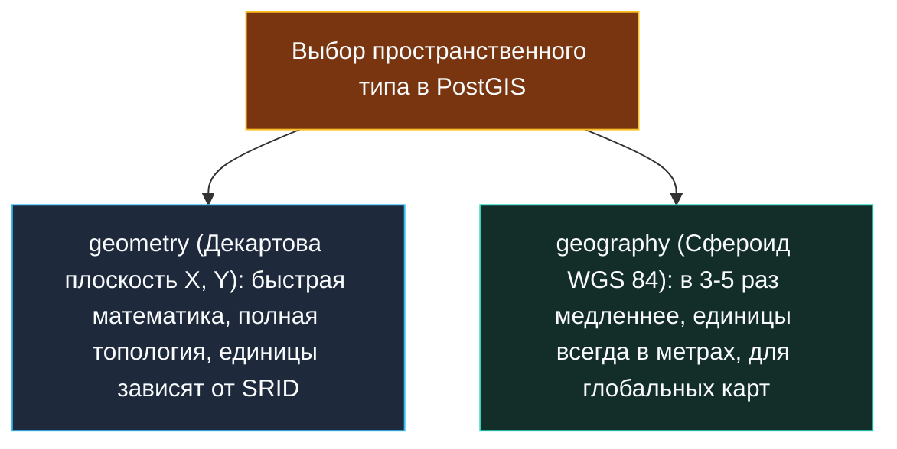
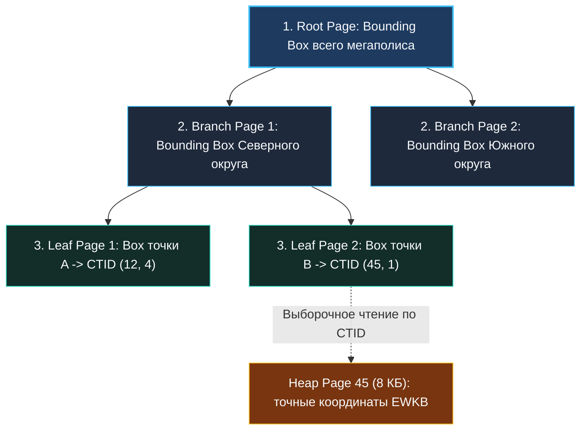

*Почему столбцы `FLOAT8` для широты и долготы не ускоряются B-Tree, как выбрать между плоской `geometry` и сфероидом `geography`, как `R-Tree` поверх `GiST` отсекает миллионы точек по ограничивающим рамкам, почему `ST_Distance < R` ломает производительность и как читать бинарный `EWKB` в Go 1.24.*

> «В идеальном мире прикладному программисту достаточно знать только API — без того, как этот API реализован и к какому железу он обращается. В реальности же чуть более глубокие знания порой оказываются весьма кстати.»  
> — Чарльз Петцольд, *Code* (2-е изд.)

В предыдущей главе [[7. Расширения PostgreSQL — pg_stat_statements, pgcrypto и экосистема]] мы увидели, как разделяемые C-библиотеки меняют возможности ядра PostgreSQL. Самый яркий пример такого преобразования — расширение **PostGIS** (разрабатывается с 2001 года), превратившее реляционную СУБД в индустриальный стандарт геоинформационных систем.

Предположим, в сервисе вроде `LedgerPulse` появляется карта терминалов приёма платежей и точек выдачи наличных (`payout_points`), либо Go-бэкенд обслуживает райдшеринг, доставку курьерами или телеметрию автопарка. Наивный путь — завести в таблице две колонки `latitude FLOAT8` и `longitude FLOAT8` и считать расстояние в коде по теореме Пифагора. Но такой подход рассыпается сразу в двух местах:
1. **Геометрия планеты и CPU:** Земля — не плоский лист миллиметровки, а сфероид (геоид). Честная длина дуги на поверхности планеты требует сферической тригонометрии — **формулы гаверсинуса (*Haversine*)**. Вычислять синусы и арккосинусы на лету для миллионов строк при каждом запросе означает мгновенно перегрузить процессор.
2. **Одномерность B-Tree:** индекс B-Tree из [[4. Семейство индексов PostgreSQL — B-Tree, GIN, GiST, SP-GiST, BRIN и Hash]] умеет упорядочивать ключи строго вдоль одной оси. Даже составной индекс `(latitude, longitude)` при поиске в радиусе 3 км вынужден просматривать всю полосу широт от края до края долгот.

PostGIS решает обе задачи: добавляет нативные геометрические типы, пространственный индекс **R-Tree поверх GiST** и сотни оптимизированных C-функций вычислительной геометрии.

---

## `geometry` против `geography`: выбор модели Земли

Первое архитектурное решение при проектировании гео-таблицы — выбор типа данных: `geometry` или `geography`. Ошибка на этом этапе обходится либо в лишние гигабайты вычислений на CPU, либо в неверные единицы расстояния.



### 1. Тип `geometry` (планарная евклидова геометрия)

Трактует координаты как точки на бесконечной плоской сетке $(X, Y)$.
* **Плюсы:** векторная математика на плоскости тривиальна и исполняется процессором максимально быстро. Доступен весь арсенал топологических операций: буферизация, объединение, разность и пересечение сложных многоугольников (зон доставки, геозон комплаенса).
* **Ловушка единиц измерения:** у каждой геометрии есть идентификатор системы координат — **SRID (*Spatial Reference System Identifier*)**. Стандартные GPS-координаты имеют `SRID 4326` (система WGS 84). Если положить их в `geometry` напрямую, функция `ST_Distance` вернёт расстояние **в градусах**, а не в метрах (причём длина одного градуса долготы на экваторе и в Москве различается почти вдвое). Чтобы считать на плоскости в метрах, координаты проецируют (`ST_Transform`) в локальную метрическую проекцию — например, подходящую зону UTM.

### 2. Тип `geography` (сфероидальная геометрия Земли)

Моделирует планету как эллипсоид вращения (по умолчанию WGS 84, `SRID 4326`).
* **Плюсы:** без ручного пересчёта локальных проекций `ST_Distance` и `ST_DWithin` всегда принимают и возвращают физическое расстояние **в метрах** в любой точке земного шара.
* **Цена:** каждая проверка использует сферическую тригонометрию на эллипсоиде. Вычисления выполняются в **3–5 раз медленнее**, чем в `geometry`, а набор поддерживаемых функций уже и сводится к базовым проверкам расстояний и пересечений.

> [!tip] Собеседование [Middle]
> **Вопрос:** В каком типе PostGIS лучше хранить координаты курьеров и ресторанов для сервиса экспресс-доставки внутри одного города, а в каком — для международного трекинга авиаперевозок?
>
> **Ответ:** В масштабах одного мегаполиса или области кривизной Земли можно пренебречь. Оптимальный выбор — **`geometry`**, спроецированный в местную метрическую координатную сетку (например, нужную зону UTM): вы получаете быстрые плоские расчёты на CPU и полный набор полигональных функций для зон доставки. Для глобальной системы (маршруты между континентами, единая таблица точек по всей планете), где невозможно подобрать одну общую плоскую проекцию без сильных искажений, выбирайте **`geography`**, закладывая запас CPU под сферическую тригонометрию.

---

## Устройство под капотом: `GiST` и `R-Tree`

Как PostGIS находит 10 ближайших точек выдачи или курьеров в радиусе 3 км среди 5 миллионов активных записей за 2–3 миллисекунды?

Движок использует расширяемый каркас сбалансированных деревьев **GiST (*Generalized Search Tree*)** из [[4. Семейство индексов PostgreSQL — B-Tree, GIN, GiST, SP-GiST, BRIN и Hash]], реализуя внутри него алгоритм **R-Tree (*Region Tree*)**.

Идея R-Tree — иерархическая кластеризация двумерных объектов в минимальные ограничивающие прямоугольники (**Bounding Boxes**). Каждый узел дерева хранит прямоугольник, накрывающий все прямоугольники своих потомков:



Пространственный поиск радиуса разворачивается в четыре шага:
1. Вокруг целевой точки строится квадратный габаритный прямоугольник (Bounding Box) со стороной, равной удвоенному радиусу.
2. Исполнитель спускается от корня GiST, отбрасывая целые поддеревья (округа и кварталы), чьи ограничивающие рамки не пересекаются с окном запроса.
3. На листовых страницах собираются `CTID` единичных кандидатов, чьи рамки попали в квадрат поиска.
4. Движок делает точечные чтения страниц Heap ([[2. Движок хранения PostgreSQL — 8 КБ страницы, Heap, TOAST и Visibility Map]]), извлекает точные координаты и отсеивает углы квадрата — ведь область поиска задана кругом, а индекс отбирал по квадратному Bounding Box.

### Быстрый поиск ближайших соседей оператором `<->`

Отдельная суперсила GiST R-Tree — индексная сортировка по расстоянию (**KNN**, *K-Nearest Neighbors*) через оператор **`<->`**. Когда нужно вывести «10 ближайших точек к клиенту» без жёсткого радиуса, напишите:

```sql
CREATE TABLE payout_points (
    id       BIGINT GENERATED ALWAYS AS IDENTITY PRIMARY KEY,
    name     TEXT NOT NULL,
    location GEOGRAPHY(Point, 4326) NOT NULL
);

CREATE INDEX idx_payout_points_loc_gist
    ON payout_points USING GIST (location);

SELECT id, name, ST_Distance(location, ST_SetSRID(ST_MakePoint(37.6173, 55.7558), 4326)::geography) AS dist_m
FROM payout_points
ORDER BY location <-> ST_SetSRID(ST_MakePoint(37.6173, 55.7558), 4326)::geography
LIMIT 10;
```

При таком `ORDER BY ... <-> ... LIMIT 10` планировщик запускает `Index Scan` по GiST, проходя ветви дерева в порядке возрастания расстояния от рамки узла до целевой точки. Как только набраны 10 гарантированно ближайших точек, сканирование останавливается — сортировать миллионы строк не приходится.

---

## Ловушка `ST_Distance < R` против `ST_DWithin` и `&&`

Самая частая ошибка при работе с PostGIS укладывает продакшен при первом росте таблицы.

> [!warning] Ловушка: наивный фильтр `ST_Distance(...) < R`
> Следующий запрос **полностью игнорирует GiST-индекс**:
> ```sql
> -- КАТАСТРОФА: Seq Scan по всей таблице с вычислением тригонометрии на каждой строке
> SELECT id, name
> FROM payout_points
> WHERE ST_Distance(location, 'SRID=4326;POINT(37.6173 55.7558)'::geography) < 3000;
> ```
> Планировщик PostgreSQL видит вызов непрозрачной функции и знак `<`: он не умеет выводить из него границы для Bounding Box. В результате база читает все 8-КБ страницы Heap и запускает тяжёлый сфероидальный расчёт на каждом кортеже.
>
> **Правильный индексный запрос — через `ST_DWithin`:**
> ```sql
> SELECT id, name
> FROM payout_points
> WHERE ST_DWithin(location, 'SRID=4326;POINT(37.6173 55.7558)'::geography, 3000);
> ```
> Внутрь `ST_DWithin` встроен пространственный оператор пересечения ограничивающих рамок **`&&`**. Планировщик раскрывает его в `Index Scan` по GiST, мгновенно отбрасывает 99.9% точек по Bounding Box и вычисляет точную дугу только для нескольких десятков кандидатов.

Обратите внимание ещё на одну частую ошибку новичков: порядок осей в PostGIS всегда **`(долгота, широта)`** — то есть `(X, Y)`, `ST_MakePoint(lon, lat)`, что противоположно привычной записи `"lat, lon"` в картографических API. Перепутав аргументы, вы перенесёте точку из Москвы в Индийский океан.

---

## Бинарный `EWKB` и интеграция с Go 1.24

Внутри страниц Heap геометрия хранится в компактном бинарном формате **EWKB (*Extended Well-Known Binary*)** с заголовком SRID. Если сложный полигон (например, граница региона с тысячами вершин) превышает ~2 КБ, подсистема **TOAST** автоматически сжимает его и убирает в чанки `pg_toast`.

Если выполнить обычный `SELECT location FROM payout_points`, PostgreSQL отдаст Go-драйверу бинарный EWKB (или его hex-представление в текстовом протоколе). На практике применяют два подхода в зависимости от нагрузки.

### Путь 1: GeoJSON на стороне БД (для обычных API)

Когда координаты нужно сразу отдать фронтенду на карту, удобно преобразовать их в GeoJSON прямо в SQL и принять в Go в `json.RawMessage` без промежуточных структур:

```go
package geo

import (
	"context"
	"database/sql"
	"encoding/json"
	"fmt"
)

type PayoutPointView struct {
	ID      int64           `json:"id"`
	Name    string          `json:"name"`
	GeoJSON json.RawMessage `json:"geojson"`
}

func FindNearbyGeoJSON(ctx context.Context, db *sql.DB, lon, lat, radiusM float64) ([]PayoutPointView, error) {
	const query = `
		SELECT id, name, ST_AsGeoJSON(location)::jsonb
		FROM payout_points
		WHERE ST_DWithin(
			location,
			ST_SetSRID(ST_MakePoint($1, $2), 4326)::geography,
			$3
		)
		ORDER BY location <-> ST_SetSRID(ST_MakePoint($1, $2), 4326)::geography
		LIMIT 20;
	`

	rows, err := db.QueryContext(ctx, query, lon, lat, radiusM)
	if err != nil {
		return nil, fmt.Errorf("find nearby payout points: %w", err)
	}
	defer rows.Close()

	var out []PayoutPointView
	for rows.Next() {
		var p PayoutPointView
		if err := rows.Scan(&p.ID, &p.Name, &p.GeoJSON); err != nil {
			return nil, fmt.Errorf("scan payout point: %w", err)
		}
		out = append(out, p)
	}
	if err := rows.Err(); err != nil {
		return nil, fmt.Errorf("iterate payout points: %w", err)
	}
	return out, nil
}
```

Для записи новой точки из GeoJSON в обратную сторону используют `ST_SetSRID(ST_GeomFromGeoJSON($1), 4326)::geography`.

### Путь 2: нативный бинарный `EWKB` (для высокой нагрузки)

Преобразование геометрии в текстовый JSON на сервере PostgreSQL нагружает ядра CPU базы данных и раздувает сетевой трафик в 3–5 раз (особенно на сложных полигонах). В высоконагруженных потоках телеметрии байты EWKB читают напрямую через библиотеку `github.com/twpayne/go-geom`: её обёртки (`ewkb.Point` и другие) реализуют интерфейсы `sql.Scanner` и `driver.Valuer`:

```go
package geo

import (
	"context"
	"database/sql"
	"fmt"

	"github.com/twpayne/go-geom"
	"github.com/twpayne/go-geom/encoding/ewkb"
)

type PayoutPointBinary struct {
	ID       int64
	Location *geom.Point
}

func FetchPayoutPointBinary(ctx context.Context, db *sql.DB, id int64) (PayoutPointBinary, error) {
	const query = `SELECT id, location::geometry FROM payout_points WHERE id = $1`

	var rowID int64
	var pt ewkb.Point
	if err := db.QueryRowContext(ctx, query, id).Scan(&rowID, &pt); err != nil {
		return PayoutPointBinary{}, fmt.Errorf("fetch ewkb point %d: %w", id, err)
	}
	return PayoutPointBinary{
		ID:       rowID,
		Location: pt.Point,
	}, nil
}
```

Чтение сырого `EWKB` снимает паразитную работу по сериализации с CPU базы данных и радикально снижает число аллокаций строк в куче Go.

---

## Упражнения

### Базовое
Исправьте SQL-запрос для таблицы `payout_points (id, name, location GEOGRAPHY(Point, 4326))`, который должен найти до 5 точек выдачи в пределах 1.5 км от координат Москвы (долгота `37.6173`, широта `55.7558`), отсортированных от ближайшей к дальней, используя GiST-индекс:
```sql
SELECT id, name
FROM payout_points
WHERE ST_Distance(location, 'SRID=4326;POINT(55.7558 37.6173)'::geography) <= 1500
LIMIT 5;
```

> [!solution] Показать решение
> В исходном запросе две ошибки: фильтр `ST_Distance <= 1500` отключает GiST-индекс (`Seq Scan`), а в `POINT(55.7558 37.6173)` перепутаны долгота и широта. Правильный вариант:
> ```sql
> SELECT
>     id,
>     name,
>     round(ST_Distance(location, target.geog)::numeric, 1) AS dist_m
> FROM payout_points
> CROSS JOIN (
>     SELECT ST_SetSRID(ST_MakePoint(37.6173, 55.7558), 4326)::geography AS geog
> ) AS target
> WHERE ST_DWithin(location, target.geog, 1500)
> ORDER BY location <-> target.geog
> LIMIT 5;
> ```
> Оператор `ST_DWithin` задействует GiST-индекс по ограничивающим рамкам (`&&`), а `ORDER BY location <-> target.geog` гарантирует выдачу ближайших точек.

### Практическое
Создайте таблицу `delivery_zones` для локальных полигональных зон доставки в пределах одного города (метрическая проекция UTM 37N, `SRID 32637`) с GiST-индексом, и напишите запрос, который проверяет, в какие зоны попадает точка клиента с GPS-координатами (`SRID 4326`, долгота `$1`, широта `$2`).

> [!solution] Показать решение
> ```sql
> CREATE EXTENSION IF NOT EXISTS postgis;
>
> CREATE TABLE delivery_zones (
>     id       BIGINT GENERATED ALWAYS AS IDENTITY PRIMARY KEY,
>     name     TEXT NOT NULL,
>     boundary GEOMETRY(Polygon, 32637) NOT NULL
> );
>
> CREATE INDEX idx_delivery_zones_boundary_gist
>     ON delivery_zones USING GIST (boundary);
>
> -- Проецируем GPS-точку клиента из SRID 4326 в локальную метрическую сетку SRID 32637
> SELECT id, name
> FROM delivery_zones
> WHERE ST_Contains(
>     boundary,
>     ST_Transform(ST_SetSRID(ST_MakePoint($1, $2), 4326), 32637)
> );
> ```
> Функция `ST_Contains` под капотом также применяет оператор пересечения рамок `&&` и использует GiST-индекс `idx_delivery_zones_boundary_gist`, быстро отсекая полигоны, чей Bounding Box не накрывает точку клиента.

### Со звёздочкой (*)
В таблице `courier_tracks` (3 миллиона точек курьеров типа `GEOGRAPHY(Point, 4326)`) с GiST-индексом `idx_courier_tracks_loc` выполняется запрос `WHERE ST_DWithin(location, $1, 500)`. План `EXPLAIN (ANALYZE, BUFFERS)` показывает, что `Index Scan` по GiST нашёл 120 кандидатов, но затем в узле `Filter` отбросил 28 из них и потратил основное время на `Buffers: shared read=94`. Объясните по шагам, почему GiST вернул 28 лишних точек, откуда взялись чтения страниц и как в PostGIS работает взаимодействие `&&` с финальной проверкой расстояния.

> [!solution] Показать решение
> 1. **Прямоугольная аппроксимация в R-Tree:** индекс GiST хранит не круглые области и даже не точные координаты каждой вершины, а **Bounding Boxes** — прямоугольные габаритные рамки. Для запроса `ST_DWithin(..., 500)` PostGIS строит вокруг целевой точки ограничивающий прямоугольник шириной ~1000 м и с помощью оператора `&&` отбирает по GiST все `CTID`, попавшие в этот квадрат (120 штук).
> 2. **Лишние кандидаты в углах квадрата:** площадь описанного квадрата больше площади вписанного круга ($4R^2$ против $\pi R^2$, примерно на 27% больше). Точки в углах квадрата находятся на расстоянии до $\sqrt{2} \cdot 500 \approx 707$ метров, но их рамки пересекаются с рамкой поиска, поэтому индекс обязан вернуть их как кандидатов (те самые 28 лишних записей).
> 3. **Чтение страниц Heap и точная проверка:** чтобы проверить реальное сфероидальное расстояние `<= 500` м, движок идёт по `CTID` всех 120 кандидатов в 8-КБ страницы Heap (`shared read=94`, если страницы ещё не прогреты в `shared_buffers`), читает полные EWKB-координаты и отсеивает 28 угловых точек на шаге `Filter`. Это нормальная механика двухфазного пространственного поиска (*Filter + Refinement*).

---

Мы прошли весь путь от процессной архитектуры и 8-килобайтных страниц Heap/TOAST до MVCC, семейства индексов, `JSONB`, полнотекстового поиска, C-расширений и геопространственных R-деревьев PostGIS. Но даже идеально спроектированные таблицы и индексы упираются в потолок при настройках PostgreSQL по умолчанию: крошечный `shared_buffers` в 128 МБ, константы планировщика эпохи механических HDD и тысячи прямых подключений от Go-сервисов быстро перегружают сервер. Как настроить память, стоимость случайного I/O под SSD и пул соединений `PgBouncer` — разберём в следующей главе этого модуля.
