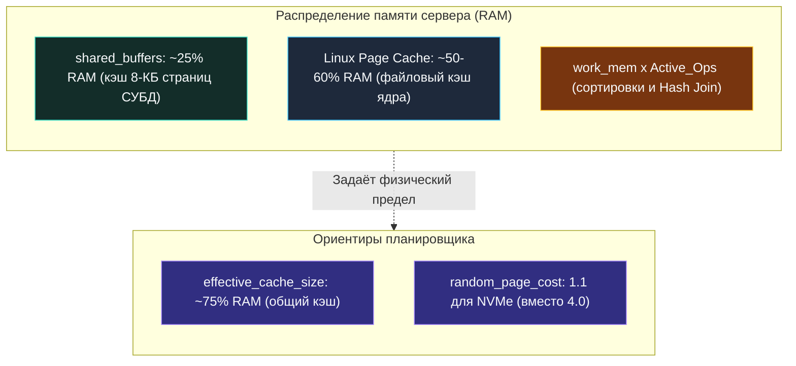
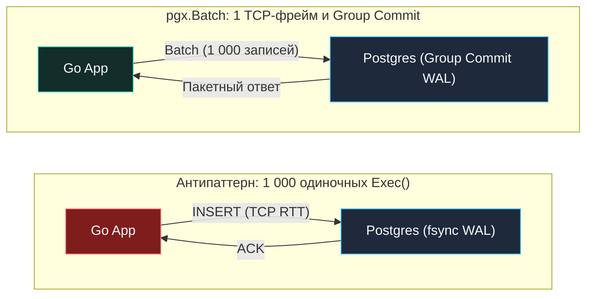

*Как рассчитать `shared_buffers`, `work_mem` и `effective_cache_size`, переключить планировщик с HDD-эвристик на NVMe, подружить `pgx` с транзакционным `PgBouncer` и ускорить запись в `LedgerPulse` через `pgx.Batch`.*

> «Блеск Unix заключался в выборе абстракции, достаточно общей, чтобы быть поразительно полезной, и при этом не слишком дорогой по производительности.»  
> — Брайан Керниган, *UNIX: A History and a Memoir*

На пике расчётов в `LedgerPulse` задержка p99 на чтении баланса подскакивает с 2 мс до 350 мс. Приложение на Go не загружено: CPU — 15%, горутины не текут, а `pprof` показывает ожидание ответа от PostgreSQL.

В девяти случаях из десяти причина кроется в самой базе. Стандартный `postgresql.conf` настроен так, чтобы кластер стартовал даже на сервере с 512 МБ RAM. Под боевой нагрузкой СУБД сбрасывает сортировки на диск, избегает индексов и сжигает CPU на повторном разборе SQL.

Исправить это помогают три рычага: расчёт памяти под физику железа, диагностика планов и правильная работа с пулом соединений.

---

## Бюджет памяти и дискового I/O

Физика накопителей задаёт масштаб каждой настройки. Обращение к странице в RAM занимает **~100 нс**, чтение случайного блока с NVMe — **~100 мкс** (в 1 000 раз медленнее), а поиск на HDD — **~10 мс** (в 100 000 раз медленнее).



### `shared_buffers`: почему 25%, а не 80% RAM

Как показано в [[1. Архитектура PostgreSQL — процессы, общая память и бэкенды]], `shared_buffers` хранит 8-килобайтные страницы таблиц и индексов. На серверах с 16–256 ГБ RAM за базу берут **25% физической памяти**.

В отличие от MySQL InnoDB (см. Модуль 7), PostgreSQL читает и пишет файлы через обычный интерфейс VFS без `O_DIRECT`, полагаясь на файловый кэш Linux (Page Cache). Исторически это избавило ранних разработчиков Postgres от написания собственных блочных драйверов под разные варианты Unix. Если отдать `shared_buffers` 80% RAM, страницы задублируются в двух кэшах, а ОС задохнётся без памяти под чтение файлов и сетевые буферы.

### `work_mem`: скрытый умножитель памяти

Директива `work_mem` задаёт лимит памяти для сортировок (`Sort`, `ORDER BY`, `DISTINCT`) и хэш-таблиц (`Hash Join`, `HashAggregate`) до сброса временных файлов на диск (`temp_blks_written`).

Опасность в том, что `work_mem` выделяется **на каждый узел плана**, а не на соединение. Запрос с тремя `Hash Join` и сортировкой способен занять `4 * work_mem`. При глобальном значении `256MB` сотня параллельных запросов быстро вызовет OOM Killer.

Для OLTP в `LedgerPulse`:
* держите глобальный `work_mem` в пределах `8MB`–`32MB`, сверяясь с формулой `(RAM * 0.25) / (max_connections * 2)`;
* для тяжёлых отчётов поднимайте лимит локально: `SET LOCAL work_mem = '128MB'`.

### `effective_cache_size`: эвристика без аллокаций

Этот параметр **не выделяет память**, а сообщает оптимизатору суммарный объём `shared_buffers` и Page Cache ОС, доступный для удержания индексов. Рабочее значение — **75% от всей RAM**. Заниженное значение (`4GB` по умолчанию) заставляет планировщик думать, что крупный индекс не поместится в память, и переключаться на `Seq Scan`.

### Диск и WAL: `random_page_cost` и `synchronous_commit`

* **`random_page_cost` (по умолчанию `4.0`).** Коэффициент эпохи HDD, где перемещение головки (~10 мс) делало случайное чтение вчетверо дороже линейного. На NVMe SSD случайное чтение почти равно последовательному (~100 мкс). Выставляйте **`1.1`** (плюс `effective_io_concurrency = 200` для предвыборки блоков), чтобы оптимизатор смело выбирал B-Tree и GiST.
* **`synchronous_commit` (по умолчанию `on`).** Бэкенд при `COMMIT` ждёт `fsync()` журнала WAL (см. [[8. WAL — журнал упреждающей записи и долговечность на диске]]). Для денежных проводок `LedgerPulse` оставляйте `on`. Для некритичной телеметрии (клики, метрики), где потеря 100–200 мс событий при отключении питания допустима, `SET LOCAL synchronous_commit = off` кратно ускоряет запись.

---

## Диагностика планов: `EXPLAIN (ANALYZE, BUFFERS)` и статистика

Когда база тормозит, главным микроскопом служит `EXPLAIN (ANALYZE, BUFFERS)` (подробно см. [[10. План выполнения запроса — читаем EXPLAIN ANALYZE BUFFERS]]):

```sql
EXPLAIN (ANALYZE, BUFFERS)
SELECT id, amount, created_at
FROM transactions
WHERE source_account_id = 500 AND status = 'pending';
```

Вывод сразу показывает причину задержки:

```text
Index Scan using idx_tx_source_account on transactions  (cost=0.43..14820.11 rows=12 width=32) (actual time=0.084..68.412 rows=8 loops=1)
  Index Cond: (source_account_id = 500)
  Filter: (status = 'pending'::text)
  Rows Removed by Filter: 49210
  Buffers: shared hit=3120 read=4815
Planning Time: 0.145 ms
Execution Time: 68.489 ms
```

Индекс отфильтровал счёт `500`, но затем движок выбросил 49 210 лишних строк и поднял с диска 4 815 страниц (`shared read`). Составной индекс `(source_account_id, status)` сократит время с 68 мс до ~0,15 мс.

> [!tip] Собеседование [Middle]
> **Вопрос:** На какие четыре показателя в `EXPLAIN (ANALYZE, BUFFERS)` нужно смотреть в первую очередь?
> **Ответ:**
> 1. **`Actual time` против `cost`**: реальное время узла в миллисекундах и кратное расхождение между оценкой `rows` и `actual rows`.
> 2. **`Rows Removed by Filter`**: большое число отброшенных строк после чтения страниц указывает на неполный индекс — нужен составной или частичный индекс.
> 3. **`Buffers: shared hit / read`**: `shared hit` — 8-КБ страницы из RAM; `shared read` — чтения с диска. Цель — свести `read` к минимуму.
> 4. **`JIT`**: для частых OLTP-запросов длительностью 0,5–2 мс компиляция LLVM способна занимать десятки миллисекунд. Для OLTP отключайте её (`jit = off`).

### Сбой кардинальности после заливки данных

Оптимизатор строит планы по статистике и гистограммам из `pg_statistic` (см. [[12. Кардинальность, селективность и статистика]]). Если ночной батч залил в `ledger_entries` 10 миллионов строк, а статистика не обновилась, планировщик ошибётся в оценке кардинальности и выберет `Nested Loop` вместо `Hash Join`. После массовых вставок всегда запускайте:

```sql
ANALYZE ledger_entries;
```

---

## Go 1.24, `pgx` и `PgBouncer`

В модели Process-per-Connection каждый процесс PostgreSQL после `fork()` занимает 5–10 МБ RAM и грузит планировщик ОС. Пятьдесят подов Go по 100 соединений в `pgxpool` создадут 5 000 процессов — и убьют производительность конкуренцией за блокировки ядра и ProcArray.

Пулер **`PgBouncer`** принимает тысячи клиентских подключений и распределяет их по 50–150 серверным бэкендам:

| Режим `PgBouncer` | Освобождение бэкенда | Совместимость с `PREPARE`, `SET`, `LISTEN` | Масштабируемость |
|---|---|---|---|
| `session` | После закрытия TCP-соединения | Полная | Низкая (1:1) |
| `transaction` | Сразу после `COMMIT` / `ROLLBACK` | Требуется настройка `pgx` или PgBouncer 1.21+ | Высокая (тысячи на десятки) |
| `statement` | После каждого оператора SQL | Ломает многошаговые транзакции | Непригодна для OLTP |

### Prepared Statements и транзакционный `PgBouncer`

Параметризованные запросы вида `pool.Query(ctx, "SELECT balance FROM accounts WHERE id = $1", id)` защищают от SQL-инъекций (подробнее см. Модуль 10) и включают **Prepared Statements**. Драйвер `pgx` кэширует разобранное дерево и план на сервере, экономя 20–30% CPU.

> [!warning] Ловушка: конфликт Prepared Statements и `PgBouncer` в режиме `transaction`
> Подготовленные выражения привязаны к конкретному процессу PostgreSQL. В транзакционном режиме первый запрос горутины может попасть в процесс `PID 101`, а следующий — в `PID 102`, где стейтмент не подготовлен. Итог — ошибка `prepared statement "..." does not exist`.
>
> **Решение:** в `pgx/v5` задайте `DefaultQueryExecMode: pgx.QueryExecModeExec` (безымянные стейтменты без серверного кэша) или `pgx.QueryExecModeSimpleProtocol`, либо используйте `PgBouncer 1.21+` с параметром `max_prepared_statements > 0`, транслирующим стейтменты между бэкендами.

### Пакетная запись через `pgx.Batch`

Вставка 1 000 записей одиночными `Exec()` в цикле создаёт 1 000 сетевых round-trip и столько же сбросов WAL. `pgx.Batch` отправляет команды одним пакетом, позволяя базе выполнить единый Group Commit (ср. `UNNEST` и `COPY` в [[16. Пакетные (Batch) запросы, UNNEST и COPY]]).



Реализация пакетной вставки проводок в `LedgerPulse` на Go 1.24 (суммы в целых копейках `int64`):

```go
package repository

import (
	"context"
	"fmt"

	"github.com/jackc/pgx/v5"
	"github.com/jackc/pgx/v5/pgxpool"
)

type LedgerEntryInput struct {
	TransactionID int64
	AccountID     int64
	AmountCents   int64
}

func InsertEntriesBatch(ctx context.Context, pool *pgxpool.Pool, entries []LedgerEntryInput) error {
	if len(entries) == 0 {
		return nil
	}

	batch := &pgx.Batch{}
	const query = `INSERT INTO ledger_entries (transaction_id, account_id, amount_cents) VALUES ($1, $2, $3)`
	for _, e := range entries {
		batch.Queue(query, e.TransactionID, e.AccountID, e.AmountCents)
	}

	br := pool.SendBatch(ctx, batch)
	defer br.Close()

	for i := range entries {
		if _, err := br.Exec(); err != nil {
			return fmt.Errorf("execute batch item %d: %w", i, err)
		}
	}
	return br.Close()
}
```

Финальный вызов `br.Close()` читает протокольный пакет завершения и возвращает возможную отложенную ошибку сервера; `defer br.Close()` страхует от утечки при выходе из цикла. Скорость массовой вставки растёт в 10–50 раз.

---

## Обслуживание bloat, индексы и `pg_stat_statements`

* **Пороги `Autovacuum`:** на таблице со 100 млн строк дефолтный порог 20% копит 20 млн мёртвых кортежей (см. [[3. MVCC в PostgreSQL — xmin, xmax, ctid, HOT и переполнение XID]]). Снизьте его точечно:

```sql
ALTER TABLE accounts SET (
    autovacuum_vacuum_scale_factor = 0.01,
    autovacuum_vacuum_cost_limit = 1000
);
```

* **Лишние индексы:** каждый индекс тормозит `INSERT` и `UPDATE`. Найти неиспользуемые индексы (исключая ограничения `UNIQUE`/`PK`) помогает `pg_stat_user_indexes`:

```sql
SELECT
    relname AS table_name,
    indexrelname AS index_name,
    idx_scan,
    pg_size_pretty(pg_relation_size(indexrelid)) AS index_size
FROM pg_stat_user_indexes
WHERE idx_scan = 0
  AND indexrelid NOT IN (SELECT conindid FROM pg_constraint WHERE conindid != 0)
ORDER BY pg_relation_size(indexrelid) DESC;
```

Проверив `idx_scan = 0` и на репликах, удаляйте индекс без блокировки записи командой `DROP INDEX CONCURRENTLY`.

* **Поиск тяжёлых запросов:** расширение `pg_stat_statements` ([[7. Расширения PostgreSQL — pg_stat_statements, pgcrypto и экосистема]]) сразу показывает главные пожиратели ресурсов:

```sql
SELECT left(query, 80) AS query_prefix, calls, total_exec_time, mean_exec_time, shared_blks_hit
FROM pg_stat_statements
ORDER BY total_exec_time DESC
LIMIT 5;
```

---

## Практикум: задачи для закрепления

### Упражнение 1 (Базовое)
Сервер `LedgerPulse` имеет **64 ГБ RAM**, массив **NVMe SSD** и работает за `PgBouncer` в режиме `transaction` с пулом в **120** соединений. Рассчитайте стартовые значения `shared_buffers`, `effective_cache_size`, `work_mem`, `random_page_cost` и `jit`.

> [!solution] Показать решение
> ```ini
> shared_buffers = 16GB          # 25% RAM; остальное для Linux Page Cache
> effective_cache_size = 48GB    # 75% RAM (shared_buffers + Page Cache)
> work_mem = 32MB                # (64 ГБ * 0.25) / (120 * 2..3) с запасом под несколько узлов в плане
> random_page_cost = 1.1         # NVMe ~100 мкс вместо HDD ~10 мс
> effective_io_concurrency = 200
> jit = off                      # убираем накладные расходы LLVM на коротких OLTP-запросах
> ```

### Упражнение 2 (Практическое)
В `transactions` есть два одиночных индекса `idx_tx_account` и `idx_tx_status`, а частый поиск по `(source_account_id, status)` отбрасывает десятки тысяч строк в фильтре. Замените их одним составным индексом без блокировки записи и обновите статистику.

> [!solution] Показать решение
> ```sql
> CREATE INDEX CONCURRENTLY idx_tx_source_status
>     ON transactions (source_account_id, status);
>
> -- После проверки планов через EXPLAIN (ANALYZE, BUFFERS) и статистики на репликах:
> DROP INDEX CONCURRENTLY IF EXISTS idx_tx_account;
> DROP INDEX CONCURRENTLY IF EXISTS idx_tx_status;
> ANALYZE transactions;
> ```
> Более селективный `source_account_id` идёт первым для точного спуска по B-Tree, а `status` — вторым.

### Упражнение 3 (Со звёздочкой \*)
После включения `PgBouncer` в режиме `transaction` Go-сервис начал падать с ошибкой `ERROR: prepared statement "lrupsc_1_0" does not exist`. Объясните протокольную причину и настройте `pgxpool.Config` на Go 1.24 так, чтобы сохранить транзакционный пулинг.

> [!solution] Показать решение
> В режиме `transaction` `pgx` кэширует именованный стейтмент в одном бэкенде PostgreSQL, а следующая транзакция попадает в другой процесс, где этого имени нет. Решение для старого `PgBouncer` (< 1.21) — переключить режим на безымянные выражения `pgx.QueryExecModeExec` (либо обновиться до `PgBouncer 1.21+` и задать `max_prepared_statements = 200`).
>
> ```go
> package db
>
> import (
> 	"context"
> 	"fmt"
>
> 	"github.com/jackc/pgx/v5"
> 	"github.com/jackc/pgx/v5/pgxpool"
> )
>
> func NewPgBouncerPool(ctx context.Context, dsn string) (*pgxpool.Pool, error) {
> 	cfg, err := pgxpool.ParseConfig(dsn)
> 	if err != nil {
> 		return nil, fmt.Errorf("parse dsn: %w", err)
> 	}
> 	cfg.ConnConfig.DefaultQueryExecMode = pgx.QueryExecModeExec
> 	return pgxpool.NewWithConfig(ctx, cfg)
> }
> ```

---

## Что дальше

Даже идеальный `postgresql.conf` не отменяет главного правила Heap-движка: каждый `UPDATE` и `DELETE` оставляет на странице мёртвый кортеж. Если фоновая уборка отстаёт, `shared_buffers` забивается мусором, а статистика планировщика стареет.

Как устроен пятишаговый конвейер `VACUUM`, по какой формуле запускается `Autovacuum` и как сжать раздутую таблицу без блокировки читателей — в следующей главе: [[10. VACUUM, Autovacuum, ANALYZE и борьба с раздуванием]].
