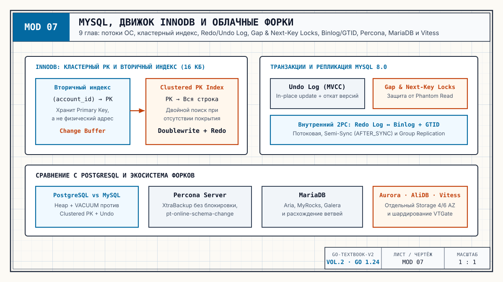

*Девять глав о второй главной реляционной платформе бэкенда: от потоковой архитектуры MySQL и кластерного движка InnoDB с Gap Locks до Binlog/GTID, честного сравнения с PostgreSQL и распределённого Vitess.*

> «Можно уверенно предсказать, что новые языки, делающие программирование проще и безопаснее, будут появляться и дальше. Но столь же уверенно можно сказать, что единого языка не будет никогда: в разработке слишком много компромиссов, чтобы один-единственный язык одинаково хорошо подходил для всех задач.»  
> — Брайан Керниган, *UNIX: A History and a Memoir*

## Что нужно знать до старта

* **Модули 1–6:** B-Tree индексы, уровни изоляции, MVCC и WAL в PostgreSQL (`xmin`/`xmax`, 8-КБ Heap, потоковая и логическая репликация).

## Что вы соберёте в этом разделе

* **Модель MySQL и движка InnoDB** — увидите контраст с PostgreSQL: единый процесс с потоками ОС, кластерный первичный ключ (16-КБ страницы, где данные лежат прямо в листьях B+ Tree), двойной поиск по вторичному индексу, `Buffer Pool`, `Doublewrite Buffer`, `Change Buffer`, `Redo Log` и `Undo Log`.
* **Понимание транзакций и репликации MySQL** — разберёте, почему `REPEATABLE READ` в InnoDB предотвращает фантомы через `Gap Locks` и `Next-Key Locks`, как работают `Binlog` (Row/Statement), `GTID` и `Group Replication` (Paxos), и почему выбор PK критичнее, чем в PostgreSQL.
* **Карту экосистемы и облачных форков** — сравните PostgreSQL и MySQL без религиозных войн, освоите инструменты Percona (`XtraBackup`, `pt-online-schema-change`), узнаете расхождение MariaDB и разберётесь, как Aurora, AliDB и Vitess масштабируют MySQL.

## Карта раздела

1. [[1. Архитектура MySQL — поток на соединение и подключаемые движки]] — парсер, оптимизатор, пул потоков ОС и граница API подключаемых движков (`InnoDB`, `MyISAM`, `Memory`).
2. [[2. Движок InnoDB — кластерный индекс, Buffer Pool, Redo и Undo Log]] — 16-КБ страницы, почему вторичные индексы хранят PK вместо адреса, `New`/`Old` LRU в `Buffer Pool` и `Doublewrite`.
3. [[3. Индексы в MySQL — вторичный поиск, Change Buffer и покрывающие ключи]] — цена двойного спуска по B+ Tree, отложенная вставка в `Change Buffer`, префиксные индексы и Invisible Indexes.
4. [[4. Транзакции в MySQL — Gap Locks, Next-Key Locks и MVCC через Undo Log]] — `Read View`, откат старых версий через `Undo Log`, `Record Lock`, `Gap Lock`, `Next-Key Lock` и их ловушки.
5. [[5. Репликация в MySQL — Binlog, GTID и Group Replication]] — двухфазный коммит между Redo Log и Binlog (`sync_binlog`), глобальные ID транзакций GTID и консенсус Group Replication.
6. [[6. PostgreSQL против MySQL — честное архитектурное сравнение]] — процессы vs потоки, Heap + `VACUUM` vs Clustered PK + `Undo`, типы данных, JSON и критерии выбора под сервис.
7. [[7. Percona Server — диагностика, XtraBackup и инструменты эксплуатации]] — горячие физические бэкапы без блокировки записи, `Percona Toolkit` и расширенная статистика.
8. [[8. MariaDB — расхождение с MySQL и собственные движки]] — исторический форк, совместимость протокола, движки `Aria`, `ColumnStore`, `MyRocks` и когда выбор падает на MariaDB.
9. [[9. Облачные форки и распределённый MySQL — Aurora, AliDB и Vitess]] — отделение хранения от вычислений в AWS Aurora, паттчи HighLoad в AliDB и шардирование YouTube/Slack в Vitess.
