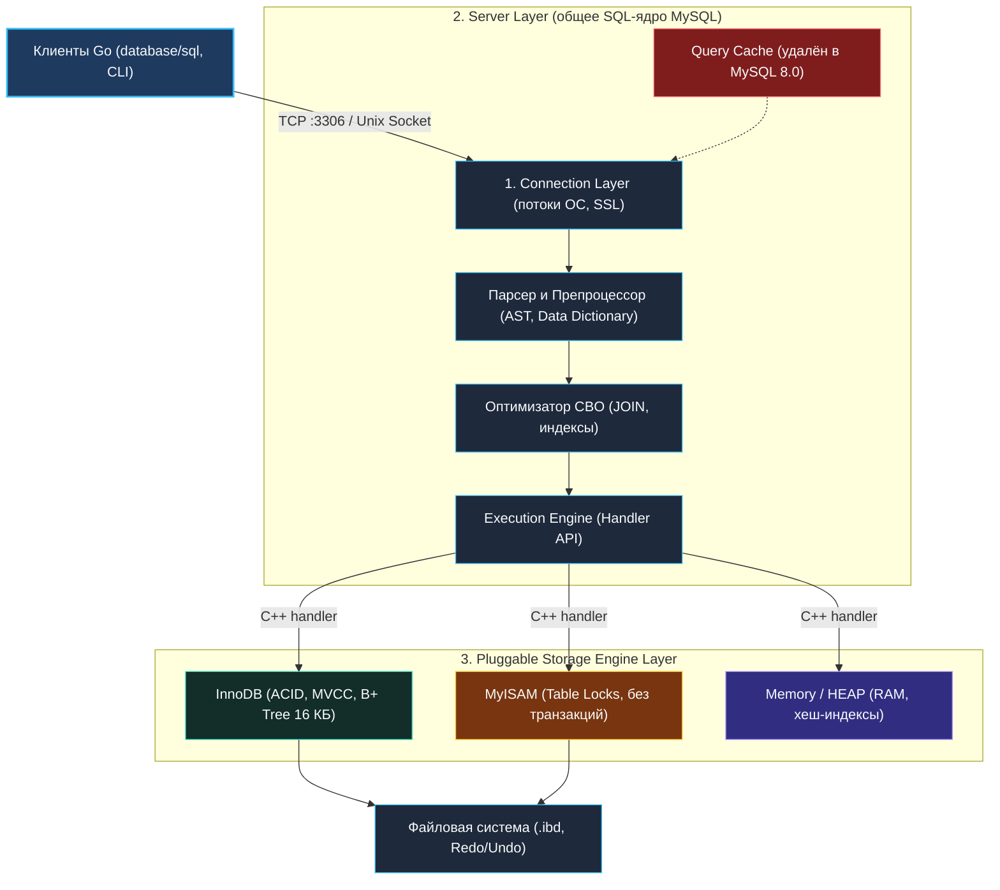
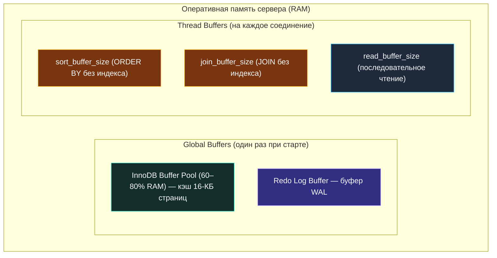

*Как устроен сервер MySQL изнутри: модель «поток на соединение», удаление Query Cache, граница Handler API между SQL-ядром и движками хранения, буферы памяти и подводные камни драйвера Go.*

> «Решения, определившие развитие этой технологии и путь, по которому мы пошли, принимали живые люди — под давлением и в жёстких ограничениях своего времени. Как минимум решения, которые сегодня кажутся ошибочными или странными, часто оказываются естественным следствием того, что тогда понимали и что позволяли доступные ресурсы.»  
> — Брайан Керниган, *UNIX: A History and a Memoir*

Если перенести в MySQL привычки от PostgreSQL ([[1. Архитектура PostgreSQL — процессы, общая память и бэкенды]]), первый же сбой под нагрузкой выглядит загадочно. Сервис `LedgerPulse` открывает несколько тысяч прямых соединений из Go, и база перестаёт отвечать задолго до исчерпания дисков. Десяток тяжёлых `ORDER BY` уводит машину с 64 ГБ RAM в `OOM Killer`, а совет из старого руководства настроить `query_cache_size` ломает запуск `mysqld` в версии 8.0.

Все три эффекта объясняются трёхуровневой архитектурой MySQL и его моделью памяти.

---

## Трёхуровневая архитектура и идея подключаемых движков

В PostgreSQL парсер, оптимизатор и страничное хранилище `Heap` жёстко связаны в едином ядре. Создатели MySQL — Монти Видениус и Дэвид Аксмарк — в середине 1990-х разделили эти обязанности через **архитектуру подключаемых движков хранения (*Pluggable Storage Engine Architecture*)**.

Разбор SQL, проверка прав и оптимизация плана живут в общем ядре (`Server Layer`). Физическая раскладка байтов на диске, транзакционность и блокировки вынесены в сменные модули (`Storage Engine Layer`) за унифицированным интерфейсом.



---

## Уровень 1. Connection Layer: поток на соединение

При вызове `sql.Open("mysql", dsn)` и первом запросе драйвер Go открывает TCP-сокет на порт `3306` (или Unix Domain Socket). В отличие от многопроцессного PostgreSQL, классический MySQL — **единый процесс `mysqld`**, реализующий модель **Thread-per-Connection** (один поток ОС на клиентское соединение):

1. После проверки TLS и аутентификации сервер ищет свободный поток в **Thread Cache**.
2. Если свободный поток найден, он сразу берёт сокет клиента.
3. Если кэш пуст, `mysqld` вызывает системный вызов Linux `clone()`, создавая новый поток ОС со стеком `thread_stack`.

> [!info] Под капотом: потоки ОС против горутин Go
> Горутина Go стартует за микросекунды со стеком **~2 КБ**, а планировщик G-M-P переключает её в пространстве пользователя без системных вызовов. В MySQL поток планирует ядро Linux, резервируя под `thread_stack` сотни килобайт или мегабайты (256 КБ–1 МБ по умолчанию). Тысячи одновременно активных потоков ОС вызывают **Thread Thrashing**: планировщик ядра тратит кванты CPU на переключение контекста в Ring 0 и сброс TLB/L1-кэшей, а исполнение SQL останавливается.

> [!warning] Ловушка: Connection Storm (шторм подключений)
> Если микросервисы `LedgerPulse` на Go откроют соединения без лимита в пуле, потоки в `mysqld` упрутся в `max_connections`, исчерпают RAM или парализуют CPU борьбой за блокировки ядра.
> **Правило:** всегда ограничивайте `SetMaxOpenConns` и `SetMaxIdleConns` в Go. Под высокой нагрузкой перед MySQL ставят внешний мультиплексор (**ProxySQL**) или используют форки с **Thread Pool** (**Percona Server**, MySQL Enterprise), где тысячи клиентских сокетов мультиплексируются поверх фиксированного числа рабочих потоков ОС.

---

## Уровень 2. Server Layer: парсер, CBO и смерть Query Cache

Всё, что происходит с запросом до чтения конкретных страниц таблицы, выполняется в общем SQL-ядре. Оно ничего не знает о формате хранения InnoDB и работает через контракт `Handler API`.

* **Парсер и препроцессор:** парсер строит абстрактное синтаксическое дерево (**AST**), а препроцессор сверяет имена таблиц и столбцов со словарём данных (**Data Dictionary**), раскрывает псевдонимы и проверяет права (`GRANT`).
* **Оптимизатор запросов (CBO):** стоимостной оптимизатор (**Cost-Based Optimizer**, [[11. Стоимостной оптимизатор (Cost-Based Optimizer)]]) перебирает порядок `JOIN` и доступные индексы, оценивая стоимость плана в единицах CPU и I/O. Дерево плана инспектируют командой `EXPLAIN` ([[10. План выполнения запроса — читаем EXPLAIN ANALYZE BUFFERS]]).
* **Исполнитель (Execution Engine):** пошагово вызывает методы нижнего уровня через `Handler API`, фильтрует остаточные условия и отправляет строки клиенту.

> [!tip] Собеседование [Middle]
> **Вопрос:** Почему MySQL иногда игнорирует индекс на столбце в `WHERE` и выбирает `Full Table Scan`?
> **Ответ:** Оптимизатор опирается на статистику распределения значений (**Cardinality**). Если условие `WHERE status = 'posted'` охватывает 80% строк таблицы `ledger_entries`, поход по вторичному индексу потребует для каждой строки случайного чтения (**Random I/O**) по первичному ключу. Последовательное чтение таблицы подряд (**Sequential Read**) с аппаратным и ОС-упреждением (*Read-ahead*) при низкой селективности сработает быстрее в разы.

> [!warning] Ловушка: удаление Query Cache в MySQL 8.0
> **В MySQL 8.0 компонент Query Cache удалён полностью.** Исторический `Query Cache` кэшировал ответы на идентичные `SELECT`, но сбрасывал все кэшированные результаты для таблицы при *любом* `INSERT`, `UPDATE` или `DELETE`. Инвалидация требовала захвата единого **Global Mutex**. На 32–64-ядерных серверах конкуренция потоков за этот глобальный мьютекс превращалась в главное узкое горлышко СУБД.

---

## Уровень 3. Storage Engine Layer и контракт `Handler API`

В C++-коде сервера MySQL объявлен абстрактный базовый класс `handler` с виртуальными методами доступа к кортежам:
* `rnd_next()` — считать следующую физическую строку при полном сканировании;
* `index_read()` — найти первую запись в индексе по ключу;
* `index_next()` — перейти к следующему элементу текущего диапазона индекса;
* `write_row()`, `update_row()`, `delete_row()` — записать, обновить или удалить строку.

Когда Go отправляет `SELECT * FROM ledger_entries WHERE account_id = 42 AND amount_cents > 1000`, Исполнитель вызывает `index_read()` по `account_id = 42` и затем повторяет `index_next()`. Детали B+ деревьев скрыты за границей `Handler API`.

| Движок | Транзакции и MVCC | Блокировки | Назначение и ограничения |
| :--- | :---: | :---: | :--- |
| **InnoDB** | Да (ACID, MVCC) | Строки (**Row-level**) | По умолчанию с MySQL 5.5; кластерный B+ Tree индекс (16 КБ), FK, Crash Recovery. Выбор для 99% сервисов. |
| **MyISAM** | Нет | Таблица (**Table-level**) | Исторический движок; любая запись блокирует всю таблицу, без восстановления после сбоя. Только read-only архивы. |
| **Memory (HEAP)** | Нет | Таблица (**Table-level**) | Таблицы в RAM (данные пропадают при рестарте), хеш-индексы. Использовался и для внутренних временных таблиц до появления `TempTable` в MySQL 8.0. |

---

## Архитектура памяти: глобальные буферы против буферов потока

Оперативная память `mysqld` делится на две категории:



1. **Глобальные буферы (`Global Buffers`)** выделяются при старте `mysqld`: **`InnoDB Buffer Pool`** (60–80% RAM на выделенном сервере — кэш 16-КБ страниц, адаптивные хеш-индексы, структуры отката) и **`Redo Log Buffer`**.
2. **Буферы потоков (`Thread Buffers`)** выделяются динамически внутри адресного пространства *каждого активного потока*: `sort_buffer_size` (`ORDER BY` без индекса), `join_buffer_size` (Block Nested Loop / Hash Join без индексов) и `read_buffer_size`.

> [!warning] Ловушка: лавинообразный OOM при нехватке индексов
> Если 1 000 параллельных соединений из Go одновременно выполнят `ORDER BY` без индекса при глобальном `sort_buffer_size = 64MB`, суммарный запрос составит `1 000 × 64 МБ = 64 ГБ` сверх `Buffer Pool`. Сервер мгновенно уйдёт в `OOM Killer`. Если же `sort_buffer_size` мал (обычно держат 256 КБ–2 МБ) и набор не помещается, MySQL переходит на **Filesort** со сбросом во временные файлы на диске, что обваливает IOPS.

---

## Практика на Go 1.24: DSN, пул и Prepared Statements

В драйвере `github.com/go-sql-driver/mysql` через стандартный `database/sql` важны три детали:
1. **DSN-параметры `parseTime=true` и `loc`:** протокол MySQL отдаёт `DATETIME`/`TIMESTAMP` как ASCII-байты. Без `parseTime=true` вызов `Scan` в `time.Time` падает с ошибкой конвертации `[]uint8`.
2. **Лимиты пула:** `SetMaxOpenConns` и `SetMaxIdleConns` удерживают число потоков ОС на стороне `mysqld` в разумных рамках (подробнее устройство пула и `Prepared Statements` в `database/sql` разобрано в Модуле 10).
3. **Двухфазные Prepared Statements:** при параметризованном запросе с `?` (в отличие от PostgreSQL с `$1`) драйвер отправляет `PREPARE` (сервер строит AST, кэширует план в сессии и возвращает `statement_id`) и затем `EXECUTE` (передаются `statement_id` и аргументы). Это защищает от SQL-инъекций и экономит парсер, но забытый `stmt.Close()` после ручного `db.PrepareContext` в цикле утечёт дескрипторами в памяти сессии.

```go
package storage

import (
	"context"
	"database/sql"
	"fmt"
	"time"

	_ "github.com/go-sql-driver/mysql"
)

type LedgerEntry struct {
	ID          int64
	AccountID   int64
	AmountCents int64
	CreatedAt   time.Time
}

func OpenMySQL(ctx context.Context, dsn string) (*sql.DB, error) {
	db, err := sql.Open("mysql", dsn)
	if err != nil {
		return nil, fmt.Errorf("open mysql: %w", err)
	}
	db.SetMaxOpenConns(25)
	db.SetMaxIdleConns(25)
	db.SetConnMaxLifetime(5 * time.Minute)
	return db, db.PingContext(ctx)
}

func FetchRecentEntries(ctx context.Context, db *sql.DB, accountID int64, limit int) ([]LedgerEntry, error) {
	const q = `SELECT id, account_id, amount_cents, created_at
		FROM ledger_entries WHERE account_id = ? ORDER BY id DESC LIMIT ?`

	rows, err := db.QueryContext(ctx, q, accountID, limit)
	if err != nil {
		return nil, fmt.Errorf("query entries: %w", err)
	}
	defer func() { _ = rows.Close() }()

	entries := make([]LedgerEntry, 0, limit)
	for rows.Next() {
		var e LedgerEntry
		if err := rows.Scan(&e.ID, &e.AccountID, &e.AmountCents, &e.CreatedAt); err != nil {
			return nil, fmt.Errorf("scan entry: %w", err)
		}
		entries = append(entries, e)
	}
	return entries, rows.Err()
}
```

Если в `dsn` забыть `?parseTime=true&loc=UTC`, первый же `Scan` вернёт ошибку драйвера:

```text
scan entry: sql: Scan error on column index 3, name "created_at": unsupported Scan, storing driver.Value type []uint8 into type *time.Time
```

С корректным DSN и лимитом пула 25 статус потоков на сервере остаётся стабильным:

```text
+-------------------+-------+
| Variable_name     | Value |
+-------------------+-------+
| Threads_cached    | 12    |
| Threads_connected | 25    |
| Threads_created   | 25    |
| Threads_running   | 3     |
+-------------------+-------+
```

Новые потоки ОС больше не создаются (`Threads_created` зафиксирован на 25), свободные потоки переиспользуются из `Thread Cache`.

---

## Упражнения

### Упражнение 1 (Базовое)
На сервере `LedgerPulse` 64 ГБ RAM, `innodb_buffer_pool_size = 48G`, `sort_buffer_size = 32M`, `join_buffer_size = 16M` и `max_connections = 1000`. В пике 600 активных потоков выполняют неиндексированный `JOIN` с неиндексированным `ORDER BY`. Оцените пиковую потребность в памяти и объясните последствия.

> [!solution] Показать решение
> 1. `InnoDB Buffer Pool`: **48 ГБ**.
> 2. Потоковые буферы на один запрос: `32 МБ + 16 МБ = 48 МБ`.
> 3. На 600 соединений: `600 × 48 МБ = 28.8 ГБ` сверх `Buffer Pool` (и без учёта `thread_stack`).
> 4. Итог превышает **76.8 ГБ** при 64 ГБ RAM. Поскольку все потоки находятся в едином процессе `mysqld`, ядро Linux через `OOM Killer` убьёт весь сервер базы данных. Лечение: ограничить пул в Go, снизить потоковые буферы до 1–2 МБ и добавить индексы.

### Упражнение 2 (Практическое)
Напишите функцию Go 1.24 `CountPostedByAccount(ctx context.Context, db *sql.DB, accountIDs []int64) (map[int64]int64, error)`, которая однократно подготавливает выражение через `db.PrepareContext`, гарантирует закрытие дескриптора через `defer` и в цикле считает число проведённых записей (`status = 'posted'`) по каждому счёту.

> [!solution] Показать решение
> `PrepareContext` один раз проходит парсер и оптимизатор (`PREPARE`), возвращая `statement_id`, а в цикле передаются только бинарные параметры (`EXECUTE`). `defer` закрывает серверный дескриптор.
>
> ```go
> func CountPostedByAccount(ctx context.Context, db *sql.DB, accountIDs []int64) (map[int64]int64, error) {
> 	stmt, err := db.PrepareContext(ctx, `SELECT COUNT(*) FROM ledger_entries WHERE account_id = ? AND status = 'posted'`)
> 	if err != nil {
> 		return nil, fmt.Errorf("prepare count: %w", err)
> 	}
> 	defer func() { _ = stmt.Close() }()
>
> 	counts := make(map[int64]int64, len(accountIDs))
> 	for _, id := range accountIDs {
> 		var n int64
> 		if err := stmt.QueryRowContext(ctx, id).Scan(&n); err != nil {
> 			return nil, fmt.Errorf("exec count %d: %w", id, err)
> 		}
> 		counts[id] = n
> 	}
> 	return counts, nil
> }
> ```

### Упражнение 3 (\*)
В продакшене при стабильных `Threads_connected = 40` сервисы начинают получать ошибку `Error 1461 (42000): Can't create more than max_prepared_stmt_count statements (current value: 16382)`. Назовите две возможные причины (в коде Go и в динамической генерации SQL) и команды диагностики на сервере.

> [!solution] Показать решение
> 1. **Утечка `*sql.Stmt`:** вызов `db.PrepareContext` внутри обработчика без `defer stmt.Close()` оставляет дескрипторы открытыми в 40 долгоживущих сессиях `mysqld`, пока сумма не достигнет 16 382.
> 2. **Динамические запросы `IN (?, ?, ...)`:** генерация шаблонов с разным числом плейсхолдеров в паре с ручным `Prepare` или кэшированием на прокси-слое плодит тысячи уникальных `statement_id`.
> 3. **Диагностика:** `SHOW GLOBAL STATUS LIKE 'Prepared_stmt_count'` и таблица `performance_schema.prepared_statements_instances`. Исправление — вызывать `stmt.Close()` или использовать `db.QueryContext` с фиксированным набором запросов.

---

Мы разобрали верхние два этажа MySQL и границу `Handler API`. В следующей главе спустимся внутрь движка `InnoDB` — к 16-килобайтным страницам, кластерному индексу, `Buffer Pool`, `Redo Log` и `Undo Log`: [[2. Движок InnoDB — кластерный индекс, Buffer Pool, Redo и Undo Log]].
