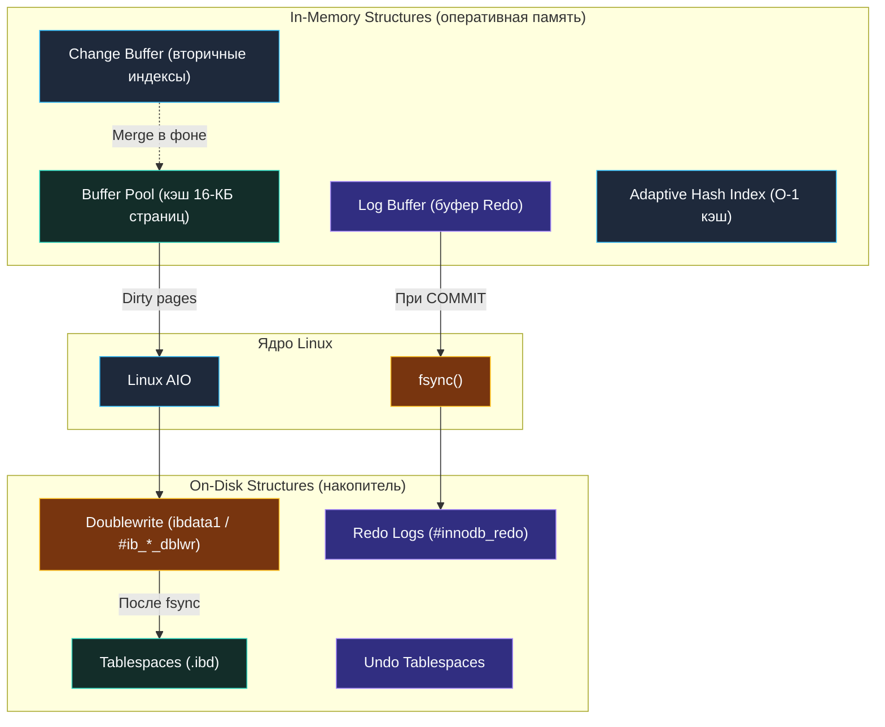
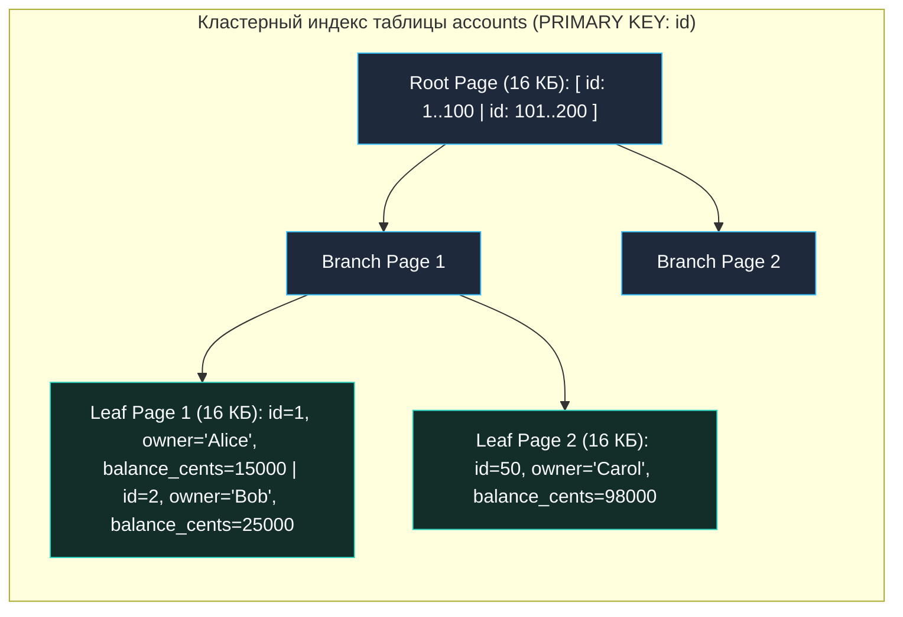
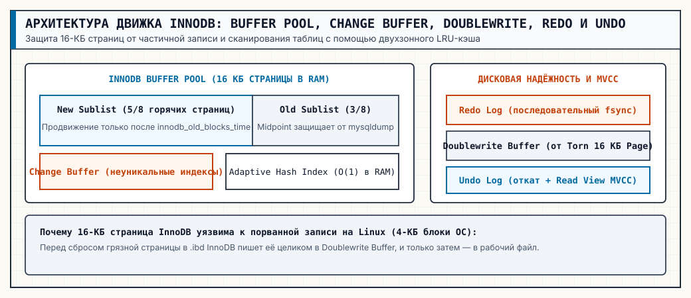
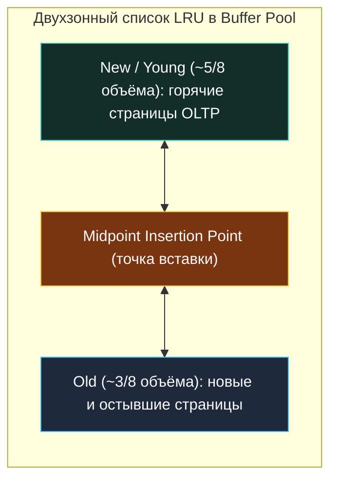
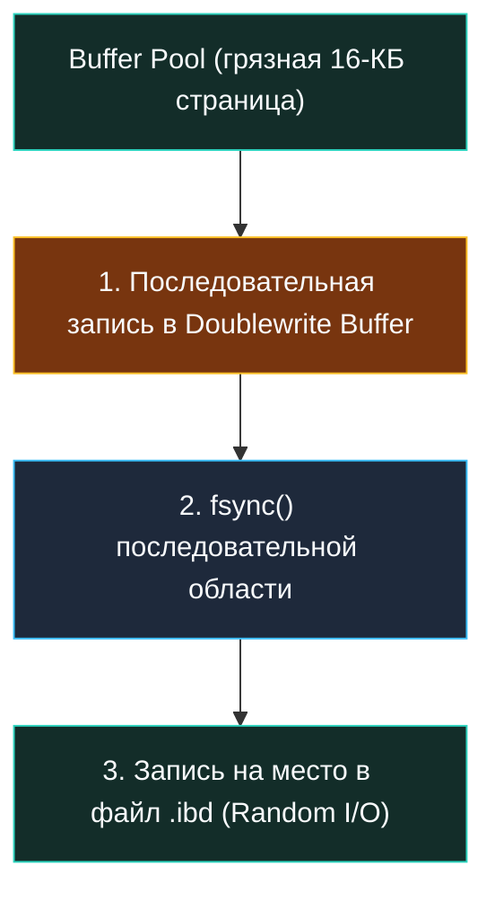
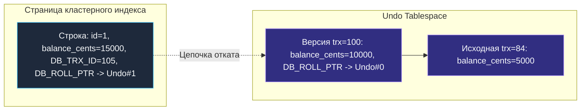

*Как InnoDB хранит таблицы внутри B+ дерева первичного ключа, зачем Buffer Pool делит LRU на сегменты New и Old, и как Redo Log, Doublewrite Buffer и Undo Log обеспечивают ACID.*

> «Мы пишем, а позже читаем. Сохраняем, а позже извлекаем. Храним, а позже обращаемся к сохранённому. Назначение памяти — уберечь информацию без искажений между двумя этими событиями. Стоит отключить питание — и энергозависимая память забывает всё, что когда-либо знала.»  
> — Чарльз Петцольд, *Code* (2-е изд.)

В PostgreSQL таблица лежит как неупорядоченная Куча (`Heap`) из 8-килобайтных страниц, а старые версии строк соседствуют с новыми прямо в тех же блоках ([[2. Движок хранения PostgreSQL — 8 КБ страницы, Heap, TOAST и Visibility Map]], [[3. MVCC в PostgreSQL — xmin, xmax, ctid, HOT и переполнение XID]]). В MySQL с движком `InnoDB` физика иная: запрос `SELECT COUNT(*)` на миллионной таблице здесь длится секунды, ночное сканирование таблицы не вымывает горячий кэш из памяти, а отключение «двойной записи» на диске без батарейного кэша оставляет разорванные 16-КБ страницы, которые бессилен починить даже `Redo Log`.

Эти свойства задаёт внутренняя архитектура **InnoDB**, созданного Хейкки Туури в конце 1990-х годов ради бескомпромиссных ACID-транзакций поверх MySQL.

---

## Философия RAM против диска и карта компонентов InnoDB

Доступ к L1-кэшу процессора занимает **~1 нс**, к оперативной памяти — **~100 нс**, случайное чтение с NVMe SSD — **~100 мкс** (в 1 000 раз дольше RAM), а поворот головки HDD — **~10 мс** (ещё в 100 раз дольше). Отсюда следует базовый закон InnoDB: **все чтения и изменения выполняются только в RAM, а запись на диск идёт либо асинхронно фоном, либо укрупнённым последовательным потоком (`Sequential I/O`)**.



---

## Дисковые структуры: страницы, экстенты и кластерный индекс


### Страницы 16 КБ и экстенты 1 МБ

Диск в InnoDB квантуется **страницами (`Pages`)** по **16 КБ** (16 384 байта) — вдвое крупнее 8-КБ страниц PostgreSQL.

> [!info] Под капотом: почему 16 КБ и когда ставят 4 КБ
> Страница виртуальной памяти Linux равна 4 КБ, а контроллеры SSD работают блоками по 4–8 КБ. Размер 16 КБ унаследован из эпохи магнитных HDD: прочитать 16 КБ за один оборот шпинделя стоило почти столько же, сколько 4 КБ, но давало вчетверо больше данных. На NVMe под нагрузкой мелких случайных чтений при инициализации инстанса задают `innodb_page_size=4k` — это снижает передачу лишних байтов по PCIe и **Write Amplification**.

Каждые **64 смежные страницы** образуют **экстент (`Extent`)** размером **1 МБ**. В режиме `innodb_file_per_table = ON` каждая таблица хранится в отдельном файле `.ibd`.

### Кластерный индекс: таблица — это B+ дерево

В PostgreSQL и `MyISAM` таблица — неупорядоченная Куча (`Heap`), а индексы лежат отдельно. В InnoDB **таблица физически и есть сбалансированное B+ дерево (`Clustered Index`)**, упорядоченное по `PRIMARY KEY`:

* промежуточные узлы содержат граничные ключи и указатели на дочерние 16-КБ страницы;
* листовые узлы хранят **все столбцы строк целиком**, отсортированные по первичному ключу.



Поэтому поиск `SELECT * FROM accounts WHERE id = 1` в InnoDB спускается за 2–3 перехода по дереву и сразу достаёт из листа готовую строку со всеми столбцами.

Отсюда же следует **главная особенность вторичных индексов InnoDB: они хранят `PRIMARY KEY`, а не физический адрес страницы**. В Куче PostgreSQL вторичный индекс указывает на пару `(страница, слот)` (`ctid`). В кластерном B+ дереве при вставках и расколах страниц (*Page Split*) строки постоянно меняют физическую страницу. Если бы вторичные индексы ссылались на номер страницы, каждый переезд строки заставлял бы переписывать все вторичные деревья. Логический `PRIMARY KEY` в листьях вторичного ключа решает эту проблему ценой второго спуска по дереву (см. [[3. Индексы в MySQL — вторичный поиск, Change Buffer и покрывающие ключи]]).

---

## Структуры в памяти: Buffer Pool и Midpoint LRU



InnoDB никогда не правит байты напрямую на накопителе. При `SELECT`, `UPDATE` или `DELETE` нужная 16-КБ страница загружается с диска в **`Buffer Pool`**. Изменения помечают её в RAM как **Dirty Page** («грязную» страницу), а фоновые воркеры `page_cleaner` сбрасывают её асинхронно через **Linux AIO**.

Чтобы разовое чтение гигантской таблицы не уничтожило горячий кэш транзакций, InnoDB модифицировал алгоритм вытеснения **LRU**:



> [!tip] Собеседование [Middle]
> **Вопрос:** Вымоет ли ночной `SELECT * FROM ledger_entries` без индекса весь горячий кэш `Buffer Pool`?
> **Ответ:** Нет, благодаря **стратегии вставки в середину (*Midpoint Insertion Strategy*)**.
> Список LRU разделён на **5/8** (горячий сегмент `New / Young`) и **3/8** (холодный `Old`). Новая страница с диска вставляется на границу `Midpoint` в начало сегмента `Old`. Чтобы попасть в горячий `New`, к странице должно прийти повторное обращение **после** интервала `innodb_old_blocks_time` (по умолчанию **1 000 мс**). Разовое сканирование читает строки страницы за микросекунды и больше к ней не возвращается — страница вытесняется из хвоста `Old`, не задев ни одной горячей страницы в `New`.

Помимо кэша страниц, в памяти лежат **`Change Buffer`** (отложенная вставка в неуникальные вторичные индексы), **`Log Buffer`** (буфер журнала транзакций) и **`Adaptive Hash Index (AHI)`** — автоматический O(1) хеш-кэш поверх горячих префиксов B+ Tree для точечных чтений.

---

## Гарантии ACID: Redo Log, Doublewrite Buffer и Undo Log

### Atomicity и Durability: Redo Log и `fsync()`

Чтобы подтвердить `COMMIT` без медленного сброса целых 16-КБ страниц в случайные смещения `.ibd`, InnoDB использует **Write-Ahead Logging (WAL)** ([[8. WAL — журнал упреждающей записи и долговечность на диске]]) — циклический журнал **`Redo Log`** (`ib_logfile*` в MySQL 5.7, каталог `#innodb_redo` в MySQL 8.0). На `COMMIT` в `Log Buffer` пишется компактный физико-логический вектор изменений («страница 42, смещение 128, новые 8 байт») и сбрасывается последовательной записью (`Sequential I/O`). При рестарте после сбоя InnoDB накатывает `Redo Log` на страницы данных.

> [!warning] Ловушка: параметр `innodb_flush_log_at_trx_commit`
> * **`1` (по умолчанию):** строгий ACID. На каждый `COMMIT` вызывается `fsync()` до физического носителя. Ноль потерь, но запись ограничена задержкой `fsync`.
> * **`2`:** при `COMMIT` вызывается быстрый `write()` в страничный кэш ядра Linux, а `fsync()` запускается раз в секунду. Падение процесса `mysqld` не теряет транзакции, но отключение питания сервера уничтожит до 1 секунды коммитов. Пропускная способность записи выше в 5–10 раз.
> * **`0`:** и `write()`, и `fsync()` выполняются раз в секунду. Крах самого `mysqld` потеряет до секунды подтверждённых транзакций — неприемлемо для `LedgerPulse`.

### Consistency: защита от Torn Page в Doublewrite Buffer

Страница InnoDB равна **16 КБ**, а блок ядра Linux и диска — **4 КБ**. Сброс одной страницы из `Buffer Pool` в `.ibd` распадается на **четыре записи по 4 КБ**. Если питание пропадёт на середине, на диске останется **Torn Page (разорванная страница)** со сломанной контрольной суммой. `Redo Log` здесь бессилен: вектор изменений нельзя применить к повреждённой странице.

Поэтому используется **Doublewrite Buffer** (исторически в `ibdata1`, а с MySQL 8.0.20 — в отдельных файлах `#ib_16384_0.dblwr`):



При восстановлении после аварии InnoDB находит разорванную страницу по контрольной сумме, восстанавливает её эталонную копию из Doublewrite Buffer и затем накатывает `Redo Log`.

### Isolation: MVCC и Undo Logs

В отличие от PostgreSQL, где мёртвые версии строк лежат прямо в Куче, **InnoDB вытесняет старые версии строк в `Undo Logs`**. В заголовке каждой записи кластерного индекса лежат два скрытых поля: **`DB_TRX_ID`** (6 байт — ID транзакции, изменившей строку) и **`DB_ROLL_PTR`** (7 байт — обратный указатель на предыдущую версию в Undo Tablespace).



Параллельный `SELECT` не ждёт пишущую транзакцию: по цепочке `DB_ROLL_PTR` он воссоздаёт версию, актуальную для своего снимка (**Read View**, [[7. MVCC — многоверсионный контроль конкурентности]]).

> [!tip] Собеседование [Middle]
> **Вопрос:** Почему `SELECT COUNT(*)` без `WHERE` в `MyISAM` мгновенный, а в `InnoDB` занимает секунды?
> **Ответ:** В `MyISAM` без транзакций число строк хранилось константой в заголовке файла ($O(1)$). В `InnoDB` из-за MVCC у параллельных транзакций разное видимое число строк. Движок вынужден сканировать листья самого компактного вторичного индекса и проверять `DB_TRX_ID` каждой строки относительно текущего снимка.

---

## Практика на Go 1.24: транзакции `LedgerPulse`

В `LedgerPulse` перевод средств в целых центах/копейках (`int64`) открывает транзакцию с уровнем изоляции по умолчанию в MySQL (`REPEATABLE READ`) и гарантирует освобождение строковых блокировок через `defer`:

```go
package ledger

import (
	"context"
	"database/sql"
	"errors"
	"fmt"
)

var ErrInsufficientFunds = errors.New("insufficient funds or account not found")

func TransferFunds(ctx context.Context, db *sql.DB, fromID, toID, amountCents int64) error {
	if amountCents <= 0 || fromID == toID {
		return errors.New("invalid transfer arguments")
	}

	tx, err := db.BeginTx(ctx, &sql.TxOptions{Isolation: sql.LevelRepeatableRead})
	if err != nil {
		return fmt.Errorf("begin tx: %w", err)
	}
	defer func() { _ = tx.Rollback() }()

	// UPDATE берёт Row-level X-lock в кластерном индексе, пишет старую версию в Undo Log.
	res, err := tx.ExecContext(ctx,
		`UPDATE accounts SET balance_cents = balance_cents - ? WHERE id = ? AND balance_cents >= ?`,
		amountCents, fromID, amountCents,
	)
	if err != nil {
		return fmt.Errorf("debit %d: %w", fromID, err)
	}
	if n, err := res.RowsAffected(); err != nil || n != 1 {
		return ErrInsufficientFunds
	}

	if _, err := tx.ExecContext(ctx,
		`UPDATE accounts SET balance_cents = balance_cents + ? WHERE id = ?`,
		amountCents, toID,
	); err != nil {
		return fmt.Errorf("credit %d: %w", toID, err)
	}

	// Сброс вектора Redo Log на диск через fsync() при innodb_flush_log_at_trx_commit=1.
	return tx.Commit()
}
```

Срез состояния памяти и логов в `SHOW ENGINE INNODB STATUS\G` показывает пропорцию `Old`/`New`, грязные страницы и хвост `Redo Log`:

```text
Database pages     7042
Old database pages 2580
Modified db pages  118
Buffer pool hit rate 999 / 1000
---
Log sequence number          48291044
Log flushed up to            48291044
Last checkpoint at           48112300
```

Равенство `Log flushed up to == Log sequence number` означает, что все зафиксированные транзакции уже прошли `fsync` в `Redo Log`, а `118` грязных страниц сбросятся в `.ibd` через Doublewrite Buffer асинхронно. О деталях блокировок при таких транзакциях ([[5. Блокировки (Locking) — 2PL, SELECT FOR UPDATE и SKIP LOCKED]]) и об особенностях `Gap Locks` в MySQL мы поговорим в главе 4.

---

## Упражнения

### Упражнение 1 (Базовое)
В `LedgerPulse` включили `innodb_flush_log_at_trx_commit = 2`. Сразу после успешного возврата `tx.Commit()` случились два разных сбоя: (1) процесс `mysqld` убит сигналом `SIGKILL`, ОС работает; (2) на сервере пропало электричество. Где данные уцелеют, где пропадут, и почему страницы `.ibd` в обоих случаях не окажутся разорванными?

> [!solution] Показать решение
> 1. При значении `2` каждый `COMMIT` сбрасывает запись в страничный кэш ядра Linux через `write()`, а `fsync()` вызывается раз в секунду. При `SIGKILL` процесса `mysqld` (сценарий 1) записи уже в кэше ОС и уцелеют. При потере питания (сценарий 2) транзакции за последнюю секунду в кэше RAM пропадут.
> 2. **Защита от Torn Page:** при фоновом сбросе 16-КБ страниц в `.ibd` их целые копии заранее сбрасываются с `fsync()` в `Doublewrite Buffer`. При запуске после обесточивания InnoDB восстановит битую страницу из Doublewrite и накатит уцелевший `Redo Log`.

### Упражнение 2 (Практическое)
Доработайте `TransferFunds` в функцию `TransferFundsSafe`, чтобы при встречных переводах (`1 -> 2` и `2 -> 1`) исключить deadlock: предварительно заблокируйте оба счёта одним запросом `SELECT id, balance_cents FROM accounts WHERE id IN (?, ?) ORDER BY id ASC FOR UPDATE` в порядке `min(fromID, toID)`, `max(fromID, toID)`. Поясните, какие структуры InnoDB задействованы на каждом этапе.

> [!solution] Показать решение
> Упорядоченный захват по `PRIMARY KEY` разрывает цикл ожидания. `SELECT ... FOR UPDATE` идёт по кластерному B+Tree в `Buffer Pool`, ставя строковые X-блокировки; `UPDATE` записывает старые значения балансов в `Undo Log` и фиксирует дельты через `Redo Log`.
>
> ```go
> func TransferFundsSafe(ctx context.Context, db *sql.DB, fromID, toID, amountCents int64) error {
> 	if amountCents <= 0 || fromID == toID {
> 		return errors.New("invalid arguments")
> 	}
> 	first, second := min(fromID, toID), max(fromID, toID)
>
> 	tx, err := db.BeginTx(ctx, &sql.TxOptions{Isolation: sql.LevelRepeatableRead})
> 	if err != nil {
> 		return fmt.Errorf("begin tx: %w", err)
> 	}
> 	defer func() { _ = tx.Rollback() }()
>
> 	rows, err := tx.QueryContext(ctx,
> 		`SELECT id, balance_cents FROM accounts WHERE id IN (?, ?) ORDER BY id ASC FOR UPDATE`,
> 		first, second,
> 	)
> 	if err != nil {
> 		return fmt.Errorf("lock accounts: %w", err)
> 	}
> 	bal := make(map[int64]int64, 2)
> 	for rows.Next() {
> 		var id, b int64
> 		if err := rows.Scan(&id, &b); err != nil {
> 			_ = rows.Close()
> 			return err
> 		}
> 		bal[id] = b
> 	}
> 	_ = rows.Close()
> 	if err := rows.Err(); err != nil {
> 		return err
> 	}
> 	if len(bal) != 2 || bal[fromID] < amountCents {
> 		return ErrInsufficientFunds
> 	}
> 	if _, err := tx.ExecContext(ctx, `UPDATE accounts SET balance_cents = balance_cents - ? WHERE id = ?`, amountCents, fromID); err != nil {
> 		return err
> 	}
> 	if _, err := tx.ExecContext(ctx, `UPDATE accounts SET balance_cents = balance_cents + ? WHERE id = ?`, amountCents, toID); err != nil {
> 		return err
> 	}
> 	return tx.Commit()
> }
> ```

### Упражнение 3 (\*)
На сервере `LedgerPulse` `innodb_buffer_pool_size = 48G`. Какой объём памяти занят под `Young` и `Old` по умолчанию? Что случится с OLTP-задержкой во время сканирования 200-ГБ таблицы `ledger_entries`, если установить `innodb_old_blocks_time = 0` и `innodb_old_blocks_pct = 50`?

> [!solution] Показать решение
> 1. По умолчанию соотношение `5/8` и `3/8` (`innodb_old_blocks_pct = 37`): `Young ≈ 30 ГБ`, `Old ≈ 18 ГБ`.
> 2. При `innodb_old_blocks_time = 0` отключается пауза 1 000 мс перед продвижением в `Young`. Чтение второй и последующих строк на одной и той же 16-КБ странице при полном сканировании происходит через микросекунды и сразу переводит страницу сканирования в горячий сегмент `Young`.
> 3. 200-гигабайтный скан за пару минут полностью вымоет `Young` (24 ГБ при `pct=50`), и горячие OLTP-запросы начнут упираться в случайное чтение с SSD (~100 мкс вместо ~100 нс).

---

Мы разобрали кластерный индекс, `Buffer Pool`, `Redo Log`, `Doublewrite` и `Undo Log`. В следующей главе изучим геометрию поиска и записи: сколько стоит двойной проход по вторичному индексу, как `Change Buffer` сглаживает вставки и чем опасен случайный `UUIDv4` в качестве `PRIMARY KEY`: [[3. Индексы в MySQL — вторичный поиск, Change Buffer и покрывающие ключи]].
