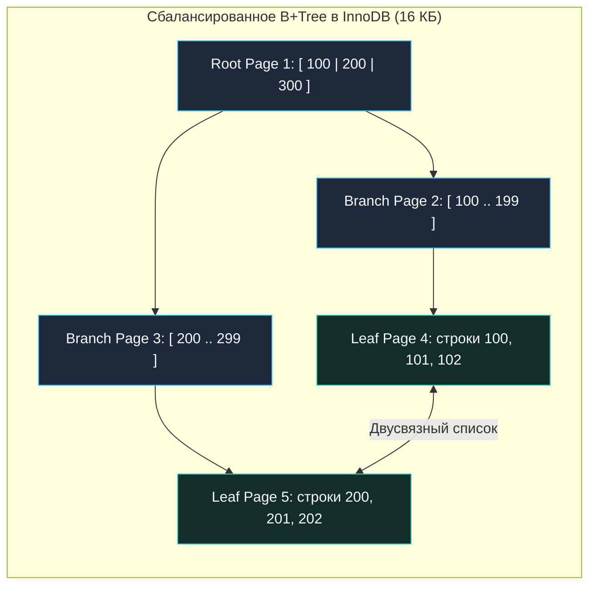

*Как устроен B+Tree индекс InnoDB на 16-килобайтных страницах, сколько стоит двойной проход Bookmark Lookup, зачем нужен Change Buffer, почему случайный UUIDv4 разрушает страницы и как работают префиксные и невидимые ключи.*

> «Go поощряет понимание устройства современных компьютеров — и прежде всего важности локальности данных в памяти.»  
> — Алан Донован и Брайан Керниган, *The Go Programming Language*

Команда `LedgerPulse` переводит `PRIMARY KEY` таблицы `ledger_entries` с автоинкрементного `BIGINT` на случайный `UUIDv4` в `CHAR(36)`, чтобы генерировать идентификаторы в сервисах Go. Через два месяца размер таблицы на диске вырастает почти вдвое, запись упирается в случайный I/O SSD, а попадания в `Buffer Pool` падают. Заодно индекс `(account_id, status, created_at)` не ускоряет отчёт с фильтром только по `status` и `created_at`.

Оба сбоя объясняются геометрией **B+Tree индекса** на 16-килобайтных страницах InnoDB (сравните с 8-КБ страницами в [[2. B-Tree индекс под капотом — страницы, ветвление и page split]]).

---

## Почему B+Tree: ветвление и 3 уровня на миллиард строк

В InnoDB индексы строятся как **B+Tree** (*сбалансированное B+ дерево*).

> [!info] Под капотом: B-Tree против B+Tree
> В классическом B-Tree полезные данные строки могут находиться в любом узле — корне, ветвях и листьях. В **B+Tree** роли разделены строго:
> 1. **Промежуточные узлы (`Branch pages`)** хранят *только* ключи маршрутизации и указатели на дочерние страницы.
> 2. **Листовые узлы (`Leaf pages`)** лежат на одном нижнем уровне и содержат сами записи.
> 3. **Двусвязный список листьев** сшивает соседние листовые страницы в непрерывную ленту.



Отсутствие тел строк во внутренних узлах даёт огромный **коэффициент ветвления (*Branching Factor*)**. На 16-КБ странице (16 384 байта) одна маршрутная запись занимает всего **8 байт** ключа `BIGINT` плюс **6 байт** указателя страницы — в один узел помещается **более 1 000 указателей**.

Дерево глубиной всего в 3 уровня адресует около **1 миллиарда записей** (`1000 * 1000 * 1000`). Корень и ветви постоянно лежат в `Buffer Pool` (~100 нс), поэтому точечный поиск требует лишь **одного чтения с NVMe SSD** (~100 мкс) — за целевым листом. Для интервалов `BETWEEN 100 AND 200` движок спускается к `100` один раз, а затем шагает вправо по двусвязному списку листьев последовательным чтением (`Sequential I/O`).

---

## Кластерный ключ, скрытый `ROW_ID` и Bookmark Lookup

Как разобрано в [[2. Движок InnoDB — кластерный индекс, Buffer Pool, Redo и Undo Log]], таблица InnoDB — это кластерное B+Tree по `PRIMARY KEY`, в листьях которого лежат все столбцы строки.

> [!warning] Ловушка: таблица без `PRIMARY KEY` и глобальный мьютекс `ROW_ID`
> Если в таблице нет ни `PRIMARY KEY`, ни `UNIQUE NOT NULL`, InnoDB создаёт скрытый 6-байтовый ключ **`ROW_ID`**. Его счётчик является **единым глобальным ресурсом на весь `mysqld` под общим глобальным мьютексом** для всех бесключевых таблиц. Конкурентная вставка из сотен горутин создаёт жёсткую конкуренцию за мьютекс (*Mutex Contention*). **Правило:** каждая таблица InnoDB обязана иметь явный `PRIMARY KEY`.

Любой непервичный индекс — **вторичный (`Secondary Index`)**. Его листья хранят только **индексируемое значение ключа и `PRIMARY KEY` строки**. Поэтому запрос:

```sql
SELECT amount_cents, currency FROM ledger_entries WHERE external_ref = 'pay_991042';
```

при обычном индексе `INDEX idx_external_ref (external_ref)` проходит **два дерева**:
1. Спуск по `idx_external_ref` до `'pay_991042'` — чтение первичного ключа `id = 420105`.
2. **`Bookmark Lookup`**: второй полный спуск по кластерному B+Tree за `id = 420105`, чтобы прочитать `amount_cents` и `currency`.


> [!tip] Собеседование [Middle]
> **Вопрос:** Как убрать `Bookmark Lookup` в запросе `SELECT amount_cents, currency FROM ledger_entries WHERE external_ref = ?`?
> **Ответ:** Использовать **покрывающий индекс (`Covering Index`)**: `INDEX (external_ref, amount_cents, currency)` (см. [[6. Покрывающие (Covering) индексы, INCLUDE и Index-Only Scan]]). Теперь все нужные поля лежат прямо в листьях вторичного индекса (**Index-Only Scan**, в `EXPLAIN` это `Extra: Using index`). Привычка писать `SELECT *` почти всегда ломает покрывающий индекс, возвращая `Bookmark Lookup`. (Если лист вторичного индекса меняла свежая незавершённая транзакция, InnoDB всё же проверит видимость строки через кластерный индекс и `Undo Log`.)

---

## Change Buffer: отложенная запись во вторичные индексы

При `INSERT` в таблицу с несколькими вторичными индексами кластерный `AUTO_INCREMENT` дописывается в правый край таблицы, а вот случайные ключи вторичных индексов разбросаны по всему дереву. Если нужной 16-КБ страницы вторичного индекса сейчас нет в `Buffer Pool`, поднимать её с SSD ради изменения пары десятков байт — дорогой Random I/O.

Для сглаживания записи служит **`Change Buffer`** (область внутри `Buffer Pool`, до 25% его объёма по умолчанию — `innodb_change_buffer_max_size`):
1. Если целевой страницы **неуникального** вторичного индекса нет в памяти, InnoDB не читает её с диска, а записывает дельту (`INSERT`/`UPDATE`/`DELETE`) в `Change Buffer` (с фиксацией в `Redo Log`).
2. Когда эту страницу позже прочитает пользовательский `SELECT` или фоновый процесс слияния, движок выполняет **Merge** отложенных изменений.

**Ограничение:** `Change Buffer` работает **только для неуникальных индексов**. Для `UNIQUE INDEX` (например, `idempotency_key`) InnoDB обязан немедленно проверить отсутствие дубликата на диске — поэтому лишние `UNIQUE`-индексы бьют по скорости вставки сильнее обычных. *(В MySQL 8.0.30+ параметр `innodb_change_buffering` по умолчанию переведён в `none` с учётом скорости NVMe и редких рисков блокировок при удалении, но механизм остаётся важным при тюнинге write-heavy систем с ограниченным `Buffer Pool`.)*

---

## Проблема UUIDv4 (`Page Splits`) и решение на Go 1.24

С автоинкрементным `BIGINT` строки ложатся строго в конец последней 16-КБ страницы (*Append-only*). Случайный **`UUIDv4`** в роли `PRIMARY KEY` ломает этот порядок:

1. Новый случайный ключ попадает в середину старой листовой страницы.
2. Страница читается с SSD в `Buffer Pool` (Random I/O).
3. Если на ней нет места, срабатывает **Page Split (раскол страницы)**.
4. InnoDB выделяет новую 16-КБ страницу, переносит половину строк из старой в новую, вставляет запись, обновляет родительские `Branch`-узлы и перешивает двусвязный список листьев.

Результат — **Write Amplification**, фрагментация (страницы заполнены на 50–60%, вдвое хуже эффективность `Buffer Pool`) и раздувание *всех* вторичных индексов, особенно при `CHAR(36)` вместо компактного `BIGINT` (8 байт) или `BINARY(16)` (16 байт).

Когда ID нужно генерировать в сервисах Go без центрального счётчика, используйте монотонные по времени **ULID** или **UUIDv7** (старшие 48 бит — миллисекунды UNIX epoch в big-endian) в столбце `BINARY(16)`:

```go
package idgen

import (
	"crypto/rand"
	"encoding/binary"
	"fmt"
	"time"
)

// NewUUIDv7Bytes генерирует 16-байтовый монотонный UUIDv7 (RFC 9562) для BINARY(16).
func NewUUIDv7Bytes(now time.Time) ([16]byte, error) {
	var u [16]byte
	if _, err := rand.Read(u[:]); err != nil {
		return u, fmt.Errorf("read random bytes: %w", err)
	}
	var ts [8]byte
	binary.BigEndian.PutUint64(ts[:], uint64(now.UnixMilli()))
	copy(u[0:6], ts[2:8])

	u[6] = (u[6] & 0x0f) | 0x70 // версия 7
	u[8] = (u[8] & 0x3f) | 0x80 // вариант RFC
	return u, nil
}
```

Ключи упорядочены по времени: вставка идёт в правый край B+Tree без массовых расколов страниц.

---

## Составные индексы, ICP, префиксные и невидимые ключи

В составном индексе `INDEX idx_acc_status_created (account_id, status, created_at)` строки отсортированы иерархически: сначала по `account_id`, затем по `status`, затем по `created_at` ([[5. Составные (Composite) индексы и правило левого префикса]]). Отсюда следует **правило левого префикса (`Left-Most Prefix Rule`)**: индекс работает строго слева направо без пропусков и останавливается для поиска после диапазонного оператора.

| Условие в `WHERE` | Индекс `(account_id, status, created_at)` | Объяснение |
| :--- | :---: | :--- |
| `WHERE account_id = 42` | **Да (полностью)** | Задействован левый префикс `account_id`. |
| `WHERE account_id = 42 AND status = 'posted'` | **Да (полностью)** | Непрерывный префикс `(account_id, status)`. |
| `WHERE account_id = 42 AND created_at >= '2026-01-01'` | **Частично** | Поиск по `account_id = 42`; `status` пропущен, `created_at` не отсортирован. |
| `WHERE status = 'posted' AND created_at >= '2026-01-01'` | **Нет (Full Scan)** | Отсутствует ведущая колонка `account_id`. |
| `WHERE account_id > 10 AND status = 'posted'` | **Частично** | После диапазона `>` индексный поиск по следующей колонке `status` невозможен. |

При частичном префиксе вроде `WHERE account_id = 42 AND created_at >= '2026-01-01'` начиная с MySQL 5.6 срабатывает **Index Condition Pushdown (ICP)**: `Server Layer` проталкивает условие по `created_at` в InnoDB, который отбрасывает лишние строки прямо в листах вторичного индекса до дорогого `Bookmark Lookup`. В живом `EXPLAIN` видны обе оптимизации:

```text
mysql> EXPLAIN SELECT id, created_at FROM ledger_entries
    -> WHERE account_id = 42 AND status = 'posted'\G
           type: ref
            key: idx_acc_status_created
        key_len: 10
          Extra: Using index

mysql> EXPLAIN SELECT id, amount_cents FROM ledger_entries
    -> WHERE account_id = 42 AND created_at >= '2026-01-01'\G
           type: ref
            key: idx_acc_status_created
        key_len: 8
          Extra: Using index condition
```

### Префиксные и невидимые индексы

* **Префиксные индексы (`INDEX idx_memo_24 (memo(24))`):** для длинных `VARCHAR`/`TEXT` индексируют только первые `N` символов, сохраняя высокий коэффициент ветвления. Длину подбирают по селективности `COUNT(DISTINCT LEFT(memo, N)) / COUNT(*)`. Ограничение: префиксный ключ **не работает** как покрывающий (`Using index`) и не ускоряет `ORDER BY memo`.
* **Невидимые индексы (`Invisible Indexes`, MySQL 8.0):** команда `ALTER TABLE ledger_entries ALTER INDEX idx_old INVISIBLE` прячет ключ от оптимизатора, но продолжает поддерживать его при записи. Это безопасный тест перед `DROP INDEX` на терабайтной таблице: если план просядет, индекс возвращается за миллисекунды через `VISIBLE`.

---

## Упражнения

### Упражнение 1 (Базовое)
Для `INDEX idx_acc_status_created (account_id, status, created_at)` (`PRIMARY KEY` — `id`) определите режим работы оптимизатора:
1. `SELECT id FROM ledger_entries WHERE account_id = 10 AND status = 'posted' ORDER BY created_at DESC LIMIT 20;`
2. `SELECT amount_cents FROM ledger_entries WHERE account_id = 10 AND created_at > '2026-03-01';`
3. `SELECT id FROM ledger_entries WHERE status = 'failed' AND created_at > '2026-03-01';`

> [!solution] Показать решение
> 1. **Покрывающий `Index-Only Scan` (`Using index`):** префикс `(account_id, status)` использован полностью, внутри него строки отсортированы по `created_at`, а `id` лежит в листе индекса.
> 2. **Частичный индекс с `ICP` (`Using index condition`):** спуск идёт по `account_id = 10`, предикат `created_at > ...` отсеивается внутри листа вторичного индекса до `Bookmark Lookup` за `amount_cents`.
> 3. **Полное сканирование:** нет ведущего столбца `account_id`, левый префикс нарушен.

### Упражнение 2 (Практическое)
Ускорьте выписку `SELECT id, amount_cents, created_at FROM ledger_entries WHERE account_id = ? AND status = 'posted' ORDER BY created_at DESC LIMIT 50;` (сейчас индекс `(account_id, created_at, status)` вызывает лишние чтения и `Bookmark Lookup`). Предложите оптимальный покрывающий индекс и напишите функцию Go 1.24 `FetchPostedStatement`.

> [!solution] Показать решение
> В `(account_id, created_at, status)` фильтрация `status` стоит после диапазона/сортировки `created_at`. Нужен индекс с равенствами в левом префиксе и `amount_cents` в хвосте:
> ```sql
> CREATE INDEX idx_acc_status_created_amt ON ledger_entries (account_id, status, created_at, amount_cents);
> ```
> Это даёт `Index-Only Scan` без `filesort` и без `Bookmark Lookup`.
>
> ```go
> func FetchPostedStatement(ctx context.Context, db *sql.DB, accountID int64) ([]LedgerEntry, error) {
> 	const q = `SELECT id, amount_cents, created_at FROM ledger_entries
> 		WHERE account_id = ? AND status = 'posted' ORDER BY created_at DESC LIMIT 50`
>
> 	rows, err := db.QueryContext(ctx, q, accountID)
> 	if err != nil {
> 		return nil, fmt.Errorf("fetch statement: %w", err)
> 	}
> 	defer func() { _ = rows.Close() }()
>
> 	out := make([]LedgerEntry, 0, 50)
> 	for rows.Next() {
> 		var e LedgerEntry
> 		e.AccountID = accountID
> 		if err := rows.Scan(&e.ID, &e.AmountCents, &e.CreatedAt); err != nil {
> 			return nil, fmt.Errorf("scan row: %w", err)
> 		}
> 		out = append(out, e)
> 	}
> 	return out, rows.Err()
> }
> ```

### Упражнение 3 (\*)
В `transactions` вставляют 40 000 строк/с. Есть `INDEX idx_merchant (merchant_id)` и `UNIQUE INDEX uq_idempotency (idempotency_key)` (случайный UUIDv4 в `BINARY(16)`). Сравните `PRIMARY KEY (id)` (`BIGINT AUTO_INCREMENT`) и `PRIMARY KEY (idempotency_key)` по трём критериям: `Page Splits`, работа `Change Buffer` и размер `idx_merchant`.

> [!solution] Показать решение
> 1. **`PRIMARY KEY (id BIGINT AUTO_INCREMENT)`:** append-only вставка без `Page Splits` (заполнение ~95%); `idx_merchant` буферизуется в `Change Buffer` (если страница не в памяти) и хранит компактный 8-байтный PK; случайный I/O на вставку вызывает только проверка уникальности в `uq_idempotency`.
> 2. **`PRIMARY KEY (idempotency_key)` со случайным UUIDv4:** массовые `Page Splits` кластерного дерева (заполнение падает до 50–60%, двойной расход `Buffer Pool`), а `idx_merchant` хранит 16-байтный PK вместо 8-байтного. Уникальность проверяется прямо в кластерном дереве, но цена фрагментации для HighLoad слишком высока — лучше оставить `BIGINT` или `UUIDv7` первичным ключом.

---

Мы разобрали физику поиска и записи в B+Tree InnoDB. В следующей главе перейдём к конкурентному доступу: как `REPEATABLE READ` в MySQL защищается от фантомов через `Gap Locks` и `Next-Key Locks` на ветвях индексов и как `Read View` читает старые версии из `Undo Log`.
