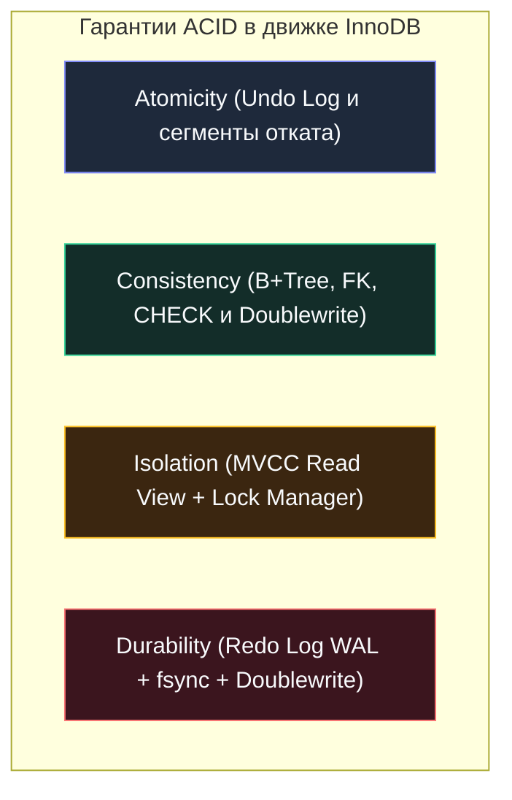
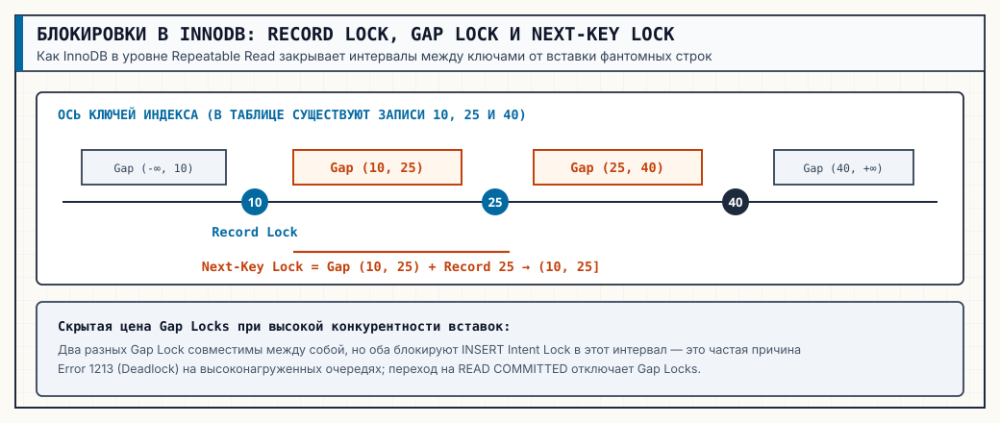

*Как InnoDB собирает ACID из Undo Log и Redo Log, зачем нужен Read View, почему REPEATABLE READ блокирует зазоры между ключами и как избегать дедлоков из Go.*

> «Хотя поддержка конкурентности — одна из главных сильных сторон Go, рассуждать о конкурентных программах по природе труднее, чем о последовательных, и интуиция, выработанная на последовательном коде, порой подводит.»  
> — Алан Донован и Брайан Керниган, *The Go Programming Language*

Бэкенд `LedgerPulse` держит пул из десятков открытых TCP-соединений к MySQL. Сотни горутин одновременно списывают средства со счетов `accounts`, добавляют проводки в `ledger_entries` и меняют статусы в `transactions`. Без строгих правил этот поток мгновенно породит отрицательные балансы, потерянные обновления и фантомные строки.

**Транзакция** переводит базу из одного согласованного состояния в другое: цепочка операций либо фиксируется целиком, либо откатывается без следа. Теорию изоляции мы разобрали в Модуле 5 ([[3. Read Committed, Repeatable Read и Serializable]]) — теперь посмотрим, какими физическими структурами InnoDB обеспечивает эти гарантии и где его поведение по умолчанию бьёт по высоконагруженному продакшену.

---

## ACID в InnoDB: из чего собраны четыре гарантии

Каждой букве **ACID** в движке InnoDB соответствует конкретный механизм в памяти и на диске.



1. **Atomicity (Атомарность):** принцип «всё или ничего». Перед изменением 16-КБ страницы в `Buffer Pool` InnoDB сохраняет обратную дельту в **Undo Log** (сегмент отката). При ошибке или `ROLLBACK` цепочка отката возвращает строки в исходное состояние.
2. **Consistency (Согласованность):** валидность первичных и уникальных ключей, `FOREIGN KEY`, `CHECK`-ограничений и целостность указателей B+Tree. Нарушение уникальности `idempotency_key` прерывает всю транзакцию.
3. **Isolation (Изоляция):** скрывает незавершённую работу параллельных транзакций через неблокирующее чтение **MVCC** и менеджер блокировок **Lock Manager**.
4. **Durability (Долговечность):** после ответа `COMMIT` изменения переживают отключение питания и краш `mysqld` благодаря последовательному **Redo Log** (WAL), вызовам `fsync()` и **Doublewrite Buffer** ([[2. Движок InnoDB — кластерный индекс, Buffer Pool, Redo и Undo Log]]).

Цена этих гарантий упирается в физику накопителей: обращение к `Buffer Pool` в RAM занимает ~100 нс, последовательный `fsync()` журнала `Redo Log` на NVMe — ~100 мкс, а случайный поиск на HDD — ~10 мс.

---

## MVCC через Undo Log и Read View

В отличие от PostgreSQL, который дописывает новую версию кортежа в кучу Heap (`xmin`/`xmax`, см. [[3. MVCC в PostgreSQL — xmin, xmax, ctid, HOT и переполнение XID]]), InnoDB обновляет строку **на месте** (*in-place*) в листе кластерного B+Tree, а старые версии убирает в **Undo Log** ([[7. MVCC — многоверсионный контроль конкурентности]]).

Каждая строка кластерного индекса хранит скрытые поля:
* `DB_TRX_ID` (6 байт) — ID последней изменившей её транзакции;
* `DB_ROLL_PTR` (7 байт) — указатель на предыдущую версию строки в `Undo Log`;
* `DB_ROW_ID` (6 байт) — скрытый ID при отсутствии явного `PRIMARY KEY`.

Для определения видимости строк InnoDB создаёт снимок **Read View**:
* `m_ids` — список активных (незакоммиченных) транзакций на момент снимка;
* `min_trx_id` и `max_trx_id` — нижняя и верхняя границы видимости;
* `creator_trx_id` — ID транзакции, создавшей снимок.

Если `DB_TRX_ID` строки меньше `min_trx_id` или равен `creator_trx_id`, строка видна сразу. Если `DB_TRX_ID >= max_trx_id` или входит в `m_ids`, движок идёт по цепочке `DB_ROLL_PTR` в `Undo Log`, пока не восстановит видимую версию. Частота создания `Read View` определяет уровень изоляции ANSI SQL-92:

1. **Read Uncommitted (RU):** `Read View` не используется, `SELECT` читает незакоммиченные байты прямо со страницы. Возникает **Dirty Read**: транзакция A увеличивает баланс в `accounts` на 1 000 000 копеек, транзакция B читает эту сумму и одобряет перевод, после чего транзакция A делает `ROLLBACK`. Практически не применяется.
2. **Read Committed (RC):** новый `Read View` строится перед **каждым `SELECT`**. Грязное чтение невозможно, но появляется **Non-repeatable Read**: первый `SELECT balance` вернул `10000`, параллельная транзакция списала `5000` и закоммитилась, а второй `SELECT` вернёт `5000`. Уровень по умолчанию в PostgreSQL, Oracle и MS SQL Server.
3. **Repeatable Read (RR) — по умолчанию в MySQL:** `Read View` создаётся **один раз** при первом согласованном `SELECT` и держится до `COMMIT` или `ROLLBACK`. Повторные чтения восстанавливают один и тот же снимок через `Undo Log`.
4. **Serializable:** при `autocommit = 0` InnoDB неявно превращает все `SELECT` в `SELECT ... FOR SHARE`, вешая разделяемые блокировки на строки и диапазоны и вызывая лавину таймаутов под нагрузкой.

> [!tip] Собеседование [Middle]
> **Вопрос:** Стандарт ANSI SQL-92 допускает на уровне `REPEATABLE READ` *Phantom Read* (повторный `SELECT ... WHERE amount > 10000` видит новую строку, закоммиченную параллельной транзакцией). Происходит ли это в MySQL InnoDB?
>
> **Ответ:** В штатном сценарии **нет**. Для неблокирующих чтений (`Consistent Nonlocking Reads`) старый `Read View` отсекает новые строки с большим `DB_TRX_ID`. Для блокирующих запросов (`SELECT ... FOR UPDATE`, `SELECT ... FOR SHARE`, `UPDATE`, `DELETE`) InnoDB ставит **Next-Key Locks**, запрещая вставку в сканируемый диапазон.
>
> *Тонкость уровня Senior:* если в одной RR-транзакции смешать снимочный `SELECT` (Snapshot Read) и изменяющий `UPDATE` (Current Read), то `UPDATE` обновит строку, вставленную параллельной транзакцией, и запишет в неё ваш `DB_TRX_ID` — после чего следующий `SELECT` внезапно увидит её в выдаче.

---

## Менеджер блокировок: Record, Gap и Next-Key Locks



Для модификации данных и явного захвата строк InnoDB использует табличные и индексные блокировки:
* **Shared (`S`)** и **Exclusive (`X`)** — строчные блокировки чтения (`FOR SHARE`) и записи (`FOR UPDATE`, `UPDATE`, `DELETE`).
* **Intention Locks (`IS` / `IX`)** — флаги намерения на уровне таблицы. Перед захватом строки транзакция ставит `IS` или `IX` на таблицу, чтобы команды уровня `LOCK TABLES accounts WRITE` за O(1) проверяли совместимость, не обходя миллионы строк.

При блокирующем поиске по B+Tree вроде `SELECT id, balance FROM accounts WHERE id BETWEEN 10 AND 20 FOR UPDATE` одной блокировки найденных строк мало: параллельная транзакция вставит `id = 12` и создаст фантом. Поэтому в `REPEATABLE READ` работают три индексные блокировки:

1. **Record Lock** — блокировка существующей записи в листе B+Tree.
2. **Gap Lock** — блокировка пустого интервала между ключами, перед первым ключом или после последнего (до виртуальной границы `supremum`). Две транзакции **могут одновременно держать совместимые `Gap Locks` на один интервал** — этот замок мешает лишь чужой вставке (`Insert Intention Lock`).
3. **Next-Key Lock** — сумма `Record Lock` и `Gap Lock` строго перед записью: полуинтервал `(prev_key, key]`.


> [!warning] Ловушка: Deadlocks из-за Gap Locks
> Рассмотрим проверку идемпотентности в `LedgerPulse` на уровне `REPEATABLE READ`:
> 1. Горутина 1 делает `SELECT id FROM transactions WHERE idempotency_key = 'pay-101' FOR UPDATE`. Строки нет — вешается `Gap Lock` на интервал до следующего ключа.
> 2. Горутина 2 параллельно проверяет отсутствующий `'pay-102'` из того же промежутка и получает **совместимый** `Gap Lock` на тот же интервал.
> 3. Горутина 1 запускает `INSERT ... VALUES ('pay-101', ...)`, запрашивает `Insert Intention Lock` и засыпает, ожидая `Gap Lock` горутины 2.
> 4. Горутина 2 пытается вставить `'pay-102'` и засыпает на `Gap Lock` горутины 1.
>
> При `innodb_deadlock_detect = ON` детектор строит граф ожидания (*Wait-For Graph*, см. [[6. Взаимоблокировки (Deadlock) — граф ожиданий и предотвращение]]), откатывает транзакцию с меньшим объёмом изменений в `Undo Log` и возвращает ошибку `Error 1213 (40001): Deadlock found when trying to get lock; try restarting transaction`.
>
> **Решение Senior-уровня:** команды уровня GitHub, Uber, Shopify и Booking.com переводят MySQL на `READ-COMMITTED` (`SET GLOBAL transaction_isolation = 'READ-COMMITTED'`). В этом режиме `Gap Locks` отключаются для поиска и сканирования (оставаясь лишь для проверок внешних ключей и дубликатов), а защита от гонок переносится на оптимистичную блокировку с колонкой `version` или вставку `ON DUPLICATE KEY UPDATE`.

Проверить активные блокировки и причину последнего дедлока можно напрямую в SQL:

```sql
SELECT engine_transaction_id, index_name, lock_mode, lock_status, lock_data
FROM performance_schema.data_locks
WHERE object_schema = 'ledgerpulse';

SHOW ENGINE INNODB STATUS\G
```

Типичная картина в `data_locks` до срабатывания детектора:

```text
+-----------------------+--------------+------------------------+-------------+---------------+
| engine_transaction_id | index_name   | lock_mode              | lock_status | lock_data     |
+-----------------------+--------------+------------------------+-------------+---------------+
| 48192                 | idx_idem_key | X,GAP                  | GRANTED     | 'pay-200', 18 |
| 48193                 | idx_idem_key | X,GAP                  | GRANTED     | 'pay-200', 18 |
| 48192                 | idx_idem_key | X,GAP,INSERT_INTENTION | WAITING     | 'pay-200', 18 |
+-----------------------+--------------+------------------------+-------------+---------------+
```

Обе транзакции держат `X,GAP` со статусом `GRANTED`, а попытка `INSERT` (`INSERT_INTENTION`) упирается в чужой `Gap Lock`.

---

## Идиоматичный Go 1.24: транзакции в `database/sql`

Вызов `db.BeginTx(ctx, opts)` извлекает из пула один физический TCP-сокет и закрепляет его за `*sql.Tx` — на стороне `mysqld` этому сокету соответствует выделенный поток ОС ([[1. Архитектура MySQL — поток на соединение и подключаемые движки]]). При отличии `TxOptions` от настроек сервера драйвер `go-sql-driver/mysql` сначала посылает `SET TRANSACTION ISOLATION LEVEL ...;`, затем `START TRANSACTION`. Потеря вызова `Commit()` или `Rollback()` при раннем `return err` утекает сокет из пула и оставляет висеть строчные блокировки.

```go
package repository

import (
	"context"
	"database/sql"
	"errors"
	"fmt"
)

var ErrInsufficientFunds = errors.New("insufficient funds")

// TransferFunds атомарно переводит сумму amountMinor (в копейках) между счетами.
func TransferFunds(ctx context.Context, db *sql.DB, fromID, toID, amountMinor int64) error {
	if amountMinor <= 0 {
		return errors.New("amount must be positive")
	}

	tx, err := db.BeginTx(ctx, &sql.TxOptions{Isolation: sql.LevelReadCommitted})
	if err != nil {
		return fmt.Errorf("begin tx: %w", err)
	}
	// После успешного Commit() повторный Rollback() вернёт sql.ErrTxDone и безопасно проигнорируется.
	defer func() {
		_ = tx.Rollback()
	}()

	res, err := tx.ExecContext(
		ctx,
		"UPDATE accounts SET balance_minor = balance_minor - ? WHERE id = ? AND balance_minor >= ?",
		amountMinor, fromID, amountMinor,
	)
	if err != nil {
		return fmt.Errorf("debit account %d: %w", fromID, err)
	}
	affected, err := res.RowsAffected()
	if err != nil {
		return fmt.Errorf("debit rows affected: %w", err)
	}
	if affected == 0 {
		return ErrInsufficientFunds
	}

	if _, err := tx.ExecContext(
		ctx,
		"UPDATE accounts SET balance_minor = balance_minor + ? WHERE id = ?",
		amountMinor, toID,
	); err != nil {
		return fmt.Errorf("credit account %d: %w", toID, err)
	}

	if err := tx.Commit(); err != nil {
		return fmt.Errorf("commit transfer: %w", err)
	}
	return nil
}
```

> [!info] Порядок блокировки встречных переводов
> Если две горутины одновременно переводят `A -> B` и `B -> A`, встречные строчные `X`-блокировки вызовут дедлок даже в `READ COMMITTED`. Всегда захватывайте счета в детерминированном порядке по возрастанию `id` (`min(fromID, toID)`, затем `max(fromID, toID)`).

---

## Практикум: задачи для закрепления

### Упражнение 1 (Базовое)
В таблице `accounts` есть ключи `id`: `10`, `20`, `35`, `50`. На уровне `REPEATABLE READ` выполняется `SELECT * FROM accounts WHERE id = 25 FOR UPDATE;`. Какой интервал заблокирует InnoDB, пройдёт ли параллельный `INSERT` с `id = 28` и пройдёт ли `UPDATE` строки `id = 35`?

> [!solution] Показать решение
> Строки `25` нет, поэтому InnoDB повесит `Gap Lock` (`X,GAP`) на открытый интервал `(20, 35)`.
> * `INSERT` с `id = 28` **заблокируется**, так как ключ попадает в зазор `(20, 35)`.
> * `UPDATE` для `id = 35` **пройдёт свободно**, потому что сама запись `35` не захвачена `Record Lock`.

### Упражнение 2 (Практическое)
Функция создания платежа в `LedgerPulse` делает `SELECT ... FOR UPDATE` по уникальному `idempotency_key` перед `INSERT` и ловит `Error 1213` под нагрузкой. Перепишите её на Go 1.24 так, чтобы убрать `SELECT ... FOR UPDATE`, использовать `LevelReadCommitted` и вернуть `created = false` при дубликате ключа.

> [!solution] Показать решение
> ```go
> package repository
>
> import (
> 	"context"
> 	"database/sql"
> 	"fmt"
> )
>
> func CreatePaymentIdempotent(
> 	ctx context.Context,
> 	db *sql.DB,
> 	accountID, amountMinor int64,
> 	idemKey string,
> ) (bool, error) {
> 	tx, err := db.BeginTx(ctx, &sql.TxOptions{Isolation: sql.LevelReadCommitted})
> 	if err != nil {
> 		return false, fmt.Errorf("begin tx: %w", err)
> 	}
> 	defer func() {
> 		_ = tx.Rollback()
> 	}()
>
> 	res, err := tx.ExecContext(
> 		ctx,
> 		"INSERT IGNORE INTO transactions (account_id, amount_minor, idempotency_key, status) VALUES (?, ?, ?, 'pending')",
> 		accountID, amountMinor, idemKey,
> 	)
> 	if err != nil {
> 		return false, fmt.Errorf("insert payment: %w", err)
> 	}
> 	affected, err := res.RowsAffected()
> 	if err != nil {
> 		return false, fmt.Errorf("rows affected: %w", err)
> 	}
> 	if err := tx.Commit(); err != nil {
> 		return false, fmt.Errorf("commit tx: %w", err)
> 	}
> 	return affected > 0, nil
> }
> ```
>
> В продакшене вместо `INSERT IGNORE` (который также подавляет ошибки вроде `NULL` в `NOT NULL` колонке) точнее ловить `mysql.MySQLError` с кодом `1062`.

### Упражнение 3 (Со звёздочкой \*)
В `LedgerPulse` ночной отчёт открывает транзакцию `REPEATABLE READ` на 6 часов, пока 200 горутин непрерывно обновляют `ledger_entries`. Что раздуется на диске в MySQL InnoDB (в отличие от Table Bloat в PostgreSQL) и пострадает ли чтение свежих записей по `PRIMARY KEY`?

> [!solution] Показать решение
> 1. Сама таблица `ledger_entries` не раздуется, потому что InnoDB обновляет строки *in-place* в 16-КБ страницах B+Tree.
> 2. Раздуется `Undo Tablespace` (`History list length` в `SHOW ENGINE INNODB STATUS`): поток `purge` не имеет права удалять Undo-записи, созданные после старта шестичасового отчёта, пока открыт его `Read View`.
> 3. Короткие транзакции, читающие свежие версии по `PRIMARY KEY`, почти не замедлятся (актуальная строка лежит прямо в листе B+Tree), но запросы, требующие старых снимков, будут тратить CPU и I/O на проход по длинным цепочкам `DB_ROLL_PTR` в `Undo Log`.

---

## Итоги и шаг вперёд

1. **ACID в InnoDB:** `Undo Log` обеспечивает атомарность и цепочки версий MVCC, а `Redo Log` с `fsync()` и `Doublewrite Buffer` — долговечность.
2. **Read View:** пересоздаётся на каждый `SELECT` в `READ COMMITTED` и один раз на всю транзакцию в `REPEATABLE READ`.
3. **Next-Key Locks (`Record + Gap`):** закрывают фантомы в `REPEATABLE READ`, но провоцируют дедлоки `Error 1213` на пустых интервалах — под высокой OLTP-нагрузкой надёжнее `READ COMMITTED`.
4. **Go `database/sql`:** `*sql.Tx` держит выделенный сокет и поток `mysqld`, поэтому `defer tx.Rollback()` обязателен.

Мы разобрали транзакции на одном узле, но одиночный сервер остаётся единой точкой отказа. Как MySQL связывает `Redo Log` и `Binlog` двухфазным коммитом и строит отказоустойчивую репликацию — в следующей главе: [[5. Репликация в MySQL — Binlog, GTID и Group Replication]].
