*Как MySQL согласует Redo Log и Binlog через двухфазный коммит, зачем нужен GTID, как MTS и Group Replication побеждают отставание и сплит-брейн и как маршрутизировать запросы из Go.*

> «Мы пишем, а позже читаем. Сохраняем, а позже извлекаем. Храним, а позже обращаемся к сохранённому. Назначение памяти — уберечь информацию без искажений между двумя этими событиями. Стоит отключить питание — и энергозависимая память забывает всё, что когда-либо знала.»  
> — Чарльз Петцольд, *Code: The Hidden Language of Computer Hardware and Software*

Одиночный сервер MySQL даже с терабайтом RAM в `Buffer Pool` и быстрыми NVMe упирается в пределы CPU, шины памяти и дисковых IOPS, оставаясь единой точкой отказа (**SPOF**). **Репликация** непрерывно копирует поток изменений с основного узла (**Source / Master**) на подчинённые серверы (**Replica**), решая три задачи: масштабирование чтений (*Read Scaling*), переключение при аварии (*Failover*) и снятие резервных копий.

---

## Binlog и двухфазный коммит с Redo Log

Прежде чем данные уйдут по сети (где RTT между дата-центрами составляет 0,5–2 мс против ~100 мкс у `fsync()` на локальном NVMe), сервер фиксирует их на диске.

> [!tip] Собеседование [Middle]
> **Вопрос:** Зачем в MySQL два журнала — `Redo Log` и `Binlog` — вместо репликации напрямую по `Redo Log`, как в PostgreSQL?
>
> **Ответ:** Это следствие слоистой архитектуры MySQL ([[1. Архитектура MySQL — поток на соединение и подключаемые движки]]):
> * **Redo Log** принадлежит движку `InnoDB`. Он хранит физические дельты 16-КБ страниц для локального **Crash Recovery**; другие движки (`Memory`, `MyISAM`) его не ведут.
> * **Binlog (Binary Log)** принадлежит серверному слою (`SQL Layer`). Это логический журнал, независимый от движка: он описывает SQL-команды или образы строк и служит для репликации и **Point-in-Time Recovery (PITR)**.

Два независимых журнала создают риск расхождения при падении. Если запись попала в `Redo Log`, но сервер упал до сброса `Binlog`, реплики потеряют транзакцию; если в `Binlog` попала раньше коммита в InnoDB, реплики применят несуществующую на мастере операцию.

Чтобы связать журналы атомарно, MySQL выполняет **внутренний двухфазный коммит (Internal 2PC / XA)**:
1. **Prepare в InnoDB:** запись в `Redo Log` со статусом `PREPARE` и сброс на диск.
2. **Запись в `Binlog`:** запись события и вызов `fsync()` (при `sync_binlog = 1`).
3. **Commit в InnoDB:** пометка `COMMIT` в `Redo Log` (`innodb_flush_log_at_trx_commit = 1`).

При старте после сбоя InnoDB сканирует хвост `Binlog`: если XID подготовленной транзакции там есть, транзакция доводится до `COMMIT`, иначе откатывается через `Undo Log`. Связка `innodb_flush_log_at_trx_commit = 1` и `sync_binlog = 1` («двойная единица») исключает потерю подтверждённых данных. Понижение до `0` или `2` ускоряет запись, но при падении ОС теряется до секунды последних транзакций.

### Форматы Binlog: SBR, RBR и Mixed

При включённом `log_bin` изменения фиксируются в одном из трёх форматов:
1. **Statement-Based Replication (SBR):** записывается текст SQL-запроса. Лог компактен, но недетерминированные функции (`NOW()`, `UUID()`, `RAND()`, `LIMIT` без `ORDER BY`) вызывают тихое расхождение данных на репликах.
2. **Row-Based Replication (RBR):** записываются физические образы изменённых строк (*Before-Image* и *After-Image*). Расхождение исключено, но массовые `UPDATE` создают **Write Amplification**.
3. **Mixed:** используется `STATEMENT`, но при недетерминированных конструкциях, триггерах или временных таблицах происходит переключение на `ROW`.

Начиная с MySQL 5.7.7 стандартом по умолчанию стал **Row-Based (`binlog_format = ROW`)** вместе с `binlog_row_image = minimal`, который оставляет в *Before-Image* только PK, а в *After-Image* — лишь изменённые колонки.

---

## Три потока репликации и борьба с лагом (MTS)

Классическая репликация работает по схеме *Publish/Subscribe* через три потока ОС:


1. **Binlog Dump Thread (Master):** выделенный поток для реплики. Читает `Binlog` или ждёт новых событий на условной переменной.
2. **IO Thread (Replica):** принимает пакеты по TCP и последовательно дописывает их в локальный **Relay Log** (*Sequential Append*).
3. **SQL Thread / Applier (Replica):** читает `Relay Log` и применяет изменения в локальном InnoDB.

> [!warning] Ловушка: Одиночный SQL Thread и рост Replication Lag
> На мастере с 64 ядрами горутины `LedgerPulse` параллельно обновляют разные счета `accounts`, но одинокий `SQL Thread` на реплике применяет события строго последовательно. Отставание `Seconds_Behind_Source` уходит в минуты, чтения отдают устаревшие данные, а падение мастера грозит потерей неприменённых транзакций.

Чтобы задействовать все ядра реплики без нарушения порядка зависимых операций, в MySQL 5.7+ и 8.0 работает **Multi-Threaded Applier (MTS)** (`replica_parallel_workers > 0`). Одиночный `SQL Thread` становится Координатором и опирается на **Group Commit** и **Logical Clock**:
* транзакции, вошедшие в одну группу коммита на мастере без конфликта блокировок, гарантированно независимы;
* в заголовок `Binlog` пишутся счётчики `sequence_number` и `last_committed` (в MySQL 8.0 дополнительно сжимаемые по хэшам строк через `binlog_transaction_dependency_tracking = WRITESET`);
* Координатор отдаёт транзакции с одинаковым `last_committed` свободным воркерам параллельно.

---

## Режимы синхронизации: Async, Semi-Sync и Group Replication

```mermaid
sequenceDiagram
    autonumber
    participant App as Go-сервис LedgerPulse
    participant Master as Master Node
    participant Replica as Replica Node

    rect rgb(30, 41, 59)
    note right of App: Асинхронная репликация (Async)
    App->>Master: COMMIT
    Master->>Master: Redo + Binlog fsync
    Master-->>App: OK
    Master-)Replica: Отправка Binlog в фоне
    end

    rect rgb(15, 23, 42)
    note right of App: Полусинхронная репликация (AFTER_SYNC)
    App->>Master: COMMIT
    Master->>Master: Redo Prepare + Binlog fsync
    Master->>Replica: Отправка пакета Binlog
    Replica->>Replica: Запись в Relay Log (fsync)
    Replica-->>Master: ACK
    Master->>Master: Commit в InnoDB
    Master-->>App: OK
    end
```



1. **Asynchronous (по умолчанию):** мастер возвращает `OK` сразу после локального 2PC и пересылает `Binlog` в фоне. Задержка минимальна, но при смерти мастера до отправки пакетов по сети данные теряются.
2. **Semi-Synchronous (`AFTER_SYNC`):** мастер ждёт `ACK` хотя бы от одной реплики после `fsync()` её `Relay Log`. Гарантируется `RPO = 0`, а задержка коммита растёт на один сетевой RTT и `fsync()` реплики. Современный режим `AFTER_SYNC` (в отличие от устаревшего `AFTER_COMMIT`) открывает видимость строк в InnoDB только **после** получения `ACK`, исключая фантомные коммиты при аварии мастера. Если все реплики замолчали дольше `rpl_semi_sync_source_timeout`, мастер деградирует в асинхронный режим.
3. **Group Replication (консенсус Paxos / XCom):** встраивает слой распределённого консенсуса **XCom** прямо в `mysqld` (минимум 3 узла для кворума `⌊N/2⌋ + 1`; обязательны `InnoDB`, `ROW`, `GTID` и `PRIMARY KEY` в каждой таблице).
   * **Single-Primary (по умолчанию):** пишет один лидер; при его отказе большинство автоматически выбирает нового, полностью исключая **split-brain**.
   * **Multi-Primary:** пишут все узлы, а при `COMMIT` рассылается *write-set* на распределённую **сертификацию** — конфликтующие транзакции на одну строку откатываются при коммите.
   * **Flow Control:** замедляет запись на мастере, если отстающая реплика не успевает применять очередь.

---

## GTID: глобальные идентификаторы транзакций

Вместо хрупких файловых смещений (`MASTER_LOG_FILE='mysql-bin.000142', MASTER_LOG_POS=48201`) современный MySQL присваивает каждой транзакции **GTID**:

```text
3E11FA47-71CA-11E1-9E33-C80AA9429562:23
```

Это пара `server_uuid:sequence_id`. Переключение реплики на нового мастера сводится к автопозиционированию:

```sql
CHANGE REPLICATION SOURCE TO
    SOURCE_HOST = 'mysql-source-2.internal',
    SOURCE_USER = 'repl',
    SOURCE_PASSWORD = '...',
    SOURCE_AUTO_POSITION = 1;
START REPLICA;

SHOW REPLICA STATUS\G
```

Ключевые метрики в выводе `SHOW REPLICA STATUS`:

```text
             Replica_IO_Running: Yes
            Replica_SQL_Running: Yes
          Seconds_Behind_Source: 0
             Retrieved_Gtid_Set: 3e11fa47-71ca-11e1-9e33-c80aa9429562:1-18420
              Executed_Gtid_Set: 3e11fa47-71ca-11e1-9e33-c80aa9429562:1-18420
```

---

## Инженерия на Go 1.24: Read/Write Split и Read-After-Write

При разделении потоков (`Master` на запись, `Replicas` на чтение) асинхронная задержка даже в 30 мс порождает аномалию **Read-After-Write**: пользователь `LedgerPulse` обновляет настройки счёта (`POST` -> `200 OK`), редиректится на `GET`, попадает на отстающую реплику и видит старые данные.

Для решения используют паттерн **Sticky Master** (в течение `stickyDuration` после записи читать с `Master`) или явное ожидание GTID на реплике (`WAIT_FOR_EXECUTED_GTID_SET`).

```go
package database

import (
	"context"
	"database/sql"
	"sync/atomic"
	"time"
)

// DBCluster маршрутизирует запросы между Master и пулом Read-реплик.
type DBCluster struct {
	Master   *sql.DB
	Replicas []*sql.DB
	counter  atomic.Uint64
}

func NewDBCluster(master *sql.DB, replicas []*sql.DB) *DBCluster {
	return &DBCluster{Master: master, Replicas: replicas}
}

func (c *DBCluster) WriteDB() *sql.DB { return c.Master }

func (c *DBCluster) ReadDB() *sql.DB {
	if len(c.Replicas) == 0 {
		return c.Master
	}
	idx := (c.counter.Add(1) - 1) % uint64(len(c.Replicas))
	return c.Replicas[idx]
}

// QueryWithAffinity направляет чтения пользователя на Master в течение stickyDuration после записи.
func (c *DBCluster) QueryWithAffinity(
	ctx context.Context,
	lastWriteAt time.Time,
	stickyDuration time.Duration,
	query string,
	args ...any,
) (*sql.Rows, error) {
	db := c.ReadDB()
	if !lastWriteAt.IsZero() && time.Since(lastWriteAt) < stickyDuration {
		db = c.WriteDB()
	}
	return db.QueryContext(ctx, query, args...)
}
```

---

## Практикум: задачи для закрепления

### Упражнение 1 (Базовое)
В `SHOW REPLICA STATUS` указано `Replica_IO_Running: Yes`, `Replica_SQL_Running: Yes`, `Seconds_Behind_Source: 420`, причём `Retrieved_Gtid_Set` заметно впереди `Executed_Gtid_Set`. Какой этап отстаёт и какие два параметра на реплике нужно проверить?

> [!solution] Показать решение
> Сеть и `IO Thread` справляются — события уже в `Relay Log`. Отстаёт локальное применение к InnoDB (`SQL Thread`). Проверьте:
> 1. `replica_parallel_workers` — если `0` или `1`, включите пул воркеров (`8`–`16`).
> 2. `replica_parallel_type` — должно быть `LOGICAL_CLOCK` (устаревшее `DATABASE` не распараллеливает таблицы внутри одной схемы `ledgerpulse`). Также проверьте наличие `PRIMARY KEY` во всех таблицах, иначе `ROW`-события сканируют таблицу целиком.

### Упражнение 2 (Практическое)
Добавьте к `DBCluster` метод `QueryConsistent(ctx context.Context, gtid, query string, args ...any) (*sql.Rows, error)`, который на одном соединении реплики вызывает `SELECT WAIT_FOR_EXECUTED_GTID_SET(?, 1)` и при таймауте (`!= 0`) или ошибке переключается на `Master`.

> [!solution] Показать решение
> ```go
> package database
>
> import (
> 	"context"
> 	"database/sql"
> )
>
> func (c *DBCluster) QueryConsistent(
> 	ctx context.Context,
> 	gtid, query string,
> 	args ...any,
> ) (*sql.Rows, error) {
> 	db := c.ReadDB()
> 	if gtid != "" && db != c.Master {
> 		if conn, err := db.Conn(ctx); err == nil {
> 			var res int
> 			err = conn.QueryRowContext(ctx, "SELECT WAIT_FOR_EXECUTED_GTID_SET(?, 1)", gtid).Scan(&res)
> 			if err == nil && res == 0 {
> 				rows, qErr := conn.QueryContext(ctx, query, args...)
> 				_ = conn.Close()
> 				return rows, qErr
> 			}
> 			_ = conn.Close()
> 		}
> 		db = c.Master
> 	}
> 	return db.QueryContext(ctx, query, args...)
> }
> ```
>
> Важно выполнять ожидание и `SELECT` на одном соединении `db.Conn(ctx)`; в продакшене также стоит вычитывать `rows` до `conn.Close()`, чтобы закрытие обёртки не прервало чтение.

### Упражнение 3 (Со звёздочкой \*)
В 3-узловом кластере MySQL Group Replication в режиме `Multi-Primary` предложили отправлять запись платежей на все 3 узла, чтобы утроить TPS обновления горячих счетов `accounts`. Почему пропускная способность может упасть и с какой ошибкой столкнётся Go-сервис при `tx.Commit()`?

> [!solution] Показать решение
> 1. **Репликация не шардирует запись:** каждый из 3 узлов всё равно применяет все транзакции кластера через свой апплаер.
> 2. **Конфликты сертификации:** одновременное обновление одного горячего счёта на разных узлах проходит локально, но на этапе XCom-сертификации конфликтующая транзакция откатывается при `tx.Commit()` (`ERROR 3101: Plugin instructed the server to rollback the current transaction`).
> 3. **Ретраи и Flow Control** съедают пропускную способность, поэтому `Single-Primary` для OLTP с горячими строками почти всегда быстрее, а запись масштабируют шардированием (подробнее о Vitess — в главе 9 этого модуля).

---

## Итоги и шаг вперёд

1. **Internal 2PC** согласует `Redo Log` (InnoDB) и `Binlog` (Server Layer); для надёжности продакшена обязательны `binlog_format = ROW`, `sync_binlog = 1` и `innodb_flush_log_at_trx_commit = 1`.
2. **MTS (`LOGICAL_CLOCK` + `WRITESET`)** снимает бутылочное горлышко одиночного `SQL Thread`.
3. **Semi-Sync (`AFTER_SYNC`)** обеспечивает `RPO = 0`, **GTID** упрощает переключение реплик, а **Group Replication** даёт встроенный Paxos-консенсус без сплит-брейна.
4. На стороне Go аномалию **Read-After-Write** закрывают через Sticky Master или ожидание GTID.

Имея полную картину обоих движков, в следующей главе сопоставим их напрямую без догм — [[6. PostgreSQL против MySQL — честное архитектурное сравнение]].
