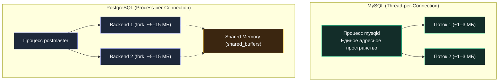
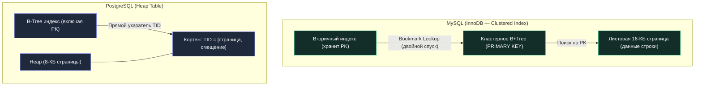
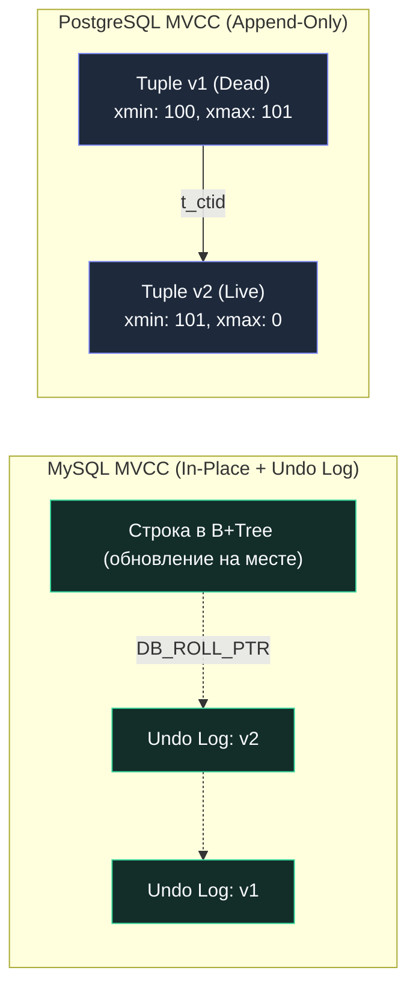

*Прямое сопоставление MySQL (InnoDB) и PostgreSQL по модели процессов, раскладке страниц на диске, MVCC, блокировкам, типам данных и драйверам для Go.*

> «Решения, определившие развитие этой технологии и путь, по которому мы пошли, принимали живые люди — под давлением и в жёстких ограничениях своего времени. Чем лучше мы знаем историю, тем глубже ценим изобретательность создателей Unix и тем яснее понимаем, почему современные компьютерные системы устроены именно так.»  
> — Брайан Керниган, *UNIX: A History and a Memoir*

Дискуссия «MySQL против PostgreSQL» редко касается синтаксиса SQL. Для инженера выбор между ними определяет, как `LedgerPulse` расходует оперативную память ядра Linux, сколько лишних IOPS уйдёт на запись платежа и как база поведёт себя под шквалом параллельных горутин.

Обе СУБД проверены десятилетиями продакшена, но строятся на противоположных инженерных подходах. Разберём оба движка с опорой на устройство железа, ОС и структур данных.

---

## 1. Модель процессов: потоки против процессов ОС

Первый контакт Go-бэкенда с СУБД начинается с открытия TCP-сокета — и уже здесь архитектуры расходятся.



* **MySQL (Thread-per-Connection):** `mysqld` — единый многопоточный процесс ([[1. Архитектура MySQL — поток на соединение и подключаемые движки]]). Подключение клиента порождает поток через `clone()` в общем адресном пространстве с расходом ~1–3 МБ на стек, поэтому MySQL относительно легко держит тысячи прямых соединений.
* **PostgreSQL (Process-per-Connection):** архитектура восходит к эпохе до стандартизации POSIX-потоков ([[1. Архитектура PostgreSQL — процессы, общая память и бэкенды]]). На каждое подключение `postmaster` выполняет `fork()`, создавая отдельный процесс ОС со своими таблицами страниц, кэшами каталога и `work_mem` (~5–15+ МБ RAM).

> [!warning] Ловушка: OOM Killer в PostgreSQL при неограниченном пуле Go
> Дефолтный `SetMaxOpenConns(0)` в `database/sql` не ограничивает число подключений. Если под пиковой нагрузкой поды `LedgerPulse` откроют 2 000 соединений к PostgreSQL, ядро Linux создаст 2 000 процессов, перегрузит планировщик и таблицы страниц, загонит сервер в swap и вызовет **OOM Killer**.
>
> Для PostgreSQL внешний пулер вроде **PgBouncer** или **Odyssey** (в режиме `transaction` pooling) — обязательный элемент продакшена. MySQL на средних нагрузках обходится без прокси дольше.

---

## 2. Физическое хранение: Clustered Index против Heap



* **MySQL (InnoDB — кластерный индекс):** таблица физически устроена как B+Tree первичного ключа ([[2. Движок InnoDB — кластерный индекс, Buffer Pool, Redo и Undo Log]]). Точечный поиск и диапазоны по `PRIMARY KEY` сразу получают строку из 16-КБ листа в `Buffer Pool`. Однако вторичные индексы хранят не адрес строки, а значение PK ([[3. Индексы в MySQL — вторичный поиск, Change Buffer и покрывающие ключи]]), что требует двойного спуска (**Bookmark Lookup**), а случайный `UUIDv4` в роли PK фрагментирует дерево.
* **PostgreSQL (Heap):** таблица — неупорядоченная куча 8-КБ страниц ([[2. Движок хранения PostgreSQL — 8 КБ страницы, Heap, TOAST и Visibility Map]]). Все индексы (включая PK) хранят физический адрес кортежа **TID** (`[страница, смещение]`): поиск по любому индексу делает один спуск и один прыжок в Heap (~100 нс в RAM, ~100 мкс на NVMe). Минус — **Write Amplification**: если при `UPDATE` новая версия строки переехала на другую страницу, меняется `TID`, и СУБД обязана обновить все индексы таблицы, даже если их колонки не менялись.

> [!info] Под капотом: HOT (Heap-Only Tuples) в PostgreSQL
> Чтобы погасить усиление записи, PostgreSQL применяет **HOT**: если `UPDATE` не меняет индексируемые колонки и в той же 8-КБ странице есть свободное место, новая версия кладётся рядом со старой, а вторичные индексы не трогаются. Для часто обновляемых таблиц вроде `transactions` в `LedgerPulse` снижают `fillfactor` (до `80`–`85`), оставляя место внутри страниц под HOT-цепочки.

---

## 3. Реализация MVCC: Undo Log против Append-Only



* **MySQL:** обновление идёт *in-place* в странице B+Tree, а старая дельта уходит в `Undo Log` ([[4. Транзакции в MySQL — Gap Locks, Next-Key Locks и MVCC через Undo Log]]). Таблицы остаются компактными и не страдают от раздувания.
* **PostgreSQL:** кортежи иммутабельны ([[3. MVCC в PostgreSQL — xmin, xmax, ctid, HOT и переполнение XID]]). Каждый `UPDATE` помечает старую версию `xmax` и дописывает новую в Heap. Мёртвые строки вызывают **Table Bloat** и убираются фоновым процессом `autovacuum`.

> [!tip] Собеседование [Senior/Staff]
> **Вопрос:** В `LedgerPulse` на Go забытая транзакция (`BEGIN` + `SELECT`) провисела открытой 48 часов, пока в таблицу `accounts` непрерывно шли `UPDATE`. Что случится с хранилищем в PostgreSQL и в MySQL?
>
> **Ответ:** В **PostgreSQL** `autovacuum` ориентируется на самый старый активный снимок (`backend_xmin`) и **не может удалить** ни одной мёртвой версии, созданной за эти двое суток. Таблица и индексы раздуваются в разы. Даже после убийства сессии и работы `autovacuum` размер файлов на диске **не уменьшится ни на байт** (место лишь пометится свободным в `FSM`), и для возврата места ОС понадобится блокирующий `VACUUM FULL` или `pg_repack`. Дополнительно при долгом простое возникает риск переполнения 32-битных `XID`.
>
> В **MySQL** сама таблица `accounts` сохранит компактность, но вырастет `Undo Tablespace` (`History list length`), а чтение старых снимков замедлится из-за длинных цепочек `DB_ROLL_PTR`.

---

## 4. Транзакции, типы данных и расширяемость

* **Блокировки и изоляция:** MySQL по умолчанию работает на `REPEATABLE READ` и защищается от фантомов через **Gap Locks** / **Next-Key Locks**, что под конкурентными вставками ведёт к дедлокам `Error 1213`. PostgreSQL стартует с `READ COMMITTED` без зазорных замков, а для строгой сериализуемости применяет **SSI** ([[12. Snapshot Isolation и Serializable Snapshot Isolation (SSI)]]), отслеживая граф rw-конфликтов и прерывая цикл ошибкой `SQLSTATE 40001`.
* **Типы и JSON:** в PostgreSQL бинарный **JSONB** напрямую индексируется инвертированным **GIN** (`WHERE meta @> '{"rail":"fps"}'`, см. [[5. JSONB в PostgreSQL — бинарное хранение, операторы и индексы]]); в MySQL для индексации вложенных полей JSON обычно заводят виртуальные генерируемые колонки с B+Tree.
* **Расширения:** PostgreSQL нативно поддерживает массивы (`TEXT[]`, `BIGINT[]`), `EXCLUDE`-ограничения и расширения уровня **PostGIS** (геоданные), **TimescaleDB** (временные ряды) и **pgvector** (векторный поиск). MySQL более консервативен и сфокусирован на плоских OLTP-схемах.

---

## 5. Идиоматичный Go 1.24: `go-sql-driver/mysql` и `pgx/v5`

* Для **MySQL** стандартом остаётся `go-sql-driver/mysql` поверх `database/sql`: лёгкий, надёжный, но без нативной пакетной отправки и массивов без кастомных `Scanner`/`Valuer`.
* Для **PostgreSQL** доминирует `github.com/jackc/pgx/v5` с `pgxpool.Pool`: **бинарный протокол** экономит CPU на парсинге чисел, дат и `UUID`, слайсы `[]string` кодируются напрямую в массивы PostgreSQL, а `pgx.Batch` отправляет пачку запросов за один RTT.

```go
package repository

import (
	"context"
	"fmt"

	"github.com/jackc/pgx/v5/pgxpool"
)

type AccountRepo struct {
	pool *pgxpool.Pool
}

// FindAccountsByTags находит активные счета LedgerPulse, содержащие все указанные теги.
func (r *AccountRepo) FindAccountsByTags(ctx context.Context, tags []string) ([]int64, error) {
	const query = `SELECT id FROM accounts WHERE tags @> $1 AND status = 'active'`

	rows, err := r.pool.Query(ctx, query, tags)
	if err != nil {
		return nil, fmt.Errorf("query accounts by tags: %w", err)
	}
	defer rows.Close()

	var ids []int64
	for rows.Next() {
		var id int64
		if err := rows.Scan(&id); err != nil {
			return nil, fmt.Errorf("scan account id: %w", err)
		}
		ids = append(ids, id)
	}
	if err := rows.Err(); err != nil {
		return nil, fmt.Errorf("iterate account rows: %w", err)
	}
	return ids, nil
}
```

---

## Матрица выбора: что взять под сервис

| Характеристика | MySQL (InnoDB) | PostgreSQL |
|---|---|---|
| **Модель соединений** | Потоки (`Thread-per-Connection`) | Процессы (`fork`, нужен PgBouncer) |
| **Память на соединение** | ~1–3 МБ на поток | ~5–15+ МБ на процесс |
| **Физическое хранение** | Кластерный B+Tree (`PRIMARY KEY`) | Неупорядоченная куча (Heap) + `TID` |
| **Поиск по PK** | Один спуск сразу к данным | B-Tree + прыжок по `TID` в Heap |
| **Вторичные индексы** | Двойной спуск (*Bookmark Lookup*) | Прямой указатель `TID` |
| **MVCC и Bloat** | *In-place* + `Undo Log` (нет bloat таблиц) | Append-Only в куче (нужен `autovacuum`) |
| **Изоляция по умолчанию** | `REPEATABLE READ` + `Gap Locks` | `READ COMMITTED` (+ `SSI` для `SERIALIZABLE`) |
| **Сложные типы** | Базовый JSON, виртуальные колонки | `JSONB` + `GIN`, массивы, `PostGIS`, `pgvector` |
| **Драйвер для Go** | `go-sql-driver/mysql` (`database/sql`) | `github.com/jackc/pgx/v5` (`pgxpool`) |

* **Выбирайте MySQL (InnoDB)** для классических OLTP-сервисов с частыми *in-place* обновлениями по `PRIMARY KEY` без забот о `VACUUM`, большим числом прямых соединений и простой репликацией ([[5. Репликация в MySQL — Binlog, GTID и Group Replication]]).
* **Выбирайте PostgreSQL** для сложных доменных ограничений, `JSONB` и массивов, геопоиска `PostGIS`, строгой изоляции `SSI` без зазорных дедлоков и аналитики с оконными функциями и частичными индексами ([[4. Семейство индексов PostgreSQL — B-Tree, GIN, GiST, SP-GiST, BRIN и Hash]]).

---

## Практикум: задачи для закрепления

### Упражнение 1 (Базовое)
В `LedgerPulse` таблица `accounts` с 6 вторичными индексами обновляет неиндексируемую колонку `last_seen_at` 5 000 раз в секунду. В какой СУБД — MySQL InnoDB или PostgreSQL с `fillfactor = 100` — нагрузка создаст больше лишней записи во вторичные индексы и почему?

> [!solution] Показать решение
> В **PostgreSQL** без свободного места в страницах (`fillfactor = 100`).
>
> * В **MySQL InnoDB** обновление выполняется *in-place*, `PRIMARY KEY` неизменен, поэтому все 6 вторичных индексов не затрагиваются.
> * В **PostgreSQL** при нехватке места на текущей 8-КБ странице оптимизация **HOT** не срабатывает, меняется `TID`, и база вынуждена вставлять новые указатели во все 6 индексов. Снижение `fillfactor` до `80`–`85` возвращает обновления в быстрый путь HOT.

### Упражнение 2 (Практическое)
Сервис на Go с дефолтным `*sql.DB` (`MaxOpenConns == 0`) запущен в 20 подах и под пиковой нагрузкой открыл 1 500 соединений к PostgreSQL. Как исправить ситуацию в коде Go и в инфраструктуре БД?

> [!solution] Показать решение
> 1. **В Go:** жёстко ограничить пул на каждом поде (`db.SetMaxOpenConns(15)`, `SetMaxIdleConns`, `SetConnMaxLifetime`, либо `MaxConns` в `pgxpool.Config`), чтобы суммарное число подключений укладывалось в бюджет базы (`20 * 15 = 300`).
> 2. **В инфраструктуре PostgreSQL:** вынести перед сервером **PgBouncer** или **Odyssey** в режиме `transaction` pooling, мультиплексируя 1 500 клиентских сокетов в 50–100 серверных процессов `postgres` и защищая память от OOM Killer.

### Упражнение 3 (Со звёздочкой \*)
В таблице `ledger_entries` (4 вторичных индекса) применили случайный `UUIDv4` в `CHAR(36)` как `PRIMARY KEY`. Назовите три конкретные проблемы такого решения в MySQL InnoDB и объясните, почему PostgreSQL переносит случайный `UUID` на месте PK мягче.

> [!solution] Показать решение
> **В MySQL InnoDB:**
> 1. **Фрагментация кластерного B+Tree:** случайный `UUIDv4` вставляется в произвольные листья, вызывая частые расщепления 16-КБ страниц и случайный дисковый I/O.
> 2. **Раздувание всех 4 вторичных индексов:** каждый вторичный индекс копирует 36-байтовый `PRIMARY KEY` в каждый лист (вместо 8-байтового `BIGINT` или `BINARY(16)` для `UUIDv7`), вымывая `Buffer Pool`.
> 3. **Потеря временной локальности:** свежие проводки разбросаны по разным страницам вместо плотной упаковки на правом краю дерева.
>
> **В PostgreSQL:** строки дописываются последовательно в конец кучи `Heap`, а вторичные индексы хранят компактный 6-байтовый `TID`, не копируя `UUID`. Страдает только B-Tree индекс самого первичного ключа. Для обеих СУБД оптимален монотонный `UUIDv7` в бинарном типе (`BINARY(16)` / `uuid`).

---

## Итоги и шаг вперёд

1. **Потоки против процессов:** `mysqld` экономично держит тысячи соединений, тогда как `fork`-модель PostgreSQL требует `PgBouncer` или `Odyssey`.
2. **Clustered Index против Heap:** InnoDB выигрывает в чтении по PK и *in-place* обновлениях без bloat, но платит *Bookmark Lookup* во вторичных индексах; PostgreSQL даёт равный доступ ко всем индексам через `TID`, опираясь на `HOT` и `autovacuum`.
3. **Экосистема и Go:** MySQL выбирают для плоских OLTP-нагрузок и классической репликации, PostgreSQL — ради `JSONB`, массивов, `PostGIS`, `SSI` и бинарного `pgxpool`.

Выбор в пользу MySQL не ограничивается официальным дистрибутивом Oracle. В следующей главе разберём главный корпоративный форк — Percona Server, горячие физические бэкапы через `XtraBackup` и инструменты диагностики эксплуатации.
