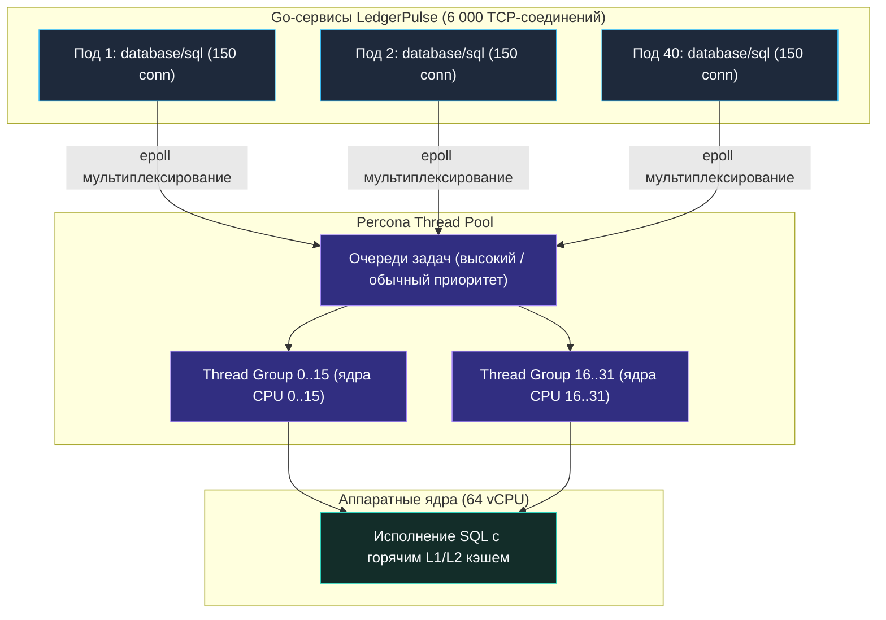
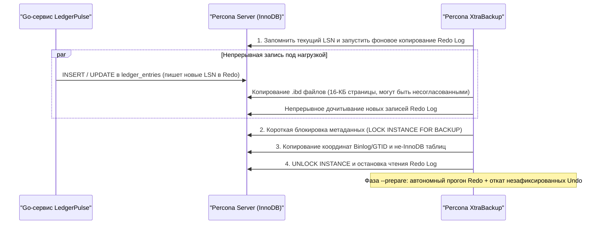

*Пул потоков вместо лавины контекстных переключений, патчи InnoDB, горячие физические бэкапы через `Percona XtraBackup`, расширенный Slow Query Log, `Percona Toolkit` и корреляция метрик Go с очередями БД.*

> «Цель вычислений — понимание сути, а не числа.»  
> — Ричард Хэмминг *(цит. по: Брайан Керниган, UNIX: A History and a Memoir)*

Нагрузочный тест платёжного ядра `LedgerPulse` на 64-ядерном сервере MySQL Community Edition ведёт себя парадоксально. На отметке в 1 000 одновременных клиентов база держит 18 000 TPS, задержка p99 не превышает 4 мс. Но стоит масштабировать Go-сервис до 40 подов с пулом по 150 соединений — суммарно 6 000 TCP-подключений — как пропускная способность падает вдвое, а загрузка `CPU System` взлетает до 75%. Диск при этом почти свободен.

Причина не в SQL и не в коде на Go, а в модели **Thread-per-Connection**, которую мы разбирали в [[1. Архитектура MySQL — поток на соединение и подключаемые движки]]. Шесть тысяч потоков операционной системы конкурируют за 64 ядра CPU и сжигают процессорное время на переключение контекста. А когда на этом же узле нужно снять резервную копию базы объёмом 800 ГБ или добавить индекс в таблицу `ledger_entries` без остановки приёма платежей, штатных утилит Community Edition оказывается недостаточно.

Решить эти задачи без переписывания кода Go и покупки коммерческих лицензий Oracle Enterprise позволяет **Percona Server for MySQL** и его экосистема инструментов.

---

## Drop-in replacement без смены протокола

**Percona Server for MySQL** — открытый форк (GPLv2), спроектированный как **прямая бинарная и протокольная замена** (*Drop-in replacement*) оригинального MySQL. Вы меняете пакет или Docker-образ `mysqld` на `percona-server`, монтируете тот же каталог данных InnoDB и продолжаете подключаться драйвером `go-sql-driver/mysql` без единой правки в коде `LedgerPulse`.

В отличие от Oracle, которая выносит пул потоков, аудит и маскирование данных в платную редакцию Enterprise Edition, Percona включает эти подсистемы в базовый открытый дистрибутив и дополняет их патчами ядра InnoDB, расширенным профилированием и утилитами эксплуатации.

---

## Thread Pool: от шести тысяч потоков к группам на ядро

Чтобы понять масштаб потерь при модели «один поток на соединение», достаточно вспомнить физику процессора. Переключение контекста потока в Linux занимает **~1–2 мкс**, но главная цена — не сам системный вызов, а вымывание кэшей **L1d/L1i** (~1 нс) и буфера трансляции адресов **TLB**. Пока ядро переключается между тысячами потоков `mysqld`, полезные инструкции SQL сменяются промахами кэша в RAM (**~100 нс**). Наступает пробуксовка (**Thrashing**): до 70–80% циклов CPU уходит на планировщик ОС и борьбу за внутренние мьютексы InnoDB.

Встроенный **Thread Pool Plugin** заменяет неконтролируемое порождение потоков архитектурой с фиксированными группами (**Thread Groups**):



Механика работы напоминает планировщик Go (модель `G-M-P`): небольшое фиксированное число потоков ОС обслуживает тысячи клиентских сокетов.

1. Число групп потоков (`thread_pool_size`) задаётся близким к числу физических ядер CPU (например, `32` или `64`).
2. Сокеты клиентов отслеживаются асинхронно; готовые к выполнению запросы попадают в компактную очередь группы.
3. Активные запросы внутри открытых транзакций получают высокий приоритет, чтобы быстрее освободить строчные блокировки InnoDB (`innodb_row_lock`) и не задерживать остальные транзакции.
4. Пока один запрос ждёт чтения страницы с NVMe (**~100 мкс**) или ответа по сети, таймер-монитор будит запасной поток в группе, не позволяя ядру простаивать.

---

## XtraDB и патчи ядра InnoDB

Исторически главным козырем Percona был **XtraDB** — форк движка InnoDB с сотнями оптимизаций многопоточности. В ветке MySQL 8.0/8.4 Oracle переняла значительную часть этих идей (см. [[2. Движок InnoDB — кластерный индекс, Buffer Pool, Redo и Undo Log]]), но Percona Server по-прежнему сохраняет важные эксплуатационные доработки:

* **Масштабируемость `Buffer Pool` (LRU Scalability).** При интенсивном чтении и записи в таблице `ledger_entries` потоки конкурируют за списки `New`/`Old` и сброс грязных страниц. Патчи Percona снижают состязание за мьютексы LRU-списков на многосокетных серверах с быстрыми NVMe-накопителями.
* **Гибкая настройка `Doublewrite Buffer`.** Буфер двойной записи защищает от частичной записи 16-КБ страниц (*torn pages*) при сбое питания, но удваивает поток записи на диск. Percona позволяет выносить файлы Doublewrite на отдельный NVMe-том или отключать его на файловых системах с атомарной записью (например, на ZFS или корпоративных SSD с поддержкой атомарных 16-КБ блоков при `O_DIRECT`), снижая усиление записи (*Write Amplification*).
* **Многопоточная очистка Undo Log (Purge Threads).** При массовых обновлениях балансов в `accounts` накопление старых версий в Undo Log удлиняет цепочки версий MVCC и тормозит чтение (см. [[4. Транзакции в MySQL — Gap Locks, Next-Key Locks и MVCC через Undo Log]]). Percona агрессивнее настраивает фоновую очистку и отслеживание истории, не давая `History list length` уйти в миллионы записей.

---

## Percona XtraBackup: горячие физические бэкапы

На базе размером 20 ГБ логический дамп через `mysqldump` занимает минуты. На базе `LedgerPulse` объёмом 1,2 ТБ логический бэкап превращается в катастрофу: чтение всех таблиц вымывает `Buffer Pool`, однопоточный SQL-дамп восстанавливается сутками, а блокировки при согласовании снимка мешают нагрузке.

Утилита **`xtrabackup`** снимает **горячий физический бэкап** InnoDB без блокировки `INSERT`, `UPDATE` и `DELETE`:



Почему копия `.ibd`-файлов, снятая «на живую», изначально несогласованна? Пока `xtrabackup` копировал первую половину файла `ledger_entries.ibd`, `LedgerPulse` уже обновил её страницы и дописал вторую половину. В сыром виде такая копия содержит страницы из разных моментов времени.

Согласованность восстанавливается на втором этапе командой `--prepare`:
1. `xtrabackup` запускает встроенный движок восстановления InnoDB *отдельно от живого сервера* на скопированном каталоге.
2. По записанному **Redo Log** все скопированные страницы доигрываются до точного конечного **LSN** (Log Sequence Number).
3. По **Undo Log** откатываются все транзакции, которые в момент снятия финальной отсечки ещё не успели выполнить `COMMIT`.

После `--prepare` каталог готов к мгновенному старту `mysqld` (RTO сокращается с суток до времени копирования файлов с хранилища). Для крупных баз поддерживаются **инкрементальные бэкапы** (копируются только 16-КБ страницы, чей LSN выше LSN последнего полного бэкапа, либо отслеживаются через bitmap измененных страниц) и потоковая передача с компрессией `zstd` через `xbstream`.

```bash
# 1. Горячий физический бэкап в потоке без остановки записи
xtrabackup --backup --target-dir=/backups/base --parallel=8

# 2. Автономная подготовка согласованного снимка через Redo/Undo
xtrabackup --prepare --target-dir=/backups/base
```

---

## Расширенная наблюдаемость и Percona Toolkit

Обычный MySQL нередко скрывает причину скачка p99: стандартный Slow Query Log показывает только сам SQL и общее время выполнения. В Percona журнал медленных запросов превращён в низкоуровневый профилировщик.

### Расширенный Slow Query Log и User Statistics

При включении `log_slow_verbosity = 'full'` в журнал попадает точная диагностика каждого медленного запроса:
* **`Lock_time` и детализация InnoDB:** сколько времени запрос ждал блокировки строк и метаданных (`MDL`), сколько страниц прочитал с диска (`InnoDB_IO_r_bytes`) против хитов в `Buffer Pool`.
* **Отношение `Rows_examined` к `Rows_sent`:** если запрос отдал 1 строку, но просмотрел 850 000, индекс отсутствует или не работает.
* **Встроенный `EXPLAIN`:** сервер способен сохранять план выполнения прямо в лог медленного запроса в момент сбоя, когда данные и статистика ещё актуальны.
* **User Statistics (`userstat = ON`):** таблицы `INFORMATION_SCHEMA.TABLE_STATISTICS`, `INDEX_STATISTICS` и `CLIENT_STATISTICS` показывают неиспользуемые индексы (которые тормозят вставку) и микросервисы, генерирующие больше всего чтений строк.

### Тройка утилит Percona Toolkit

Вместе с сервером в индустрии используют CLI-набор **Percona Toolkit**:

1. **`pt-online-schema-change`:** выполняет `ALTER TABLE` на таблицах в сотни гигабайт без долгой блокировки записи. Утилита создаёт пустую теневую таблицу с новой схемой, вешает на оригинал триггеры (`INSERT`, `UPDATE`, `DELETE`), пачками (*chunks*) копирует исторические строки с паузами при росте нагрузки или отставании реплик (`--max-lag`) и в конце меняет таблицы местами атомарным `RENAME TABLE`.
2. **`pt-query-digest`:** агрегирует гигабайтные файлы Slow Query Log или сетевые дампы трафика MySQL, превращает конкретные запросы в структурные отпечатки (*fingerprints*, заменяя литералы на `?`) и строит рейтинг по суммарному времени нагрузки на базу.
3. **`pt-kill`:** сторожевой демон, который по заданным правилам (например, `SELECT` длится дольше 15 секунд или запрос висит в состоянии `Waiting for table metadata lock`) прерывает проблемные соединения, спасая кластер от каскадного исчерпания потоков.

> [!warning] Цена триггеров в `pt-online-schema-change`
> Встроенные триггеры копирования в `pt-online-schema-change` добавляют накладные расходы на каждую транзакцию записи и усиливают конкуренцию за блокировки на горячих строках. На экстремально нагруженных таблицах инженеры также применяют бес-триггерную альтернативу `gh-ost`, читающую поток изменений асинхронно из **Binlog** (см. [[5. Репликация в MySQL — Binlog, GTID и Group Replication]]).

---

## Безопасность, аудит и стек PMM для Go

В отличие от Oracle Community Edition, Percona предоставляет средства комплаенса без коммерческой подписки:
* **Audit Log Plugin:** запись всех подключений, ошибок авторизации и SQL-операций для соответствия требованиям PCI DSS и SOC 2.
* **Data Masking:** маскирование чувствительных полей (PII, номера карт) на уровне движка для аналитических учётных записей.
* **External Authentication:** интеграция с LDAP, Active Directory и Kerberos.

Для связки с микросервисами на Go экосистема предлагает **PMM (Percona Monitoring and Management)** — стек на базе Prometheus, Grafana и ClickHouse (`QAN` — Query Analytics). Он позволяет на одном дашборде сопоставить рост ожидания свободного соединения в пуле `database/sql` с метриками СУБД: очередями Thread Pool, `Innodb_row_lock_current_waits` и всплесками `History list length`.

---

## Диагностика в Go 1.24 и разбор реального отпечатка

В коде Go 1.24 важно периодически снимать `db.Stats()` (`sql.DBStats`), чтобы видеть, ждёт ли приложение свободный сокет локально (`WaitCount`, `WaitDuration`) или сама база долго отвечает по сети и держит соединения в статусе `InUse`.

```go
package diagnostics

import (
	"context"
	"database/sql"
	"log/slog"
	"time"
)

// MonitorDBPool периодически логирует состояние пула database/sql для корреляции с PMM и Percona.
func MonitorDBPool(ctx context.Context, db *sql.DB, logger *slog.Logger, interval time.Duration) {
	ticker := time.NewTicker(interval)
	defer ticker.Stop()

	var prevWaitCount int64
	var prevWaitDuration time.Duration

	for {
		select {
		case <-ctx.Done():
			return
		case <-ticker.C:
			st := db.Stats()
			deltaWaits := st.WaitCount - prevWaitCount
			deltaWaitDur := st.WaitDuration - prevWaitDuration
			prevWaitCount, prevWaitDuration = st.WaitCount, st.WaitDuration

			logger.Info("mysql pool snapshot",
				slog.Int("open_conns", st.OpenConnections),
				slog.Int("in_use", st.InUse),
				slog.Int("idle", st.Idle),
				slog.Int64("waits_delta", deltaWaits),
				slog.Duration("wait_duration_delta", deltaWaitDur),
			)
		}
	}
}
```

Если метрика `in_use` упирается в `MaxOpenConns`, а `waits_delta` растёт, открываем агрегированный отчёт **`pt-query-digest`** по расширенному Slow Query Log:

```text
# Query 1: 42.10 QPS, 0.78x concurrency, ID 0x9F2A118C44E0B102
# Attribute    pct   total     min     max     avg     95%  stddev  median
# ============ === ======= ======= ======= ======= ======= ======= =======
# Count         18   12630
# Exec time     64    234s    12ms   190ms    18ms    41ms    14ms    15ms
# Lock time     71     89s     0us   165ms     7ms    22ms    11ms     2ms
# Rows sent      1  12.34k       1       1       1       1       0       1
# Rows exam     83  10.42G  820.1k  910.4k  865.2k  895.0k   18.4k  862.1k
SELECT id, amount, status FROM ledger_entries WHERE account_id = ? AND status = 'pending' ORDER BY created_at DESC LIMIT 1;
```

Вывод мгновенно вскрывает диагноз: запрос 12 630 раз вернул по **1 строке** (`Rows sent`), но каждый раз сканировал в среднем **865 200 строк** (`Rows exam`), съев 64% всего времени базы и удерживая блокировки. Составной индекс `(account_id, status, created_at)` убирает сканирование и снимает давление на пул соединений Go.

> [!tip] Собеседование [Middle]
> **Вопрос:** Сервис на Go вырос в 10 раз, и на 64-ядерном сервере MySQL Community при 5 000 открытых соединений график `CPU System` ушёл в потолок, а пропускная способность упала. Что вы предложите в первую очередь?
> **Ответ:**
> 1. Перевести сервер в формате *Drop-in replacement* на **Percona Server for MySQL** и включить **Thread Pool**: фиксированные группы потоков уберут лавину переключений контекста и вымывание кэшей L1/TLB.
> 2. Дополнительно ограничить `MaxOpenConns` на стороне подов Go (или поставить ProxySQL), чтобы не держать тысячи бездействующих транзакций.
> 3. Включить **Extended Slow Query Log** и прогнать его через **`pt-query-digest`**, чтобы найти запросы с высоким отношением `Rows_examined / Rows_sent` и долгим ожиданием блокировок InnoDB.

---

## Упражнения

### Базовое
Инженер снимает резервную копию базы `LedgerPulse` (600 ГБ) утилитой `xtrabackup --backup` на работающем мастере.
1. Почему полученный каталог с `.ibd`-файлами нельзя сразу запускать на новом сервере без команды `xtrabackup --prepare`?
2. Какие два журнала InnoDB использует `--prepare`, чтобы привести физическую копию к единой транзакционно согласованной точке?

> [!solution] Показать решение
> 1. Во время онлайн-копирования `.ibd`-файлов фоновые потоки `LedgerPulse` продолжают изменять 16-КБ страницы. В результате разные страницы в скопированных файлах относятся к разным значениям LSN: одни содержат ещё не зафиксированные изменения, другие отстают от более свежих заголовков. Без подготовки InnoDB при старте увидел бы физически рассинхронизированный снимок.
> 2. Фаза `--prepare` использует **Redo Log** (доигрывает все зафиксированные транзакции до конечного LSN, скопированного за время бэкапа) и **Undo Log** (откатывает все незафиксированные на момент завершения бэкапа транзакции).

### Практическое
При разборе инцидента в `LedgerPulse` вы получили фрагмент вывода **Extended Slow Query Log** (Percona):
```text
# Query_time: 1.842110  Lock_time: 0.000140  Rows_sent: 20  Rows_examined: 4820190
# Thread_pool_wait_time: 0.000210  InnoDB_IO_r_ops: 31420  InnoDB_IO_r_bytes: 514785280
SELECT id, reference_id, kind FROM transactions WHERE status = 'pending' AND created_at >= '2026-11-01';
```
Определите по метрикам, является ли тормоз следствием конкуренции за блокировки строк, нехватки потоков в Thread Pool или отсутствия подходящего индекса. Обоснуйте ответ цифрами из лога и предложите индекс.

> [!solution] Показать решение
> Конкуренция за блокировки и очередь в Thread Pool здесь ни при чём: `Lock_time` составил всего `0.14 мс`, а `Thread_pool_wait_time` — `0.21 мс`. Главная причина — **отсутствие подходящего индекса**: для отдачи 20 строк сервер просмотрел **4 820 190 строк** (`Rows_examined`), выполнив **31 420 чтений страниц с диска** (~491 МБ через `InnoDB_IO_r_bytes`).
>
> Решение — добавить составной индекс `(status, created_at)` (равенство по `status` ставим первым, диапазон по `created_at` — вторым, см. [[3. Индексы в MySQL — вторичный поиск, Change Buffer и покрывающие ключи]]):
> ```sql
> CREATE INDEX idx_tx_status_created ON transactions (status, created_at);
> ```
> При наличии такого индекса в MySQL 8.0 на таблице из сотен миллионов строк лучше применить его через `ALGORITHM=INPLACE, LOCK=NONE` или `pt-online-schema-change` с контролем лага реплик.

### Со звёздочкой (*)
Команде нужно добавить колонку `settlement_date DATE NULL` и индекс по ней в таблицу `ledger_entries` (450 ГБ, 2 500 записей в секунду в пик, две асинхронные реплики). Объясните, почему прямой `ALTER TABLE` даже с `ALGORITHM=INPLACE` способен вызвать серьёзный лаг репликации, и напишите безопасный вызов `pt-online-schema-change`, который сам притормозит копирование, если задержка реплик превысит 2 секунды, а число запущенных потоков на мастере перевалит за 40.

> [!solution] Показать решение
> 1. В классической асинхронной репликации `ALTER TABLE` записывается в Binlog как единая DDL-операция и начинает выполняться на реплике **только после того**, как полностью завершится на мастере. Построение индекса на таблице в 450 ГБ на одной машине может занять 20–40 минут — всё это время реплика будет отставать на эти же 20–40 минут, останавливая применение новых проводок.
> 2. `pt-online-schema-change` копирует данные мелкими транзакциями и встроенными паузами отслеживает нагрузку мастера и лаг всех подключённых реплик:
> ```bash
> pt-online-schema-change \
>   --alter="ADD COLUMN settlement_date DATE NULL, ADD INDEX idx_le_settlement (settlement_date)" \
>   D=ledgerpulse,t=ledger_entries \
>   --chunk-size=2000 \
>   --max-lag=2 \
>   --check-slave-lag=h=replica-01.internal \
>   --max-load="Threads_running=40" \
>   --critical-load="Threads_running=80" \
>   --execute
> ```
> При лаге реплики > 2 с или `Threads_running > 40` утилита приостанавливает копирование чанков до стабилизации кластера, а при `Threads_running > 80` безопасно прерывает миграцию.

---

## Мостик к следующему уроку

Percona Server показывает, как выжать максимум производительности и наблюдаемости из классического ядра MySQL, сохраняя полную бинарную совместимость с экосистемой Oracle.

Но что делать, если вам нужен по-настоящему синхронный мультимастер-кластер без единой точки отказа, колоночная аналитика или движок на базе LSM-дерева с кратно меньшим усилением записи, а зависимость от ветки Oracle неприемлема? В следующей главе мы разберём главного исторического соперника в мире открытого SQL — [[8. MariaDB — расхождение с MySQL и собственные движки]].
