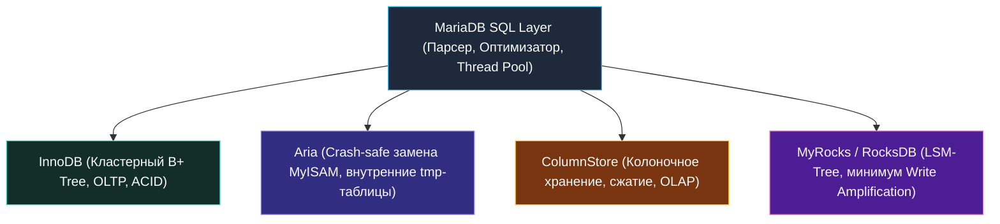
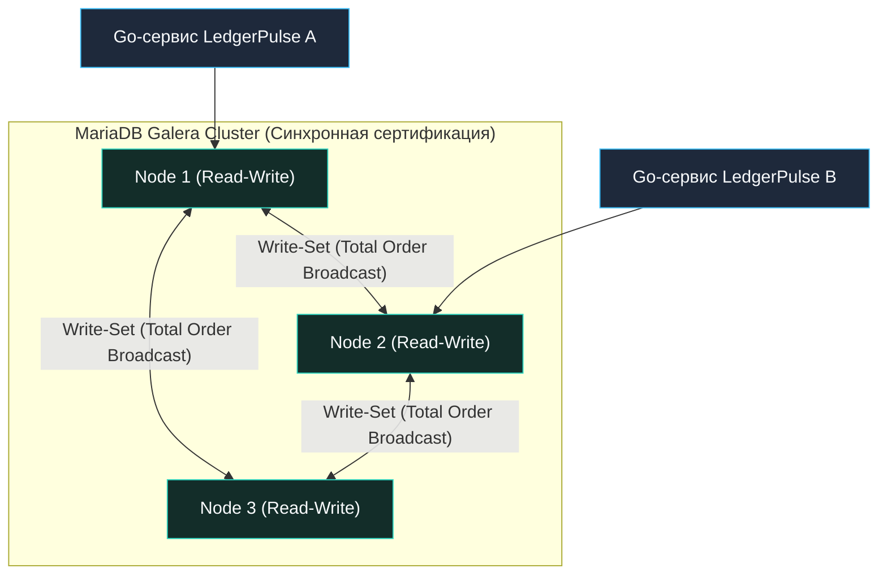

*Исторический форк от создателя MySQL, независимый оптимизатор, специализированные движки `Aria`, `ColumnStore` и `MyRocks`, синхронный мультимастер `Galera Cluster`, расхождение с MySQL 8.0 и обработка конфликтов сертификации в Go 1.24.*

> «Решения, определившие развитие этой технологии и путь, по которому мы пошли, принимали живые люди — под давлением и в жёстких ограничениях своего времени.»  
> — Брайан Керниган, *UNIX: A History and a Memoir*

В 2009 году корпорация Oracle поглотила компанию Sun Microsystems, получив права на код и торговую марку MySQL. Опасаясь закрытия экосистемы и коммерциализации ключевых модулей, первоначальный автор MySQL Майкл «Монти» Видениус покинул проект и основал независимый форк **MariaDB** (названный в честь его младшей дочери Марии — так же, как сам MySQL был назван в честь старшей дочери Мю).

Первые версии MariaDB 5.5 и 10.0 замышлялись как прямая бинарная замена (*Drop-in replacement*) классического MySQL. Но за следующие пятнадцать лет ветки разошлись далеко за пределы косметических отличий. Пока Oracle развивала монолитный InnoDB внутри MySQL 8.0/8.4, команда MariaDB сделала ставку на независимый оптимизатор, модульность подключаемых движков хранения и встроенную синхронную кластеризацию.

Для инженера на Go это означает важную развилку: MariaDB остаётся совместимой по сетевому протоколу с `go-sql-driver/mysql`, но ведёт себя как самостоятельная СУБД со своими сильными сторонами и ловушками миграции.

---

## Оптимизатор запросов и уровень сервера

Различие между MariaDB и Oracle MySQL начинается ещё до обращения к диску — на уровне парсера, планировщика и пула потоков:

* **Постоянная статистика и независимость от движка (Engine-Independent Table Statistics).** В MariaDB статистика кардинальности и гистограммы распределения значений собираются на уровне SQL-сервера (а не только внутри InnoDB) и сохраняются в системных таблицах `mysql.table_stats`, `mysql.column_stats`, `mysql.index_stats`. После рестарта базы планы выполнения остаются предсказуемыми, а при `JOIN` таблиц на разных движках оптимизатор опирается на единую модель стоимости.
* **Ранние оптимизации подзапросов.** В старых версиях MySQL вложенные конструкции `WHERE id IN (SELECT ...)` нередко вырождались в квадратичное сканирование. MariaDB раньше базовой ветки внедрила стратегии полусоединений (**Semi-Joins**), материализацию подзапросов во временные таблицы и алгоритм пакетного доступа по ключам **Batched Key Access (BKA)**.
* **Бесплатный Thread Pool.** Как и [[7. Percona Server — диагностика, XtraBackup и инструменты эксплуатации|Percona Server]], MariaDB включает встроенный пул потоков в стандартную открытую поставку. На 64-ядерных машинах это позволяет обслуживать свыше 10 000 параллельных TCP-подключений от микросервисов на Go без паралича планировщика Linux и вымывания кэшей L1/TLB.
* **Вычисляемые (виртуальные) колонки и синтаксис `RETURNING`.** MariaDB одной из первых внедрила виртуальные (`VIRTUAL`, вычисляются на лету при чтении и не занимают место на диске) и материализованные (`PERSISTENT` / `STORED`, сохраняются в строку и поддерживают обычные B+ Tree индексы) колонки, а также удобный для Go-репозиториев синтаксис `INSERT ... RETURNING` и `DELETE ... RETURNING`.

> [!tip] Собеседование [Middle]
> **Вопрос:** Как в MariaDB быстро искать по вложенному полю внутри JSON-документа `metadata` в таблице `accounts`, если индексировать сырой текст целиком неэффективно?
> **Ответ:** Используют паттерн материализованной вычисляемой колонки (`STORED`/`PERSISTENT`) и обычного B+ Tree индекса:
> ```sql
> ALTER TABLE accounts
>     ADD COLUMN kyc_tier VARCHAR(16)
>     AS (JSON_VALUE(metadata, '$.kyc_tier')) PERSISTENT,
>     ADD INDEX idx_accounts_kyc_tier (kyc_tier);
> ```
> При вставке и обновлении MariaDB один раз извлечёт значение через `JSON_VALUE()`, запишет его в строку и поддержит в B+ Tree. Поиск `WHERE kyc_tier = 'verified'` отработает за логарифмическое время `O(log N)` — за доли миллисекунды, как по обычному индексированному столбцу.

---

## Плюрализм движков: Aria, ColumnStore и MyRocks

Если в Oracle MySQL все альтернативные движки фактически ушли на второй план ради единого InnoDB, то MariaDB довела идею подключаемых подсистем хранения до специализации под разные профили I/O:



1. **InnoDB** остаётся главным выбором для строгих OLTP-транзакций с ACID, строчными блокировками и внешними ключами — например, для основных таблиц `accounts` и `ledger_entries` в `LedgerPulse`.
2. **Aria** создан как устойчивая к сбоям (*crash-safe*) замена устаревшего MyISAM. В отличие от MyISAM, который при внезапном отключении питания портил индексы и требовал долгой починки `REPAIR TABLE`, Aria ведёт журнал транзакций. На практике Aria работает «под капотом» почти каждого сложного `GROUP BY` и `ORDER BY`: MariaDB использует его для материализации внутренних временных таблиц на диске.
3. **ColumnStore** — распределённый колоночный движок для аналитических запросов (OLAP) поверх петабайтных массивов. Данные хранятся по столбцам с высокой степенью сжатия и векторным чтением, позволяя выполнять тяжёлую аналитику внутри MariaDB без выгрузки в отдельные колоночные СУБД вроде ClickHouse (подробнее см. Модуль 9).
4. **MyRocks** — движок поверх встраиваемой библиотеки **RocksDB** (разработанной в Meta), использующий структуру **LSM-дерева** (*Log-Structured Merge-Tree*). В B+ Tree движке InnoDB обновление случайной 16-КБ страницы порождает запись самой страницы, Doublewrite Buffer, Redo Log, Undo Log и вторичных индексов — итоговый коэффициент усиления записи (*Write Amplification*) нередко достигает **20–30x**. В `MyRocks` новые записи и удаления сбрасываются последовательно в мемтаблицу и SST-файлы на диске: усиление записи падает до **2–4x**, а плотность сжатия вырастает в **2–3 раза**, кратно снижая износ NVMe-накопителей и экономя место на дисках. Плата за это — более дорогое чтение диапазонов (*Read Amplification*) по сравнению с кластерным B+ Tree.

---

## Galera Cluster: синхронный Multi-Master без потери коммитов

Классическая асинхронная репликация через `Binlog` (см. [[5. Репликация в MySQL — Binlog, GTID и Group Replication]]) оставляет зазор между фиксацией транзакции на мастере и её доставкой на реплики. При внезапном отказе мастера последние подтверждённые клиенту проводки `LedgerPulse` могут не успеть доехать до слейва.

MariaDB интегрирует технологию **Galera Cluster** прямо в ядро сервера (`wsrep` API), превращая три или пять узлов в **синхронный Active-Active Multi-Master кластер**:



Как устроена **репликация на основе сертификации** (*Certification-Based Replication*):

1. **Локальное исполнение.** Клиент на Go отправляет `BEGIN`, `UPDATE` и `INSERT` на любой узел (например, Node 1). До вызова `COMMIT` транзакция меняет страницы локально, не удерживая межсетевых распределённых блокировок.
2. **Рассылка Write-Set на `COMMIT`.** В момент фиксации Node 1 упаковывает изменения в компактный пакет **Write-Set** (ключи и хэши изменённых строк) и рассылает его всем узлам кластера через протокол глобального упорядочивания (*Total Order Multicast*).
3. **Детерминированная сертификация.** Каждый узел проверяет входящий Write-Set против транзакций, уже сертифицированных после того момента, когда транзакция стартовала на Node 1.
4. **Единое решение.** Если конфликта по строкам нет — транзакция фиксируется на всех узлах (`RPO = 0`). Если два клиента одновременно изменили одну строку на разных узлах, побеждает транзакция, пришедшая в глобальную очередь первой, а проигравшая транзакция на узле-инициаторе откатывается на этапе `COMMIT` с ошибкой взаимной блокировки: **`Error 1213 (ER_LOCK_DEADLOCK)`**.

### Честная цена Galera Cluster

Синхронность не даётся бесплатно. Во-первых, скорость записи всего кластера ограничена **самым медленным узлом** (если один сервер отстаёт по диску, срабатывает механизм *Flow Control* и тормозит запись на всех). Во-вторых, каждый `COMMIT` платит ценой полного сетевого круга (RTT) сертификации — внутри одного дата-центра это **~0,5–2 мс**, но разносить узлы Galera через океан с задержкой 80 мс губительно для OLTP.

---

## Расхождение с MySQL 8.0 и критерии выбора

С приходом MySQL 8.0 и веток MariaDB 10.6 / 11.x две СУБД перестали быть взаимозаменяемыми на уровне файлов данных и репликации:

* **Несовместимость формата данных и Binlog.** Системная схема `mysql.*`, словари метаданных (Data Dictionary в MySQL 8.0), алгоритмы шифрования и формат событий бинарного журнала разошлись. Нельзя подмонтировать каталог данных MySQL 8.0 к MariaDB или строить штатную репликацию от MySQL 8.0 к MariaDB без промежуточного логического дампа.
* **Разные реализации GTID.** MySQL кодирует GTID как `UUID:номер` (`3E11FA47-...:1-25`), а MariaDB — как триплет `domain_id-server_id-seq_no` (`0-1-25`).
* **Хранение JSON.** В MySQL 8.0 `JSON` — бинарный тип с частичным обновлением на месте, а в MariaDB `JSON` является псевдонимом для `LONGTEXT` с валидацией и набором JSON-функций.

> [!warning] Ловушка строгости SQL и значений по умолчанию
> MariaDB традиционно строже трактует `STRICT_TRANS_TABLES` и явные значения `DEFAULT`. Если миграция или старый Go-код пытается вставить пустую строку `''` в числовой столбец или пропустить `NOT NULL` поле без `DEFAULT`, старый MySQL 5.x нередко ограничивался предупреждением и подставлял `0`, тогда как MariaDB немедленно откатит транзакцию с ошибкой `1366` или `1364`. Всегда прогоняйте полный набор интеграционных тестов при переносе схемы.

### Когда выбирать MariaDB, а когда MySQL / Percona

| Критерий выбора | MariaDB 10.11 / 11.x | MySQL 8.0 / 8.4 или Percona Server |
|---|---|---|
| **Синхронный Active-Active без внешнего оркестратора** | Нативный `Galera Cluster` в поставке | Требуется `Group Replication` / InnoDB Cluster |
| **Сверхплотная запись и экономия SSD** | Движок `MyRocks` (LSM-Tree, 2–4x WA) | Только `InnoDB` (B+ Tree, 20–30x WA) |
| **Синтаксис `RETURNING` при вставке** | Есть `INSERT ... RETURNING` | Нет (нужен повторный `SELECT` или `LAST_INSERT_ID()`) |
| **Управляемые облачные форки и шардирование** | Меньше сторонней обвязки | Прямая совместимость с AWS Aurora и Vitess |
| **Горячий физический бэкап и диагностика** | `mariadb-backup` (форк XtraBackup) | Эталонные `XtraBackup`, `Percona Toolkit`, `PMM` |

---

## Код на Go 1.24: повтор транзакции при конфликте сертификации Galera

При работе с MariaDB Galera Cluster через стандартный `database/sql` и драйвер `github.com/go-sql-driver/mysql` ошибка `1213` может прийти не только на `UPDATE`, но и в момент вызова **`tx.Commit()`** — именно тогда кластер выполняет сетевую сертификацию Write-Set.

Идиоматичный репозиторий `LedgerPulse` обязан перехватывать `ER_LOCK_DEADLOCK` (`1213`) и повторять транзакцию с экспоненциальной задержкой и случайным разбросом (*jitter*), чтобы конкурирующие горутины не столкнулись на следующей попытке синхронно:

```go
package ledger

import (
	"context"
	"database/sql"
	"errors"
	"fmt"
	"math/rand/v2"
	"time"

	"github.com/go-sql-driver/mysql"
)

type AccountRepo struct {
	db *sql.DB
}

func NewAccountRepo(db *sql.DB) *AccountRepo {
	return &AccountRepo{db: db}
}

// CreditWithRetry зачисляет сумму на счёт и повторяет транзакцию при конфликте сертификации Galera.
func (r *AccountRepo) CreditWithRetry(ctx context.Context, accountID, amount int64) error {
	const maxAttempts = 4
	baseBackoff := 15 * time.Millisecond

	for attempt := 1; attempt <= maxAttempts; attempt++ {
		err := r.creditOnce(ctx, accountID, amount)
		if err == nil {
			return nil
		}
		if !isDeadlockError(err) || attempt == maxAttempts {
			return fmt.Errorf("credit account %d (attempt %d): %w", accountID, attempt, err)
		}

		// Экспоненциальная задержка со случайным разбросом из math/rand/v2 (Go 1.22+)
		jitter := rand.N(baseBackoff)
		wait := baseBackoff + jitter
		baseBackoff *= 2

		select {
		case <-ctx.Done():
			return ctx.Err()
		case <-time.After(wait):
		}
	}
	return nil
}

func (r *AccountRepo) creditOnce(ctx context.Context, accountID, amount int64) error {
	tx, err := r.db.BeginTx(ctx, nil)
	if err != nil {
		return err
	}
	defer func() { _ = tx.Rollback() }()

	if _, err := tx.ExecContext(ctx,
		"UPDATE accounts SET balance = balance + ?, updated_at = NOW(6) WHERE id = ?",
		amount, accountID,
	); err != nil {
		return err
	}

	// В Galera сертификация Write-Set происходит здесь и может вернуть Error 1213
	return tx.Commit()
}

func isDeadlockError(err error) bool {
	var myErr *mysql.MySQLError
	return errors.As(err, &myErr) && myErr.Number == 1213
}
```

При одновременном обновлении одного горячего счёта на двух узлах Galera проигравшая горутина увидит в логах отказ на фиксации и пройдёт со второй попытки:

```text
attempt=1 err="credit account 42 (attempt 1): Error 1213 (40001): Deadlock found when trying to get lock; try restarting transaction"
attempt=2 err=nil duration=24.8ms
```

---

## Упражнения

### Базовое
Сравните поведение трёх движков хранения MariaDB — `InnoDB`, `Aria` и `MyRocks` — для следующих сценариев:
1. Таблица `accounts` и парные проводки `ledger_entries` с внешними ключами и строгими транзакциями.
2. Поток аудита и телеметрии (50 000 вставок в секунду, минимум чтений по диапазонам, жёсткое ограничение по объёму NVMe).
3. Промежуточная дисковая таблица, которую MariaDB создаёт при тяжёлом `GROUP BY` с сортировкой.
Укажите оптимальный движок для каждого случая и назовите одно ключевое физическое свойство, которое это объясняет.

> [!solution] Показать решение
> 1. **`InnoDB`** — единственный из трёх с полноценной поддержкой `FOREIGN KEY`, кластерным B+ Tree по первичному ключу и предсказуемыми точечными/диапазонными выборками OLTP.
> 2. **`MyRocks`** — за счёт структуры LSM-дерева (последовательная запись в мемтаблицу и SST-файлы) снижает Write Amplification с 20–30x до 2–4x и сжимает данные в 2–3 раза лучше InnoDB, экономя ресурс и ёмкость NVMe.
> 3. **`Aria`** — устойчив к сбоям (*crash-safe*) и оптимизирован под быструю материализацию временных таблиц без накладных расходов полноценного MVCC.

### Практическое
В таблице `transactions` (MariaDB 11) поле `payload` хранит JSON вида `{"gateway":"stripe","fee_minor":350}`. Аналитики и бэкенд часто выполняют фильтр `WHERE JSON_VALUE(payload, '$.gateway') = 'stripe'`.
Напишите миграцию `ALTER TABLE`, добавляющую индексируемую вычисляемую колонку `gateway`, и проверьте через `EXPLAIN`, почему выборка без такой колонки приводит к полному сканированию таблицы.

> [!solution] Показать решение
> Без вычисляемой колонки выражение `JSON_VALUE(payload, '$.gateway')` не является SARGable-предикатом по индексу, поэтому MariaDB вынуждена читать каждую строку (`type: ALL`) и заново парсить текст JSON на CPU.
> ```sql
> ALTER TABLE transactions
>     ADD COLUMN gateway VARCHAR(32)
>         AS (JSON_VALUE(payload, '$.gateway')) PERSISTENT,
>     ADD INDEX idx_transactions_gateway (gateway);
>
> EXPLAIN
> SELECT id, reference_id
> FROM transactions
> WHERE gateway = 'stripe';
> ```
> После добавления `PERSISTENT` (или `STORED`) колонки и B+ Tree индекса `EXPLAIN` покажет `type: ref`, `key: idx_transactions_gateway`, читая только нужные строки вместо полного сканирования.

### Со звёздочкой (*)
Представьте сервис `LedgerPulse`, запущенный на трёхузловом MariaDB Galera Cluster. Наблюдается всплеск ошибок `Error 1213` при вызовах `tx.Commit()`, причём в обычном одноузловом InnoDB этих конфликтов почти не было.
1. Объясните, почему оптимистичная модель сертификации Galera порождает `1213` именно на `Commit()`, тогда как на одном узле InnoDB вторая транзакция просто ждала бы строчную блокировку (`X-Lock`).
2. Почему в методе `CreditWithRetry` добавление случайного разброса (`jitter`) критично при пиковой нагрузке на один «горячий» счёт?

> [!solution] Показать решение
> 1. На одиночном сервере InnoDB вторая транзакция, пытающаяся выполнить `UPDATE accounts SET balance = ... WHERE id = 42`, блокируется на локальной строчной блокировке (`X-Lock`) и ждёт завершения первой транзакции до `innodb_lock_wait_timeout`. В Galera Cluster две транзакции на **разных** узлах (Node 1 и Node 2) ничего не знают о локальных блокировках соседа до самого `COMMIT`. Обе меняют строку `id = 42` в своём буферном пуле и отправляют Write-Set на глобальную сертификацию. Сертификация пропускает первую по порядку транзакцию, а вторую вынуждена прервать с кодом `1213`, потому что её снимок данных уже устарел.
> 2. Без `jitter` две (или десять) проигравшие горутины проснутся ровно через фиксированные `15 мс`, одновременно пошлют повторный запрос на разные узлы Galera и снова столкнутся на сертификации. Случайный разброс разносит повторные попытки во времени, превращая серию конфликтов в последовательную очередь.

---

## Мостик к следующему уроку

Percona Server и MariaDB позволяют выжать максимум из классических серверов с локальными дисками и даже объединить несколько узлов в синхронный Galera-кластер. Но у обоих подходов остаётся физический потолок: в Galera каждый узел по-прежнему хранит полную копию всей базы и участвует в глобальной сертификации, а локальный диск одного узла рано или поздно заканчивается по объёму или пропускной способности IOPS.

Чтобы обслуживать распродажи масштаба 11.11 в Alibaba, мгновенно масштабировать читающие реплики до 128 ТБ в облаках AWS или горизонтально шардировать миллионы транзакций, как в YouTube и Slack, архитектуру MySQL пришлось перекроить с нуля. В заключительной главе модуля мы разберём облачные форки и распределённый MySQL — [[9. Облачные форки и распределённый MySQL — Aurora, AliDB и Vitess]].
