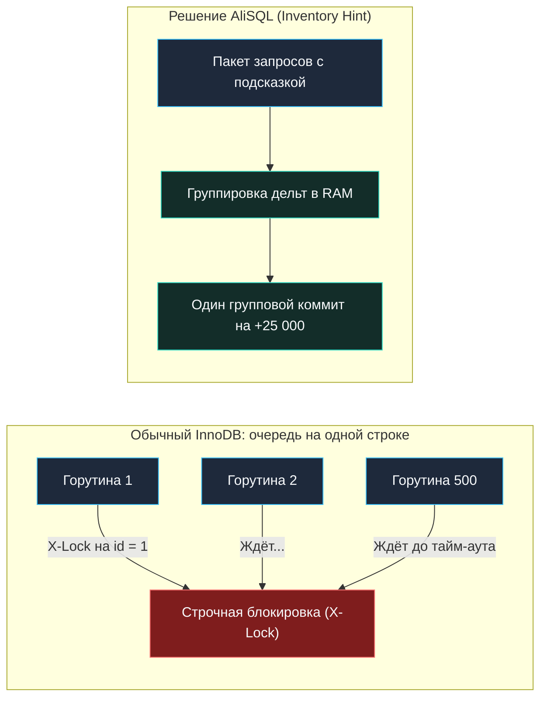
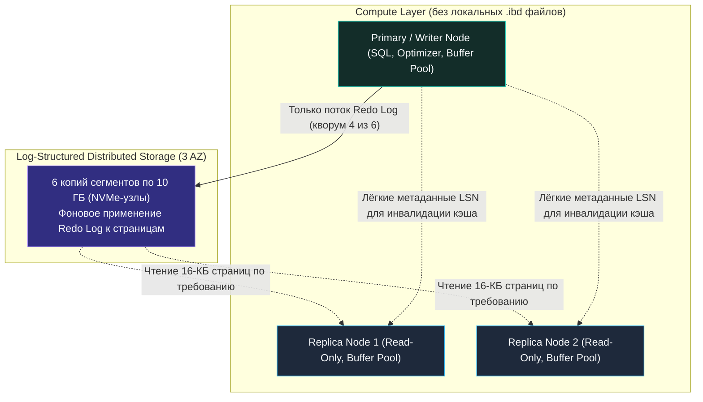
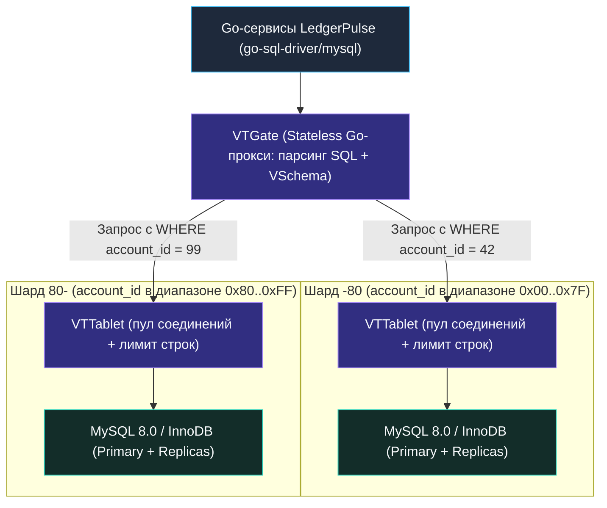

*Оптимизации под экстремальные пики в AliSQL (Inventory Hint и Query Queue), отделение вычислений от хранилища в AWS Aurora и Alibaba PolarDB, физика облачных IOPS, Survivable Buffer Pool, горизонтальное шардирование на Go через Vitess и выход в распределённые системы.*

> «В идеальном мире прикладному программисту достаточно знать только API — без того, как этот API реализован и к какому железу он обращается. В реальности же чуть более глубокие знания порой оказываются весьма кстати.»  
> — Чарльз Петцольд, *Code: The Hidden Language of Computer Hardware and Software*

Одиночный сервер MySQL или Percona упирается в потолок локального диска и шины памяти. Классический `Binlog` нагружает мастер двойной работой и при всплесках записи отстаёт на минуты, а `Galera Cluster` ограничен самым медленным узлом и полным объёмом базы на каждом сервере.

При нагрузке в сотни тысяч транзакций в секунду (Alibaba, AWS, YouTube, Slack) применяют два подхода:
1. **Ядро и облачное хранение:** патчи под горячие строки (**AliDB / AliSQL**) и отделение вычислений (**Compute**) от распределённого журнала хранения (**Storage**) в **AWS Aurora** и **Alibaba PolarDB**.
2. **Шардирование поверх MySQL:** горизонтальное разбиение через прокси-слой **Vitess** на Go.

---

## AliDB (AliSQL): патчи под шторм распродаж 11.11

**AliSQL** — форк MySQL от инженерной команды Alibaba, созданный для фестиваля онлайн-распродаж «День холостяка» (11.11), когда транзакционный поток на короткое время взлетает до сотен тысяч операций в секунду.

Главная проблема таких пиков — **Inventory Hotspot** (горячая точка на одной строке). Тысячи параллельных покупателей одновременно списывают остаток одного флагманского товара — или, в терминах `LedgerPulse`, тысячи платежей за секунду начисляют комиссию на **один системный счёт платформы** (`UPDATE accounts SET balance = balance + 50 WHERE id = 1`).



В обычном InnoDB все 500 транзакций выстраиваются в последовательную очередь за эксклюзивной строчной блокировкой `X-Lock`: потоки простаивают, растут задержки и массово срабатывают тайм-ауты. В **AliSQL** эту стену обходят тремя доработками ядра:

* **Inventory Hint (пакетное слияние обновлений).** Клиент передаёт специальную SQL-подсказку, помечая операцию как коммутативное обновление счётчика или остатка. Движок объединяет сотни параллельных изменений одной строки в оперативной памяти (**~100 нс** против миллисекунд ожидания блокировки) и фиксирует их пачкой в одном групповом коммите, поднимая пропускную способность горячей строки в десятки раз.
* **Query Queue (кольцевая очередь в ядре).** При внезапном десятикратном всплеске трафика обычный MySQL плодит тысячи потоков и рискует упасть по OOM. `Query Queue` ограничивает число одновременно исполняемых транзакций на уровне движка: лишние запросы не создают новые потоки ОС, а ждут в быстрой кольцевой очереди.
* **Async Update (отложенное обновление вторичных индексов).** Позволяет отложить часть работы по поддержанию некритичных вторичных индексов, снижая пиковую задержку подтверждения заказа.

---

## Облачная архитектура: отделение Compute от Storage

Второй прорыв совершили облачные базы **AWS Aurora** и **Alibaba PolarDB**, пересмотревшие саму границу между базой данных и диском. В традиционном MySQL (см. [[5. Репликация в MySQL — Binlog, GTID и Group Replication]]) мастер делает избыточную работу: записывает локальный Redo Log, сбрасывает грязные 16-КБ страницы через Doublewrite Buffer в `.ibd`-файлы на локальный диск и параллельно формирует логический `Binlog` для отправки по сети на реплики.

Облачные форки реализовали принцип **«Журнал и есть база данных» (*The Log is the Database*)**:



В **AWS Aurora** (совместимой с MySQL по протоколу) работают четыре механизма:

1. **Никаких записей страниц с Compute.** Primary не сбрасывает 16-КБ страницы и Doublewrite на локальный диск — в слой хранения идёт только поток **Redo Log**. Узлы хранения сами применяют Redo к страницам в фоне.
2. **Кворумная запись без 2PC.** Данные нарезаются на 10-ГБ сегменты по **6 копий в 3 зонах доступности (AZ)** — по две копии в зоне. Для `COMMIT` достаточно ответа **4 из 6 узлов**: кворум `4/6` переживает отказ целой AZ и ещё одного диска.
3. **Реплики с лагом 5–15 мс.** Все Read-Replicas читают из **общего** распределённого слоя хранения. Поднятие новой реплики на 40 ТБ занимает секунды без копирования данных — от мастера идут только метаданные LSN для инвалидации `Buffer Pool`.
4. **Самовосстановление.** Узлы хранения сверяют сегменты деревьями Меркла (*Merkle Trees*) и чинят повреждённые 10-ГБ блоки между собой в фоне, не нагружая Primary.

### Сравнение: классический MySQL против облачного форка

| Характеристика | Стандартный MySQL (Community) | Облачный форк (Aurora / PolarDB) |
|---|---|---|
| **Механизм репликации** | `Binlog` (логическая / строчная передача) | Физический `Redo Log` в общем слое хранения |
| **Подсистема хранения** | Локальный том (EBS / локальный NVMe) | Распределённый отказоустойчивый слой (6 копий в 3 AZ) |
| **Время переключения лидера (Failover)** | 30–60+ с (нужен внешний оркестратор) | Менее 15–30 с (смена указателя без копирования данных) |
| **Нагрузка репликации на Master** | Высокая (диск + сеть + формирование Binlog) | Минимальная (отправка только дельты Redo Log) |
| **Предел объёма данных** | Ёмкость локального диска | Авторасширение до 128 ТБ и выше |
| **Модель стоимости** | Фиксированная цена ВМ и диска | Оплата Compute (vCPU/RAM) + объём + I/O-запросы |

---

## Физика облачного ввода-вывода и Survivable Buffer Pool

Облачные базы снимают проблему локального диска, но предъявляют жёсткие требования к знанию того, как устроены их кэш и биллинг.

> [!warning] Ловушка цены дисковых операций (IOPS) в облаке
> В конфигурациях вроде AWS Aurora Standard провайдер тарифицирует **каждый I/O-запрос** к распределённому хранилищу. Отчёт без индекса по `ledger_entries` (800 ГБ) вроде `SELECT * FROM ledger_entries WHERE description LIKE '%refund%'` запускает **Full Table Scan**, протаскивая сотни гигабайт 16-КБ страниц из хранилища мимо кэша и накручивая миллиарды оплачиваемых операций. Грамотная индексация (см. [[3. Индексы в MySQL — вторичный поиск, Change Buffer и покрывающие ключи]]) в облаке определяет не только p99, но и счёт за инфраструктуру.

> [!info] Под капотом: Survivable Buffer Pool
> В обычном MySQL рестарт `mysqld` обнуляет `Buffer Pool`: после запуска запросы читают страницы с задержкой **~100 мкс – 1 мс**, пока кэш прогреется. В облачных форках буферный пул вынесен в защищённый сегмент разделяемой памяти ОС (**Survivable Buffer Pool**), поэтому после быстрого рестарта процесса страницы в RAM остаются горячими.

---

## Vitess: горизонтальное шардирование MySQL (YouTube, Slack)

У AWS Aurora и Alibaba PolarDB остаётся фундаментальный предел: несмотря на распределённое хранилище, **узел записи (Writer Primary) по-прежнему один**. Когда поток транзакций `INSERT`/`UPDATE` или размер активного рабочего набора упирается в CPU и сеть одного мастера, вертикальное масштабирование заканчивается. Нужно **горизонтальное шардирование** — разбиение таблиц по нескольким независимым кластерам MySQL.

Эту задачу решает **Vitess** — распределённый слой поверх стандартного MySQL/InnoDB, созданный в **YouTube** в 2010 году, принятый в CNCF и написанный на **Go**. Сегодня на Vitess работают базы данных Slack, GitHub, Shopify и облачной платформы PlanetScale.



Четыре компонента превращают кластеры InnoDB в единую базу:

1. **`VTGate`** — stateless-прокси на Go с протоколом MySQL (и gRPC). Приложение шлёт обычный SQL, а `VTGate` по ключу шардирования (`account_id`) и конфигурации **`VSchema`** маршрутизирует запрос в нужный шард или агрегирует ответ со всех шардов (*scatter-gather*).
2. **`VTTablet`** — агент рядом с каждым `mysqld`. Он держит **пул соединений** к MySQL (решая Thread-per-Connection) и ограничивает размер выборок (`max-result-size`) и тайм-ауты, обрывая `Full Table Scan`.
3. **`VSchema` и Vindexes** — правила распределения строк по диапазонам ключей (`-80`, `80-`) через хэши вроде `xxhash` без перекосов.
4. **`VReplication` и онлайн-решардинг** — потоковое копирование через `Binlog`, разрезающее перегруженный шард `-80` на `-40` и `40-80` без простоя записи.

> [!tip] Собеседование [Senior/Staff]
> **Вопрос:** Почему при переходе `LedgerPulse` на Vitess нельзя просто «разрезать» таблицы `accounts` и `ledger_entries` по случайным ключам, и что случится с транзакциями?
> **Ответ:** Если таблица `accounts` шардирована по `id`, а `ledger_entries` — по `transaction_id`, любой перевод между счетами превратится в распределённую транзакцию по нескольким шардам (2PC), а запрос баланса с `JOIN` потребует дорогого сетевого scatter-gather. Правильный дизайн — шардировать обе таблицы по одному ключу `account_id` (или переводить межшардовые проводки на уровень саг и асинхронной сверки), чтобы локальные операции оставались внутри одного шарда InnoDB без 2PC.

---

## Go 1.24 с облачными эндпоинтами: ловушка DNS-кэширования

С точки зрения Go-драйвера `github.com/go-sql-driver/mysql` работа с AWS Aurora, PolarDB и `VTGate` выглядит как обычный MySQL. Но в облаке вместо статических IP-адресов стоят виртуальные DNS-имена:
* **Cluster (Writer) Endpoint** — всегда указывает на текущий Primary-узел.
* **Reader Endpoint** — балансирует соединения между живыми Read-Replicas.

Если в настройках пула `database/sql` оставить время жизни соединений неограниченным (`SetConnMaxLifetime(0)`), при автоматическом failover Aurora переведёт DNS-запись Cluster Endpoint на новый узел, но старые открытые TCP-сокеты в Go продолжат указывать на прежний сервер, который после переключения стал `read-only` (или вообще перезагружается). Приложение начнёт получать ошибку `Error 1290 (ER_OPTION_PREVENTS_STATEMENT): --read-only` вплоть до ручного рестарта подов.

Ниже — правильная инициализация раздельных пулов чтения/записи и обработка ошибки переключения роли на Go 1.24:

```go
package cloudmysql

import (
	"context"
	"database/sql"
	"errors"
	"fmt"
	"time"

	"github.com/go-sql-driver/mysql"
)

type Cluster struct {
	Writer *sql.DB
	Reader *sql.DB
}

// OpenCluster открывает раздельные пулы к Writer и Reader эндпоинтам облачного MySQL.
func OpenCluster(ctx context.Context, writerDSN, readerDSN string) (*Cluster, error) {
	writer, err := sql.Open("mysql", writerDSN)
	if err != nil {
		return nil, fmt.Errorf("open writer: %w", err)
	}
	reader, err := sql.Open("mysql", readerDSN)
	if err != nil {
		_ = writer.Close()
		return nil, fmt.Errorf("open reader: %w", err)
	}

	configureCloudPool(writer, 60, 15)
	configureCloudPool(reader, 120, 30)

	if err := writer.PingContext(ctx); err != nil {
		_ = writer.Close()
		_ = reader.Close()
		return nil, fmt.Errorf("ping writer: %w", err)
	}
	return &Cluster{Writer: writer, Reader: reader}, nil
}

func configureCloudPool(db *sql.DB, maxOpen, maxIdle int) {
	db.SetMaxOpenConns(maxOpen)
	db.SetMaxIdleConns(maxIdle)
	// Принудительно закрываем и переоткрываем сокеты, чтобы подхватывать новый DNS после failover
	db.SetConnMaxLifetime(3 * time.Minute)
	db.SetConnMaxIdleTime(1 * time.Minute)
}

// IsReadOnlyFailover распознаёт ошибки 1290/1836, возникающие при устаревшем соединении к бывшему Primary.
func IsReadOnlyFailover(err error) bool {
	var myErr *mysql.MySQLError
	if errors.As(err, &myErr) {
		return myErr.Number == 1290 || myErr.Number == 1836
	}
	return false
}
```

При `IsReadOnlyFailover` идемпотентный запрос повторяют после паузы под DNS TTL (1–5 с), а `ConnMaxLifetime` гарантирует обновление сокетов:

```text
2026/11/24 04:12:03 WARN writer returned read-only during failover err="Error 1290 (HY000): The MySQL server is running with the --read-only option so it cannot execute this statement"
2026/11/24 04:12:05 INFO reconnected via updated cluster DNS endpoint new_host=10.42.8.19
```

---

## Упражнения

### Базовое
Сравните механизмы достижения отказоустойчивости и масштабирования чтения в классическом MySQL с асинхронными репликами и в AWS Aurora:
1. Почему в Aurora задержка репликации обычно составляет 5–15 мс даже при высокой нагрузке на запись, тогда как в классическом MySQL реплика может отстать на минуты?
2. Что произойдёт в Aurora с записью транзакции, если одна из трёх зон доступности (2 копии сегмента из 6) полностью потеряет сетевую связность?

> [!solution] Показать решение
> 1. В классическом MySQL реплика получает логический поток событий `Binlog` и вынуждена заново исполнять изменения в своём локальном движке InnoDB, сбрасывать собственный Redo/Doublewrite и конкурировать с читающими запросами. В Aurora Primary и Read-Replicas делят **один и тот же** распределённый слой хранения: реплике не нужно перестраивать страницы данных — она лишь получает лёгкие уведомления о новых LSN, чтобы инвалидировать или обновить горячие страницы в своём `Buffer Pool`.
> 2. Запись продолжится без прерывания доступности: для кворума записи в Aurora нужно подтверждение **4 из 6** узлов хранения. При потере одной зоны доступности (2 узла) оставшиеся 4 узла в двух других AZ формируют кворум и продолжают принимать `Redo Log`.

### Практическое
В проекте `LedgerPulse` развёрнута база на облачном MySQL с оплатой за I/O-запросы. Ночью сработал финансовый алерт: за 2 часа счёт за I/O вырос на 1 400 долларов. В журнале медленных запросов обнаружился новый отчётный запрос из сервиса выписок:
```sql
SELECT transaction_id, amount, created_at
FROM ledger_entries
WHERE currency = 'EUR'
ORDER BY created_at DESC
LIMIT 50;
```
В таблице `ledger_entries` 400 млн строк (примерно 95% в `USD` и 5% в `EUR`), а индекс сейчас есть только на `(account_id, created_at)`.
1. Объясните, почему этот запрос сгенерировал миллионы оплачиваемых IOPS в облачном хранилище.
2. Предложите минимальный индекс, который радикально сократит и время ответа, и число облачных I/O-операций.

> [!solution] Показать решение
> 1. Поле `currency` отсутствует в начале существующего индекса `(account_id, created_at)`. При фильтрации `WHERE currency = 'EUR'` с `LIMIT 50` оптимизатор либо выполняет полное сканирование кластерного индекса, либо читает индекс и просматривает миллионы страниц с диска, вымывая `Buffer Pool` и поднимая сотни гигабайт 16-КБ страниц из распределённого хранилища — каждое такое чтение учитывается как оплачиваемый I/O.
> 2. Составной покрывающий (или близкий к покрывающему) индекс с равенством `currency` на первом месте и сортировкой `created_at` на втором, плюс нужные столбцы выборки, чтобы отработать по индексу без лишних походов в кластерный индекс:
> ```sql
> CREATE INDEX idx_le_currency_created
>     ON ledger_entries (currency, created_at DESC, transaction_id, amount);
> ```
> С таким индексом InnoDB сразу встаёт в правый край диапазона `currency = 'EUR'` и читает ровно **50 последних записей** (несколько 16-КБ страниц вместо миллионов).

### Со звёздочкой (*)
Вы проектируете перенос `LedgerPulse` с одного крупного сервера Percona (8 ТБ, 35 000 записей/с) на горизонтально шардированный кластер **Vitess**. В таблице `accounts` есть `id` и `external_id`, а в таблице `ledger_entries` — `id`, `account_id`, `transaction_id`, `amount`.
1. Какой столбец лучше выбрать в качестве первичного Vindex (ключа шардирования) для `accounts` и `ledger_entries`, чтобы запросы баланса и истории счёта (`SELECT ... FROM ledger_entries WHERE account_id = ? ORDER BY created_at DESC LIMIT 50`) всегда шли в один шард?
2. Какая архитектурная проблема возникает в этот момент для таблицы `transactions` и парного перевода между `account_id = 10` (шард `-80`) и `account_id = 99` (шард `80-`)? Какие два инженерных подхода применяют на практике, чтобы не превращать каждую проводку в медленный распределённый 2PC?

> [!solution] Показать решение
> 1. Для обеих таблиц стоит выбрать `account_id` (для `accounts` — столбец `id`) с хэш-Vindex вроде `xxhash`. Тогда каждая строка счёта и все её проводки в `ledger_entries` физически лежат в одном и том же шарде InnoDB, а запрос истории по счёту `VTGate` отправляет в один конкретный `VTTablet` без сетевого scatter-gather.
> 2. При переводе между двумя счетами на **разных** шардах (`-80` и `80-`) одиночная ACID-транзакция InnoDB уже не может атомарно обновить оба счёта: `VTGate` придётся координировать двухфазный коммит (2PC), который резко снижает пропускную способность и повышает риск блокировок при сбое координатора. На практике применяют два подхода:
>    - **Асинхронные саги и двойная запись через Outbox:** списание со счёта-источника фиксируется локальной транзакцией на первом шарде вместе с событием перевода, а зачисление на счёт-получатель выполняется асинхронно на втором шарде с гарантией идемпотентности и компенсирующей проводкой при отказе (подробнее см. Модуль 8 и Том 3).
>    - **Шардирование по домену / тенанту (Tenant-based sharding):** если большинство переводов происходит внутри одного крупного клиента (маркетплейса, компании), шардируют по `tenant_id`, удерживая парные счета внутри одного шарда.

---

## Мостик к следующему модулю

Мы прошли полный путь по второй главной реляционной платформе бэкенда — от модели потоков MySQL и кластерного индекса InnoDB ([[1. Архитектура MySQL — поток на соединение и подключаемые движки]], [[2. Движок InnoDB — кластерный индекс, Buffer Pool, Redo и Undo Log]]) через `Gap Locks` и `Binlog`/`GTID` ([[4. Транзакции в MySQL — Gap Locks, Next-Key Locks и MVCC через Undo Log]], [[5. Репликация в MySQL — Binlog, GTID и Group Replication]]) к честному сравнению с PostgreSQL и промышленным форкам — Percona Server, MariaDB, AliSQL, AWS Aurora и Vitess.

Именно на примере `Galera Cluster`, кворумной записи `4/6` в AWS Aurora и шардирования в Vitess мы впервые упёрлись в границу, где одного сервера уже недостаточно: появляются сетевые задержки, разделение сети, конфликты одновременной записи на разных узлах и выбор между строгой согласованностью и доступностью.

Как устроены теоремы **CAP** и **PACELC**, алгоритмы консенсуса **Raft** и **Paxos**, векторные часы, распределённые транзакции (2PC/Saga) и шардирование на уровне строгой теории и практики систем — мы разберём в **Модуле 8 «Распределённые базы данных, репликация и шардирование»**.
