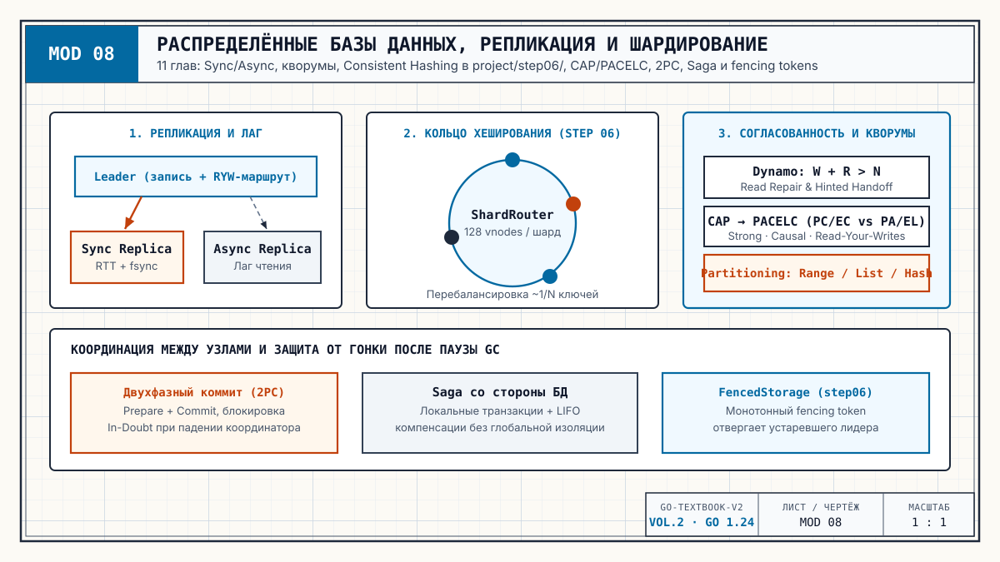

*Одиннадцать глав о выходе базы данных за пределы одного сервера: от синхронной/асинхронной репликации и консистентного хеширования в `project/step06/` до моделей согласованности, CAP/PACELC, 2PC, Saga и fencing tokens.*

> «В распределённых системах отказ одного узла — не исключение, а штатный режим работы; сложность растёт не от числа серверов, а от числа состояний сети между ними.»  
> — *Сводный принцип раздела; подробнее о теории консенсуса и отказоустойчивости — в Томе 4*

## Что нужно знать до старта

* **Модули 1–7:** реляционные схемы, индексы `B-Tree`/`Hash`, транзакции (`ACID`, MVCC, WAL), потоковая/логическая репликация PostgreSQL и `Binlog`/`GTID` в MySQL.

## Что вы соберёте в этом разделе

* **Грамотную топологию репликации** — научитесь выбирать между `Async`, `Semi-Sync` и `Sync`, управлять лагом репликации `Leader-Follower` (`Read-Your-Writes`, `Monotonic Reads`), а также разрешать конфликты записи в `Multi-Leader` и настраивать кворумы $R + W > N$ в `Leaderless`.
* **Шардирование и партиционирование без перекосов** — разберёте локальное `Partitioning` (`Range`/`List`/`Hash`) и горизонтальное `Sharding`, перебалансировку без остановки сервиса и код `ShardRouter` (кольцо консистентного хеширования с виртуальными узлами) в `project/step06/sharding.go`.
* **Честные границы распределённых транзакций** — поймёте цену `Two-Phase Commit` (2PC) при отказе координатора, роль `Saga` со стороны локальных транзакций БД и защиту от устаревших блокировок через `fencing tokens` (`FencedStorage` в `project/step06/`).

## Карта раздела

1. [[1. Репликация — синхронная, полусинхронная и асинхронная]] — физика сетевого RTT против долговечности WAL, `synchronous_commit` и потеря транзакций при failover.
2. [[2. Репликация Leader-Follower — лаг репликации и аномалии чтения]] — `Read-Your-Writes`, `Monotonic Reads`, `Consistent Prefix Reads` и маршрутизатор `ReadYourWritesRouter` из `project/step06/`.
3. [[3. Multi-Leader и Leaderless репликация — конфликты записи и кворумы]] — разрешение конфликтов (LWW, CRDT), кворумы Dynamo $R + W > N$, Read Repair и Hinted Handoff.
4. [[4. Шардирование (Sharding) — ключи, консистентное хеширование и перебалансировка]] — выбор ключа шардирования, `Cross-Shard JOIN`, кольцо консистентного хеширования в `project/step06/sharding.go` и перебалансировка.
5. [[5. Партиционирование (Partitioning) — Range, List, Hash и управление таблицами]] — декларативное партиционирование в PostgreSQL/MySQL, `Partition Pruning`, локальные индексы и мгновенный `DROP`/`DETACH` старых партиций.
6. [[6. Модели согласованности в БД — Strong, Eventual, Read-Your-Writes и Causal]] — линеаризуемость, последовательная, причинная (Lamport/Vector Clocks) и конечная согласованность глазами клиента БД.
7. [[7. CAP и PACELC в выборе баз данных]] — почему разделение сети (P) неизбежно, выбор `CP` vs `AP` при сбое и компромисс `Latency vs Consistency` (PACELC) в нормальном режиме.
8. [[8. Распределённые транзакции — цена атомарности между узлами]] — отказ от глобального атомарного коммита, координация и изоляция между независимыми базами данных.
9. [[9. Двухфазный коммит (2PC) — протокол, блокировки и отказ координатора]] — фазы `Prepare` и `Commit`, окно неопределённости при падении координатора, удержание замков и сравнение с `3PC`.
10. [[10. Паттерн Saga со стороны базы данных — локальные транзакции и компенсации]] — хореография и оркестрация, семантика `ACD` без `I` (пивотная транзакция, компенсирующие проводки в `LedgerPulse`).
11. [[11. Распределённые блокировки (Distributed Locks) и fencing tokens]] — миф об идеальном мьютексе поверх Redis/Redlock, `GC-паузы`, монотонные `fencing tokens` и `FencedStorage` в `project/step06/`.
