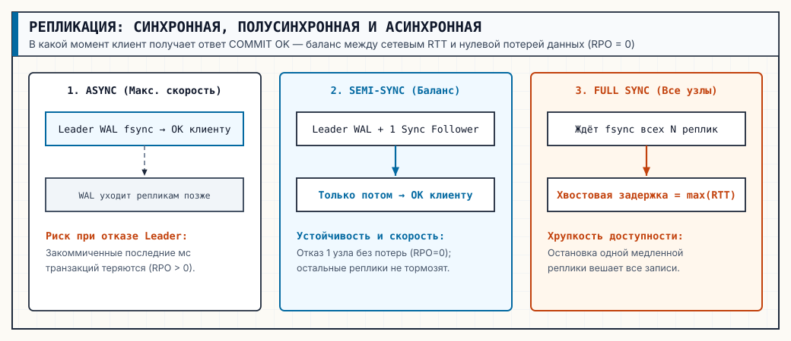
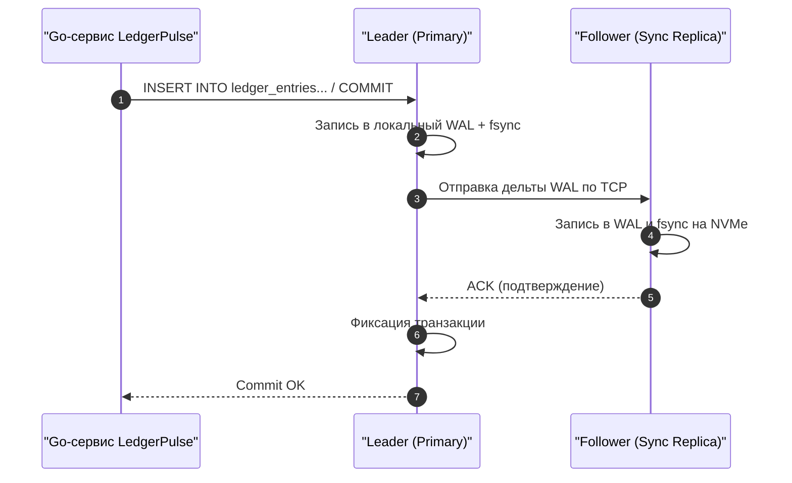
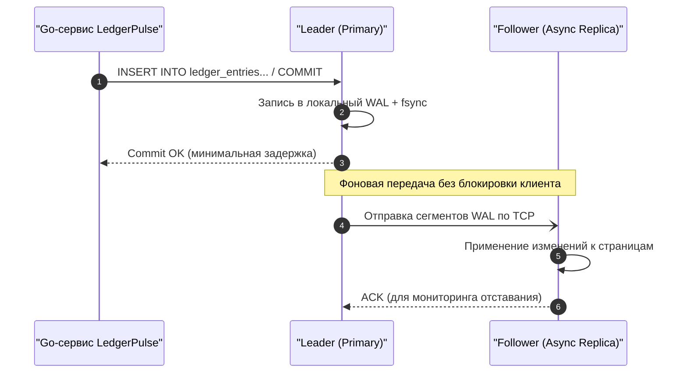
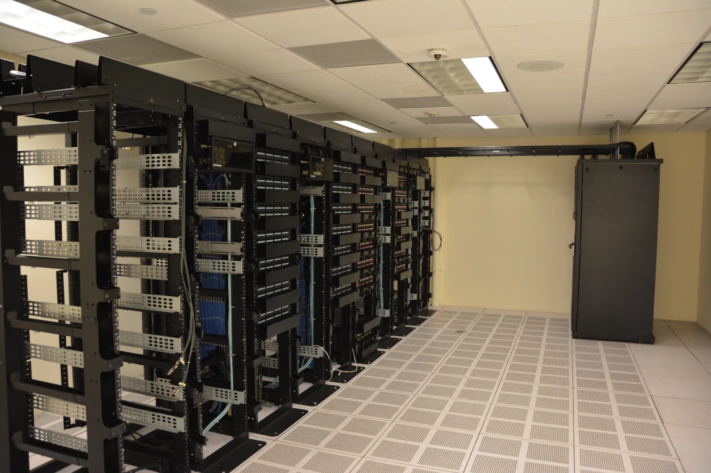
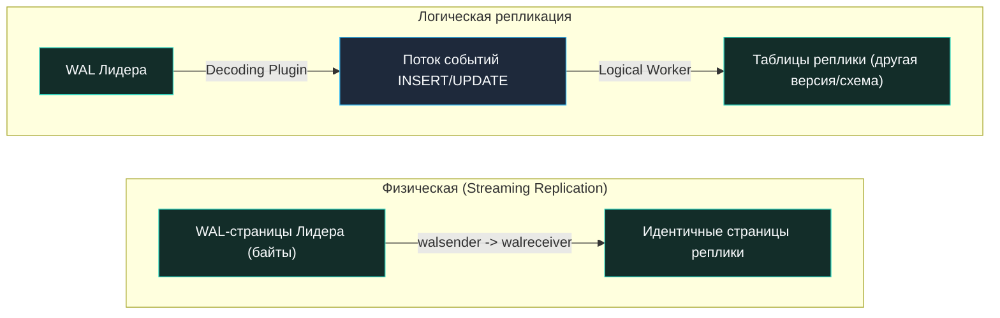

*Физика сетевого RTT против долговечности WAL, уровни `synchronous_commit`, физическая и логическая доставка изменений и разделение пулов чтения и записи в Go.*

> «Любая функция ввода-вывода обязана считаться с вероятностью сбоя, и лишь наивный программист верит, что простое чтение или запись не могут завершиться ошибкой. Именно тогда, когда внезапно отказывают самые надёжные операции, нам нужнее всего знать почему.»  
> — Алан Донован и Брайан Керниган, *The Go Programming Language*

Даже сервер с терабайтами оперативной памяти и массивом NVMe остаётся уязвимой **единой точкой отказа (Single Point of Failure, SPOF)**. Выходит из строя контроллер накопителя, в стойке пропадает питание, либо экскаватор перебивает магистральный оптоволоконный кабель — и одиночная база `LedgerPulse` перестаёт отвечать. Единственный способ пережить аппаратные сбои — **избыточность (Redundancy)** через непрерывную **репликацию**, поддержание нескольких актуальных копий данных на физически независимых узлах.

Помимо высокой доступности (**High Availability, HA**) и катастрофоустойчивости (**Disaster Recovery**), репликация открывает горизонтальное масштабирование нагрузки на чтение (**Read Scaling**): тяжёлые выборки выписки по счёту уходят на резервные серверы, оставляя ресурсы основного узла для транзакций записи. За это приходится платить усложнением протокола фиксации. Главный инженерный вопрос звучит так: *в какой именно момент транзакция считается сохранённой, а реплика — обновлённой?*

Ответ делит стратегии подтверждения записи на три режима: **синхронный**, **асинхронный** и **полусинхронный**.

---

## Синхронная репликация и цена скорости света



При **синхронной репликации (Synchronous Replication)** основной узел (**Leader / Primary**) не возвращает прикладному клиенту статус успешного коммита до тех пор, пока изменения не будут гарантированно записаны хотя бы на одной или всех назначенных репликах (**Follower / Standby**).

Путь транзакции в `LedgerPulse` при синхронном режиме состоит из шести шагов:
1. Go-сервис отправляет `INSERT INTO ledger_entries ...` и вызывает `tx.Commit()`.
2. Лидер записывает изменения в локальный журнал предзаписи (**WAL**, см. [[8. WAL — журнал упреждающей записи и долговечность на диске]]) и сбрасывает их на свой диск.
3. Лидер ставит фиксацию транзакции на паузу и отправляет байты WAL по сети на реплику.
4. Реплика принимает пакет, записывает дельту в свой WAL и вызывает системный вызов `fsync()` для сброса страниц из кэша ОС на носитель.
5. Реплика отправляет Лидеру сетевое подтверждение (**ACK**).
6. Только после получения ACK Лидер помечает транзакцию зафиксированной и возвращает `OK` приложению.



### Физика сети, диска и планировщик Go

Чтобы оценить цену синхронной гарантии, сравним порядки задержек разных уровней железа:

| Уровень иерархии | Типичная задержка | Примечание |
| :--- | :--- | :--- |
| Доступ к RAM | ~100 нс | Локальная память процесса БД |
| `fsync()` на локальный NVMe | ~100 мкс | Сброс WAL из Page Cache на флеш-память |
| Запись на HDD (случайная) | ~10 мс | Механический поворот головки и пластин |
| Сеть внутри одной зоны доступности (AZ) | ~0,3–0,5 мс | Короткий оптоволоконный маршрут |
| Сеть между зонами (Cross-AZ) | ~1–2 мс | Соседние дата-центры в одном регионе |
| Межконтинентальный канал (Франкфурт — Вирджиния) | ~70–80 мс | Скорость света в кварцевом стекле ~200 000 км/с |

Скорость света в оптическом волокне ограничена ~$200\,000$ км/с (минимум 1 мс RTT на каждые 200 км). Между Франкфуртом и Вирджинией фотоны добавляют 70–80 мс к каждому `COMMIT`, ограничивая один поток записи потолком 10–15 транзакций в секунду.

Синхронная репликация привязывает **Write Latency** кластера к самому медленному узлу: пауза диска или обрыв на одной реплике подвешивает все пишущие транзакции Лидера. В Go сетевой поллер (`netpoller` поверх `epoll_wait`) при вызове `tx.Commit()` освобождает поток ОС (`M`), но горутина (стек 2–8 КБ) и соединение пула остаются занятыми. При сетевом джиттере 10 000 ожидающих транзакций замораживают до 80 МБ памяти под стеки, удерживают дескрипторы ядра (`ulimit -n`) и исчерпывают `SetMaxOpenConns`.

> [!tip] Собеседование [Middle]
> **Вопрос:** Когда на практике оправдана строгая синхронная репликация, а когда от неё отказываются?
>
> **Ответ:** Чистая синхронная репликация со строгим ожиданием диска на удалённом узле оправдана там, где потеря даже одной зафиксированной транзакции недопустима юридически или финансово — например, при фиксации межбанковского клиринга или проводок двойной записи в `LedgerPulse` (`RPO = 0`, нулевая точка восстановления). В остальных системах вместо ожидания всех узлов используют **полусинхронную репликацию** (ожидание одной реплики в соседней AZ) либо **кворумные консенсусные протоколы** (Raft/Paxos), где достаточно подтверждения от большинства узлов ($\lfloor N / 2 \rfloor + 1$).

---

## Асинхронная репликация и окно потери данных

При **асинхронной репликации (Asynchronous Replication)** Лидер записывает транзакцию в локальный WAL, вызывает `fsync()` на своём диске и немедленно возвращает приложению `Commit OK`. Отправка журнала на реплики выполняется фоновыми процессами по мере пропускной способности сети и загрузки CPU реплик.



Асинхронная схема даёт низкую задержку записи и полную автономность Лидера: даже при отключении всех реплик он принимает транзакции. Обратная сторона — два эффекта:
1. **Риск потери данных (`RPO > 0`):** при гибели Лидера до отправки свежего WAL по сети подтверждённые транзакции теряются при переключении (failover) на реплику.
2. **Лаг репликации (Replication Lag) и Eventual Consistency:** реплика применяет изменения с задержкой от миллисекунд до минут. Модель, где реплики догоняют Лидер после остановки записи, называется **согласованностью в конечном счёте (Eventual Consistency)**. Чтение с отстающей реплики даёт **Stale Read** и аномалию **Read-After-Write** (пользователь не видит только что созданный платёж), которую мы подробно разберём в главе [[2. Репликация Leader-Follower — лаг репликации и аномалии чтения]].

---

## Полусинхронная репликация и настройки СУБД



Чтобы не выбирать между мгновенной, но рискованной асинхронностью и медленной строгой синхронностью по всем узлам, промышленные кластеры используют **полусинхронную репликацию (Semi-Synchronous Replication)**. В этом режиме Лидер ждёт подтверждения строго от **одной** быстрой реплики (обычно расположенной в другой стойке или соседней зоне доступности в 1–2 мс RTT), а остальные реплики догоняют поток асинхронно.

| Характеристика | Синхронная (на все узлы) | Полусинхронная (1 узел / кворум) | Асинхронная |
| :--- | :--- | :--- | :--- |
| Согласованность | Строгая на всех узлах | Строгая на Лидере и синхронной реплике | Конечная (Eventual Consistency) |
| Доступность записи | Низкая (отказ любой реплики стопорит запись) | Средняя/высокая (деградация при отказе выделенной реплики или кворум) | Максимальная (Лидер не зависит от реплик) |
| Задержка записи | Линейно зависит от самого медленного RTT + `fsync` | Локальный `fsync` + 1 RTT до ближайшей реплики | Скорость локального `fsync` на Лидере |
| Потеря данных (RPO) | `RPO = 0` | `RPO = 0` до момента деградации в async | `RPO > 0` (пропорционально лагу отправки WAL) |

### Реализация в PostgreSQL и MySQL

В **PostgreSQL** поведение управляется двумя параметрами (подробно разобрано в [[11. Репликация в PostgreSQL — потоковая, логическая и слоты]]): списком синхронных кандидатов `synchronous_standby_names` и уровнем фиксации `synchronous_commit`.

```sql
-- В postgresql.conf на Лидере: ждём подтверждения хотя бы от одной реплики из двух
-- synchronous_standby_names = 'FIRST 1 (ledger_az2, ledger_az3)'

-- Уровень надёжности можно менять даже на уровне конкретной транзакции в Go!
BEGIN;
SET LOCAL synchronous_commit = 'on';
INSERT INTO ledger_entries (account_id, delta_minor) VALUES (42, -50000);
COMMIT;
```

Пять значений `synchronous_commit` задают точную градацию между скоростью и прочностью:
* `off` — клиент получает ответ до сброса локального WAL на диск (риск потери последних миллисекунд даже на одиночном сервере).
* `local` — коммит ждёт локального `fsync()` WAL на Лидере, игнорируя синхронных фолловеров.
* `remote_write` — Лидер ждёт, пока реплика примет байты WAL и запишет их в Page Cache своей ОС (без удалённого `fsync`). Двойной одновременный сбой питания потеряет транзакцию, зато одиночный отказ Лидера переживается.
* `on` (по умолчанию при заданном `synchronous_standby_names`) — Лидер ждёт, пока реплика вызовет `fsync()` WAL на свой NVMe. Гарантирует `RPO = 0`.
* `remote_apply` — Лидер ждёт не только сброса WAL на диск реплики, но и фактического применения изменений к таблицам (`replay_lsn`), чтобы чтение с этой реплики сразу видело новую строку.

В **MySQL** полусинхронная схема обеспечивается плагином `rpl_semi_sync_master` в режиме `AFTER_SYNC` (см. [[5. Репликация в MySQL — Binlog, GTID и Group Replication]]): мастер сбрасывает `Binlog`, отправляет событие и ждёт ACK от реплики до окончательной публикации коммита в движке InnoDB. Если за заданный таймаут (`rpl_semi_sync_source_wait_for_replica_count` / `timeout`) подтверждение не приходит, MySQL автоматически переключается в асинхронный режим, сохраняя доступность записи ценой временного снижения RPO. В PostgreSQL при падении *всех* реплик из `synchronous_standby_names` запись с `synchronous_commit = on` заблокируется до восстановления хотя бы одной реплики (поэтому в список ставят минимум две реплики: `ANY 1 (az2, az3)`).

---

## Физический и логический транспорт под капотом

Независимо от выбранного режима подтверждения, изменения нужно доставить по сети с Лидера на Фолловеры. Современные СУБД применяют два принципиально разных механизма доставки.



1. **Физическая (потоковая) репликация:** процесс `walsender` на Лидере считывает из WAL точные бинарные дельты 8-килобайтных страниц диска и передаёт их процессу `walreceiver` на реплике.
   * *Плюсы:* нулевые накладные расходы CPU на парсинг и декодирование, максимальная пропускная способность, точная копия всех баз, индексов и таблиц кластера.
   * *Минусы:* реплика обязана совпадать с Лидером по мажорной версии СУБД, архитектуре процессора (`x86_64` / `arm64`) и порядку байтов; нельзя реплицировать одну таблицу выборочно.
2. **Логическая репликация:** специальный декодер (например, `pgoutput` в PostgreSQL или `Row-Based Binlog` в MySQL) преобразует физические записи журнала в логические события изменения кортежей (`INSERT account_id=42, delta=-50000`).
   * *Плюсы:* позволяет обновлять мажорную версию СУБД с нулевым простоем (например, PostgreSQL 15 на 17), переносить данные между `x86_64` и `arm64`, фильтровать таблицы и отдельные столбцы.
   * *Минусы:* повышенная нагрузка на CPU и память при декодировании потока WAL, необходимость иметь первичный ключ или `REPLICA IDENTITY` для корректного `UPDATE`/`DELETE`.

---

## Разделение пулов в Go для `LedgerPulse`

Стандартный пакет `database/sql` не анализирует текст SQL и не знает о ролях узлов в кластере. Прикладной код на Go сам разделяет поток операций между пулом записи (Лидер) и пулом масштабируемых чтений (Фолловеры), выставляя строгие ограничения открытых соединений, чтобы не перегрузить сервер при скачках задержки синхронной репликации.

```go
package replication

import (
	"context"
	"database/sql"
	"errors"
	"fmt"
	"time"
)

// ClusterDB инкапсулирует раздельные пулы соединений к Лидеру и Фолловерам.
type ClusterDB struct {
	Leader   *sql.DB
	Follower *sql.DB
}

// NewClusterDB настраивает пулы с явными лимитами под разный профиль нагрузки.
func NewClusterDB(driver, leaderDSN, followerDSN string) (*ClusterDB, error) {
	leader, err := sql.Open(driver, leaderDSN)
	if err != nil {
		return nil, fmt.Errorf("open leader: %w", err)
	}
	// Жёсткий потолок на Лидере защищает его от шторма горутин при сетевом джиттере.
	leader.SetMaxOpenConns(25)
	leader.SetMaxIdleConns(10)
	leader.SetConnMaxLifetime(10 * time.Minute)

	follower, err := sql.Open(driver, followerDSN)
	if err != nil {
		_ = leader.Close()
		return nil, fmt.Errorf("open follower: %w", err)
	}
	// Чтений обычно в 5–10 раз больше, поэтому пул реплик шире.
	follower.SetMaxOpenConns(100)
	follower.SetMaxIdleConns(25)
	follower.SetConnMaxLifetime(10 * time.Minute)

	return &ClusterDB{Leader: leader, Follower: follower}, nil
}

// PostEntry фиксирует проводку строго на Лидере с заданным уровнем синхронности.
func (c *ClusterDB) PostEntry(ctx context.Context, accountID, deltaMinor int64, strictSync bool) error {
	tx, err := c.Leader.BeginTx(ctx, nil)
	if err != nil {
		return fmt.Errorf("begin tx: %w", err)
	}
	defer func() { _ = tx.Rollback() }()

	if strictSync {
		// Гарантия RPO = 0 для критичных финансовых проводок.
		if _, err := tx.ExecContext(ctx, "SET LOCAL synchronous_commit = 'on'"); err != nil {
			return fmt.Errorf("set sync commit: %w", err)
		}
	}

	if _, err := tx.ExecContext(
		ctx,
		`INSERT INTO ledger_entries (account_id, delta_minor) VALUES ($1, $2)`,
		accountID, deltaMinor,
	); err != nil {
		return fmt.Errorf("insert entry: %w", err)
	}
	return tx.Commit()
}

// ReadBalance читает баланс с реплики, если не требуется строгая актуальность.
func (c *ClusterDB) ReadBalance(ctx context.Context, accountID int64, fromLeader bool) (int64, error) {
	target := c.Follower
	if fromLeader {
		target = c.Leader
	}
	var balance int64
	err := target.QueryRowContext(
		ctx,
		`SELECT COALESCE(SUM(delta_minor), 0) FROM ledger_entries WHERE account_id = $1`,
		accountID,
	).Scan(&balance)
	if err != nil && !errors.Is(err, sql.ErrNoRows) {
		return 0, fmt.Errorf("query balance: %w", err)
	}
	return balance, nil
}
```

Если синхронная реплика теряет связь с сетью при `synchronous_commit = 'on'`, а резервных синхронных узлов в `synchronous_standby_names` больше нет, вызов `tx.Commit()` в функции `PostEntry` зависнет до истечения таймаута переданного `ctx`:

```text
ERROR: canceling statement due to user request
CONTEXT: while waiting for synchronous replication confirmation at LSN 0/1A4F890
```

> [!warning] Ловушка: Забытый `context.WithTimeout` при синхронной репликации
> Если передавать в `PostEntry` фоновый `context.Background()`, зависание единственной синхронной реплики заблокирует горутину и её соединение из `Leader` навечно. Все запросы исчерпают лимит `25` соединений за секунды, и сервис `LedgerPulse` упадёт полностью, даже для операций чтения. Всегда ограничивайте время ожидания транзакции через `context.WithTimeout(ctx, 2*time.Second)` и перечисляйте минимум двух кандидатов в `synchronous_standby_names`.

---

## Упражнения

1. **Базовое.** Кластер `LedgerPulse` использует строгую синхронную репликацию на один узел. Лидер расположен во Франкфурте, синхронная реплика — в Вирджинии (сетевой RTT между ними — 76 мс). Локальный `fsync()` WAL на NVMe занимает 0,1 мс, обработка логики в Go — 0,2 мс. Оцените минимальное время одного последовательного `COMMIT` и максимальный TPS одного потока записи. Как изменится цифра, если перенести синхронную реплику в соседнюю зону доступности во Франкфурте (RTT = 1,2 мс)?

> [!solution] Показать решение
> При межконтинентальной синхронной репликации время одного коммита складывается из локального `fsync` на Лидере (0,1 мс), сетевого RTT туда и обратно (76 мс), `fsync` на удалённой реплике (0,1 мс) и локальной обработки (0,2 мс) — итого около **76,4 мс**. Один последовательный поток сможет выполнить не более $1000 / 76.4 \approx 13{,}1$ транзакции в секунду.
>
> При переносе синхронной реплики в соседнюю AZ во Франкфурте (RTT = 1,2 мс) время коммита упадёт до $0{,}1 + 1{,}2 + 0{,}1 + 0{,}2 = 1{,}6\text{ мс}$, а пропускная способность одного потока вырастет до $1000 / 1{,}6 = 625\text{ TPS}$ (почти в 48 раз быстрее при сохранении `RPO = 0` на уровне зоны доступности).

2. **Практическое.** В кластере PostgreSQL задано `synchronous_standby_names = 'ANY 1 (replica_az2, replica_az3)'`. Необходимо, чтобы проводки перевода денег (`POST /transfers`) гарантированно дожидались `fsync()` хотя бы на одной из двух реплик, а запись телеметрии в таблицу `audit_events` коммитилась без ожидания сети. Напишите SQL-команду для сессии или транзакции записи аудита и объясните, почему она безопасна для соседних финансовых транзакций.

> [!solution] Показать решение
> ```sql
> BEGIN;
> SET LOCAL synchronous_commit = 'local';
> INSERT INTO audit_events (event_type, payload) VALUES ('login', '{"ip":"10.0.0.5"}');
> COMMIT;
> ```
> Команда `SET LOCAL` действует строго до конца текущей транзакции (`BEGIN ... COMMIT`), поэтому при возврате соединения в пул `pgxpool` или `database/sql` соседние транзакции переводов продолжат работать с серверным значением `synchronous_commit = 'on'` и гарантией `RPO = 0`. Запись аудита при этом ограничится локальным `fsync()` на Лидере (~100 мкс), не тратя сетевой RTT.

3. **Со звёздочкой (\*).** В MySQL включена полусинхронная репликация с таймаутом 1 000 мс (`rpl_semi_sync_source_timeout = 1000`). В 12:00:00 сеть до единственной полусинхронной реплики обрывается на 30 секунд. В 12:00:05 Лидер теряет питание и не подлежит восстановлению. Опишите по шагам состояние кластера между 12:00:00 и 12:00:05 и объясните, будут ли потеряны подтверждённые транзакции при переключении на реплику.

> [!solution] Показать решение
> 1. **12:00:00 – 12:00:01:** Первая транзакция после обрыва сети ждёт ACK от реплики в течение 1 000 мс. По истечении таймаута `rpl_semi_sync_master` фиксирует таймаут и **автоматически переводит кластер в асинхронный режим**, чтобы сохранить доступность записи.
> 2. **12:00:01 – 12:00:05:** Все новые транзакции на Лидере коммитятся локально и мгновенно возвращают клиенту `OK`, но их `Binlog`-события не доходят до отрезанной реплики.
> 3. **12:00:05:** При внезапной гибели Лидера и последующем промоушене реплики все транзакции, подтверждённые за эти 4 секунды асинхронной работы, **будут безвозвратно потеряны** (`RPO > 0`). Полусинхронный режим защищает от потери данных только до тех пор, пока жива хотя бы одна реплика в пределах таймаута. Чтобы избежать тихого переключения в async, в финансовых системах держат минимум две синхронные реплики в кворуме или ставят большой таймаут (выбирая остановку записи вместо потери денег).

---

Мы разобрались с временными режимами подтверждения записи и физическим транспортом журналов. Но в кластере из нескольких машин остаётся открытым вопрос ролей и побочных эффектов асинхронной доставки: кто именно имеет право принимать изменения, как пережить аварию Лидера без «расщепления мозга» и как защитить пользователей от устаревших чтений? Эти вопросы разберём в следующей главе — [[2. Репликация Leader-Follower — лаг репликации и аномалии чтения]].
