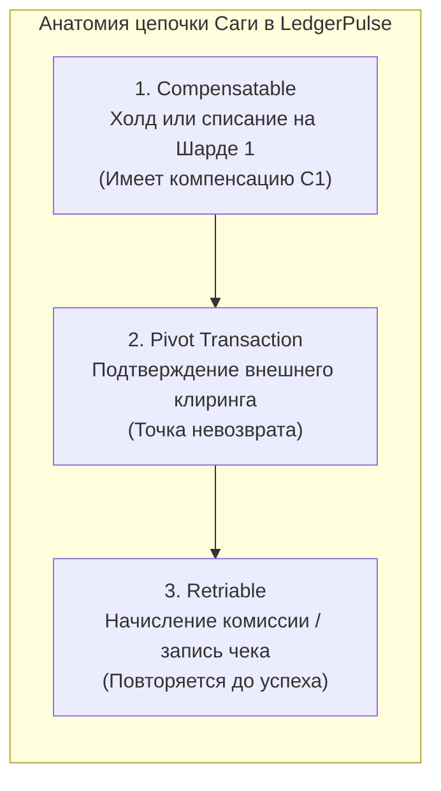

*Как заменить блокирующий 2PC цепочкой локальных транзакций в `LedgerPulse`: семантика `ACD` без `I`, поворотная транзакция, неизменяемые компенсирующие проводки, таблицы `saga_executions`, `outbox_events` и `idempotency_keys`, семантические блокировки и код на Go 1.24.*

> «Хотя поддержка конкурентности — одна из главных сильных сторон Go, рассуждать о конкурентных программах по природе труднее, чем о последовательных, и интуиция, выработанная на последовательном коде, порой подводит.»  
> — Алан Донован и Брайан Керниган, *The Go Programming Language*

В [[9. Двухфазный коммит (2PC) — протокол, блокировки и отказ координатора|предыдущей главе]] мы убедились, что протокол 2PC защищает строгую атомарность дорогой ценой: пока пакеты идут по сети, базы данных держат эксклюзивные блокировки строк, а падение координатора замораживает участников в состоянии `In-Doubt`. В высоконагруженных системах и шардированной архитектуре `LedgerPulse` такой простой недопустим.

Решение предложили исследователи Принстонского университета Гектор Гарсия-Молина и Кеннет Салем ещё в 1987 году, описав **паттерн Сага (Saga Pattern)**. Идея проста: вместо одной глобальной транзакции, держащей замки поверх сети, система выполняет цепочку коротких **локальных ACID-транзакций**. Каждая транзакция коммитится в своей базе немедленно и освобождает блокировки. Если на одном из следующих шагов возникает сбой, запускается обратная последовательность **компенсирующих транзакций (Compensating Transactions)**, которая логически нейтрализует уже зафиксированные изменения.

---

## Анатомия Саги: `ACD` без свойства `Isolation`

Главный сдвиг мышления при переходе от одиночной СУБД к Сагам: **между шагами Саги нет изоляции (`Isolation`)**.

Поскольку первый шаг уже выполнил `COMMIT` в своей базе данных, его результаты сразу видны другим запросам. В `LedgerPulse` это означает, что деньги со счёта отправителя уже списаны, а на шард получателя ещё не зачислены. Система временно находится в промежуточном состоянии, которое открыто для чтения другим клиентам.

Формально Сага обеспечивает свойства **`ACD`**:
* **Atomicity (семантическая атомарность):** либо все шаги завершатся успешно, либо уже выполненные будут компенсированы;
* **Consistency:** система приходит к [[6. Модели согласованности в БД — Strong, Eventual, Read-Your-Writes и Causal|согласованности в конечном счёте (Eventual Consistency)]];
* **Durability:** каждый шаг защищён локальным `WAL` своей СУБД.

### Три роли транзакций внутри Саги

Чтобы Сага корректно переживала сбои, каждый шаг цепочки проектируется как одна из трёх категорий:



1. **Компенсируемые транзакции (`Compensatable`):** шаги до точки невозврата. У каждого такого шага есть парная компенсирующая операция в БД (например, возвратная проводка в `ledger_entries` или снятие резерва средств).
2. **Поворотная транзакция (`Pivot Transaction`):** точка невозврата. Если поворотный шаг завершился сбоем — Сага разворачивается назад и запускает компенсации. Если поворотный шаг зафиксировал `COMMIT`, Сага обязана дойти до конца вперёд — откатить поворотный шаг нельзя.
3. **Повторяемые транзакции (`Retriable`):** шаги строго *после* поворотной точки (например, начисление сервисной комиссии или запись уведомления). Они проектируются так, чтобы гарантированно завершаться успехом при многократных идемпотентных повторах.

---

## Хореография и оркестрация: взгляд со стороны базы данных

В распределённой архитектуре различают два стиля управления Сагой:
* **Хореография (Choreography):** центрального координатора нет. Каждый сервис фиксирует локальную транзакцию и публикует событие, на которое реагирует следующий участник. Подход удобен для коротких цепочек из 2–3 шагов, но при расширении бизнес-логики превращается в «спагетти-события», где сложно отследить текущий статус перевода и отладить циклы.
* **Оркестрация (Orchestration):** выделенный координатор (конечный автомат) последовательно отправляет команды участникам, сохраняет прогресс каждого шага в базе данных и при ошибке запускает компенсации строго в обратном порядке — **LIFO (`Last-In, First-Out`)**. Если оркестратор опирается на отказоустойчивую таблицу состояний в БД, он не становится единой точкой отказа при перезапуске процесса.

Межсервисная инфраструктура доставки событий (брокеры `Kafka`, `RabbitMQ`, `NATS`, библиотека `Watermill`) и внешние движки оркестрации рабочих процессов вроде `Temporal.io` или `Cadence` подробно разбираются в следующем томе (подробнее см. Том 3). Здесь мы сосредоточимся на том, как правильно устроить **таблицы, блокировки и локальные транзакции в самой базе данных**.

---

## Проектирование Саги на уровне таблиц `LedgerPulse`

Перенос Саги на уровень SQL требует четырёх чётких паттернов в схеме базы данных.

### 1. Неизменяемые компенсирующие проводки вместо `DELETE`

В финансовом учёте `LedgerPulse` нельзя «отменить» шаг 1 через `DELETE FROM ledger_entries WHERE transaction_id = ...`. Удаление закоммиченных строк разрушает аудиторский след и нарушает бухгалтерские инварианты.

Компенсация в базе данных — это **новая полноценная транзакция**:
1. Исходная запись в таблице `transactions` помечается статусом `'reversed'`.
2. Создаётся новая запись `transactions` с уникальным `reference_id` (например, `'saga-901-comp-1'`) и статусом `'posted'`.
3. В `ledger_entries` добавляется парная проводка с обратным знаком (`+amount` вместо `-amount`), а `balance` счёта увеличивается в той же локальной транзакции.

### 2. Семантические блокировки (`Semantic Locking`) против потерянного обновления

> [!warning] Ловушка: потерянное обновление (`Lost Update`) из-за отсутствия `Isolation`
> Пока Сага переводит 10 000 копеек и ждёт ответа второго шарда, параллельный запрос может прочитать ещё не зафиксированный итог перевода или потратить те же средства повторно. Если шаг 1 просто записал промежуточную сумму или не закрыл резерв, параллельная транзакция перезапишет баланс, а последующая компенсация Саги вернёт деньги дважды.

Защита от этого на уровне БД — **семантическая блокировка (`Semantic Lock`)**. Вместо мгновенного финального списания или незаметного статуса строка в базе явно помечается переходным состоянием:
* в таблице `transactions` перевод создаётся со статусом **`'pending'`**;
* на уровне счёта `accounts` используется поле резерва `held_balance` (или таблица удержаний `account_holds`), а проверка достаточности средств проверяет `balance - held_balance >= $1` (подробнее о базовых аномалиях читайте в [[4. Аномалии — Dirty Read, Phantom Read, Lost Update и Write Skew]]).

Любая сторонняя бизнес-операция видит транзакцию в статусе `'pending'` или зарезервированный остаток и либо пропускает её, либо отказывает в двойном списании до завершения Саги.

### 3. Таблица состояния оркестратора (`saga_executions`)

Если оркестратор хранит выполненные шаги только в памяти Go (в слайсе), перезапуск пода между шагом 2 и шагом 3 приведёт к потере контекста: процесс не узнает, какие шаги уже прошли и что нужно компенсировать. Поэтому состояние автомата хранят в PostgreSQL:

```sql
CREATE TABLE IF NOT EXISTS saga_executions (
    saga_id      TEXT        PRIMARY KEY,
    saga_type    TEXT        NOT NULL,
    state        TEXT        NOT NULL CHECK (state IN ('running', 'compensating', 'completed', 'failed')),
    current_step INT         NOT NULL DEFAULT 0,
    payload      JSONB       NOT NULL,
    last_error   TEXT        NOT NULL DEFAULT '',
    updated_at   TIMESTAMPTZ NOT NULL DEFAULT now()
);
```

Перед вызовом шага (или сразу после его локального коммита) оркестратор обновляет `current_step` и `state`, переживая падения процесса без потери истории.

### 4. `outbox_events` и `idempotency_keys` в одной локальной транзакции

Если сервис зафиксировал `COMMIT` в PostgreSQL, а через миллисекунду упал до отправки сообщения в брокер, следующий шаг Саги никогда не запустится. Чтобы исключить этот разрыв, в схеме `LedgerPulse` (`project/sql/migrations/003_idempotency_outbox.sql`) используются таблицы `outbox_events` и `idempotency_keys`:
* **Transactional Outbox:** запись в `ledger_entries` и вставка события в `outbox_events` выполняются внутри **одного локального `BEGIN ... COMMIT`**. Отдельный процесс или CDC-коннектор (`Debezium`) позже считывает неопубликованные строки (`WHERE published_at IS NULL`) и доставляет их в шину сообщений (подробнее см. Том 3).
* **Идемпотентность (`idempotency_keys`):** каждый прямой шаг (`saga-901:step-1`) и каждая компенсация (`saga-901:comp-1`) передают уникальный ключ идемпотентности. Если сеть оборвалась и оркестратор повторил команду, локальная БД не проведёт возврат дважды.

---

## Практика в Go 1.24: DB-оркестратор и компенсирующая проводка

Ниже показан каркас оркестратора Саги на Go 1.24 с обратным порядком компенсаций (LIFO) и реальный метод `CompensateDebit`, выполняющий идемпотентную возвратную проводку в таблицах `LedgerPulse`.

```go
package saga

import (
	"context"
	"database/sql"
	"encoding/json"
	"errors"
	"fmt"
	"log"
	"time"
)

// Step описывает шаг Саги с прямым действием и парной компенсацией.
type Step struct {
	Name       string
	Execute    func(ctx context.Context) error
	Compensate func(ctx context.Context) error
}

// Run выполняет шаги последовательно; при сбое запускает компенсации в порядке LIFO.
func Run(ctx context.Context, steps []Step) error {
	executed := make([]Step, 0, len(steps))
	for _, st := range steps {
		if err := st.Execute(ctx); err != nil {
			rollbackLIFO(ctx, executed)
			return fmt.Errorf("step %s failed: %w", st.Name, err)
		}
		executed = append(executed, st)
	}
	return nil
}

func rollbackLIFO(ctx context.Context, executed []Step) {
	for i := len(executed) - 1; i >= 0; i-- {
		st := executed[i]
		if st.Compensate == nil {
			continue
		}
		if err := st.Compensate(ctx); err != nil {
			// Критическая ситуация: упавшая компенсация направляется в DLQ и алертинг
			log.Printf("DLQ_ALERT compensate step=%s err=%v", st.Name, err)
		}
	}
}

// CompensateDebit идемпотентно возвращает списанную сумму новой проводкой в LedgerPulse.
func CompensateDebit(ctx context.Context, db *sql.DB, sagaID, origRefID string, accountID, amount int64) error {
	compKey := sagaID + ":comp:debit"
	tx, err := db.BeginTx(ctx, nil)
	if err != nil {
		return fmt.Errorf("begin tx: %w", err)
	}
	defer func() { _ = tx.Rollback() }()

	var dummy int64
	err = tx.QueryRowContext(ctx,
		`SELECT transaction_id FROM idempotency_keys WHERE idempotency_key = $1`, compKey,
	).Scan(&dummy)
	if err == nil {
		return tx.Commit() // Компенсация уже применялась ранее
	}
	if !errors.Is(err, sql.ErrNoRows) {
		return fmt.Errorf("check idempotency: %w", err)
	}

	if _, err := tx.ExecContext(ctx,
		`UPDATE accounts SET balance = balance + $1, updated_at = now() WHERE id = $2`,
		amount, accountID,
	); err != nil {
		return fmt.Errorf("refund account: %w", err)
	}
	_, _ = tx.ExecContext(ctx, `UPDATE transactions SET status = 'reversed' WHERE reference_id = $1`, origRefID)

	var revTxID int64
	if err := tx.QueryRowContext(ctx,
		`INSERT INTO transactions (reference_id, kind, status, description)
		 VALUES ($1, 'transfer', 'posted', 'saga compensation') RETURNING id`,
		compKey,
	).Scan(&revTxID); err != nil {
		return fmt.Errorf("insert reversal tx: %w", err)
	}
	if _, err := tx.ExecContext(ctx,
		`INSERT INTO ledger_entries (transaction_id, account_id, amount, currency)
		 SELECT $1, id, $2, currency FROM accounts WHERE id = $3`,
		revTxID, amount, accountID,
	); err != nil {
		return fmt.Errorf("insert reversal entry: %w", err)
	}

	body, _ := json.Marshal(map[string]any{"reversal_tx_id": revTxID})
	if _, err := tx.ExecContext(ctx,
		`INSERT INTO idempotency_keys
		 (idempotency_key, request_hash, transaction_id, response_code, response_body, expires_at)
		 VALUES ($1, $1, $2, 200, $3, $4)`,
		compKey, revTxID, body, time.Now().Add(7*24*time.Hour),
	); err != nil {
		return fmt.Errorf("store comp key: %w", err)
	}
	return tx.Commit()
}
```

При сбое второго шага и повторном вызове компенсации вывод логов оркестратора и записи в `ledger_entries` выглядят предсказуемо:

```text
step=debit_shard_1 status=committed (balance: 10000 -> 5000, ledger_entry=-5000)
step=credit_shard_2 status=failed (account 88 is frozen) -> starting LIFO rollback
compensate step=debit_shard_1 status=committed (balance: 5000 -> 10000, ledger_entry=+5000, orig_tx=reversed)
retry compensate step=debit_shard_1 status=idempotent_hit (no-op, balance=10000)
```

> [!tip] Собеседование [Middle]
> **Вопрос:** Что должна делать система, если сама компенсирующая транзакция завершилась ошибкой?
>
> **Ответ:** Потеря компенсации оставляет систему в разорванном состоянии (деньги списаны без возврата). По правилам паттерна Saga все компенсирующие операции обязаны быть **повторяемыми (`Retriable`) и идемпотентными**. При сетевых таймаутах или временной недоступности БД оркестратор бесконечно повторяет компенсацию с экспоненциальной задержкой и джиттером. Если же ошибка не лечится повтором (например, программный баг или нарушение ограничения схемы), событие отправляется в очередь недоставленных сообщений (**DLQ — Dead Letter Queue**) с мгновенным алертом дежурному инженеру для ручного разбора.

> [!tip] Собеседование [Senior/Staff]
> **Вопрос:** Почему модель двойной записи (`ledger_entries`) подходит для Саг лучше, чем простое хранение одного столбца `balance` в таблице `accounts`?
>
> **Ответ:** Если менять только `balance`, при расследовании сбоя в Саге невозможно отличить нормальное пополнение от возвратной компенсации или двойного повтора. Модель `append-only` в `ledger_entries` хранит каждую прямую и компенсирующую проводку как отдельный неизменяемый факт с привязкой к `transaction_id` и `reference_id`, позволяя провести сверку баланса (`SUM(amount)`) и безопасно проверить идемпотентность на уровне уникальных ключей.

---

## Упражнения

### 1. Базовое: Классификация шагов Саги в `LedgerPulse`

Разбейте операцию международного перевода в `LedgerPulse` на три типа транзакций Саги (`Compensatable`, `Pivot`, `Retriable`):
1. Внутреннее резервирование 25 000 копеек на счёте клиента в PostgreSQL.
2. Неотменяемая отправка платёжного поручения во внешний межбанковский клиринг.
3. Начисление 100 бонусных баллов и сохранение квитанции для клиента.
4. Запись комиссии партнёру во внутренний реестр.

> [!solution] Показать решение
> * Шаг 1 (резервирование средств в PostgreSQL) — **`Compensatable`**: если клиринг отклонит платёж, резерв можно снять компенсирующей транзакцией.
> * Шаг 2 (неотменяемый внешний клиринг) — **`Pivot Transaction`**: как только внешняя система приняла поручение и транзакция зафиксировалась, откатить её автоматически невозможно; Сага обязана довести процесс до конца.
> * Шаги 3 и 4 (бонусы, квитанция, комиссия во внутренний реестр) — **`Retriable`**: следуют после точки невозврата и должны безопасно повторяться с ключом идемпотентности до гарантированного успеха.

### 2. Практическое: `Transactional Outbox` внутри шага Саги

Допишите в SQL-транзакцию `CompensateDebit` вставку доменного события `'saga.debit.compensated'` в таблицу `outbox_events` (`project/sql/migrations/003_idempotency_outbox.sql`) так, чтобы публикация факта компенсации была атомарна с возвратом баланса.

> [!solution] Показать решение
> Перед `tx.Commit()` в той же транзакции `tx` добавляется запрос:
> ```sql
> INSERT INTO outbox_events (aggregate_type, aggregate_id, event_type, payload)
> VALUES (
>     'saga',
>     $1, -- sagaID
>     'saga.debit.compensated',
>     jsonb_build_object(
>         'saga_id', $1,
>         'account_id', $2,
>         'amount', $3,
>         'reversal_tx_id', $4
>     )
> );
> ```
> Поскольку вставка в `outbox_events` идёт в одном `COMMIT` с `UPDATE accounts` и `INSERT INTO ledger_entries`, событие либо попадёт в очередь вместе с возвратом денег, либо при откате не появится вовсе.

### 3. Со звёздочкой (\*): Семантическая блокировка через таблицу удержаний (`account_holds`)

В `accounts` есть `balance BIGINT NOT NULL CHECK (balance >= 0)`. Спроектируйте дополнительную таблицу `account_holds` и две локальные SQL-операции:
1. Шаг 1 Саги (`ReserveFunds`): ставит удержание на `amount`, проверяя, что `accounts.balance - SUM(active holds) >= amount` (под блокировкой строки счёта `SELECT ... FOR UPDATE`).
2. Компенсация (`ReleaseHold`): переводит запись в `account_holds` в статус `'released'`, не трогая `accounts.balance`.
Почему этот вариант защищает от двойного списания лучше, чем временное уменьшение `balance` без флага, и что произойдёт в обоих случаях при `SELECT balance` внешним клиентом?

> [!solution] Показать решение
> ```sql
> CREATE TABLE IF NOT EXISTS account_holds (
>     id          BIGINT GENERATED ALWAYS AS IDENTITY PRIMARY KEY,
>     saga_id     TEXT        NOT NULL UNIQUE,
>     account_id  BIGINT      NOT NULL REFERENCES accounts(id),
>     amount      BIGINT      NOT NULL CHECK (amount > 0),
>     status      TEXT        NOT NULL CHECK (status IN ('active', 'captured', 'released')),
>     created_at  TIMESTAMPTZ NOT NULL DEFAULT now()
> );
>
> -- Шаг 1 (ReserveFunds) в локальной транзакции:
> -- 1) Блокируем строку счёта на время короткой локальной проверки:
> SELECT balance FROM accounts WHERE id = $1 AND status = 'active' FOR UPDATE;
> -- 2) Считаем сумму активных холдов:
> SELECT COALESCE(SUM(amount), 0) FROM account_holds WHERE account_id = $1 AND status = 'active';
> -- 3) Если balance - held >= $2, вставляем холд:
> INSERT INTO account_holds (saga_id, account_id, amount, status)
> VALUES ($3, $1, $2, 'active')
> ON CONFLICT (saga_id) DO NOTHING;
>
> -- Компенсация (ReleaseHold):
> UPDATE account_holds SET status = 'released'
> WHERE saga_id = $1 AND status = 'active';
> ```
> `SELECT ... FOR UPDATE` на короткой локальной транзакции сериализует параллельные проверки свободного остатка, исключая гонку `Write Skew` / `Lost Update` при одновременном запуске двух Саг. При этом `accounts.balance` остаётся честным фактическим остатком до поворотной точки (`Pivot`), а интерфейс пользователя или соседние сервисы видят два раздельных числа: `balance` (на счёте) и `available = balance - held` (доступно к трате). При отмене Саги холд переводится в `'released'` без создания «шума» из списаний и возвратов в выписке клиента.

---

## Главный вывод и мостик дальше

Паттерн **Saga** заменяет глобальные блокировки 2PC последовательностью коротких локальных транзакций с `Compensatable`, `Pivot` и `Retriable` шагами, опираясь со стороны БД на неизменяемые проводки, семантические блокировки, таблицу `outbox_events` и ключи `idempotency_keys`.

Но координация шагов транзакции решает только часть задачи. Как быть, если в кластере запущены десять подов одного Go-воркера, и ровно один из них должен начислять ночные комиссии, закрывать расчётный период или мигрировать данные счёта, не имея общей памяти для `sync.Mutex`? Почему обычный ключ с `TTL` в Redis ломается от паузы сборщика мусора Go и как эту проблему закрывает `Fencing Token` — разберём в финальной главе этого модуля: [[11. Распределённые блокировки (Distributed Locks) и fencing tokens]].
