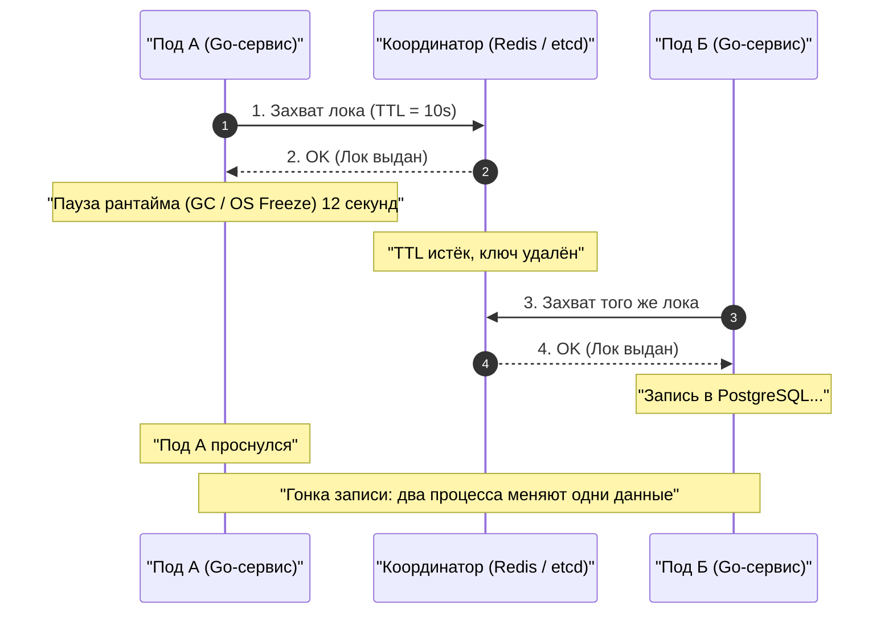
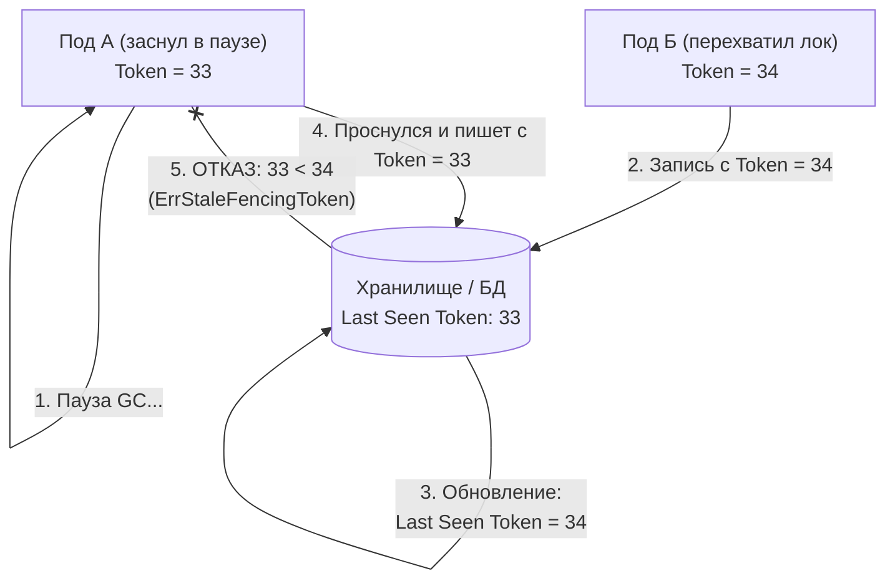

*Почему `sync.Mutex` бессилен между подами Kubernetes, как пауза сборки мусора ломает блокировки с TTL в Redis, чем отличается Redlock от `etcd`, как устроены монотонные fencing tokens и разбор `FencedStorage` из `project/step06/sharding.go`.*

> «Сборка мусора — огромное подспорье при написании корректных программ, но она не избавляет вас от необходимости думать о памяти. Вам не нужно выделять и освобождать память вручную, однако для написания эффективного кода всё равно приходится понимать время жизни переменных.»  
> — Алан Донован и Брайан Керниган, *The Go Programming Language*

В пределах одного процесса Go конкурентный доступ к структуре защищается просто: `sync.Mutex` или `sync.RWMutex` опираются на атомарные инструкции процессора (`CAS` — *Compare-And-Swap*) и общую оперативную память за ~100 нс.

Но как только бэкенд `LedgerPulse` разворачивается в десяти изолированных подах Kubernetes или на разных серверах, общей памяти между процессами больше нет. При этом задача требует строгого взаимного исключения по всему кластеру:
* ровно один воркер в полночь должен начислить комиссии и закрыть суточный расчётный период;
* ровно один обработчик должен списать бонусы клиента при серии двойных кликов;
* ровно один процесс должен строить тяжёлый сверочный отчёт по `ledger_entries`.

Для координации независимых узлов используют **распределённые блокировки (Distributed Locks)** — механизм взаимного исключения, вынесенный во внешнее сетевое хранилище, доступное всем подам кластера.

---

## Фундаментальная ловушка: паузы рантайма и время TTL

Кажется, что достаточно записать ключ в Redis с временем жизни `TTL = 10` секунд: кто первый поставил ключ, тот и владеет критической секцией. На практике эта наивная схема ломается из-за физики операционной системы, рантайма Go и асинхронной сети.

> [!warning] Ловушка: заснувший клиент («Стоп-мир» и фризы ОС)
> Представьте последовательность событий:
> 1. Под А захватывает блокировку в Redis с `TTL = 10 с`.
> 2. В следующую миллисекунду под А попадает под тяжёлую фазу сборки мусора (`GC` pause), либо гипервизор переносит виртуальную машину, приостанавливая поток ОС на 12 секунд.
> 3. Пока под А заморожен и не подозревает о ходе времени, 10-секундный `TTL` в Redis истекает — Redis удаляет ключ.
> 4. Под Б запрашивает ту же блокировку, видит пустой ключ, успешно захватывает лок и начинает обновлять баланс в PostgreSQL.
> 5. Под А просыпается. В его локальном состоянии блокировка всё ещё «принадлежит» ему — и он тоже пишет в ту же строку `accounts`, затирая изменения Пода Б.



Сложность усугубляется рассинхронизацией физических часов (`NTP`-скачки) и сетевыми задержками: никакой локальный таймер не даёт клиенту права считать, что он до сих пор удерживает распределённый ресурс.

---

## Три стратегии реализации распределённых блокировок

Каждый способ построения распределённого мьютекса упирается в компромиссы [[7. CAP и PACELC в выборе баз данных|CAP и PACELC]]:

### 1. Блокировки на базе реляционной БД (SQL)

Самый прямолинейный вариант без лишних компонентов инфраструктуры — таблица блокировок с уникальным первичным ключом:

```sql
CREATE TABLE IF NOT EXISTS distributed_locks (
    resource_name TEXT        PRIMARY KEY,
    owner_id      TEXT        NOT NULL,
    expires_at    TIMESTAMPTZ NOT NULL
);
```

Захват — вставка строки (`INSERT ... ON CONFLICT DO NOTHING` или обработка ошибки уникальности `23505`); освобождение — `DELETE WHERE resource_name = $1 AND owner_id = $2` (внутри SQL). В PostgreSQL для привязанных к соединению блокировок также применяют встроенные `pg_advisory_lock(key)` и `pg_try_advisory_lock(key)`, которые автоматически снимаются при разрыве TCP-соединения с базой.
* **Плюсы:** не требует отдельного кластера координации.
* **Минусы:** при табличных локах каждый захват бьёт в диск через WAL, плохо масштабируется на тысячи локов в секунду, а упавший под без `expires_at` оставляет «вечную» блокировку до ручной или фоновой очистки.

### 2. Redis и алгоритм Redlock

Экстремально быстрый вариант поверх оперативной памяти:
* **Одиночный Redis:** атомарная команда `SET lock:settlement $unique_owner_id NX PX 30000` (записать ключ, только если его не существует — `NX`, со сроком жизни 30 000 мс — `PX`).
* **Алгоритм Redlock (Сальваторе Санфилиппо / Antirez):** клиент поочерёдно запрашивает блокировку на $N$ независимых узлах Redis (обычно 5). Блокировка считается взятой, если большинство ($N/2 + 1$) подтвердили её за время, сильно меньшее общего `TTL`.
* **Критика Мартина Клеппманна:** в асинхронных сетях без идеальных физических часов и при длительных паузах `GC`/ОС Redlock не гарантирует строгое взаимное исключение для критичных финансовых записей. Он отлично подходит для *блокировок эффективности* (не делать лишнюю работу дважды, например не перестраивать кэш параллельно), но не для *блокировок корректности* (защита денег от двойного списания).

> [!tip] Собеседование [Middle]
> **Вопрос:** Почему при использовании Redis-блокировки нельзя освобождать её обычной командой `DEL lock_key`, и как сделать снятие безопасным?
>
> **Ответ:** Если процесс замедлился дольше `TTL`, Redis уже удалил его ключ, и тот же ключ мог занять другой воркер. Слепой вызов `DEL lock_key` удалит **чужую** блокировку, пустив в критическую секцию третьего участника. При захвате `SET ... NX` клиент обязан сгенерировать случайный уникальный `owner_token` (например, UUID), а при освобождении выполнить атомарный **Lua-скрипт**, который сравнивает значение ключа и удаляет его только при совпадении:
> ```lua
> if redis.call("get", KEYS[1]) == ARGV[1] then
>     return redis.call("del", KEYS[1])
> else
>     return 0
> end
> ```

### 3. Системы консенсуса (`etcd`, `Consul`, `ZooKeeper`)

Промышленный **CP**-стандарт для критических блокировок и выбора лидера (`Leader Election`):
* **Механизм:** под капотом работают протоколы распределённого консенсуса `Raft` или `Paxos` (подробнее о теории консенсуса, выборе лидера и отказах кворума см. Том 4). Клиент создаёт ключ, привязанный к **аренде (`Lease`)**, и в фоновой горутине шлёт подтверждения жизни (**`Keep-Alive` / `Heartbeat`**). Если под падает, `etcd` автоматически отзывает аренду по таймауту и уведомляет ожидающих через **`Watch`**.
* **Плюсы:** линеаризуемость операций и монотонно растущий номер ревизии кластера.

---

## Защита от заснувшего клиента: `Fencing Tokens`

Если под А проснулся после паузы `GC` и уверен, что всё ещё владеет блокировкой, ни один координатор не способен остановить его локальную память. Значит, **проверять актуальность владения должно само целевое хранилище данных** (PostgreSQL, файловый сервис или шардированный движок).

Мартин Клеппманн сформулировал решение через **защитные токены (`Fencing Tokens`)**:
1. При каждом успешном захвате блокировки координатор (например, `etcd`) выдаёт монотонно возрастающее целое число — токен (`Epoch` / `Revision`). Под А получил `Token = 33`.
2. Пока Под А спит, аренда истекает, и Под Б захватывает блокировку, получая более высокий токен: `Token = 34`.
3. Каждый запрос записи в базу данных сопровождается этим токеном. Хранилище запоминает максимальный увиденный токен (`highestToken`) и **отклоняет любые записи с меньшим токеном**.



Когда Под А просыпается и пытается записать устаревшие данные с `Token = 33`, хранилище видит `33 < 34` и отвергает запрос. Целостность счетов сохранена.

---

## Разбор `FencedStorage` из `project/step06/sharding.go`

В кодовой базе нашего учебного проекта `LedgerPulse` защита от заснувшего клиента реализована в `project/step06/sharding.go`:

```go
var ErrStaleFencingToken = errors.New("stale fencing token rejected")

// FencedStorage защищает хранилище от устаревшего держателя блокировки после GC-паузы.
type FencedStorage struct {
	mu           sync.Mutex
	highestToken uint64
	data         map[string]int64
}

func NewFencedStorage() *FencedStorage {
	return &FencedStorage{data: make(map[string]int64)}
}

func (s *FencedStorage) WriteWithToken(token uint64, key string, val int64) error {
	s.mu.Lock()
	defer s.mu.Unlock()
	if token < s.highestToken {
		return fmt.Errorf("%w: got %d, highest %d", ErrStaleFencingToken, token, s.highestToken)
	}
	s.highestToken = token
	s.data[key] = val
	return nil
}
```

Разберём тонкость условия `if token < s.highestToken`:
* Строго меньшие токены (`33 < 34`) отклоняются с ошибкой `ErrStaleFencingToken`.
* Равный токен (`34 == 34`) **разрешён**: это позволяет текущему легитимному владельцу блокировки выполнить серию записей в рамках одной и той же сессии владения с `Token = 34`.
* Более высокий токен (`35 > 34`) обновляет верхнюю планку `s.highestToken = 35` и фиксирует новое значение.

Тест `TestConsistentHashingRebalanceAndFencing` в `project/step06/sharding_test.go` проверяет именно этот сценарий гонки между токенами `34` и `33`:

```go
st := NewFencedStorage()
if err := st.WriteWithToken(34, "bal", 100); err != nil {
	t.Fatalf("token 34 failed: %v", err)
}
if err := st.WriteWithToken(33, "bal", 999); !errors.Is(err, ErrStaleFencingToken) {
	t.Fatalf("expected ErrStaleFencingToken for token 33, got %v", err)
}
```

В реальной таблице `accounts` PostgreSQL та же проверка превращается в столбец `fencing_token BIGINT NOT NULL DEFAULT 0` и одно атомарное условие в `WHERE`:

```sql
UPDATE accounts
SET balance = $1, fencing_token = $2, updated_at = now()
WHERE id = $3 AND fencing_token <= $2;
```

Если `RowsAffected() == 0`, база отвергла устаревший токен, и Go-сервис возвращает ошибку `ErrStaleFencingToken` вместо порчи баланса.

---

## Идиоматичный Go 1.24: блокировка с арендой в `etcd`

В экосистеме Go стандартным клиентом для консенсус-блокировок служит `go.etcd.io/etcd/client/v3` и пакет `concurrency`. Пакет сам создаёт аренду, запускает фоновую горутину `Keep-Alive` для продления `Lease` и корректно освобождает сессию при завершении контекста:

```go
package main

import (
	"context"
	"log"
	"time"

	clientv3 "go.etcd.io/etcd/client/v3"
	"go.etcd.io/etcd/client/v3/concurrency"
)

func main() {
	cli, err := clientv3.New(clientv3.Config{
		Endpoints:   []string{"localhost:2379"},
		DialTimeout: 5 * time.Second,
	})
	if err != nil {
		log.Fatalf("connect to etcd: %v", err)
	}
	defer cli.Close()

	// Аренда на 5 секунд: клиент автоматически шлёт Keep-Alive в фоне.
	// При падении процесса аренда истечёт, и блокировка освободится.
	session, err := concurrency.NewSession(cli, concurrency.WithTTL(5))
	if err != nil {
		log.Fatalf("create session: %v", err)
	}
	defer session.Close()

	mutex := concurrency.NewMutex(session, "/ledgerpulse/locks/nightly-settlement")

	ctx, cancel := context.WithTimeout(context.Background(), 10*time.Second)
	defer cancel()

	if err := mutex.Lock(ctx); err != nil {
		log.Fatalf("acquire lock: %v", err)
	}
	defer func() {
		if err := mutex.Unlock(context.Background()); err != nil {
			log.Printf("unlock error: %v", err)
		}
	}()

	// Монотонная ревизия Raft из заголовка ответа Lock() — честный fencing token
	fencingToken := mutex.Header().Revision
	log.Printf("lock acquired, fencing_token=%d lease_id=%x", fencingToken, session.Lease())
}
```

Обратите внимание на разницу между `mutex.Header().Revision` и `session.Lease()`: идентификатор аренды (`LeaseID`) не обязан расти строго монотонно для разных ключей так, как растёт глобальная ревизия кластера `Raft` (`Header().Revision`). Поэтому именно `mutex.Header().Revision` служит честным монотонно возрастающим `fencing token` при записи в хранилище.

---

## Шпаргалка выбора инструмента

| Технология | Задержка захвата | Надёжность (CAP) | Когда применять |
| :--- | :--- | :--- | :--- |
| **PostgreSQL / MySQL** (`advisory_lock` / таблица) | Низкая–средняя (диск при таблице) | Зависит от репликации БД | Редкие фоновые задачи, когда не хочется поднимать отдельный координатор |
| **Redis / Redlock** | Микросекунды–миллисекунды (RAM) | **AP**-склонность при сбоях сети | Блокировки эффективности (дедупликация писем, прогрев кэша), где редкий сбой не портит деньги |
| **etcd / Consul / ZooKeeper** | Единицы миллисекунд (Raft RTT) | Строгий **CP** | Критичные финансовые задачи, выбор лидера, миграции схемы с `fencing tokens` |

---

## Упражнения

### 1. Базовое: Опасность `DEL` в Redis

Почему последовательность `SET lock:job_42 my_uuid NX PX 10000` и последующий `DEL lock:job_42` через 11 секунд работы воркера разрушают взаимное исключение? Как именно Lua-скрипт устраняет эту ошибку?

> [!solution] Показать решение
> Через 10 секунд Redis автоматически удалил ключ `lock:job_42` по `TTL`, и второй воркер уже успел записать свой новый UUID в тот же ключ. Когда первый воркер на 11-й секунде вызывает обычный `DEL lock:job_42`, он стирает блокировку второго воркера, открывая дорогу третьему воркеру. Атомарный Lua-скрипт выполняется в однопоточном цикле Redis без прерываний: он сначала сравнивает `redis.call("get", KEYS[1]) == ARGV[1]` и вызывает `DEL` лишь в том случае, если в ключе до сих пор лежит UUID именно первого воркера.

### 2. Практическое: Защита счёта `LedgerPulse` в PostgreSQL через `fencing_token`

Напишите Go-функцию `UpdateBalanceFenced(ctx context.Context, db *sql.DB, accountID int64, newBalance int64, token int64) error`, которая обновляет баланс в таблице `accounts` с проверкой `fencing_token <= $2` и возвращает ошибку `ErrStaleFencingToken`, если база данных отклонила запись из-за устаревшего токена.

> [!solution] Показать решение
> ```go
> var ErrStaleFencingToken = errors.New("stale fencing token rejected")
>
> func UpdateBalanceFenced(ctx context.Context, db *sql.DB, accountID, newBalance, token int64) error {
> 	res, err := db.ExecContext(ctx,
> 		`UPDATE accounts
> 		 SET balance = $1, fencing_token = $2, updated_at = now()
> 		 WHERE id = $3 AND fencing_token <= $2`,
> 		newBalance, token, accountID,
> 	)
> 	if err != nil {
> 		return fmt.Errorf("update fenced account: %w", err)
> 	}
> 	rows, err := res.RowsAffected()
> 	if err != nil {
> 		return fmt.Errorf("rows affected: %w", err)
> 	}
> 	if rows == 0 {
> 		// Для диагностики в продакшене также проверяют, существует ли сам accountID
> 		return fmt.Errorf("%w: account=%d token=%d", ErrStaleFencingToken, accountID, token)
> 	}
> 	return nil
> }
> ```

### 3. Со звёздочкой (\*): Изоляция токенов по ключам в `FencedStorage`

Посмотрите на `FencedStorage` в `project/step06/sharding.go`: поле `highestToken uint64` в нём **одно на всю структуру**. Представьте, что два воркера в `LedgerPulse` держат независимые блокировки на разные счета: Воркер 1 держит лок на `acc:1` (получил `token = 10`), а Воркер 2 чуть позже захватил лок на `acc:2` (получил `token = 11`) и записал данные первым. Что произойдёт, когда Воркер 1 запишет по `acc:1` со своим актуальным токеном `10`? Доработайте `FencedStorage`, чтобы токен отслеживался независимо для каждого ключа, и напишите тест.

> [!solution] Показать решение
> При едином `highestToken` на всю мапу запись Воркера 2 (`acc:2`, `token = 11`) поднимет глобальный `highestToken` до `11`, и легитимная запись Воркера 1 по совершенно другому ключу (`acc:1`, `token = 10`) ошибочно получит `ErrStaleFencingToken`. Хранить максимальный токен нужно отдельно для каждого ресурса (`highestTokens map[string]uint64`):
> ```go
> type KeyedFencedStorage struct {
> 	mu            sync.Mutex
> 	highestTokens map[string]uint64
> 	data          map[string]int64
> }
>
> func NewKeyedFencedStorage() *KeyedFencedStorage {
> 	return &KeyedFencedStorage{
> 		highestTokens: make(map[string]uint64),
> 		data:          make(map[string]int64),
> 	}
> }
>
> func (s *KeyedFencedStorage) WriteWithToken(token uint64, key string, val int64) error {
> 	s.mu.Lock()
> 	defer s.mu.Unlock()
> 	if highest, ok := s.highestTokens[key]; ok && token < highest {
> 		return fmt.Errorf("%w: key=%s got=%d highest=%d", ErrStaleFencingToken, key, token, highest)
> 	}
> 	s.highestTokens[key] = token
> 	s.data[key] = val
> 	return nil
> }
> ```
> Тест:
> ```go
> func TestKeyedFencedStorageIsolation(t *testing.T) {
> 	st := NewKeyedFencedStorage()
> 	if err := st.WriteWithToken(11, "acc:2", 500); err != nil {
> 		t.Fatalf("acc:2 write failed: %v", err)
> 	}
> 	// Независимый ключ acc:1 с токеном 10 не должен блокироваться токеном 11 от acc:2
> 	if err := st.WriteWithToken(10, "acc:1", 200); err != nil {
> 		t.Fatalf("acc:1 independent write failed: %v", err)
> 	}
> 	// Устаревший токен 9 для acc:1 по-прежнему отклоняется
> 	if err := st.WriteWithToken(9, "acc:1", 999); !errors.Is(err, ErrStaleFencingToken) {
> 		t.Fatalf("expected ErrStaleFencingToken, got %v", err)
> 	}
> }
> ```

---

## Главный вывод и мостик дальше

Мы завершили Модуль 8 — путь базы данных за пределы одного сервера: от физики репликации и кольца консистентного шардирования до моделей согласованности, CAP/PACELC, протокола 2PC, паттерна Saga со стороны БД и распределённых блокировок с `fencing tokens`.

Вся эта распределённая машинерия до сих пор крутилась вокруг привычных реляционных таблиц и строгих схем. Но что делать, когда проекту нужны субмиллисекундные счётчики и кэш сессий в памяти, документная гибкость без жёстких миграций или аналитические отчёты по миллиардам строк за секунду, где строчный B-Tree в PostgreSQL упирается в потолок дискового I/O? В следующем **Модуле 9 «NoSQL, аналитические и специализированные базы»** мы выйдем за границы классических РСУБД и разберём, как устроены Redis, документные и колоночные движки вроде ClickHouse.
