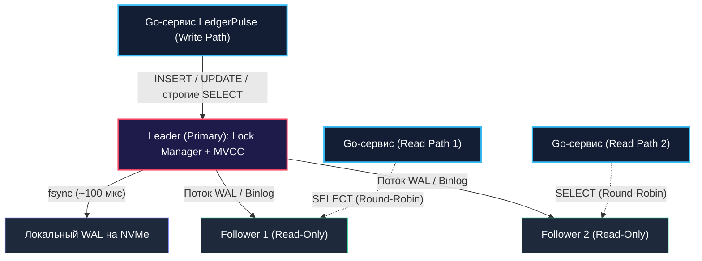
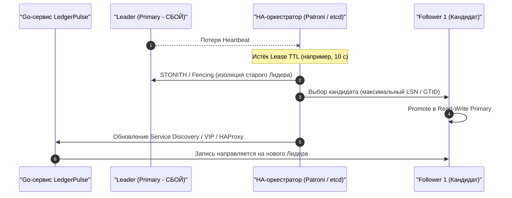

*Асимметрия ролей Лидера и Фолловеров, три аномалии при отставании реплики, разбор `ReadYourWritesRouter` из `project/step06/`, аварийный failover и защита от Split-Brain.*

> «Хотя поддержка конкурентности — одна из главных сильных сторон Go, рассуждать о конкурентных программах по природе труднее, чем о последовательных, и интуиция, выработанная на последовательном коде, порой подводит.»  
> — Алан Донован и Брайан Керниган, *The Go Programming Language*

В главе [[1. Репликация — синхронная, полусинхронная и асинхронная]] мы измерили цену синхронного подтверждения по сети. Теперь поднимемся на уровень топологии кластера: *кто из узлов имеет право принимать изменения, а кто обязан лишь повторять их?*

Безусловным промышленным стандартом для реляционных баз данных (PostgreSQL, MySQL) и многих других хранилищ остаётся асимметричная топология **Leader–Follower** (Primary–Standby, исторически Master–Slave):
* **Leader (Primary):** единственный полномочный узел кластера, принимающий операции модификации (`INSERT`, `UPDATE`, `DELETE`, `DDL`). Он фиксирует порядок изменений в локальном WAL или Binlog и транслирует непрерывный поток репликации.
* **Follower (Replica / Standby):** подчинённые узлы в режиме «только чтение», которые непрерывно накатывают поток журнала от Лидера и обслуживают запросы `SELECT`.

---

## Зачем нужен ровно один Лидер

При росте нагрузки на запись возникает соблазн разрешить модификацию данных сразу на всех узлах кластера. Главная преграда на этом пути — **конкурентные конфликты записи (Write Conflicts)**.

Представьте счёт клиента в `LedgerPulse` с балансом `10000` минорных единиц (100,00 руб.). Две параллельные горутины отправляют запросы на списание всей суммы в пользу двух разных получателей на разные узлы, если оба узла открыты на запись. Узел A успешно списывает 100 руб. в адрес банка X, а узел B в ту же миллисекунду списывает те же 100 руб. в адрес банка Y. Когда журналы репликации дойдут друг до друга, баланс уйдёт в минус, а инвариант двойной записи окажется нарушен.

Менеджеры блокировок и многоверсионность (`shared_buffers`, `Buffer Pool`, `MVCC`) в PostgreSQL и InnoDB спроектированы для работы в общей памяти **одного физического сервера**: локальная строчная блокировка занимает около 0,2 мс (или микросекунды в памяти). Вынос строчных блокировок в распределённую сеть через консенсус (`etcd`, `Raft`) превращает простейший `UPDATE` в операцию на 15–20 мс с жёсткой зависимостью от сетевого джиттера.

Архитектура с **одним Лидером** решает задачу радикально:
* все запросы на изменение выстраиваются в единую очередь на одном сервере;
* локальный менеджер блокировок детерминированно упорядочивает конкурирующие транзакции;
* Лидер выступает **единым источником правды (Single Source of Truth)** для истории изменений.



Масштабирование чтений (**Read Scaling**) в этой модели работает почти линейно: если один узел отдаёт 10 000 `SELECT` в секунду, добавление пяти фолловеров поднимает пропускную способность чтения до ~50 000 RPS. Однако при асинхронной репликации между записью на Лидере и её появлением на реплике всегда существует временной зазор — **лаг репликации (Replication Lag)**. Именно он порождает три коварные аномалии чтения.

---

## Три аномалии чтения из-за лага репликации

Разработчики часто проверяют кластер в локальном `docker-compose`, где задержка сети меньше миллисекунды, и считают репликацию мгновенной. В продакшене при тяжёлой транзакции, вакууме или перегрузке диска на фолловере лаг возрастает до сотен миллисекунд или секунд, ломая логику приложения сразу в трёх сценариях.

### 1. Нарушение Read-Your-Own-Writes (Чтение своих записей)

Клиент пополняет кошелёк в `LedgerPulse`. Запрос уходит на Лидер, фиксируется за 2 мс, сервис отвечает `201 Created`. Браузер мгновенно делает редирект на экран баланса, и балансировщик отправляет `SELECT` на Follower 2, который отстаёт на 50 мс. Клиент видит старый баланс без своего пополнения, решает, что платёж потерялся, и нажимает «Оплатить» повторно.

**Решения на уровне базы данных и Go:**
1. **Временная привязка к Лидеру (Sticky Master / Read-Your-Writes Window):** после успешной записи для конкретного пользователя или аккаунта на время $T$ (заведомо больше ожидаемого лага, например 2–3 секунды) чтения направляются строго на Лидер.
2. **Привязка по эндпоинту:** данные, которые часто редактирует сам владелец (настройки профиля, черновик платежа), всегда читаются с Лидера, тогда как публичные каталоги и старые выписки уходят на реплики.
3. **Барьер по позиции журнала (Causal LSN / GTID):** при записи Лидер возвращает `pg_current_wal_lsn()` (или `GTID` в MySQL). При последующем чтении Go-сервис передаёт эту метку и либо ждёт на реплике, пока `pg_last_wal_replay_lsn() >= target_lsn` (в PostgreSQL 17 для этого появилась нативная процедура `pg_wal_replay_wait`), либо при отставании перенаправляет запрос на Лидер.

### 2. Нарушение Monotonic Reads (Монотонные чтения)

Представьте, что у кластера две асинхронные реплики: Follower 1 с лагом 5 мс и Follower 2 с лагом 400 мс. Клиент обновляет ленту транзакций:
1. Первый запрос `GET /entries` балансируется на быстрый Follower 1 — клиент видит только что поступивший перевод на 5 000 руб.
2. Через секунду клиент обновляет страницу (F5), и Round-Robin отправляет запрос на отстающий Follower 2 — перевод внезапно исчезает. Для наблюдателя время пошло вспять.

**Решение:** **Sticky Follower** (привязка читателя к одной реплике). В Go-маршрутизаторе целевой фолловер выбирается детерминированно по хешу от `account_id` или `session_id` (например, `hash(accountID) % len(followers)`), а не случайным или цикличным Round-Robin для каждого запроса. Если один и тот же клиент всегда читает с одной и той же реплики (пока она жива), его картина мира движется строго вперёд.

### 3. Нарушение Consistent Prefix Reads (Согласованное чтение префикса)

Эта аномалия проявляется в шардированных или многопоточных системах, где две причинно-связанные записи попадают в разные очереди репликации. Допустим, в `LedgerPulse` операция `A` создаёт счёт, а операция `B` (спустя миллисекунду) привязывает к нему комментарий аудита или встречную проводку, причём `A` и `B` реплицируются через разные сегменты. Если наблюдатель читает реплику, куда поток `B` добежал быстрее потока `A`, он видит ответ на вопрос до самого вопроса — следствие без причины.

**Решение:** любые причинно-связанные операции должны попадать в один поток упорядочивания (на один и тот же шард/партицию) либо снабжаться явным вектором причинных зависимостей (подробнее модели согласованности и причинные часы разобраны далее в этом модуле).

---

## Разбор `ReadYourWritesRouter` из `project/step06/`

Посмотрим, как гарантия **Read-Your-Writes** реализована в учебном проекте курса — файле `project/step06/sharding.go` (и проверена в `project/step06/sharding_test.go`):

```go
// ReadYourWritesRouter направляет чтение на Leader, если клиент недавно писал в этот аккаунт,
// иначе разгружает чтение на Follower-реплики.
type ReadYourWritesRouter struct {
	mu        sync.RWMutex
	window    time.Duration
	lastWrite map[string]time.Time
}

func NewReadYourWritesRouter(window time.Duration) *ReadYourWritesRouter {
	return &ReadYourWritesRouter{
		window:    window,
		lastWrite: make(map[string]time.Time),
	}
}

func (r *ReadYourWritesRouter) RecordWrite(accountKey string, now time.Time) {
	r.mu.Lock()
	defer r.mu.Unlock()
	r.lastWrite[accountKey] = now
}

func (r *ReadYourWritesRouter) TargetNode(accountKey string, now time.Time) string {
	r.mu.RLock()
	defer r.mu.RUnlock()
	t, ok := r.lastWrite[accountKey]
	if ok && now.Sub(t) <= r.window {
		return "leader"
	}
	return "follower"
}
```

Разберём инженерные детали этой структуры:
1. **`sync.RWMutex` вместо обычного `sync.Mutex`:** операции чтения случаются в десятки раз чаще записей. `RLock()` позволяет тысячам горутин проверять мапу `lastWrite` параллельно без блокировки друг друга, захватывая эксклюзивную блокировку только в `RecordWrite`.
2. **Точечный ключ `accountKey`:** вместо того чтобы переключать весь сервис на Лидер, маршрутизатор изолирует окно строго для изменённого счёта (`"acc:1"`). Остальные миллионы счетов продолжают разгружать Лидер, читая с фолловеров.
3. **Временное окно `window`:** в тесте `TestConsistentHashingRebalanceAndFencing` окно задано как `2 * time.Second`. До записи `TargetNode("acc:1", t0)` возвращает `"follower"`; через 1 секунду после `RecordWrite` — `"leader"`; через 3 секунды, когда `now.Sub(t) > window`, маршрут снова возвращается на `"follower"`.

> [!warning] Ловушка продакшена при переносе локальной мапы в Kubernetes
> У структуры `ReadYourWritesRouter` в памяти одного процесса есть два ограничения для многоинстансных сервисов:
> 1. **Локальное состояние пода:** если `POST /transfers` обработал Под A, а следующий `GET /balance` попал в Под B, мапа в Поде B ничего не знает о записи. В кластере Kubernetes маркер `ryow:account:{id}` с TTL выносят во внешний общий кэш (Redis) либо возвращают клиенту в подписанной cookie / HTTP-заголовке.
> 2. **Неограниченный рост `lastWrite`:** мапа в Go никогда не освобождает выделенные бакеты автоматически. В долгоживущем сервисе миллионы ключей приведут к утечке памяти и нагрузке на сборщик мусора при сканировании указателей (`time.Time` содержит указатель на `*Location`). Для локального маршрутизатора обязательно периодически удалять устаревшие записи либо хранить вместо `time.Time` монотонное число наносекунд `int64`.

---

## Отказоустойчивость, Failover и Split-Brain

Что происходит, если Лидер внезапно погибает из-за паники ядра, отказа NVMe или обрыва сети? Поскольку писать разрешено только ему, кластер теряет доступность на запись (**Write Unavailability**). Возврат системы в строй называется **аварийным переключением (Failover)**.



Классический Failover проходит четыре этапа:
1. **Обнаружение сбоя (Failure Detection):** внешний оркестратор (`Patroni` поверх `etcd`/`Consul` для PostgreSQL, `Orchestrator` для MySQL, `Redis Sentinel` для Redis) проверяет пульс Лидера через короткие сообщения (**Heartbeats**). Если аренда (**Lease / TTL**) истекает (обычно 10–30 секунд, чтобы не реагировать на короткие сетевые моргания), объявляется авария.
2. **Выбор нового лидера (Leader Election):** среди живых фолловеров выбирается узел с самыми свежими данными — максимальным `LSN` в PostgreSQL или `GTID` в MySQL.
3. **Повышение роли (Promotion):** выбранная реплика выходит из режима восстановления, накатывает остаток локального журнала и открывается на запись.
4. **Переконфигурация (Reconfiguration):** оставшиеся фолловеры переключают поток репликации на нового Лидера, а Go-клиенты обновляют адреса через балансировщик, DNS с низким TTL, Service Discovery или плавающий виртуальный IP (**VIP**).

### Главные опасности Failover

* **Split-Brain (Расщепление мозга):** самая разрушительная авария распределённой базы. Если сеть разделила дата-центр, фолловеры перестают видеть Лидера и выбирают нового. Но старый Лидер всё ещё жив и продолжает принимать транзакции от клиентов в своём сегменте сети. Появляются два независимых Лидера, пишущих расходящиеся данные.
  *Защита:* механизм **Fencing** и жёсткая изоляция **STONITH (Shoot The Other Node In The Head)** — перед повышением фолловера оркестратор принудительно отключает питание старого сервера по IPMI, убивает виртуальную машину через Cloud API или сбрасывает его сетевые правила. Даже если старый узел «очнётся» после паузы, его аренда в `etcd` уже истекла, и прокси не пустит туда трафик (роль монотонных `fencing tokens` при защите хранилища подробно разобрана в конце этого модуля).
* **Потеря данных при асинхронной репликации:** транзакции, подтверждённые старым Лидером, но не долетевшие до нового, утрачиваются. Более того, если старый Лидер позже поднимется, его локальный WAL ушёл на другую временную линию (**Timeline**), и перед возвратом в роли фолловера его придётся откатить к точке расхождения с помощью `pg_rewind` или переналить заново через `pg_basebackup`.

---

## Топологически-осведомлённый клиент в Go

Жёстко зашитый IP-адрес Лидера в конфигурации сервиса ломается при первом же Failover. На практике применяют два надёжных способа маршрутизации из Go:

1. **Умный прокси-слой (рекомендуется в проде):** Go-сервис всегда ходит на единую точку входа (`HAProxy` + `PgBouncer` для PostgreSQL или `ProxySQL` для MySQL). Оркестратор `Patroni` обновляет состояние бэкендов в `HAProxy` за миллисекунды, а приложение видит лишь краткий обрыв TCP-сокета.
2. **Топологически-осведомлённый драйвер (`pgxpool`):** драйвер `jackc/pgx/v5` сам опрашивает список хостов в строке подключения, используя параметр `target_session_attrs=read-write` для пула Лидера и `target_session_attrs=read-only` для пула Фолловеров. В экосистеме Redis ту же задачу решает `redis.NewFailoverClient` поверх `Redis Sentinel`.

Чтобы переживать момент переключения Лидера (обычно 5–15 секунд) без ошибок для пользователя, идемпотентные операции записи оборачивают в цикл повторных попыток с экспоненциальной задержкой и таймаутом контекста:

```go
package database

import (
	"context"
	"errors"
	"fmt"
	"net"
	"time"

	"github.com/jackc/pgx/v5/pgxpool"
)

type LedgerCluster struct {
	Writer *pgxpool.Pool
	Reader *pgxpool.Pool
}

func NewLedgerCluster(ctx context.Context, hosts string) (*LedgerCluster, error) {
	wCfg, err := pgxpool.ParseConfig(
		fmt.Sprintf("postgres://ledger:secret@%s/ledgerpulse?target_session_attrs=read-write", hosts),
	)
	if err != nil {
		return nil, fmt.Errorf("parse writer dsn: %w", err)
	}
	wCfg.MaxConns = 25

	wPool, err := pgxpool.NewWithConfig(ctx, wCfg)
	if err != nil {
		return nil, fmt.Errorf("connect writer: %w", err)
	}

	rCfg, err := pgxpool.ParseConfig(
		fmt.Sprintf("postgres://ledger:secret@%s/ledgerpulse?target_session_attrs=read-only", hosts),
	)
	if err != nil {
		wPool.Close()
		return nil, fmt.Errorf("parse reader dsn: %w", err)
	}
	rCfg.MaxConns = 100

	rPool, err := pgxpool.NewWithConfig(ctx, rCfg)
	if err != nil {
		wPool.Close()
		return nil, fmt.Errorf("connect reader: %w", err)
	}

	return &LedgerCluster{Writer: wPool, Reader: rPool}, nil
}

// ExecIdempotentWithRetry повторяет идемпотентную запись при кратком обрыве во время Failover.
func (c *LedgerCluster) ExecIdempotentWithRetry(ctx context.Context, sql string, args ...any) error {
	backoff := 100 * time.Millisecond
	const maxAttempts = 4

	for attempt := 1; attempt <= maxAttempts; attempt++ {
		_, err := c.Writer.Exec(ctx, sql, args...)
		if err == nil {
			return nil
		}

		// Повторяем только при сетевых сбоях и контекстно не отменённых ошибках.
		var netErr net.Error
		if !errors.As(err, &netErr) || attempt == maxAttempts {
			return fmt.Errorf("exec attempt %d: %w", attempt, err)
		}

		timer := time.NewTimer(backoff)
		select {
		case <-ctx.Done():
			timer.Stop()
			return ctx.Err()
		case <-timer.C:
			backoff *= 2
		}
	}
	return errors.New("unreachable")
}
```

### Четыре антипаттерна эксплуатации Leader–Follower

1. **Тяжёлые аналитические `SELECT` на Лидере:** отчёты грузят CPU и вымывают горячие страницы `shared_buffers`, замедляя транзакции записи.
2. **Игнорирование мониторинга лага в байтах (`pg_wal_lsn_diff`) и секундах:** если реплика отстаёт или зависла с открытым слотом репликации, WAL на Лидере не удаляется и переполняет диск до полной остановки базы.
3. **Повторы неидемпотентных записей при таймауте:** если транзакция успела зафиксироваться на Лидере, но ответ потерялся в сети при failover, слепой retry создаст дубликат списания. Обязательно используйте ключ идемпотентности (`idempotency_key UNIQUE`).
4. **Смешивание пулов без маршрутизации:** невозможность разнести чтения и записи без переписывания репозиториев.

---

## Упражнения

1. **Базовое.** Выберите три пользовательских сценария в `LedgerPulse` и соотнесите с каждым подходящую гарантию чтения:
   а) Клиент перевёл 1 000 руб. и сразу открывает экран «Баланс счёта»;
   б) Аналитик пролистывает отчёт о транзакциях за прошлый год и обновляет страницу — число строк при обновлении не должно внезапно уменьшиться;
   в) Клиент открыл счёт и через миллисекунду отправил первую проводку — наблюдатель с реплики не должен увидеть проводку без самого счёта.

> [!solution] Показать решение
> а) **Read-Your-Own-Writes** — реализуется через `ReadYourWritesRouter` (окно Sticky Master после записи) или проверку `LSN`.
> б) **Monotonic Reads** — реализуется привязкой пользователя или сессии аналитика к одной и той же реплике (`hash(session_id) % len(followers)`), чтобы не прыгать с быстрой реплики на более отсталую.
> в) **Consistent Prefix Reads** — гарантируется тем, что операции над одним счётом упорядочиваются в одном потоке WAL одного Лидера (или на одном шарде в распределённой схеме).

2. **Практическое.** Модифицируйте метод `TargetNode` в `ReadYourWritesRouter` так, чтобы при возврате `"follower"` маршрутизатор детерминированно выбирал один из нескольких переданных узлов `followers []string` и гарантировал **Monotonic Reads** для `accountKey`. Какое ограничение нужно проверить перед вычислением индекса?

> [!solution] Показать решение
> ```go
> func (r *ReadYourWritesRouter) SelectTarget(accountKey string, now time.Time, followers []string) string {
> 	r.mu.RLock()
> 	t, ok := r.lastWrite[accountKey]
> 	r.mu.RUnlock()
>
> 	if ok && now.Sub(t) <= r.window {
> 		return "leader"
> 	}
> 	if len(followers) == 0 {
> 		// Обязательный fallback на Лидер, если живых реплик не осталось.
> 		return "leader"
> 	}
> 	h := crc32.ChecksumIEEE([]byte(accountKey))
> 	return followers[int(h)%len(followers)]
> }
> ```
> Проверка `len(followers) == 0` критична: при падении всех фолловеров деление по модулю вызовет панику `integer divide by zero`, а корректный fallback на `"leader"` сохранит работоспособность чтения.

3. **Со звёздочкой (\*).** В кластере из 1 Лидера и 2 Фолловеров настроена асинхронная репликация. В 03:00 Лидер А теряет связь с сетью из-за сбоя коммутатора, но остаётся включённым и продолжает принимать запросы от локального приложения в своей подсети. Спустя 10 секунд оркестратор без настроенного STONITH повышает Фолловер Б до нового Лидера. Опишите последствия к 03:05, когда сеть восстановится, и предложите два независимых механизма защиты, которые предотвратили бы катастрофу.

> [!solution] Показать решение
> К 03:05 в системе возникнет классический **Split-Brain**: за 5 минут и Лидер А, и новый Лидер Б зафиксировали независимые транзакции, возможно, списав одни и те же средства дважды. Автоматически объединить их WAL невозможно: требуется ручная сверка проводок и пересборка одного из узлов.
>
> Два независимых механизма защиты:
> 1. **Fencing / STONITH на уровне оркестратора:** перед промоушеном Фолловера Б оркестратор обязан принудительно изолировать Лидер А (отключить питание через IPMI или закрыть порты на коммутаторе/облачном API). Кроме того, Лидер А без кворума в `etcd`/`Consul` должен сам останавливать запись (Patroni отзывает роль Primary при потере связи с DCS).
> 2. **Проверка роли перед записью / Fencing Tokens:** прокси-слой (HAProxy) направляет трафик только в узел, подтвердивший статус текущего Primary через API Patroni, а критичные внешние хранилища отвергают операции с устаревшим поколением (fencing token) старого Лидера.

---

Модель с одним Лидером избавляет от конфликтов записи, пока весь поток изменений помещается на одном сервере и пользователи сосредоточены в одном регионе. Но что делать, если сервис глобален, а клиенты в Берлине и Сингапуре не готовы ждать по 200 мс на каждую запись? Или если требуется принимать запись даже при выходе из строя отдельных дата-центров без выделенного лидера вообще? Этим топологиям посвящена следующая глава — [[3. Multi-Leader и Leaderless репликация — конфликты записи и кворумы]].
