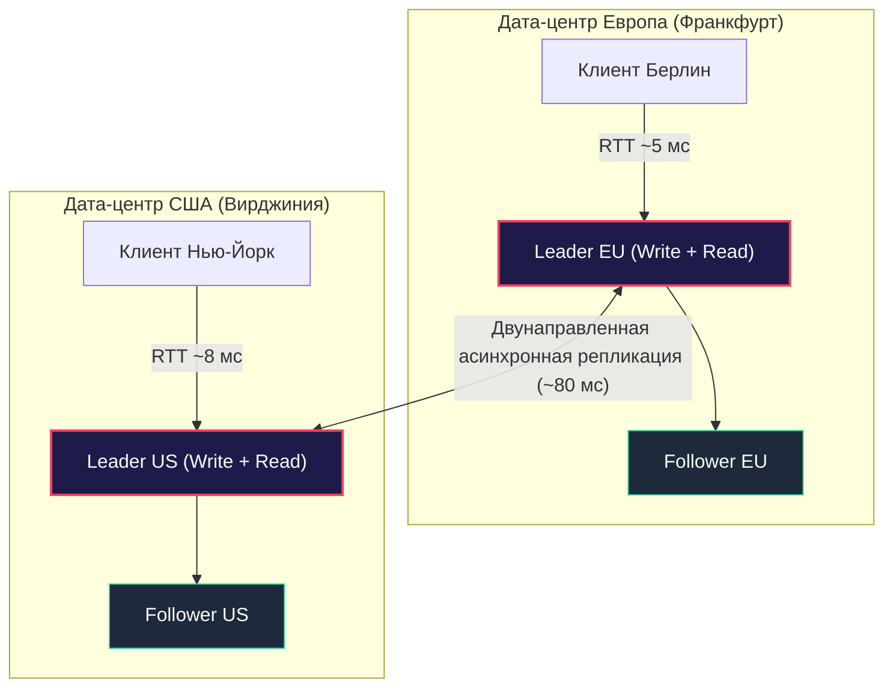
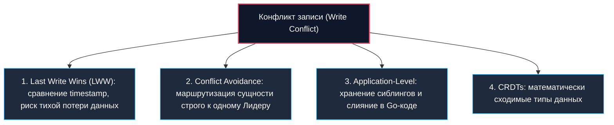
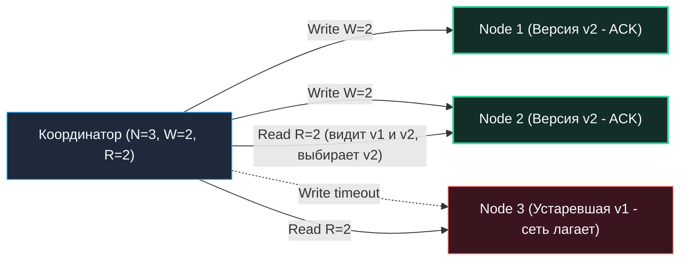

*Географически распределённая запись, конфликты параллельных модификаций (LWW, Vector Clocks, CRDT), генерация распределённых ключей UUID v7 / Snowflake и беслидерная репликация с кворумами $R + W > N$.*

> «Как сформулировал Роб Пайк, «сложность мультипликативна»: решая задачу за счёт усложнения одной части системы, вы медленно, но верно добавляете сложность во все остальные. Под постоянным давлением сроков и требований добавить ещё фич, опций и настроек легко поступиться простотой — хотя в долгосрочной перспективе именно простота служит ключом к хорошему ПО.»  
> — Алан Донован и Брайан Керниган *(цитируя Роба Пайка)*, *The Go Programming Language*

В топологии [[2. Репликация Leader-Follower — лаг репликации и аномалии чтения]] всей властью на запись наделён один сервер. Пока клиенты находятся на одном континенте, схема работает предсказуемо. Стоит сервису выйти на глобальный уровень с пользователями в Берлине, Нью-Йорке и Сингапуре, как вмешивается физика: если единственный Лидер стоит во Франкфурте, пользователи в Европе получают отклик за 5–15 мс, а запросы из Сингапура на каждый тривиальный `INSERT` тратят 200–300 мс на перелёт через половину планеты.

Чтобы убрать межконтинентальный сетевой пинг из критического пути записи и пережить отказ целого дата-центра без глобального переключения, используют две альтернативные топологии: **Multi-Leader** (несколько ведущих узлов) и **Leaderless** (беслидерная репликация в стиле Amazon Dynamo).

---

## Multi-Leader репликация и проблема конфликтов

В конфигурации **Multi-Leader (Active-Active / Master-Master)** в каждом крупном регионе ставится собственный Лидер, принимающий локальные записи за 5–10 мс и асинхронно обменивающийся потоком изменений с лидерами других дата-центров. Помимо географического распределения, та же модель описывает **оффлайн-клиенты** (мобильные приложения или локальные базы, которые принимают правки без сети, а при подключении синхронизируются с сервером).



Главное достоинство Multi-Leader — низкая локальная задержка записи и устойчивость к изоляции дата-центра: обрыв трансатлантического кабеля не останавливает работу ни в Европе, ни в США. Но плата высока: **конфликты одновременной записи (Write Conflicts)**.

Рассмотрим сбой на общем корпоративном счёте:
1. В `12:00:00.000` администратор в Берлине меняет лимит счёта на `500000` (5 000 руб.) через `Leader EU`.
2. В `12:00:00.050` (пока трансатлантический пакет задерживается на 80 мс) финансовый контролёр в Нью-Йорке меняет лимит того же счёта на `300000` (3 000 руб.) через `Leader US`.
3. Спустя 80 мс оба лидера получают встречные события репликации. Без детерминированного правила слияния на европейском узле останется `300000`, на американском — `500000`, и реплики необратимо разойдутся.

> [!tip] Собеседование [Senior/Staff]
> **Вопрос:** Почему классический PostgreSQL не поддерживает полноценный Multi-Leader Active-Active из коробки?
>
> **Ответ:** Ядро PostgreSQL строится вокруг строгих гарантий `ACID`, локальных строчных блокировок и снимков `MVCC` в общей памяти. Поддерживать распределённый `Lock Manager` и глобальные снимки между дата-центрами через океан невозможно без падения производительности на порядки. Поэтому в энтерпрайзе с PostgreSQL чаще держат **Active-Passive** (второй мастер готов, но трафик идёт строго на один) или используют специализированное расширение **BDR (Bi-Directional Replication)** для строго изолированных таблиц, либо переходят на NewSQL-системы (**CockroachDB**, **YugabyteDB**), где шарды изначально координируются через консенсус Raft.

---

## Топологии связи и стратегии разрешения конфликтов

Способ соединения нескольких Лидеров определяет устойчивость сети к сбоям:
* **Circular (Кольцо):** $A \to B \to C \to A$. Отказ одного узла разрывает кольцо и останавливает доставку по всей цепочке.
* **Star (Звезда):** центральный маршрутизатор раздаёт изменения периферийным лидерам. Центр становится единой точкой отказа (SPOF).
* **All-to-All (Все-ко-всем):** каждый Лидер шлёт поток напрямую всем остальным. Сбой одного узла не мешает остальным, однако появляются сетевые гонки: `UPDATE` строки может прийти по быстрому маршруту раньше её `INSERT` по медленному. Для защиты пакеты снабжают версионными метками.

Для разрешения самих конфликтов записи применяют четыре стратегии:



### 1. Last Write Wins (LWW) и ложь физических часов

Каждой записи присваивается метка физического времени, и при конфликте побеждает запись с большим `Timestamp`, а конкурирующая молча стирается.

> [!warning] Ловушка: Дрейф кварцевых часов (Clock Drift)
> Физические кварцевые генераторы серверов дрейфуют, а синхронизация по NTP через сеть асимметрична: расхождение между дата-центрами в 10–100 мс — нормальная ситуация. В результате операция, фактически выполненная позже, может получить меньший таймстемп и быть тихо уничтоженной ранней записью (**Silent Data Loss**). Для финансовых проводок `LedgerPulse` и инвентарных остатков LWW категорически неприемлем.

### 2. Избегание конфликтов (Conflict Avoidance)

Самый надёжный способ решить конфликт — не допускать его. Каждая сущность привязывается к «домашнему» региону (например, европейские клиенты всегда маршрутизируются на `Leader EU`, американские — на `Leader US`). Пока пользователь не меняет регион каждую секунду, записи по одному счёту проходят строго через один Лидер.

### 3. Разрешение на уровне приложения и Векторные часы

База данных не гадает по физическим часам, а отслеживает причинность через **векторные часы (Version Vectors)** — массив логических счётчиков по одному на каждого участника.

Пусть строка `X` имеет вектор `[EU: 5, US: 2]`.
* `Leader EU` выполняет локальное изменение и инкрементирует свой компонент: `[EU: 6, US: 2]`.
* Параллельно `Leader US` меняет ту же строку и получает: `[EU: 5, US: 3]`.

Ни один из векторов не доминирует над другим (`6 > 5`, но `2 < 3`). Это строгое доказательство того, что события **конкурентны (произошли независимо)**. Система сохраняет обе конфликтующие версии (сиблинги, как в CouchDB или Riak) и отдаёт их приложению на слияние — например, объединение корзин покупок в Go.

### 4. Бесконфликтные типы данных — CRDT

**CRDT (Conflict-free Replicated Data Types)** — структуры данных (счётчики `PN-Counter`, множества `G-Set`/`OR-Set`), операция слияния ($\sqcup$) которых по математическому построению удовлетворяет трём законам:
* коммутативность: $A \sqcup B = B \sqcup A$;
* ассоциативность: $(A \sqcup B) \sqcup C = A \sqcup (B \sqcup C)$;
* идемпотентность: $A \sqcup A = A$.

Независимо от порядка доставки и повторных пакетов по сети, все узлы сходятся к одному и тому же состоянию без блокировок. Именно CRDT лежат в основе счётчиков и распределённых множеств в Redis Enterprise Active-Active, Riak и частично в агрегаторах телеметрии.

---

## Распределённые первичные ключи в Go

В кластере с одним Лидером `SERIAL` или `AUTO_INCREMENT` работает идеально. В Multi-Leader (как и при шардировании) локальный автоинкремент приводит к немедленной катастрофе: оба лидера сгенерируют строку с `id = 1001`, и при встречной репликации поток остановится с ошибкой `duplicate key value violates unique constraint`.

Инженерное решение — генерация глобально уникальных ключей прямо на уровне Go-приложения без координации с базой:
1. **UUID v7:** 128-битный идентификатор, где старшие 48 бит кодируют Unix-время в миллисекундах, а остальные — случайные биты. В отличие от случайного UUID v4, фрагментирующего B-Tree индексы из-за вставки в случайные страницы, UUID v7 монотонно упорядочен во времени и дружелюбен к кэшу страниц БД.
2. **64-битный Snowflake ID:** компактный `int64` (`BIGINT` в PostgreSQL/MySQL), вмещающий 41 бит миллисекунд от заданной эпохи, 10 бит идентификатора дата-центра/ноды и 12 бит локального счётчика (до 4 096 ID за миллисекунду на узел):

```go
package idgen

import (
	"errors"
	"sync"
	"time"
)

const (
	customEpoch = int64(1735689600000) // 2025-01-01T00:00:00Z в мс
	nodeBits    = uint(10)
	stepBits    = uint(12)
	maxNodeID   = int64(-1 ^ (-1 << nodeBits))
	maxStep     = int64(-1 ^ (-1 << stepBits))
	timeShift   = nodeBits + stepBits
	nodeShift   = stepBits
)

// SnowflakeGenerator генерирует монотонные 64-битные ключи без сетевых походов в БД.
type SnowflakeGenerator struct {
	mu       sync.Mutex
	lastTime int64
	nodeID   int64
	step     int64
}

func NewSnowflakeGenerator(nodeID int64) (*SnowflakeGenerator, error) {
	if nodeID < 0 || nodeID > maxNodeID {
		return nil, errors.New("nodeID out of range [0..1023]")
	}
	return &SnowflakeGenerator{nodeID: nodeID}, nil
}

func (g *SnowflakeGenerator) NextID() int64 {
	g.mu.Lock()
	defer g.mu.Unlock()

	now := time.Now().UnixMilli()
	if now < g.lastTime {
		// Защита от обратного скачка NTP: ждём выравнивания часов.
		now = g.lastTime
	}

	if now == g.lastTime {
		g.step = (g.step + 1) & maxStep
		if g.step == 0 {
			for now <= g.lastTime {
				now = time.Now().UnixMilli()
			}
		}
	} else {
		g.step = 0
	}

	g.lastTime = now
	return ((now - customEpoch) << timeShift) | (g.nodeID << nodeShift) | g.step
}
```

---

## Leaderless репликация (Dynamo-style) и кворумы

В классической статье 2007 года о системе **Amazon Dynamo** был популяризирован третий подход — **беслидерная репликация (Leaderless)**, на которой сегодня работают Apache Cassandra, ScyllaDB и Riak. Здесь нет ни Лидера, ни Фолловеров: все реплики равноправны.

Запись и чтение координируются клиентом (или любым узлом-координатором, принявшим запрос):
1. На запись клиент рассылает запрос параллельно всем $N$ узлам-репликам и считает операцию успешной, как только получил подтверждение от $W$ узлов.
2. На чтение клиент отправляет запрос параллельно $R$ репликам, получает значения вместе с их версиями и выбирает наиболее свежую версию.

### Магия неравенства $R + W > N$

Откуда берётся гарантия, что чтение увидит свежее значение, если при записи часть узлов могла не ответить? Ответ даёт принцип Дирихле (пересечение кворумов): если

$$W + R > N,$$

то множество из $W$ узлов, подтвердивших запись, и множество из $R$ узлов, опрошенных при чтении, **гарантированно пересекаются минимум в одном узле**. Этот узел содержит актуальную версию (с максимальным номером версии или векторными часами).



Меняя $W$ и $R$ при фиксированном факторе репликации $N$ (обычно $N = 3$), вы настраиваете баланс под профиль нагрузки:
* $N = 3, W = 2, R = 2$ — сбалансированный кворум: кластер переживает отказ любого одного узла и при записи, и при чтении.
* $N = 3, W = 3, R = 1$ — мгновенное чтение с одной ноды, но отказ даже одной реплики блокирует запись.
* $N = 3, W = 1, R = 3$ — сверхбыстрая запись, но дорогое чтение со всех узлов.

При $W + R \le N$ кворум перестаёт гарантировать строгое пересечение, давая высокую доступность при падениях ценой устаревших чтений (**Eventual Consistency**).

### Read Repair, Anti-Entropy и Hinted Handoff

В беслидерных базах нет единого WAL от Лидера, поэтому расхождение отставших реплик устраняют три фоновых механизма:
1. **Read Repair (Починка при чтении):** когда клиент в схеме $R=2$ получает от `Node 2` версию `v2`, а от `Node 3` — устаревшую `v1`, он не только возвращает `v2` пользователю, но и фоном отправляет актуальное значение на `Node 3`.
2. **Anti-Entropy (Фоновая синхронизация):** узлы в фоне сверяют свои диапазоны ключей с помощью **деревьев Меркла (Merkle Trees)** — хеш-деревьев, позволяющих быстро локализовать различающиеся фрагменты данных без перекачки всей базы по сети.
3. **Sloppy Quorums и Hinted Handoff (Нестрогий кворум и отложенная передача):** если из-за сетевого разрыва клиент не может достучаться до $W$ «родных» узлов ключа, но база должна оставаться доступной на запись, **Sloppy Quorum** разрешает временно записать данные на $W$ любых достижимых узлов кластера с пометкой-подсказкой (**Hint**), какому именно домашнему узлу предназначена запись. Как только связь восстанавливается, временный узел пересылает накопленные записи хозяину (**Hinted Handoff**) и удаляет локальную подсказку. Это повышает доступность записи ценой ослабления гарантий свежести при чтении, пока подсказки не доставлены.

Проиллюстрируем логику координатора с $R$-чтением и фоновым **Read Repair** на Go:

```go
package dynamo

import "context"

type VersionedValue struct {
	Version int64
	Balance int64
}

type NodeClient interface {
	Name() string
	Get(ctx context.Context, key string) (VersionedValue, error)
	Put(ctx context.Context, key string, val VersionedValue) error
}

// QuorumRead опрашивает R реплик, выбирает самую свежую версию и асинхронно чинит отстающих.
func QuorumRead(ctx context.Context, nodes []NodeClient, r int, key string) (VersionedValue, error) {
	type reply struct {
		node NodeClient
		val  VersionedValue
		err  error
	}

	ch := make(chan reply, len(nodes))
	for _, n := range nodes {
		go func(node NodeClient) {
			v, err := node.Get(ctx, key)
			ch <- reply{node: node, val: v, err: err}
		}(n)
	}

	var (
		acks   int
		latest VersionedValue
		stale  []NodeClient
		seen   []reply
	)

	for range len(nodes) {
		res := <-ch
		if res.err != nil {
			continue
		}
		acks++
		seen = append(seen, res)
		if res.val.Version > latest.Version {
			latest = res.val
		}
		if acks >= r && len(seen) >= r {
			break
		}
	}

	for _, s := range seen {
		if s.val.Version < latest.Version {
			stale = append(stale, s.node)
		}
	}
	for _, target := range stale {
		// Read Repair: подтягиваем отставшую реплику до актуальной версии.
		go func(n NodeClient) {
			_ = n.Put(context.Background(), key, latest)
		}(target)
	}
	return latest, nil
}
```

---

## Упражнения

1. **Базовое.** Кластер ScyllaDB настроен с фактором репликации $N = 5$. Запись требует подтверждения от $W = 3$ узлов. Какое минимальное значение $R$ обеспечит строгое пересечение кворумов? Сколько отказавших узлов кластер выдержит при записи и при чтении с такими настройками?

> [!solution] Показать решение
> По условию $W + R > N$ подставляем $N = 5$ и $W = 3$:
> $$3 + R > 5 \implies R_{\min} = 3.$$
> При параметрах $(N=5, W=3, R=3)$ кластер гарантирует пересечение минимум в одном узле и способен пережить одновременный выход из строя до $5 - 3 = 2$ узлов как для операций записи, так и для операций чтения.

2. **Практическое.** В функции `QuorumRead` выше есть два тонких недостатка при работе с реальной сетью: (1) если `acks < r` после ответа всех нод, функция возвращает нулевое `VersionedValue` без ошибки; (2) фоновые горутины чтения могут утекать, если кворум `r` уже собран, а оставшиеся узлы висят. Исправьте `QuorumRead`, добавив отмену дочернего контекста после сбора кворума и возврат ошибки при недоборе `r` ответов.

> [!solution] Показать решение
> ```go
> func QuorumReadSafe(ctx context.Context, nodes []NodeClient, r int, key string) (VersionedValue, error) {
> 	readCtx, cancel := context.WithCancel(ctx)
> 	defer cancel() // Прерываем медленные реплики сразу после сбора R ответов.
>
> 	type reply struct {
> 		node NodeClient
> 		val  VersionedValue
> 		err  error
> 	}
> 	ch := make(chan reply, len(nodes))
> 	for _, n := range nodes {
> 		go func(node NodeClient) {
> 			v, err := node.Get(readCtx, key)
> 			ch <- reply{node: node, val: v, err: err}
> 		}(n)
> 	}
>
> 	var (
> 		latest VersionedValue
> 		seen   []reply
> 	)
> 	for range len(nodes) {
> 		res := <-ch
> 		if res.err != nil {
> 			continue
> 		}
> 		seen = append(seen, res)
> 		if res.val.Version > latest.Version {
> 			latest = res.val
> 		}
> 		if len(seen) >= r {
> 			break
> 		}
> 	}
>
> 	if len(seen) < r {
> 		return VersionedValue{}, fmt.Errorf("quorum not reached: got %d of %d", len(seen), r)
> 	}
> 	for _, s := range seen {
> 		if s.val.Version < latest.Version {
> 			go func(n NodeClient) {
> 				repairCtx, repairCancel := context.WithTimeout(context.Background(), 2*time.Second)
> 				defer repairCancel()
> 				_ = n.Put(repairCtx, key, latest)
> 			}(s.node)
> 		}
> 	}
> 	return latest, nil
> }
> ```
> Вызов `defer cancel()` освобождает медленные горутины опроса остальных реплик и предотвращает утечку, а буферизированный канал `make(chan reply, len(nodes))` гарантирует, что уже запущенные горутины не заблокируются при отправке в `ch` после выхода из цикла.

3. **Со звёздочкой (\*).** Два дата-центра работают в режиме Multi-Leader с векторными часами. Исходный документ счёта имеет вектор `[EU: 2, US: 4]`.
   - `Leader EU` обрабатывает два последовательных обновления и передаёт их в `Leader US`, который ещё не делал своих локальных правок.
   - Затем `Leader US` делает своё локальное обновление.
   - Одновременно с этим (до получения письма от `Leader US`) `Leader EU` делает ещё одно локальное обновление.
   Выпишите значения векторных часов на каждом шаге и определите, какие два состояния в итоге вступят в конфликт.

> [!solution] Показать решение
> 1. Начальное состояние на обоих узлах: `[EU: 2, US: 4]`.
> 2. Два обновления на `Leader EU`: вектор становится `[EU: 3, US: 4]`, затем `[EU: 4, US: 4]`. После доставки в США на обоих узлах синхронно `[EU: 4, US: 4]`.
> 3. Локальное обновление на `Leader US`: `[EU: 4, US: 5]`.
> 4. Одновременное локальное обновление на `Leader EU` (до прихода правки из США): `[EU: 5, US: 4]`.
> 5. При обмене репликацией сравниваются `[EU: 4, US: 5]` и `[EU: 5, US: 4]`. Ни один вектор не больше другого по всем координатам (`4 < 5`, но `5 > 4`), поэтому движок фиксирует **конкурентный конфликт** и передаёт обе версии на процедуру слияния, не теряя ни одну из правок.

---

И в Leader–Follower, и в Multi-Leader каждый сервер хранил полную копию всей базы данных. Но что делать, когда таблица `ledger_entries` разрастается до десятков терабайт, индексы B-Tree перестают помещаться в RAM, а поток записей превышает пропускную способность любого одиночного железа? Пришло время разделить сами данные между машинами — этому посвящена следующая глава [[4. Шардирование (Sharding) — ключи, консистентное хеширование и перебалансировка]].
