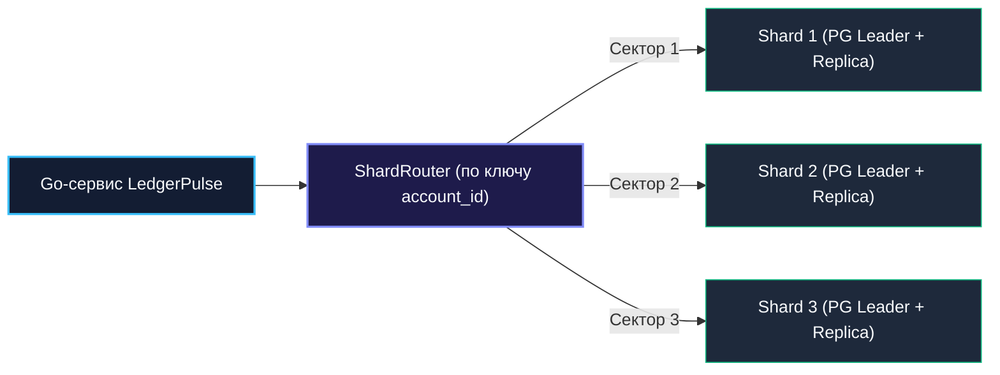
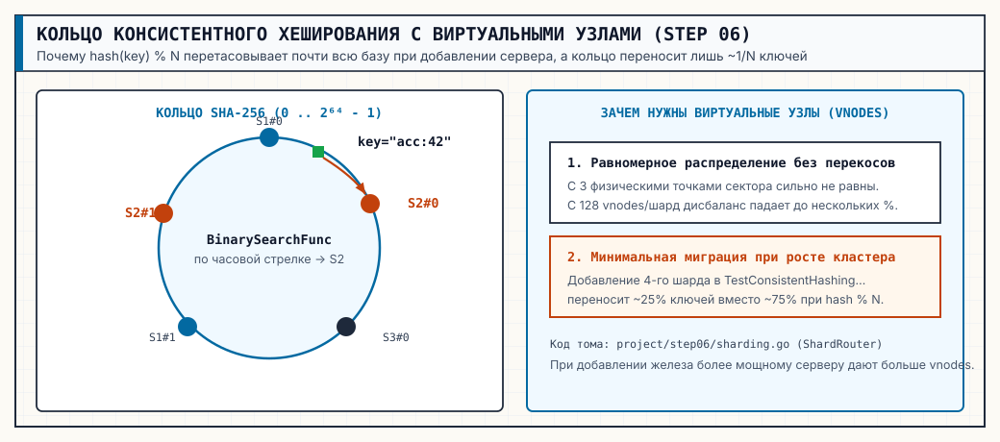

*Горизонтальное масштабирование данных: выбор ключа шардирования, стратегии Range/Hash/Directory, разбор `ShardRouter` из `project/step06/`, Scatter-Gather и перебалансировка без простоя.*

> «Go поощряет понимание устройства современных компьютеров — и прежде всего важности локальности данных в памяти. Его встроенные типы и большинство структур стандартной библиотеки спроектированы так, чтобы естественно работать без явной инициализации и скрытых конструкторов, поэтому в коде спрятано сравнительно мало лишних аллокаций и записей в память. Составные типы Go (структуры и массивы) хранят элементы напрямую, требуя меньше памяти, меньше выделений и меньше переходов по указателям, чем языки с косвенными полями.»  
> — Алан Донован и Брайан Керниган, *The Go Programming Language*

Рано или поздно даже идеально настроенная база данных упирается в потолок **вертикального масштабирования (Scaling Up)**. Таблица `ledger_entries` разрастается до десятков терабайт, рабочее множество индексов B-Tree перестаёт помещаться в оперативную память, массив NVMe насыщается по IOPS, а покупка четырёхсокетного сервера с 4 ТБ RAM обходится не в 4, а в 20–30 раз дороже четырёх обычных двухпроцессорных машин. На уровне железа к цене добавляются насыщение межпроцессорных шин (UPI/QPI), задержки когерентности кэшей и фрагментация памяти на узлах NUMA.

Репликация (главы [[1. Репликация — синхронная, полусинхронная и асинхронная]]–[[3. Multi-Leader и Leaderless репликация — конфликты записи и кворумы]]) масштабирует чтения и повышает живучесть, но в ней каждый сервер всё равно хранит полную копию базы. Единственный способ пробить потолок объёма диска и пропускной способности записи — **горизонтальное масштабирование (Scaling Out)** через **шардинг (Sharding)**.

**Шардинг** — это физическое разделение логической базы данных на независимые непересекающиеся фрагменты (**шарды**), размещённые на разных серверах со своими CPU, RAM и накопителями. В отличие от **партиционирования** — логического разбиения одной таблицы на отдельные файлы *внутри одного экземпляра СУБД* (о нём пойдёт речь в следующей главе модуля) — отдельные шарды ничего не знают друг о друге.

На практике шардинг и репликация всегда сочетаются: шардирование делит данные по объёму и потоку записи, а каждый отдельный шард работает как отказоустойчивая группа репликации Leader–Follower.

---

## Ключ шардирования и три стратегии распределения


Чтобы не опрашивать все серверы при поиске одного счёта, маршрутизатор вычисляет целевой шард детерминированно по **ключу шардирования (Shard Key)** — одному или нескольким столбцам сущности.

Выбор неудачного ключа убивает кластер: если шардировать проводки по дате `created_at`, 100% записей за сегодняшний день ударят в один-единственный сервер («горячий шард», **Hot Partition**), выжигая его IOPS и CPU, пока остальные 99 серверов простаивают. Для `LedgerPulse` ключ шардирования обязан сочетать три свойства:
* **Высокая кардинальность** (миллионы уникальных `account_id`, а не 5 типов валют);
* **Равномерное распределение записи (Uniform Write Distribution)**;
* **Совместное размещение (Co-location):** связанные таблицы (`accounts`, `ledger_entries`) шардируются по одному ключу `account_id`, чтобы вся история конкретного счёта жила на одном физическом узле и читалась без межсерверных запросов.



Существуют три базовые стратегии отображения ключа в шард:

| Стратегия | Механика | Плюсы | Минусы |
| :--- | :--- | :--- | :--- |
| **Range Sharding** | Фиксированные диапазоны (`id` 1..1M на Shard 1, 1M..2M на Shard 2) | Быстрые диапазонные выборки (`BETWEEN`) на одном узле | Горячие точки на свежих монотонных ID/датах, ручная нарезка границ |
| **Hash Sharding** | `hash(key) % N` (быстрый `crc32`, `fnv`, `xxhash`) | Равномерное распределение нагрузки без горячих точек | Разрушение диапазонных запросов; добавление $N+1$ узла перемещает 75–80% данных |
| **Directory Sharding** | Таблица соответствий `account_id -> shard` (в Redis/метаданных) | Гибкость: крупного «кита» можно перенести на выделенный сервер | Дополнительный сетевой прыжок и единая точка отказа (SPOF) в самом каталоге |

---

## Консистентное хеширование и разбор `ShardRouter`



Наивная формула $\text{hash}(\text{key}) \pmod N$ катастрофична при росте кластера. Если три шарда заполнены на 95% и вы добавляете четвёртый, изменение делителя с $N=3$ на $N=4$ меняет остаток примерно у **75–80% всех ключей**. Придётся перекачивать терабайты по сети под нагрузкой.

Чтобы избежать лавинной миграции, Дэвид Каргер с соавторами в 1997 году предложили **консистентное хеширование (Consistent Hashing)**. Пространство значений хеша замыкается в логическое кольцо (например, от $0$ до $2^{64}-1$). На кольцо наносятся как ключи данных, так и сами серверы. Целевой шард для ключа — первый узел, встреченный на кольце при движении по часовой стрелке (а в конце кольца — переход к первому узлу с индексом `0`).

Когда к $N$ узлам добавляется $(N+1)$-й, мигрирует лишь доля ключей порядка

$$\text{Rebalanced Keys} \approx \frac{K}{N + 1},$$

причём новый узел забирает данные только у ближайших соседей по кольцу, не трогая остальной кластер. Чтобы избежать неравномерных секторов при малом числе физических серверов, каждый сервер размещают на кольце в виде десятков или сотен **виртуальных узлов (Virtual Nodes, vnodes)**, равномерно перемешанных по окружности.

Посмотрим, как этот алгоритм реализован в `project/step06/sharding.go`:

```go
type vnode struct {
	hash  uint64
	shard string
}

// ShardRouter распределяет account_id по физическим шардам через кольцо консистентного хеширования.
type ShardRouter struct {
	vnodesPerShard int
	ring           []vnode
}

func NewShardRouter(shards []string, vnodesPerShard int) *ShardRouter {
	if vnodesPerShard <= 0 {
		vnodesPerShard = 64
	}
	r := &ShardRouter{vnodesPerShard: vnodesPerShard}
	for _, s := range shards {
		for i := range vnodesPerShard {
			h := hashKey(fmt.Sprintf("%s#%d", s, i))
			r.ring = append(r.ring, vnode{hash: h, shard: s})
		}
	}
	slices.SortFunc(r.ring, func(a, b vnode) int {
		if a.hash < b.hash {
			return -1
		}
		if a.hash > b.hash {
			return 1
		}
		return 0
	})
	return r
}

func hashKey(k string) uint64 {
	sum := sha256.Sum256([]byte(k))
	return binary.BigEndian.Uint64(sum[:8])
}

func (r *ShardRouter) ShardFor(key string) string {
	if len(r.ring) == 0 {
		return ""
	}
	h := hashKey(key)
	idx, _ := slices.BinarySearchFunc(r.ring, h, func(v vnode, target uint64) int {
		if v.hash < target {
			return -1
		}
		if v.hash > target {
			return 1
		}
		return 0
	})
	if idx == len(r.ring) {
		idx = 0
	}
	return r.ring[idx].shard
}
```

Разберём устройство `ShardRouter` и результаты теста `TestConsistentHashingRebalanceAndFencing` из `project/step06/sharding_test.go`:
1. **Сортированный слайс виртуальных узлов:** `r.ring` хранит плотный слайс структур `vnode` без лишних указателей — дружелюбно к кэшу CPU (локальность данных) и незаметно для сборщика мусора. Для 4 шардов по 128 vnodes длина слайса составляет всего 512 элементов.
2. **Поиск за $O(\log(N \cdot V))$:** `slices.BinarySearchFunc` находит первый виртуальный узел с `v.hash >= h`. Если `h` больше максимального хеша на кольце (`idx == len(r.ring)`), кольцо замыкается на `idx = 0`.
3. **Проверка равномерности и минимальной миграции в тесте:** `sharding_test.go` прогоняет 1 000 ключей `acc:0` … `acc:999` через кольцо из 3 шардов (`r3`) и сравнивает с кольцом из 4 шардов (`r4`) при 128 виртуальных узлах на шард:
   * перекос по каждому шарду укладывается в жёсткие рамки `200..450` ключей из 1 000 (при идеальных 333);
   * при добавлении четвёртого шарда переезжает около ~25% ключей (допуск теста `< 380` из 1 000), а не ~75% как при `hash % N`.

Прогон `go test -v ./step06/...` подтверждает поведение:

```text
=== RUN   TestConsistentHashingRebalanceAndFencing
--- PASS: TestConsistentHashingRebalanceAndFencing (0.00s)
PASS
ok  	github.com/UnrealTemplier/go-textbook-v2-vol2/project/step06	0.002s
```

> [!info] Под капотом: Выбор хеш-функции для горячего пути
> В учебном `hashKey` используется `crypto/sha256` ради идеального лавинного эффекта на коротких строках `"pg-shard-1#0"`. На высоконагруженном горячем пути (сотни тысяч маршрутизаций в секунду) криптографический хеш в 15–20 раз медленнее некриптографических алгоритмов вроде `xxhash` или `hash/fnv` и дополнительно аллоцирует при преобразовании строк в `[]byte`. В продакшене `hashKey` достаточно заменить на `xxh3` / `fnv64a` с `[]byte` без изменения логики кольца.

---

## Последствия для Go-приложения и рантайма

Разделение базы на шарды ломает сразу несколько привычных механизмов монолитного SQL:

1. **Исчезновение межсерверных `JOIN`:** если таблица `users` лежит на Shard 1, а `ledger_entries` с разбиением по другому ключу — на Shard 3, движок PostgreSQL физически не сможет соединить их. Решения два: денормализация (сохранять копию имени/метаданных счёта или размещать связанные данные по общему `account_id`) либо **Application-Side Join** в Go (два точечных запроса и склейка структур в памяти).
2. **Кросс-шардовые запросы (Scatter–Gather):** поиск не по ключу шардирования (например, по `email` или `status = 'flagged'`) вынуждает рассылать `SELECT` по всем $N$ шардам параллельно и собирать результаты. Без ограничителя параллелизма 1 000 одновременных запросов на 64 шардах откроют 64 000 параллельных сокетов и убьют пулы соединений. Для защиты используйте семафор (`golang.org/x/sync/semaphore`) или выносите вторичный поиск в отдельный индекс (Elasticsearch, глобальную индексную таблицу). Предвыделение результирующего слайса `make([]Entry, 0, expected)` и `sync.Pool` для буферов уменьшают нагрузку на GC при сборке результатов.
3. **Раздувание пулов соединений:** если в монолите под держал 30 соединений, то в кластере из 20 шардов 50 подов Kubernetes с `MaxOpenConns(20)` откроют $20 \times 20 \times 50 = 20\,000$ TCP-соединений. Обязательно снижайте лимит на под и ставьте пулер транзакций (`PgBouncer`, `Odyssey`) перед каждым шардом.
4. **Глобальные первичные ключи:** отказ от `SERIAL` / `AUTO_INCREMENT` в пользу UUID v7 или Snowflake ID (глава [[3. Multi-Leader и Leaderless репликация — конфликты записи и кворумы]]).
5. **Кросс-шардовые транзакции:** локальные гарантии `ACID` работают строго внутри одного шарда. Перевод денег между `acc:1` (Shard 1) и `acc:2` (Shard 3) требует распределённой координации — двухфазного коммита (2PC) или паттерна Saga с компенсирующими проводками (подробно рассмотрены в главах 8–10 этого модуля).

Пример безопасного **Scatter–Gather** в Go 1.24 с ограничением параллелизма и корректной обработкой контекста:

```go
package sharding

import (
	"context"
	"database/sql"
	"fmt"
	"sync"

	"golang.org/x/sync/semaphore"
)

type Entry struct {
	ID        int64
	AccountID int64
	Amount    int64
}

// FindLargeEntries выполняет контролируемый Scatter-Gather по всем шардам.
func FindLargeEntries(ctx context.Context, shards []*sql.DB, minAmount int64, maxInFlight int64) ([]Entry, error) {
	sem := semaphore.NewWeighted(maxInFlight)
	var (
		mu      sync.Mutex
		results = make([]Entry, 0, len(shards)*4)
		wg      sync.WaitGroup
		firstErr error
	)

	for _, db := range shards {
		if err := sem.Acquire(ctx, 1); err != nil {
			return nil, fmt.Errorf("acquire semaphore: %w", err)
		}
		wg.Add(1)
		go func(target *sql.DB) {
			defer wg.Done()
			defer sem.Release(1)

			rows, err := target.QueryContext(
				ctx,
				`SELECT id, account_id, delta_minor FROM ledger_entries WHERE delta_minor >= $1 LIMIT 50`,
				minAmount,
			)
			if err != nil {
				mu.Lock()
				if firstErr == nil {
					firstErr = err
				}
				mu.Unlock()
				return
			}
			defer rows.Close()

			local := make([]Entry, 0, 8)
			for rows.Next() {
				var e Entry
				if err := rows.Scan(&e.ID, &e.AccountID, &e.Amount); err != nil {
					mu.Lock()
					if firstErr == nil {
						firstErr = err
					}
					mu.Unlock()
					return
				}
				local = append(local, e)
			}
			if err := rows.Err(); err != nil {
				mu.Lock()
				if firstErr == nil {
					firstErr = err
				}
				mu.Unlock()
				return
			}

			mu.Lock()
			results = append(results, local...)
			mu.Unlock()
		}(db)
	}

	wg.Wait()
	if firstErr != nil {
		return nil, firstErr
	}
	return results, nil
}
```

---

## Перебалансировка без простоя и готовые инструменты

Даже с консистентным хешированием добавление нового шарда требует физически перенести мигрирующие ключи со старых серверов на новый без остановки `LedgerPulse`. Безопасная перебалансировка (Resharding) идёт в пять фаз:
1. **Двойная запись (Dual-Write):** приложение продолжает читать со старого шарда, но все новые записи мигрирующих ключей отправляет в оба шарда (старый и новый) либо в новый с синхронизацией через CDC/триггеры.
2. **Фоновый перенос (Backfill):** воркер порциями копирует исторические строки мигрирующих ключей со старого шарда на новый, не перезаписывая более свежие версии.
3. **Сверка (Reconciliation):** сверка количества строк и контрольных сумм балансов.
4. **Переключение чтения (Read Cutover):** маршрутизатор переводит `SELECT` мигрирующих ключей на новый шард.
5. **Очистка:** отключение двойной записи и фоновое удаление перенесённых строк на старом сервере.

Чтобы не поддерживать этот конвейер вручную в каждом микросервисе, на уровне инфраструктуры применяют готовые прокси и распределённые СУБД:
* **Vitess** — промышленный шардирующий прокси для MySQL (создан в YouTube на языке Go), который сам разбирает SQL, маршрутизирует запросы и делает онлайн-решардинг через VReplication.
* **Citus** — расширение PostgreSQL с узлом-координатором и воркерами, позволяющее подключаться обычным `pgxpool`.
* **Redis Cluster** — фиксированные 16 384 хеш-слота (`CRC16(key) % 16384`) с протоколом перенаправления `MOVED`/`ASK`.
* **MongoDB** (`mongos` + `config servers`) и **CockroachDB / YugabyteDB** (автоматическое деление на диапазоны поверх Raft).

### Три типичных антипаттерна

1. **Преждевременное шардирование:** дробить базу объёмом 15 ГБ и нагрузкой 200 RPS — значит бесплатно усложнить транзакции, отладку и схему ради экономии, которая не нужна.
2. **Рассинхрон миграций между шардами:** схема должна накатываться единым автоматизированным пайплайном (`goose`, `golang-migrate`) на все шарды с проверкой контрольного состояния.
3. **Отсутствие алертов на перекос (Skew):** один «кит»-клиент с миллионом проводок в день способен положить один шард, пока средняя нагрузка по кластеру выглядит нормальной.

> [!tip] Собеседование [Senior/Staff]
> **Вопрос:** Таблица истории финансовых транзакций растёт на 1,5 ТБ в месяц, чтение в 99% случаев идёт по `account_id` и диапазону дат `created_at`. Как спроектировать хранение?
>
> **Ответ:** Лучше всего работает связка **Шардирование + Партиционирование**:
> 1. **Горизонтальный шард по `account_id`** через консистентное хеширование (`ShardRouter`): вся история счёта живёт на одном узле (Co-location), выписки обходятся без Scatter–Gather.
> 2. **Локальное партиционирование по дате внутри каждого шарда** (`PARTITION BY RANGE (created_at)` по месяцам): планировщик отсекает ненужные месяцы (Partition Pruning), а архивные данные сбрасываются в холодное хранилище за миллисекунды через `DETACH/DROP PARTITION`.
> 3. **Глобальные ID:** монотонный Snowflake или UUID v7 для B-Tree индексов без фрагментации.

---

## Упражнения

1. **Базовое.** Вычислите долю ключей, которая в среднем переедет при добавлении 5-го шарда к кластеру из 4 шардов: (а) при наивном `hash(key) % N` (подсказка: проверьте совпадение остатков для первых 20 целых хешей `0..19` при `h % 4 == h % 5`); (б) при консистентном хешировании на кольце.

> [!solution] Показать решение
> а) При `hash % 4` и `hash % 5` период равен $\text{НОК}(4, 5) = 20$. Остатки `h % 4` и `h % 5` совпадают только при `h ∈ {0, 1, 2, 3}` (4 значения из 20, то есть 20%). Остальные **80% ключей** меняют целевой шард и требуют миграции.
> б) При консистентном хешировании при переходе от $N = 4$ к $N + 1 = 5$ переезжает примерно $\frac{1}{N+1} = \frac{1}{5} = \mathbf{20\%}$ ключей (в 4 раза меньше).

2. **Практическое.** Модифицируйте `NewShardRouter` из `project/step06/sharding.go` (или напишите функцию-обёртку), добавив поддержку весов узлов `ShardSpec{Name string, Weight int}` — например, сервер с вдвое большим диском NVMe и RAM должен получать вдвое больше виртуальных узлов на кольце. Как проверить равномерность распределения новым тестом?

> [!solution] Показать решение
> ```go
> type ShardSpec struct {
> 	Name   string
> 	Weight int // 1 = базовый сервер, 2 = сервер вдвое мощнее
> }
>
> func NewWeightedShardRouter(specs []ShardSpec, baseVnodes int) *ShardRouter {
> 	if baseVnodes <= 0 {
> 		baseVnodes = 64
> 	}
> 	r := &ShardRouter{vnodesPerShard: baseVnodes}
> 	for _, sp := range specs {
> 		w := max(sp.Weight, 1)
> 		totalVnodes := baseVnodes * w
> 		for i := range totalVnodes {
> 			h := hashKey(fmt.Sprintf("%s#%d", sp.Name, i))
> 			r.ring = append(r.ring, vnode{hash: h, shard: sp.Name})
> 		}
> 	}
> 	slices.SortFunc(r.ring, func(a, b vnode) int {
> 		return cmp.Compare(a.hash, b.hash)
> 	})
> 	return r
> }
> ```
> В тесте прогоняем 10 000 ключей `acc:0..9999` при `Weight: 1` для `pg-1` и `Weight: 2` для `pg-2` и проверяем, что доля `pg-2` лежит около $2/3$ (например, в диапазоне `63%..70%`).

3. **Со звёздочкой (\*).** В `LedgerPulse` перекос на одном шарде вызван корпоративным клиентом `acc:mega_corp`, генерирующим 30% всей нагрузки сервиса, тогда как остальные миллионы счетов маленькие. Ключ шардирования `account_id` превратил его шард в «горячую точку». Предложите схему доработки ключа шардирования (Salting / Write Splitting), которая размажет запись `acc:mega_corp` по $K$ шардам, и опишите цену такого решения при чтении баланса этого клиента.

> [!solution] Показать решение
> Применяется техника **соления горячего ключа (Key Salting)**: в справочнике или конфигурации для `acc:mega_corp` включается коэффициент расщепления $K$ (например, $K = 8$). При каждой новой проводке Go-сервис добавляет случайный или циклический суффикс `0..K-1`, формируя ключ маршрутизации `acc:mega_corp#3` для `ShardFor`. Запись равномерно распределяется по нескольким (до $K$) физическим шардам.
>
> **Цена при чтении:** обычный счёт читается точечным запросом с одного шарда, тогда как для чтения баланса `acc:mega_corp` приложению приходится выполнить ограниченный **Scatter–Gather** по всем $K$ суффиксам (`acc:mega_corp#0` … `#7`), просуммировать частичные балансы (или читать предвычисленный итог из кэша/агрегирующей витрины). Поэтому соление включают избирательно только для подтверждённых горячих ключей.

---

Мы научились разносить данные по разным физическим серверам с минимальными потерями при росте кластера. Но прежде чем разрезать базу по сети, почти всегда стоит использовать более дешёвый и встроенный механизм разбиения таблиц *внутри одного сервера* — декларативное партиционирование. О том, как устроены `Range`, `List`, `Hash` партиции и `Partition Pruning` в PostgreSQL и MySQL, поговорим в следующей главе.
