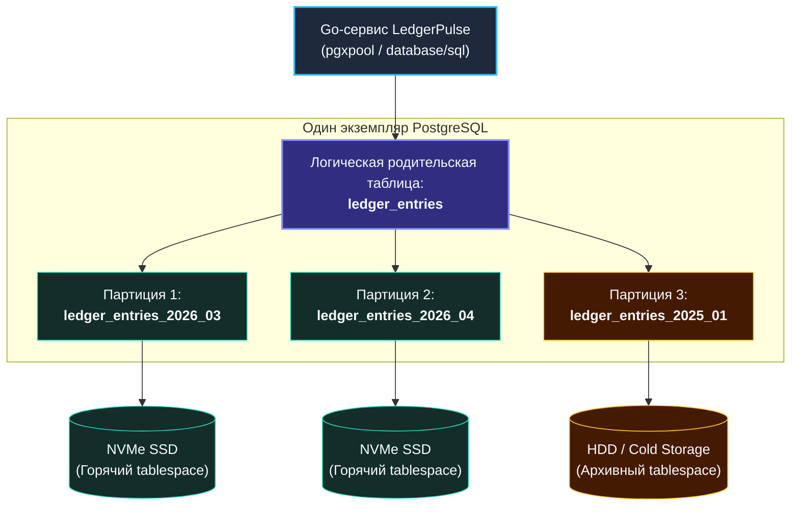
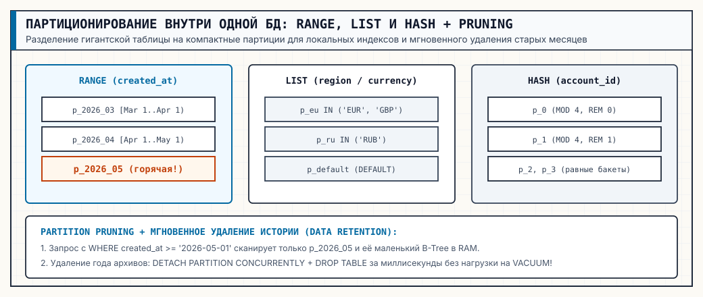

*Как декларативное партиционирование (Range, List, Hash) спасает гигантские таблицы от деградации внутри одного узла СУБД, ускоряет выборки через Partition Pruning, обеспечивает мгновенный Data Retention и предотвращает индексный взрыв в коде на Go.*

> «Память часто была самым дорогим компонентом компьютера. Когда на счету был каждый байт, этот дефицит навязывал программистам особую дисциплину: приходилось постоянно отдавать себе отчёт, сколько памяти занимает программа, а порой и прибегать к ухищрениям и рискованным приёмам, чтобы втиснуть её в доступный объём.»  
> — Брайан Керниган, *UNIX: A History and a Memoir*

В [[4. Шардирование (Sharding) — ключи, консистентное хеширование и перебалансировка]] мы разбирали горизонтальное разделение данных между независимыми серверами. Но выход в распределённую сеть — дорогой шаг, который ломает локальные `JOIN` и усложняет транзакции. Прежде чем резать базу по серверам, инженер решает проблему роста на одном узле.

Когда таблица `ledger_entries` в `LedgerPulse` переваливает за сотни миллионов строк и терабайты объёма, монолитная архитектура деградирует по трём направлениям:
1. **Вытеснение индексов из RAM.** B-Tree вырастает до 100–200 ГБ и перестаёт помещаться в `shared_buffers` PostgreSQL или `innodb_buffer_pool_size` MySQL. Вместо чтения из оперативной памяти (~100 нс) поиск уходит в случайный дисковый ввод-вывод (~100 мкс на NVMe, ~10 мс на HDD).
2. **Паралич обслуживания.** Регламентные `VACUUM`, `REINDEX` и `ALTER TABLE` идут часами, расходуя IOPS и удерживая блокировки.
3. **Удар от удаления архивов.** Оператор `DELETE FROM ledger_entries WHERE created_at < ...` генерирует миллионы записей в WAL и раздувает таблицу мёртвыми кортежами.

Эту задачу решает **партиционирование (Partitioning / секционирование)**.

---

## Партиционирование против шардирования

**Партиционирование** — это разбиение одной логической родительской таблицы на несколько физически независимых подтаблиц (**секций**, или **партиций**) **внутри одного экземпляра СУБД**. Приложение на Go по-прежнему отправляет запросы к единой таблице `ledger_entries`, а планировщик базы сам направляет чтение и запись в нужные файлы на диске.

| Критерий | Партиционирование (Partitioning) | Шардирование (Sharding) |
| :--- | :--- | :--- |
| **Физическая граница** | Один сервер (один инстанс СУБД) | Несколько независимых серверов по сети |
| **Маршрутизация** | Планировщик СУБД (прозрачно для Go) | Код Go или прокси (`Citus`, `Vitess`) |
| **Локальные `JOIN` и ACID** | Работают нативно на одном узле | Ограничены шардом или требуют 2PC/Saga |
| **Пулы соединений Go** | Один пул (`pgxpool.Pool` / `*sql.DB`) | Отдельный пул на шард (умножение TCP-сокетов) |



На практике обе техники образуют **гибридную синергию**: кластер шардируют по `account_id` на 16 серверов (чтобы выписка счёта жила на одном узле), а внутри каждого шарда проводки партиционируют по месяцам (`created_at`).

Разделение бывает **горизонтальным** (строки разносятся по секциям) и **вертикальным** (редкие тяжёлые поля `BLOB`, крупные `JSONB` или тексты выносят в отдельную таблицу со связью 1-к-1, оставляя горячие числовые колонки компактными в 8-КБ страницах). В PostgreSQL вертикальное вынесение тяжёлых значений частично автоматизировано через **TOAST** ([[2. Движок хранения PostgreSQL — 8 КБ страницы, Heap, TOAST и Visibility Map]]).

---

## Стратегии распределения: Range, List, Hash



При создании родительской таблицы объявляется **ключ партиционирования (Partition Key)** и правило распределения строк:

1. **Range Partitioning (по диапазонам).** Выбор для временных рядов, логов аудита и финансовых проводок (`created_at` по месяцам). Главный выигрыш — мгновенный **Data Retention**: вместо мучительного `DELETE` старая секция отсоединяется и удаляется через `DROP TABLE`. Файловая система выполняет `unlink()` за миллисекунды, не создавая лишних записей WAL и мёртвых строк. Минус — все новые вставки бьют в последнюю горячую секцию.
2. **List Partitioning (по списку значений).** Дискретное перечисление ключей (`region IN ('ru', 'eu', 'us')`). Полезно для multi-tenant систем и соблюдения законов о локализации данных (GDPR, 152-ФЗ) через привязку секций к разным табличным пространствам.
3. **Hash Partitioning (по хешу).** Целевая секция определяется как `hash(key) % modulus = remainder` (например, `PARTITION BY HASH (account_id)`). Ликвидирует горячие точки записи, равномерно распределяя параллельный дисковый I/O. Но диапазонные выборки по этому ключу не отсекают секции, а удалить архив по дате через `DROP TABLE` нельзя.

PostgreSQL поддерживает **субпартиционирование** (композитное разбиение, например `RANGE (created_at)` + `HASH (account_id)` для распараллеливания записи внутри месяца) и страховочную секцию `DEFAULT`. Однако `DEFAULT`-партиция опасна в эксплуатации: при добавлении новой секции PostgreSQL обязан целиком просканировать `DEFAULT` под эксклюзивной блокировкой. Надёжнее создавать будущие секции заранее.

---

## Локальность данных, Partition Pruning и Storage Tiering

Ускорение от партиционирования держится на **отсечении партиций (Partition Pruning)**. Когда приложение на Go запрашивает:

```sql
SELECT entry_id, amount_cents, direction
FROM ledger_entries
WHERE created_at >= '2026-04-01'
  AND created_at < '2026-05-01'
  AND account_id = 42001;
```

планировщик сопоставляет границы секций с условиями `WHERE` и исключает лишние таблицы:
* **Статический pruning** срабатывает на этапе компиляции плана по константам — ненужные файлы даже не открываются.
* **Динамический pruning** срабатывает во время выполнения при параметрах из `JOIN` или подготовленных запросов (в `EXPLAIN ANALYZE` это отражается строкой `Subplans Removed: N`).

Вместо обхода B-Tree объёмом 150 ГБ с вытеснением из RAM база обращается к компактному 500-МБ индексу одной месячной секции. Он целиком помещается в `shared_buffers` и кэше страниц ОС, сокращая задержку чтения с миллисекунд до десятков микросекунд.

Поскольку секции — отдельные файлы на диске, **ярусное хранение (Storage Tiering)** через `TABLESPACE` позволяет держать текущий месяц на быстрых NVMe SSD, а прошлые годы переносить на дешёвые HDD. Предварительный `VACUUM FREEZE` заполняет карту видимости, после чего `Autovacuum` перестаёт тратить ресурсы на архив ([[10. VACUUM, Autovacuum, ANALYZE и борьба с раздуванием]]).

---

## Декларативное партиционирование в PostgreSQL и MySQL

С версии PostgreSQL 10 партиционирование встроено в декларативный DDL (в PG 12 добавили внешние ключи на партиционированные таблицы, в PG 14 — `DETACH PARTITION CONCURRENTLY`). Создадим схему проводок `LedgerPulse`:

```sql
CREATE TABLE ledger_entries (
    entry_id      BIGINT GENERATED ALWAYS AS IDENTITY,
    account_id    BIGINT NOT NULL,
    tx_id         UUID NOT NULL,
    amount_cents  BIGINT NOT NULL CHECK (amount_cents > 0),
    direction     CHAR(1) NOT NULL CHECK (direction IN ('D', 'C')),
    created_at    TIMESTAMPTZ NOT NULL,
    PRIMARY KEY (entry_id, created_at)
) PARTITION BY RANGE (created_at);

CREATE TABLE ledger_entries_2026_03 PARTITION OF ledger_entries
    FOR VALUES FROM ('2026-03-01 00:00:00+00') TO ('2026-04-01 00:00:00+00');

CREATE TABLE ledger_entries_2026_04 PARTITION OF ledger_entries
    FOR VALUES FROM ('2026-04-01 00:00:00+00') TO ('2026-05-01 00:00:00+00');

-- Индекс на родителе автоматически распространяется на все дочерние секции
CREATE INDEX idx_ledger_entries_account_date
    ON ledger_entries (account_id, created_at);
```

План запроса с фильтром по дате подтверждает обращение только к одной секции:

```sql
EXPLAIN (ANALYZE, BUFFERS)
SELECT entry_id, amount_cents, direction
FROM ledger_entries
WHERE account_id = 42001
  AND created_at >= '2026-04-01 00:00:00+00'
  AND created_at <  '2026-04-15 00:00:00+00';
```

```text
Index Scan using ledger_entries_2026_04_account_id_created_at_idx on ledger_entries_2026_04
  Index Cond: ((account_id = 42001) AND (created_at >= '2026-04-01 00:00:00+00') AND (created_at < '2026-04-15 00:00:00+00'))
  Buffers: shared hit=4
Planning Time: 0.194 ms
Execution Time: 0.048 ms
```

Устаревшую секцию выводят без блокировки текущей записи:

```sql
ALTER TABLE ledger_entries DETACH PARTITION ledger_entries_2024_01 CONCURRENTLY;
DROP TABLE ledger_entries_2024_01;
```

В **MySQL InnoDB** декларативное разбиение работает схожим образом (`PARTITION BY RANGE COLUMNS (created_at)`), включая требование вхождения ключа во все `PRIMARY KEY` и `UNIQUE`, но для безболезненного архивирования применяют `EXCHANGE PARTITION` или `ALTER TABLE ... DROP PARTITION`.

---

## Ограничения, ловушки и дисциплина кода в Go

1. **Отсутствие глобальных уникальных индексов.** Индексы в PostgreSQL и MySQL локальны для каждой секции. Нельзя создать `UNIQUE (tx_id)` без `created_at`: для проверки глобальной уникальности движку пришлось бы сканировать десятки секций на каждый `INSERT`. Решение — отдельная компактная таблица идемпотентности или кодирование времени в ключе (`UUID v7`).
2. **Ошибка отсутствующей секции.** При вставке строки, для которой не создана секция, `INSERT` падает с SQLSTATE `23514` (`no partition of relation found for row`). Будущие секции создают заранее через `pg_partman` или cron-воркер на Go.
3. **Не-SARGable условия.** Вызов `WHERE date_trunc('month', created_at) = '2026-04-01'` отключает Partition Pruning и заставляет сканировать все секции ([[15. Оптимизация SELECT — SARGable-условия и кейсы LedgerPulse]]). Используйте полуоткрытый интервал `created_at >= $1 AND created_at < $2`.

> [!warning] Ловушка: Индексный взрыв (Partition Explosion)
> Разбиение таблицы по дням на 5 лет создаёт ~1 825 секций. Запрос без ключа партиционирования в `WHERE` заставляет планировщик открыть и заблокировать (`AccessShareLock`) все 1 825 таблиц и столько же индексов. Это резко раздувает `Planning Time`, исчерпывает `max_locks_per_transaction` и память каталогов бэкенда.
>
> **Правило:** держите активное число секций в десятках или паре сотен и обязывайте код на Go передавать ключ партиционирования в сигнатуре метода репозитория.

Репозиторий на Go 1.24 с `pgxpool` закрепляет это правило на уровне типов:

```go
package ledger

import (
	"context"
	"errors"
	"fmt"
	"time"

	"github.com/jackc/pgx/v5/pgconn"
	"github.com/jackc/pgx/v5/pgxpool"
)

var ErrPartitionMissing = errors.New("target time partition does not exist")

type Entry struct {
	ID          int64
	AccountID   int64
	AmountCents int64
	Direction   string
	CreatedAt   time.Time
}

type PartitionedRepo struct{ pool *pgxpool.Pool }

// ListByAccountAndPeriod требует явный интервал [from, to) для Partition Pruning.
func (r *PartitionedRepo) ListByAccountAndPeriod(
	ctx context.Context, accountID int64, from, to time.Time,
) ([]Entry, error) {
	if !to.After(from) {
		return nil, fmt.Errorf("invalid period: %s..%s", from, to)
	}
	const query = `
		SELECT entry_id, account_id, amount_cents, direction, created_at
		FROM ledger_entries
		WHERE account_id = $1 AND created_at >= $2 AND created_at < $3
		ORDER BY created_at DESC, entry_id DESC LIMIT 200`

	rows, err := r.pool.Query(ctx, query, accountID, from.UTC(), to.UTC())
	if err != nil {
		return nil, fmt.Errorf("query ledger entries: %w", err)
	}
	defer rows.Close()

	entries := make([]Entry, 0, 32)
	for rows.Next() {
		var e Entry
		if err := rows.Scan(&e.ID, &e.AccountID, &e.AmountCents, &e.Direction, &e.CreatedAt); err != nil {
			return nil, fmt.Errorf("scan entry: %w", err)
		}
		entries = append(entries, e)
	}
	return entries, rows.Err()
}

func (r *PartitionedRepo) InsertEntry(ctx context.Context, e Entry) error {
	const query = `
		INSERT INTO ledger_entries (account_id, tx_id, amount_cents, direction, created_at)
		VALUES ($1, gen_random_uuid(), $2, $3, $4)`
	if _, err := r.pool.Exec(ctx, query, e.AccountID, e.AmountCents, e.Direction, e.CreatedAt.UTC()); err != nil {
		var pgErr *pgconn.PgError
		if errors.As(err, &pgErr) && pgErr.Code == "23514" {
			return fmt.Errorf("%w: %s", ErrPartitionMissing, e.CreatedAt.UTC())
		}
		return fmt.Errorf("insert entry: %w", err)
	}
	return nil
}
```

> [!tip] Собеседование [Middle]
> **Вопрос:** Таблица транзакций `LedgerPulse` растёт на 800 ГБ в год, отчёты выбирают данные клиента за последние 30 дней, а записи старше 3 лет нужно удалять. Что выбрать: партиционирование, шардирование или их комбинацию?
>
> **Ответ:** Для 800 ГБ в год на одном NVMe-сервере первым шагом выбираем **помесячное `RANGE`-партиционирование по `created_at`** без усложнения сети шардированием. Отчёты за 30 дней затронут 1–2 секции, чьи индексы останутся в RAM за счёт Partition Pruning, а удаление данных старше 3 лет пройдёт через `DETACH PARTITION CONCURRENTLY` + `DROP TABLE` за миллисекунды. Когда нагрузка на запись превысит возможности одного узла, поверх добавится шардирование по `account_id`.

---

## Практикум: задачи для закрепления

### Упражнение 1 (Базовое)
При создании индекса `CREATE UNIQUE INDEX idx_tx_unique ON ledger_entries (tx_id);` на партиционированной по `RANGE (created_at)` таблице PostgreSQL возвращает ошибку `unique index on partitioned table must include all partitioning columns`. Почему так происходит и как гарантировать глобальную уникальность `idempotency_key`?

> [!solution] Показать решение
> Индексы в PostgreSQL локальны для каждой секции: проверять глобальную уникальность при вставке без ключа партиционирования пришлось бы полным обходом всех файлов.
>
> **Решения:**
> 1. Вынести `idempotency_keys (key UUID PRIMARY KEY, created_at TIMESTAMPTZ)` в отдельную компактную таблицу с коротким TTL (например, 7 дней).
> 2. Либо использовать `UUID v7`, где временная метка встроена в старшие 48 бит ключа, и включать `(tx_id, created_at)` в составной уникальный индекс.

### Упражнение 2 (Практическое)
Перепишите запрос ниже, чтобы включился Partition Pruning на `ledger_entries` (`RANGE (created_at)`), и напишите на Go функцию `EnsureMonthlyPartition(ctx context.Context, pool *pgxpool.Pool, month time.Time) error`.

```sql
SELECT count(*), coalesce(sum(amount_cents), 0)
FROM ledger_entries
WHERE to_char(created_at AT TIME ZONE 'UTC', 'YYYY-MM') = '2026-04'
  AND direction = 'D';
```

> [!solution] Показать решение
> Вызов `to_char(...)` над столбцом делает условие не-SARGable. Исправленный запрос:
> ```sql
> SELECT count(*), coalesce(sum(amount_cents), 0)
> FROM ledger_entries
> WHERE created_at >= '2026-04-01 00:00:00+00'
>   AND created_at <  '2026-05-01 00:00:00+00'
>   AND direction = 'D';
> ```
>
> Создание месячной секции на Go:
> ```go
> func EnsureMonthlyPartition(ctx context.Context, pool *pgxpool.Pool, month time.Time) error {
> 	start := time.Date(month.Year(), month.Month(), 1, 0, 0, 0, 0, time.UTC)
> 	end := start.AddDate(0, 1, 0)
> 	name := fmt.Sprintf("ledger_entries_%04d_%02d", start.Year(), start.Month())
> 	ddl := fmt.Sprintf(
> 		`CREATE TABLE IF NOT EXISTS %s PARTITION OF ledger_entries FOR VALUES FROM ('%s') TO ('%s')`,
> 		name, start.Format("2006-01-02 15:04:05+00"), end.Format("2006-01-02 15:04:05+00"),
> 	)
> 	if _, err := pool.Exec(ctx, ddl); err != nil {
> 		return fmt.Errorf("create partition %s: %w", name, err)
> 	}
> 	return nil
> }
> ```

### Упражнение 3 (Со звёздочкой \*)
В `DEFAULT`-секцию таблицы `ledger_entries` из-за остановки воркера попали 12 млн строк за май 2026 года, и теперь `CREATE TABLE ledger_entries_2026_05 PARTITION OF ...` падает с ошибкой. Составьте план безопасной нарезки майской секции без блокировки записи в базу.

> [!solution] Показать решение
> 1. Отсоединить `DEFAULT` без долгой блокировки: `ALTER TABLE ledger_entries DETACH PARTITION ledger_entries_default CONCURRENTLY;`.
> 2. В короткой транзакции создать новую пустую `DEFAULT`-секцию (если нужна как страховка) и секцию `ledger_entries_2026_05` — проверка пройдёт мгновенно, так как новая `DEFAULT` пуста.
> 3. Батчами по 10 000–50 000 строк перенести майские записи из отсоединённой таблицы обратно в `ledger_entries` (`DELETE ... RETURNING` + `INSERT`), после чего удалить старую таблицу через `DROP TABLE`.

---

## Что дальше

Партиционирование и шардирование решают проблему объёма и скорости доступа. Но как только копии данных живут на разных серверах сети, возникает главный вопрос согласованности: когда и в каком порядке изменения на одном узле становятся видны клиентам на других узлах?

Разберём этот спектр контрактов в следующей главе — [[6. Модели согласованности в БД — Strong, Eventual, Read-Your-Writes и Causal]].
