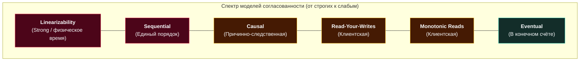
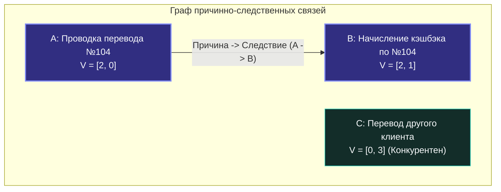

*Почему в распределённой базе данных рассыпается иллюзия единого физического времени, чем отличаются Strong, Sequential, Causal, Read-Your-Writes и Eventual Consistency и как эти контракты влияют на код и рантайм Go.*

> «Хотя поддержка конкурентности — одна из главных сильных сторон Go, рассуждать о конкурентных программах по природе труднее, чем о последовательных, и интуиция, выработанная на последовательном коде, порой подводит.»  
> — Алан Донован и Брайан Керниган, *The Go Programming Language*

На одном сервере СУБД свежесть данных кажется самоочевидной: транзакция завершила `UPDATE`, и следующий `SELECT` немедленно видит новое значение. На одном кристалле CPU когерентность кэшей (`MESI`/`MOESI`) и барьеры памяти за наносекунды поддерживают строгую картину памяти.

За пределами одного сервера эта иллюзия исчезает. Сигнал в оптоволокне ограничен скоростью света ($\approx 200\,000$ км/с), пакеты задерживаются буферами маршрутизаторов на миллисекунды, а кварцевые генераторы серверов подвержены дрейфу часов (**Clock Drift**).

Сразу разделим два понятия, которые часто путают:
* **Consistency в ACID** — внутренняя целостность и бизнес-инварианты транзакции (баланс в `LedgerPulse` неотрицательный, сумма дебета равна кредиту, внешние ключи валидны).
* **Consistency в распределённых системах (и в CAP)** — согласованность копий (*Coherence*): формальный контракт о том, какую версию данных и в каком порядке видит приложение на Go при обращении к разным узлам кластера.

---

## Спектр моделей согласованности

Модели выстраиваются от самых строгих (дорогих по задержке и доступности) к самым слабым (быстрым, но перекладывающим разрешение расхождений на прикладной код):



---

## Strong Consistency: линеаризуемость и последовательность

**Сильная согласованность (Strong Consistency)** создаёт иллюзию **единственной неделимой копии данных**.

Её строжайшая форма — **линеаризуемость (Linearizability)**, описанная Морисом Херлихи и Джанет Винг (1990): каждая операция имеет мгновенную *точку линеаризации* между вызовом (`invoke`) и ответом (`response`). Как только запись подтверждена в реальном физическом времени, любое последующее чтение с любого узла кластера обязано вернуть это значение или более новое. Откат во времени исключён.

Более мягкая форма — **последовательная согласованность (Sequential Consistency)** Лесли Лампорта: все узлы наблюдают единый глобальный порядок операций, совместимый с порядком внутри каждого клиента, но без строгой привязки к физическим часам.

### Как БД обеспечивают Strong Consistency

1. **Кворумная репликация ($R + W > N$):** в кластере из $N$ реплик запись подтверждают $W$ узлов, а чтение опрашивает $R$ узлов. По принципу Дирихле множества записи и чтения гарантированно пересекаются минимум на одном узле со свежей версией ([[3. Multi-Leader и Leaderless репликация — конфликты записи и кворумы]]).
2. **Консенсус (Raft, Multi-Paxos):** записи проходят через лидера и подтверждаются кворумом $\lfloor N/2 \rfloor + 1$ узлов (`etcd`, `CockroachDB`, `YugabyteDB`). Чтобы чтения не отдавали устаревшее состояние, лидер подтверждает своё лидерство через `ReadIndex` или `Leader Lease`.
3. **Синхронизированные часы:** `Google Spanner` применяет атомные часы и GPS (`TrueTime`) для задания гарантированного интервала времени при глобальных транзакциях (подробнее о распределённом консенсусе и векторных часах см. Том 4).

### Влияние на Go-рантайм

Цена строгой согласованности — задержка (**Latency Penalty**) на сетевой RTT и `fsync()` кворума, а также отказ в обслуживании при изоляции от большинства узлов.

Горутина Go, ожидающая кворума, паркуется сетевым поллером (`netpoller`). Поток ОС не блокируется, но стек горутины (2–8 КБ) и дескриптор сокета остаются занятыми. При 50 000 параллельных запросов и сетевом всплеске зависшие горутины замораживают сотни мегабайт RAM и нагружают сборщик мусора сканированием стеков. Поэтому в клиентах обязательны `context.WithTimeout` и ограничение параллелизма.

Пример переключения строгости чтения в `etcd`:

```go
package consistency

import (
	"context"
	"fmt"
	"time"

	clientv3 "go.etcd.io/etcd/client/v3"
)

func GetFeatureFlag(ctx context.Context, client *clientv3.Client, key string, strict bool) (string, error) {
	reqCtx, cancel := context.WithTimeout(ctx, 2*time.Second)
	defer cancel()

	var opts []clientv3.OpOption
	if !strict {
		// WithSerializable отключает кворумную проверку лидерства:
		// быстрее и доступнее при разрыве сети, но допускает чтение устаревшего значения.
		opts = append(opts, clientv3.WithSerializable())
	}

	resp, err := client.Get(reqCtx, key, opts...)
	if err != nil {
		return "", fmt.Errorf("etcd get %q: %w", key, err)
	}
	if len(resp.Kvs) == 0 {
		return "", nil
	}
	return string(resp.Kvs[0].Value), nil
}
```

---

## Eventual Consistency и разрешение конфликтов

**Согласованность в конечном счёте (Eventual Consistency)** гарантирует лишь одно: *если новые записи прекратятся, через конечное время все реплики сойдутся к одинаковому состоянию*. Промежуток до сходимости называется **окном несогласованности (Inconsistency Window)**. На этой модели строится подход **BASE** (*Basically Available, Soft state, Eventually consistent*).

Примеры: **DNS** (распространение от минут до 72 часов), **Cassandra / DynamoDB** при `ONE`, асинхронная репликация PostgreSQL ([[11. Репликация в PostgreSQL — потоковая, логическая и слоты]]) и кэш `Cache-Aside` (подробнее о стратегиях кэширования см. Том 3).

Горутины в этой модели освобождаются за микросекунды, но на приложение и базу ложится **разрешение конфликтов (Conflict Resolution)**:
* **LWW (Last-Write-Wins):** побеждает запись с большей меткой физических часов. Из-за дрейфа NTP в 10 мс физически более поздняя транзакция способна проиграть «убежавшим» часам. Для балансов `LedgerPulse` LWW неприменим.
* **CRDT (*Conflict-free Replicated Data Types*):** структуры данных (`PN-Counter`, `OR-Set`), чьё слияние коммутативно и ассоциативно, что гарантирует сходимость без блокировок.

---

## Клиентские модели: Read-Your-Writes и Monotonic Reads

Для интерактивных сервисов глобальная линеаризуемость избыточна, но чистая Eventual Consistency сбивает пользователя с толку. Эту нишу закрывают **клиентские модели (Client-Centric Consistency)**:

1. **Read-Your-Writes (Чтение своих записей).** Клиент `LedgerPulse` создал перевод, страница обновилась, и `SELECT` ушёл на отстающую реплику — пользователь не видит свою операцию и нажимает «Отправить» повторно. Решения в Go ([[2. Репликация Leader-Follower — лаг репликации и аномалии чтения]]):
   * **Sticky Master:** временно (на 5–10 с) направлять чтения конкретного пользователя после записи на Primary;
   * **отслеживание LSN / GTID:** передавать в контексте маркер транзакции (`pg_current_wal_lsn()`) и читать с реплики только при `pg_last_wal_replay_lsn() >= targetLSN`.
2. **Monotonic Reads (Монотонное чтение).** Прочитав состояние $v_2$, клиент не должен при следующем обновлении страницы попасть на отставшую реплику и увидеть $v_1$ (откат назад во времени). Решается привязкой сессии к одной реплике (consistent hashing по `user_id`) или водяным знаком LSN в сессии.

---

## Causal Consistency и векторные часы

**Причинная согласованность (Causal Consistency)** сохраняет порядок для причинно связанных событий ($A \to B$ — создание счёта и первая проводка по нему, либо вопрос в чате и ответ), но разрешает конкурентным событиям ($A \parallel C$ — переводы двух независимых клиентов) приходить на узлы в произвольном порядке. Это строже Eventual, но не требует глобальной синхронизации и сохраняет доступность при сетевых разрывах.



### Векторные часы (Vector Clocks)

Чтобы не зависеть от физических часов, опираются на логические часы Лэмпорта и **векторные часы**. Каждый из $N$ узлов хранит вектор $V[1..N]$:
1. Перед локальным событием узел увеличивает свою координату: $V_i[i] = V_i[i] + 1$.
2. Исходящее сообщение несёт копию вектора $V_i$.
3. Принимая сообщение с $V_{msg}$, узел обновляет свой вектор и увеличивает локальный счётчик:
   $$\forall k: V_{local}[k] = \max(V_{local}[k], V_{msg}[k])$$

Событие $A$ предшествовало $B$ ($A \to B$) тогда и только тогда, когда:
$$\forall k, V_A[k] \le V_B[k] \quad \text{и} \quad \exists k, V_A[k] < V_B[k]$$

Если оба неравенства нарушены, события **конкурентны ($A \parallel B$)** (подробнее о распределённом консенсусе и векторных часах см. Том 4).

Компактная реализация на Go 1.24:

```go
package causality

import (
	"maps"
	"sync"
)

type Relation int

const (
	Equal Relation = iota
	Before
	After
	Concurrent
)

type VectorClock struct {
	mu     sync.RWMutex
	values map[string]uint64
}

func NewVectorClock() *VectorClock { return &VectorClock{values: make(map[string]uint64)} }

func (vc *VectorClock) Tick(nodeID string) map[string]uint64 {
	vc.mu.Lock()
	defer vc.mu.Unlock()
	vc.values[nodeID]++
	return maps.Clone(vc.values)
}

func (vc *VectorClock) Merge(remote map[string]uint64, localNode string) map[string]uint64 {
	vc.mu.Lock()
	defer vc.mu.Unlock()
	for node, ts := range remote {
		if ts > vc.values[node] {
			vc.values[node] = ts
		}
	}
	vc.values[localNode]++
	return maps.Clone(vc.values)
}

func Compare(a, b map[string]uint64) Relation {
	var less, greater bool
	for k, va := range a {
		if vb := b[k]; va < vb {
			less = true
		} else if va > vb {
			greater = true
		}
	}
	for k, vb := range b {
		if _, ok := a[k]; !ok && vb > 0 {
			less = true
		}
	}
	switch {
	case !less && !greater:
		return Equal
	case less && !greater:
		return Before
	case greater && !less:
		return After
	default:
		return Concurrent
	}
}
```

> [!warning] Ловушка: Аллокации векторных часов в Go
> Сериализация `map[string]uint64` в заголовках каждого RPC-вызова создаёт сотни байт аллокаций в куче и нагружает сборщик мусора. При фиксированном числе реплик в горячем пути используйте плотный массив `[N]uint32` и не привязывайте координаты вектора к миллионам клиентских ID.

---

## Связь с архитектурными паттернами

* **CAP и PACELC** определяют фундаментальные пределы этих моделей в [[7. CAP и PACELC в выборе баз данных]].
* **CQRS, Saga и Cache-Aside:** асинхронные витрины чтения в `CQRS` и кэш `Cache-Aside` опираются на `Eventual Consistency`, а `Saga` заменяет глобальную блокировку на локальные транзакции с компенсациями (подробнее о CQRS, Saga и кэшировании см. Том 3; сторону БД в `Saga` разберём в главе 10 этого модуля).

> [!tip] Собеседование [Senior/Staff]
> **Вопрос:** Какие модели согласованности вы выберете в платёжной платформе для: 1) витрины курсов и каталога партнёров; 2) ветки сообщений поддержки; 3) списания баланса в `LedgerPulse`?
>
> **Ответ:**
> 1. **Витрина и каталог — Eventual Consistency:** критична задержка `P99 < 10 мс`, а расхождение кэша на 1–3 секунды допустимо.
> 2. **Чат поддержки — Causal + Read-Your-Writes:** клиент видит свои сообщения мгновенно, а ответ оператора никогда не приходит раньше вопроса.
> 3. **Списание баланса — Strong Consistency (Linearizability):** проверка остатка и проводка идут через Primary или кворум консенсуса, исключая повторное списание и овердрафт.

---

## Практикум: задачи для закрепления

### Упражнение 1 (Базовое)
На 3-узловом кластере зафиксированы снимки векторных часов для одного ключа: $X$: `[nodeA: 2, nodeB: 1, nodeC: 0]` и $Y$: `[nodeA: 2, nodeB: 0, nodeC: 1]`. Определите отношение между $X$ и $Y$ и действия БД.

> [!solution] Показать решение
> По `nodeB` $1 > 0$, а по `nodeC` $0 < 1$. Ни $V_X \le V_Y$, ни $V_Y \le V_X$ не выполняется — события **конкурентны ($X \parallel Y$)**. Система должна разрешить конфликт через CRDT или вернуть обе версии (*siblings*) приложению; опора на LWW по физическим часам рискует потерять одно из обновлений.

### Упражнение 2 (Практическое)
После записи в `Master` приложение `LedgerPulse` получило `targetLSN = "0/16B4A80"`. Реализуйте функцию `WaitReplicaCatchUp(ctx context.Context, replica *pgxpool.Pool, targetLSN string) error`, проверяющую `pg_last_wal_replay_lsn() >= $1::pg_lsn` с коротким поллингом и отменой по `ctx`.

> [!solution] Показать решение
> ```go
> func WaitReplicaCatchUp(ctx context.Context, replica *pgxpool.Pool, targetLSN string) error {
> 	const query = `SELECT pg_last_wal_replay_lsn() >= $1::pg_lsn`
> 	ticker := time.NewTicker(10 * time.Millisecond)
> 	defer ticker.Stop()
> 	for {
> 		var ready bool
> 		if err := replica.QueryRow(ctx, query, targetLSN).Scan(&ready); err != nil {
> 			return fmt.Errorf("check replica lsn: %w", err)
> 		}
> 		if ready {
> 			return nil
> 		}
> 		select {
> 		case <-ctx.Done():
> 			return fmt.Errorf("replica lag exceeded for lsn %s: %w", targetLSN, ctx.Err())
> 		case <-ticker.C:
> 		}
> 	}
> }
> ```
> При коротком таймауте (`context.DeadlineExceeded`) маршрутизатор безопасно переводит чтение на `Master`.

### Упражнение 3 (Со звёздочкой \*)
В `LedgerPulse` реплика `R1` отстаёт на 5 мс, а `R2` — на 120 мс. Клиент увидел платёж №501, обновил страницу — платёж исчез. Назовите нарушенную гарантию и предложите способ починить маршрутизатор без отправки всех `SELECT` на `Master` и без отключения `R2`.

> [!solution] Показать решение
> Нарушена модель **Monotonic Reads** (откат во времени при попадании с быстрой `R1` на медленную `R2`).
>
> **Исправление:**
> 1. Липкая маршрутизация сессии: консистентный хеш по `user_id` закрепляет пользователя за одной репликой на время сессии.
> 2. Водяной знак LSN: сохранять `replay_lsn` ответа от `R1` в сессии/токене и отбирать при следующем чтении только те реплики, где `pg_last_wal_replay_lsn() >= lastSeenLSN`.

---

## Что дальше

Спектр моделей показывает, какие гарантии бывают. Но в какой момент распределённая база физически неспособна дать одновременно строгую согласованность, стопроцентную доступность и минимальную задержку?

Ответ даёт фундаментальный закон, который мы разберём в следующей главе — [[7. CAP и PACELC в выборе баз данных]].
