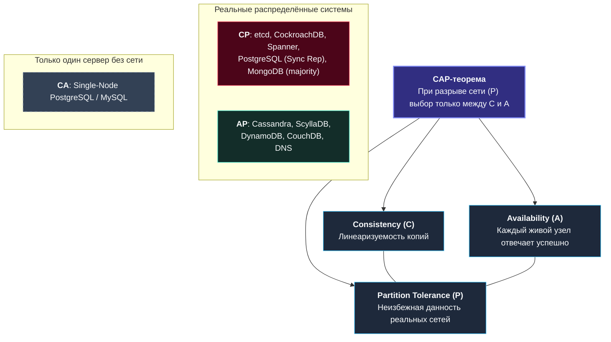
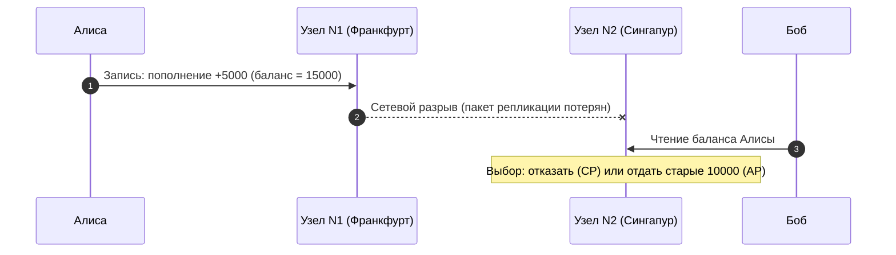
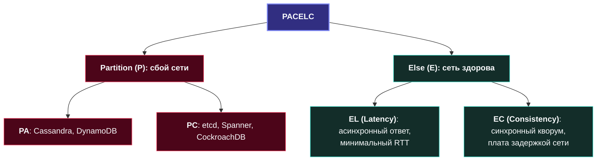

*Почему в реальной сети невозможно совместить строгую согласованность и стопроцентную доступность, почему «CA-системы» — миф, как теорема PACELC описывает компромиссы здоровой сети и как выбор БД отражается на коде Go.*

> «Можно уверенно предсказать, что новые языки, делающие программирование проще и безопаснее, будут появляться и дальше. Но столь же уверенно можно сказать, что единого языка не будет никогда: в разработке слишком много компромиссов, чтобы один-единственный язык одинаково хорошо подходил для всех задач.»  
> — Брайан Керниган, *UNIX: A History and a Memoir*

В [[6. Модели согласованности в БД — Strong, Eventual, Read-Your-Writes и Causal]] мы разобрали спектр гарантий от линеаризуемости до сходимости в конечном счёте. Инженеру хочется получить от базы данных всё сразу: задержку в доли миллисекунды, свежие данные на всех узлах и безотказность при обрыве каналов между дата-центрами.

На пути к этому стоит физический предел. В 1998–2000 годах Эрик Брюэр из Беркли выдвинул гипотезу, которую в 2002 году Сет Гилберт и Нэнси Линч (MIT) строго доказали для асинхронных сетей — **теорему CAP**. Спустя десять лет Даниэль Абади (Yale University) расширил её до **PACELC** (подробнее о формальном доказательстве и теореме FLP см. Том 4).

---

## Три свойства CAP и миф о «CA-системах»

CAP рассматривает распределённую систему с разделяемым состоянием поверх асинхронной сети:

1. **Consistency (Согласованность / Линеаризуемость).** Не путать с `C` в ACID (бизнес-инварианты вроде `balance >= 0`). В CAP это **Linearizability**: каждое чтение возвращает результат самой последней завершённой записи либо ошибку. Запись `15000` во Франкфурте обязана мгновенно стать видимой в Токио. Асинхронная репликация с ненулевым лагом нарушает `C`.
2. **Availability (Доступность).** Это не «99.9% аптайма за год» из SLA, а жёсткое условие: любой запрос к любому **не упавшему (non-failing)** узлу обязан завершиться успешным осмысленным ответом (без `500`, таймаута и вечного ожидания). Если сервер работает, но отказал из-за потери кворума, доступность нарушена.
3. **Partition Tolerance (Устойчивость к разделению сети).** Система продолжает работать при потере или произвольной задержке сообщений между узлами.



Во многих упрощённых схемах предлагают выбрать две стороны из трёх, включая **CA**. В распределённых системах **комбинации CA не существует**.

Сетевое разделение нельзя выключить конфигурацией. В продакшене рвутся кабели, переполняются буферы сетевых карт (*bufferbloat* и *tail drops*), зависают коммутаторы, деградирует BGP, возникают асимметричные «серые сбои» (*gray failures*), а процессы замирают на паузах ядра. Гилберт и Линч доказали: в асинхронной сети узел за медленным маршрутизатором неотличим от упавшего узла.

«CA-система» — это **одиночный сервер без сети** (одноузловой PostgreSQL или MySQL; ср. [[5. Репликация в MySQL — Binlog, GTID и Group Replication]] и [[8. MariaDB — расхождение с MySQL и собственные движки]]). Как только два сервера соединяет кабель, свойство `P` неизбежно, а выбор сводится к **CP** или **AP**.

---

## Сбой на практике: CP против AP в LedgerPulse

Представим два узла: $N_1$ во Франкфурте и $N_2$ в Сингапуре. На счёте Алисы в `LedgerPulse` лежит `10000` центов ($100.00$). Оптоволокно между ЦОД рвётся (разделение $P$). Алиса вносит `+5000` на $N_1$ (локально `15000`), но пакет репликации до $N_2$ не доходит. Через 10 секунд Боб запрашивает баланс Алисы на $N_2$.



У узла $N_2$ ровно два исхода:
1. **Путь CP (Consistency + Partition Tolerance).** Потеряв связь с кворумом, $N_2$ отклоняет запрос с ошибкой `quorum lost / unavailable`. Согласованность сохранена, доступность потеряна. Примеры: `etcd`, `Consul`, `ZooKeeper`, `CockroachDB`, `Google Spanner`, `MongoDB` (`w: "majority"`, `readConcern: "linearizable"`), `PostgreSQL` с синхронной репликацией и `Patroni`.
2. **Путь AP (Availability + Partition Tolerance).** Узел $N_2$ отвечает `200 OK`, баланс `10000`. Доступность сохранена, данные устарели. Если $N_2$ примет и списание `8000`, возникнет split-brain, требующий слияния после восстановления канала. Примеры: `Apache Cassandra`, `ScyllaDB`, `Amazon DynamoDB` (по умолчанию), `CouchDB`, `Riak`, `DNS`. (`Redis Cluster` при асинхронной репликации допускает потерю подтверждённых записей при failover, а изолированное меньшинство блокирует запись после `cluster-node-timeout` при `cluster-require-full-coverage = yes`.)

---

## PACELC: компромисс, когда сеть здорова

CAP описывает только момент аварии ($P$), хотя 99.9% времени сеть исправна. В 2012 году Даниэль Абади сформулировал теорему **PACELC**:

$$\text{If } \mathbf{P} \text{ (Partition)} \implies \text{choose } [\mathbf{A} \lor \mathbf{C}], \quad \mathbf{E}\text{lse} \implies \text{choose } [\mathbf{L} \lor \mathbf{C}]$$

* **Если есть разделение ($P$):** выбираем между доступностью ($A$) и согласованностью ($C$).
* **Иначе ($E$ — штатный режим):** выбираем между **задержкой ($L$ — Latency)** и **согласованностью ($C$)**.

Даже при идеальной сети строгая согласованность требует сетевого RTT и `fsync` от кворума реплик (1–2 мс внутри зоны, 50–150 мс между регионами). Чтобы отвечать за доли миллисекунды ($L$), система обязана отвечать асинхронно ценой свежести ($C$).



Профили реальных СУБД:
* **PC/EC:** `etcd`, `Google Spanner`, `CockroachDB`, `PostgreSQL` с `synchronous_commit = remote_apply` (строгость и в аварии, и в штатном режиме за счёт задержки).
* **PA/EL:** `Cassandra`, `ScyllaDB`, `DynamoDB` по умолчанию, `DNS` (скорость и аптайм превыше свежести).
* **PC/EL:** системы вроде `Yahoo PNUTS` (нет split-brain при аварии, но быстрое чтение из локальных реплик в норме).
* **PA/EC:** редкий класс (например, `MongoDB` с кворумной записью в норме, но допуском локального чтения со вторичных узлов при изоляции).

---

## Настраиваемая согласованность и код на Go 1.24

Современные БД поддерживают **настраиваемую согласованность (Tunable Consistency)** для отдельных запросов: в Cassandra — `ONE`, `QUORUM`, `ALL`; в DynamoDB — `ConsistentRead: true` против eventual; в PostgreSQL — `SET LOCAL synchronous_commit` от `off` до `remote_apply` ([[1. Репликация — синхронная, полусинхронная и асинхронная]]).

### 1. CP-хранилища в Go: таймауты, jitter и защита от зависших горутин

Горутины, ждущие ответа от кворума, паркуются в `netpoller`, но удерживают по 2–8 КБ стека и сокет. При сетевом jitter десятки тысяч зависших горутин съедают сотни мегабайт RAM и удлиняют сканирование стеков GC. Поэтому в CP-вызовах обязательны `context.WithTimeout` и retry с экспоненциальным откатом и случайным разбросом (`math/rand/v2`), гасящим шторм повторных запросов (*Thundering Herd*):

```go
package storage

import (
	"context"
	"errors"
	"fmt"
	"math/rand/v2"
	"time"
)

var ErrTransientUnavailable = errors.New("quorum temporarily unavailable")

type KVStore interface {
	PutLinearizable(ctx context.Context, key string, val []byte) error
}

func PutWithRetry(ctx context.Context, store KVStore, key string, val []byte) error {
	const maxAttempts = 4
	baseDelay := 40 * time.Millisecond

	for attempt := range maxAttempts {
		attemptCtx, cancel := context.WithTimeout(ctx, 500*time.Millisecond)
		err := store.PutLinearizable(attemptCtx, key, val)
		cancel()

		if err == nil {
			return nil
		}
		if !errors.Is(err, ErrTransientUnavailable) || attempt == maxAttempts-1 {
			return fmt.Errorf("cp put failed on attempt %d: %w", attempt+1, err)
		}

		// Полный джиттер (Full Jitter) разносит повторы клиентов во времени.
		timer := time.NewTimer(baseDelay + rand.N(baseDelay))
		select {
		case <-ctx.Done():
			timer.Stop()
			return fmt.Errorf("retry aborted: %w", ctx.Err())
		case <-timer.C:
		}
		baseDelay *= 2
	}
	return nil
}
```

### 2. AP-сценарии: переключение строгости и плавная деградация

В AP-пути горутины завершаются за микросекунды, а сложность переезжает на CPU (слияние конфликтов, CRDT) и резервный fallback с флагом `Stale: true`:

```go
package storage

import (
	"context"
	"fmt"
	"sync"
	"time"
)

type ConsistencyLevel int

const (
	LevelOne ConsistencyLevel = iota // PA/EL: локальный узел, минимальный RTT
	LevelQuorum                      // PC/EC: кворум большинства
)

type RateQuote struct {
	Pair      string
	RateNano  int64
	UpdatedAt time.Time
	Stale     bool
}

type QuoteBackend interface {
	ReadQuote(ctx context.Context, pair string, level ConsistencyLevel) (RateQuote, error)
}

type QuoteService struct {
	backend QuoteBackend
	mu      sync.RWMutex
	cache   map[string]RateQuote
}

func (s *QuoteService) GetQuote(ctx context.Context, pair string, forSettlement bool) (RateQuote, error) {
	if forSettlement {
		q, err := s.backend.ReadQuote(ctx, pair, LevelQuorum)
		if err != nil {
			return RateQuote{}, fmt.Errorf("settlement requires quorum: %w", err)
		}
		return q, nil
	}

	q, err := s.backend.ReadQuote(ctx, pair, LevelOne)
	if err == nil {
		s.mu.Lock()
		s.cache[pair] = q
		s.mu.Unlock()
		return q, nil
	}

	s.mu.RLock()
	cached, ok := s.cache[pair]
	s.mu.RUnlock()
	if ok {
		cached.Stale = true
		return cached, nil
	}
	return RateQuote{}, fmt.Errorf("quote unavailable: %w", err)
}
```

---

## Связь с паттернами и выбор для доменов

Крупная система комбинирует профили по доменам. Добавление `Cache-Aside` в Redis переводит чтение в **PA/EL**; в `CQRS` командная модель остаётся **PC/EC**, а асинхронные витрины чтения — **PA/EL**; отказ от 2PC в пользу `Saga` — сдвиг от хрупкой CP-координации к высокой доступности с компенсациями (подробнее о Cache-Aside, CQRS, Event Sourcing и Saga см. Том 3).

> [!tip] Собеседование [Middle]
> **Вопрос:** В `LedgerPulse` нужно хранить: а) баланс и историю проводок; б) кэш справочника тарифов и счётчики просмотров; в) распределённые фича-флаги. Как вы распределите эти задачи по CAP/PACELC?
>
> **Ответ:**
> 1. **Баланс и проводки — `CP` (`PC/EC`).** Овердрафт и двойное списание ведут к финансовым потерям; при потере кворума корректнее вернуть временный отказ, чем нарушить инвариант двойной записи.
> 2. **Кэш тарифов и счётчики — `AP` (`PA/EL`).** Ошибка `500` на витрине бьёт по конверсии, а задержка обновления на 1–2 секунды безопасна.
> 3. **Фича-флаги и координация — `CP` (`PC/EC`, например `etcd`),** но с локальным кэшем в памяти Go-процесса как fallback для чтения при недоступности кластера.

---

## Практикум: задачи для закрепления

### Упражнение 1 (Базовое)
В 5-узловом кластере `CockroachDB` (кворум $\lfloor 5/2 \rfloor + 1 = 3$) произошёл разрыв сети: `{N1, N2}` в ЦОД-1 и `{N3, N4, N5}` в ЦОД-2. Опишите поведение обоих сегментов для записи и последствия принудительного разрешения записи в `{N1, N2}`.

> [!solution] Показать решение
> Сегмент `{N3, N4, N5}` удерживает большинство (3 из 5) и продолжает принимать записи. Сегмент `{N1, N2}` теряет кворум и по модели **CP** отклоняет записи (жертвует `A` ради `C`). Принудительное включение записи на меньшинстве породит **split-brain**: обе половины зафиксируют конфликтующую историю, нарушив свойство `Consistency`.

### Упражнение 2 (Практическое)
В `Cassandra` с фактором репликации $N = 3$ настроено `W = 1` и `R = 2`. Выполняется ли строгий кворум, какой это профиль PACELC и какая аномалия возможна даже при здоровой сети?

> [!solution] Показать решение
> $W + R = 1 + 2 = 3 \not> 3$: строгий кворум **не выполняется**, множества записи и чтения могут не пересечься. Это профиль **PA/EL**: даже при здоровой сети ради минимальной задержки записи (`W = 1`) система жертвует свежестью и может вернуть старое значение, пока асинхронная репликация не дойдёт до остальных узлов. Для кворума нужны $W = 2, R = 2$.

### Упражнение 3 (Со звёздочкой \*)
В распределённом KV-хранилище выставлены `N = 3`, `W = 2`, `R = 2`, но при сбое одного узла сразу после записи клиенты иногда наблюдают «исчезновение» нового значения. Почему одного условия $W + R > N$ мало для строгой линеаризуемости и что ещё требуется?

> [!solution] Показать решение
> Формула $W + R > N$ без дополнительных гарантий не защищает от трёх случаев:
> 1. **Частичная запись при ошибке (*Partial Write*):** клиент успел записать на `N1`, затем `N2` упал и вернулась ошибка. Первый читатель попал на `{N1, N3}` и увидел новое значение, второй после переключения попал на `{N2, N3}` и увидел старое.
> 2. **Дрейф физических часов в LWW:** конкурентные записи разрешаются неверно.
> 3. **Отсутствие Read Repair / консенсуса:** для честной линеаризуемости нужно либо опираться на консенсусный лог с термами (`Raft`/`Paxos`), либо при каждом чтении накатывать свежую найденную версию на кворум (*Read Repair* до ответа клиенту) с логическими версиями.

---

## Что дальше

CAP и PACELC объясняют границы компромиссов внутри одного распределённого хранилища. Но в платёжных системах часто требуется провести атомарную операцию сразу между двумя независимыми базами или шардами — например, списать на одном узле и зачислить на другой.

В следующей главе — **«8. Распределённые транзакции — цена атомарности между узлами»** — мы разберём, почему обычный `BEGIN ... COMMIT` перестаёт работать через границы серверов и как распределённые протоколы решают эту задачу.
