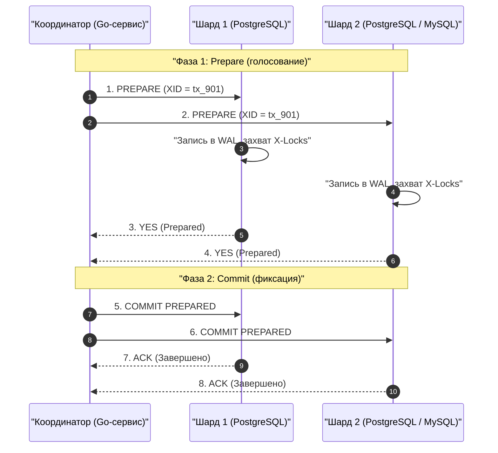
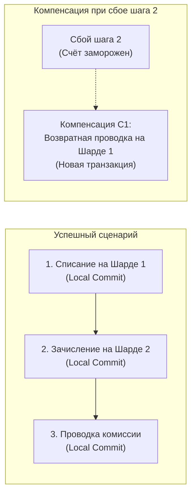

*Почему локальный `BEGIN ... COMMIT` перестаёт работать на границе нескольких баз данных, как частичные отказы разрушают данные `LedgerPulse`, в чём разница между 2PC и Saga и зачем каждому запросу ключ идемпотентности.*

> «Любая функция ввода-вывода обязана считаться с вероятностью сбоя, и лишь наивный программист верит, что простое чтение или запись не могут завершиться ошибкой. Именно тогда, когда внезапно отказывают самые надёжные операции, нам нужнее всего знать почему.»  
> — Алан Донован и Брайан Керниган, *The Go Programming Language*

В [[7. CAP и PACELC в выборе баз данных|предыдущей главе]] мы разобрали, как базы данных выбирают между согласованностью, доступностью и задержкой при разделении сети. Но пока все таблицы `LedgerPulse` жили на одном сервере PostgreSQL, бизнес-операция перевода оставалась простой: мы открывали `BEGIN`, проверяли баланс отправителя, записывали две строки в `ledger_entries` и вызывали `COMMIT`.

За всю магию отвечал один движок хранения: единый журнал [[8. WAL — журнал упреждающей записи и долговечность на диске|WAL]], общий менеджер блокировок и общая оперативная память. Если процесс падал посередине, при рестарте база откатывала незавершённую транзакцию, и деньги не пропадали.

Стоит вынести расчётный счёт на один шард, накопительный счёт на другой, а учёт бонусов или складских остатков — в соседний сервис с собственной СУБД, как локальная гарантия `ACID` исчезает. У каждой базы данных собственный изолированный WAL, независимая таблица блокировок и раздельная память.

**Распределённая транзакция** — это механизм координации группы операций над несколькими физически независимыми хранилищами так, чтобы вся цепочка сохраняла атомарность (`Atomicity`) и согласованность (`Consistency`) на уровне бизнес-процесса.

---

## Проблема: частичные отказы в сети

В распределённой системе действуют три жёстких физических ограничения:
* **Сеть ненадёжна:** пакет теряется между запросом списания в первом узле и запросом зачисления во втором, либо соединение обрывается по таймауту ровно после того, как первый узел уже зафиксировал изменения.
* **Процессы умирают без предупреждения:** OOM-Killer ядра Linux, сбой питания или перезапуск пода в Kubernetes прерывают Go-сервис между двумя вызовами к базам данных.
* **Локальные ограничения срабатывают несинхронно:** первый узел успешно списал средства, а второй отклонил вставку из-за нарушения `CHECK`-ограничения, блокировки счёта (`status = 'frozen'`) или конфликта уникального ключа.

Если Go-сервис просто выполняет последовательные SQL-вызовы к двум шардам или последовательные HTTP/gRPC-запросы к разным сервисам, неизбежно возникает **частичный отказ (Partial Failure)**. Итог — несогласованное состояние (`Inconsistent State`): деньги у клиента списаны, а получатель их не увидел, либо платёж прошёл, но заказ не создан.

Чтобы закрыть этот разрыв, индустрия выработала два фундаментально разных подхода: **атомарную блокирующую фиксацию (2PC)** и **цепочки локальных транзакций с компенсациями (Saga)**.

---

## Стратегия 1: Атомарная фиксация (2PC)

**Двухфазный коммит (Two-Phase Commit, 2PC)** — классический протокол, созданный в попытке перенести привычный локальный `ACID` поверх сети. В схеме появляется выделенная роль — **координатор транзакции (Transaction Coordinator)**, который управляет несколькими **участниками (Participants)**.

Протокол делится на две фазы:
1. **Фаза 1 — Prepare (подготовка к фиксации):** координатор рассылает всем базам команду подготовить транзакцию. Каждый узел проверяет ограничения целостности, сбрасывает изменения в локальный WAL через `fsync()`, захватывает строгие эксклюзивные блокировки (`X-Locks`) на изменённые строки и голосует `YES` (готов) или `NO` (отказ).
2. **Фаза 2 — Commit или Rollback (решение):**
   * Если **каждый** участник ответил `YES`, координатор фиксирует решение в собственном журнале и рассылает команду `COMMIT`. Участники открывают изменения для читателей и снимают блокировки.
   * Если **хотя бы один** узел ответил `NO` или не уложился в таймаут, координатор отправляет всем `ROLLBACK`. Узлы откатывают подготовленные записи по своим журналам.



Главный компромисс протокола виден сразу: 2PC опирается на синхронные блокировки через сеть. Пока пакеты летают между узлами (сетевой RTT между дата-центрами измеряется миллисекундами — на четыре-пять порядков медленнее обращения к RAM за ~100 нс), изменённые строки счетов остаются заблокированными для всех остальных запросов.

> [!warning] Ловушка: удержание блокировок и отказ координатора
> Если координатор падает сразу после фазы `Prepare`, участники переходят в подвешенное состояние (**In-Doubt Transactions**). Они уже пообещали зафиксировать данные, но не знают финального вердикта: они не имеют права ни самостоятельно закоммитить, ни откатить транзакцию. Эксклюзивные блокировки на строках `accounts` остаются захваченными на минуты или часы, парализуя соседние переводы.

Подробную механику 2PC, стандарта XA и окна неопределённости мы разберём в следующей главе.

---

## Стратегия 2: Паттерн Saga

Из-за высокой цены блокировок в 2PC в масштабируемых микросервисах и шардированных системах закрепился другой подход — **паттерн Saga**, сформулированный Гектором Гарсия-Молиной и Кеннетом Салемом в 1987 году.

**Сага** заменяет одну распределённую транзакцию упорядоченной цепочкой независимых **локальных транзакций**. Каждый шаг фиксируется в своей базе данных немедленно, не удерживая глобальных сетевых блокировок. Если на третьем шаге операция срывается (например, счёт получателя заморожен или на складе нет товара), система запускает в обратном порядке цепочку **компенсирующих транзакций (Compensating Transactions)**, которые логически нейтрализуют эффект уже завершённых шагов.



### Два способа координации Саги

1. **Хореография (Choreography):** центрального дирижёра нет. Сервис А фиксирует локальную транзакцию и публикует доменное событие в шину сообщений; сервис Б подписывается на событие, выполняет свой шаг и публикует следующее событие или событие ошибки. Такой стиль даёт слабую связанность, но при росте числа шагов превращается в запутанный граф событий.
2. **Оркестрация (Orchestration):** выделенный координатор-оркестратор хранит состояние процесса, последовательно отправляет команды участникам и при сбое централизованно запускает компенсации.

Подробнее о выборе брокеров сообщений (`Kafka`, `RabbitMQ`, `NATS`) и специализированных движков оркестрации вроде `Temporal.io`, `Cadence` или `DTM` см. Том 3. В рамках Тома 2 нас интересует фундамент со стороны самой базы данных: как локальные таблицы и транзакции поддерживают Сагу без потери денег.

> [!tip] Собеседование [Middle]
> **Вопрос:** В чём принципиальная разница между `ROLLBACK` в реляционной СУБД и компенсирующей транзакцией в Саге?
>
> **Ответ:** Локальный `ROLLBACK` стирает следы незакоммиченной транзакции в памяти и WAL — благодаря гарантии `Isolation` ни один посторонний запрос не видел промежуточных цифр. Компенсация в Саге — это **новая, полноценно закоммиченная транзакция** (например, возвратная проводка в `ledger_entries`). Поскольку каждый шаг Саги фиксируется сразу, между первым шагом и завершением или компенсацией возникает окно **временной семантической несогласованности (Semantic Inconsistency)**, которое открыто для чтения другим клиентам.

---

## Физика сети и обязательная идемпотентность

В распределённых операциях сетевые сбои делают **повторные запросы (Retries)** неизбежными. Допустим, Go-сервис отправил команду списания 5 000 копеек на первый шард, но TCP-соединение оборвалось до получения ответа от PostgreSQL. Клиент не может отличить две ситуации:
* пакет потерялся по дороге, и база данных ничего не списала;
* база данных успешно выполнила `COMMIT`, но ответ потерялся на обратном пути.

При повторной отправке команды без защиты клиент спишет деньги дважды. Поэтому любая операция, участвующая в распределённой цепочке, обязана быть **идемпотентной**: один или десять повторных вызовов с тем же ключом должны давать абсолютно одинаковый итоговый баланс.

Для этого в схеме `LedgerPulse` существует таблица `idempotency_keys` (`project/sql/migrations/003_idempotency_outbox.sql`), которая хранит ключ запроса `idempotency_key`, хеш параметров `request_hash`, ссылку на `transaction_id` и сохранённый ответ. Ключевой принцип локальности и атомарности прост: **проверка ключа, изменение баланса и запись ключа выполняются внутри одной локальной транзакции**.

Ниже — пример функции `LedgerPulse` на Go 1.24, которая идемпотентно списывает средства со счёта в рамках одной транзакции PostgreSQL:

```go
package ledger

import (
	"context"
	"database/sql"
	"encoding/json"
	"errors"
	"fmt"
	"time"
)

var (
	ErrInsufficientFunds = errors.New("insufficient funds or inactive account")
	ErrKeyConflict       = errors.New("idempotency key reused with different payload")
)

// DebitAccountIdempotent атомарно списывает amount со счёта и фиксирует ключ идемпотентности.
func DebitAccountIdempotent(
	ctx context.Context,
	db *sql.DB,
	idemKey, reqHash, refID string,
	accountID, amount int64,
) (int64, error) {
	tx, err := db.BeginTx(ctx, nil)
	if err != nil {
		return 0, fmt.Errorf("begin tx: %w", err)
	}
	defer func() { _ = tx.Rollback() }()

	var storedHash string
	var existingTxID sql.NullInt64
	err = tx.QueryRowContext(ctx,
		`SELECT request_hash, transaction_id FROM idempotency_keys WHERE idempotency_key = $1`,
		idemKey,
	).Scan(&storedHash, &existingTxID)
	if err == nil {
		if storedHash != reqHash {
			return 0, ErrKeyConflict
		}
		return existingTxID.Int64, tx.Commit()
	}
	if !errors.Is(err, sql.ErrNoRows) {
		return 0, fmt.Errorf("lookup idempotency key: %w", err)
	}

	var txID int64
	err = tx.QueryRowContext(ctx,
		`INSERT INTO transactions (reference_id, kind, status, description)
		 VALUES ($1, 'withdrawal', 'posted', 'distributed debit') RETURNING id`,
		refID,
	).Scan(&txID)
	if err != nil {
		return 0, fmt.Errorf("insert transaction: %w", err)
	}

	res, err := tx.ExecContext(ctx,
		`UPDATE accounts SET balance = balance - $1, updated_at = now()
		 WHERE id = $2 AND status = 'active' AND balance >= $1`,
		amount, accountID,
	)
	if err != nil {
		return 0, fmt.Errorf("debit account: %w", err)
	}
	if rows, _ := res.RowsAffected(); rows == 0 {
		return 0, ErrInsufficientFunds
	}

	if _, err := tx.ExecContext(ctx,
		`INSERT INTO ledger_entries (transaction_id, account_id, amount, currency)
		 SELECT $1, id, -$2, currency FROM accounts WHERE id = $3`,
		txID, amount, accountID,
	); err != nil {
		return 0, fmt.Errorf("insert ledger entry: %w", err)
	}

	body, _ := json.Marshal(map[string]any{"transaction_id": txID, "status": "posted"})
	if _, err := tx.ExecContext(ctx,
		`INSERT INTO idempotency_keys
		 (idempotency_key, request_hash, transaction_id, response_code, response_body, expires_at)
		 VALUES ($1, $2, $3, 200, $4, $5)`,
		idemKey, reqHash, txID, body, time.Now().Add(24*time.Hour),
	); err != nil {
		return 0, fmt.Errorf("store idempotency key: %w", err)
	}

	return txID, tx.Commit()
}
```

Обратите внимание на две детали, защищающие данные при конкурентных повторах:
1. Если два параллельных повтора с одинаковым `idemKey` придут одновременно на уровне `Read Committed`, оба увидят `sql.ErrNoRows` на шаге `SELECT`. При записи в `idempotency_keys` победит только первая транзакция, а вторая получит ошибку уникального ключа (`23505`), откатит списание и сможет вернуть сохранённый результат первой. Для исключения лишнего отката первый шаг часто делают через `INSERT INTO idempotency_keys ... ON CONFLICT DO NOTHING`.
2. Проверка `storedHash != reqHash` отлавливает баг клиента, который по ошибке переиспользовал старый `idempotency_key` для новой суммы.

При первом вызове и при повторном вызове из-за обрыва сети вывод и состояние таблиц выглядят так:

```text
call #1 (idemKey="req-77", amount=5000): txID=1042, accounts.balance: 15000 -> 10000
call #2 (idemKey="req-77", amount=5000): txID=1042, accounts.balance: 10000 (повторное списание не выполнено)
call #3 (idemKey="req-77", amount=9999): error="idempotency key reused with different payload"
```

---

## Сравнение подходов: 2PC против Saga

| Характеристика | Two-Phase Commit (2PC) | Паттерн Saga |
| :--- | :--- | :--- |
| **Изоляция (`Isolation`)** | Строгая: эксклюзивные блокировки скрывают изменения до `COMMIT` | Отсутствует на глобальном уровне: промежуточные шаги видны |
| **Доступность (`Availability`)** | Низкая: падение координатора блокирует строки участников | Высокая: каждый узел коммитит сразу без удержания локов |
| **Согласованность** | Строгая (`Strong Consistency`) | В конечном счёте (`Eventual Consistency`) |
| **Сложность реализации** | Встроена в движки СУБД (протокол XA / `PREPARE TRANSACTION`) | Ложится на прикладной код: проектирование компенсаций и идемпотентности |
| **Задержка на операцию** | Минимум два сетевых RTT плюс `fsync()` под блокировкой | Каждый шаг выполняется за локальный коммит |
| **Типичное применение** | Узкие корпоративные контуры в одной доверенной сети | Распределённые микросервисы и шардированный highload |

Выбор модели напрямую зависит от того, допускает ли ваш домен временную конечную согласованность ([[6. Модели согласованности в БД — Strong, Eventual, Read-Your-Writes и Causal|Eventual Consistency]]) или требует строгой линеаризуемости на каждом шаге.

> [!tip] Инструменты экосистемы Go
> Самостоятельно писать конечные автоматы повторов, таймеры и журналы координатора для распределённых транзакций рискованно. В промышленной разработке на Go для координации рабочих процессов и саг применяют специализированные оркестраторы вроде **Temporal.io / Cadence** и распределённый координатор **DTM** (подробнее о них см. Том 3).

---

## Упражнения

### 1. Базовое: Почему два локальных `Commit()` не дают атомарности

Разработчик `LedgerPulse` для перевода между двумя шардами `pg-shard-1` и `pg-shard-2` открыл две транзакции `tx1` и `tx2`, выполнил в них оба запроса `UPDATE accounts`, а затем написал подряд `tx1.Commit()` и `tx2.Commit()`. Какие три сценария сбоя сломают целостность балансов при таком подходе?

> [!solution] Показать решение
> 1. **Падение процесса Go между коммитами:** `tx1.Commit()` уже сбросил запись в WAL на первом шарде, а `tx2.Commit()` не вызван — сервер перезагрузился, соединение закрылось, и второй шард откатил `tx2`. Деньги списаны и исчезли.
> 2. **Отказ второго шарда при фиксации:** после `tx1.Commit()` второй шард потерял диск, отклонил коммит по отложенному ограничению (`DEFERRABLE` constraint) или разорвал соединение. Откатить уже зафиксированный `tx1` стандартным `tx1.Rollback()` невозможно.
> 3. **Нарушение изоляции до коммитов:** между `UPDATE` и `Commit()` клиенты не видят изменений, но в окне между `tx1.Commit()` и `tx2.Commit()` читатель на первом шарде уже видит уменьшенный баланс, а на втором — ещё не увеличенный (временный дисбаланс суммы по системе).

### 2. Практическое: Исключение гонки при параллельном повторе

В функции `DebitAccountIdempotent` при одновременном приходе двух одинаковых запросов с `idemKey = "req-77"` в режиме `Read Committed` оба `SELECT` вернут `sql.ErrNoRows`, и второй запрос упадёт на вставке в `idempotency_keys` с ошибкой уникальности. Как перестроить шаг резервирования ключа в начале транзакции с помощью `INSERT ... ON CONFLICT DO NOTHING`, чтобы избежать лишнего списания и вернуть корректный статус при повторе?

> [!solution] Показать решение
> В самом начале транзакции нужно попытаться вставить заглушку ключа в `idempotency_keys` (если `transaction_id` допускает `NULL`):
> ```sql
> INSERT INTO idempotency_keys
>     (idempotency_key, request_hash, transaction_id, response_code, response_body, expires_at)
> VALUES ($1, $2, NULL, 0, '{}'::jsonb, now() + interval '24 hours')
> ON CONFLICT (idempotency_key) DO NOTHING;
> ```
> * Если `RowsAffected() == 1`, текущая транзакция первой захватила ключ (строка заблокирована её `X-Lock` до `COMMIT`), выполняет списание и в конце обновляет `transaction_id`, `response_code` и `response_body` через `UPDATE`.
> * Если `RowsAffected() == 0`, значит, ключ уже вставлен другой транзакцией. Следующий `SELECT request_hash, transaction_id FROM idempotency_keys WHERE idempotency_key = $1` в PostgreSQL автоматически **подождёт** завершения конкурирующей транзакции, удерживающей блокировку на этой строке, и сразу прочитает готовый `transaction_id` после её коммита (или обнаружит, что первая транзакция откатилась).

### 3. Со звёздочкой (\*): Расчёт потолка TPS и окно несогласованности

Координатор 2PC соединяет два шарда через межрегиональную сеть с задержкой `RTT = 15 мс`. Локальный `fsync()` на NVMe занимает `0.4 мс`. Пул соединений на координаторе ограничен `MaxOpenConns = 20`. Какой максимальный теоретический потолок TPS выдержит такой координатор при 2PC (учитывая 2 сетевых раунда на `Prepare` и `Commit` плюс 1 раунд на DML)? Почему в тех же условиях при Саге суммарная пропускная способность выше, но `SELECT SUM(balance)` по двум шардам может временно показать недостачу?

> [!solution] Показать решение
> 1. На каждую распределённую транзакцию уходит минимум 3 последовательных сетевых раунда (`BEGIN/DML` + `PREPARE` + `COMMIT`) и накладные расходы на `fsync()`: `3 × 15 мс + 2 × 0.4 мс ≈ 45.8 мс` (при параллельной рассылке участникам). Одно соединение из пула даёт не более `1000 / 45.8 ≈ 21.8 TPS`. При `MaxOpenConns = 20` потолок координатора упрётся примерно в `20 × 21.8 ≈ 436 TPS`, причём всё это время строки на обоих шардах заблокированы для других транзакций.
> 2. В Саге каждый шаг выполняется локально без глобального удержания замков между шардами, поэтому блокировки держатся доли миллисекунды, а между шагами нет ожидания второго фазного раунда под `X-Lock`. Однако после локального коммита шага 1 (списание на Шарде 1) и до локального коммита шага 2 (зачисление на Шарде 2) глобальный инвариант суммы балансов временно нарушен: аналитический запрос `SELECT SUM(balance)` по обоим шардам увидит недостачу ровно на сумму перевода, пока шаг 2 не зафиксируется.

---

## Главный вывод и мостик дальше

При выходе за пределы одного узла локальный `ACID` распадается: сеть приносит частичные отказы, а выбор сводится к компромиссу между жёсткой блокирующей атомарностью **2PC** и высокой доступностью **Saga** с обязательной идемпотентностью.

Но что именно происходит внутри баз данных во время двухфазного коммита, почему стандарт `XA` требует от координатора собственного `fsync`-журнала и как сбой одного сервера способен намертво заморозить чужие таблицы? В следующей главе мы вскроем механику протокола 2PC на уровне системных вызовов, блокировок и отказов — [[9. Двухфазный коммит (2PC) — протокол, блокировки и отказ координатора]].
