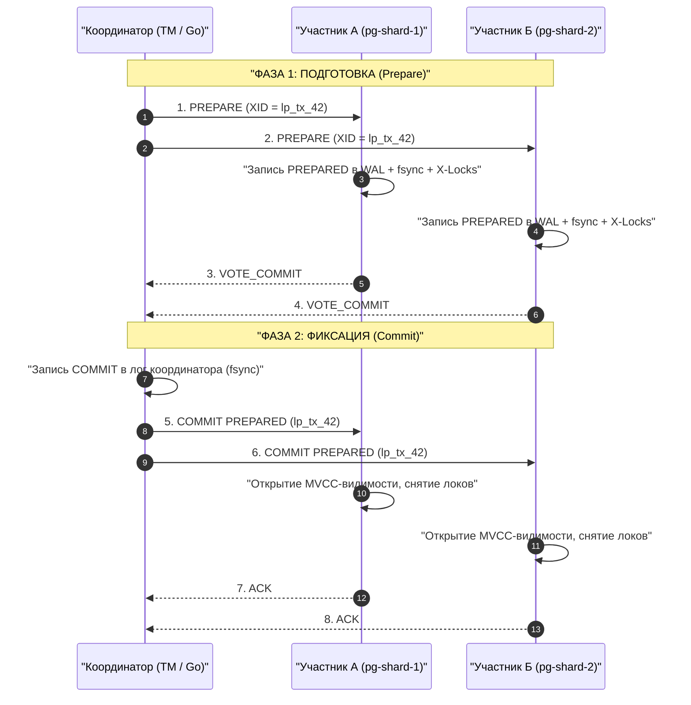

*Разбираем протокол Two-Phase Commit (2PC) по шагам: роли стандарта X/Open DTP, `fsync` журнала координатора, окно неопределённости (In-Doubt), удержание замков, сравнение с 3PC и реальный код на Go 1.24 для PostgreSQL и MySQL.*

> «В идеальном мире прикладному программисту достаточно знать только API — без того, как этот API реализован и к какому железу он обращается. В реальности же чуть более глубокие знания порой оказываются весьма кстати.»  
> — Чарльз Петцольд, *Code: The Hidden Language of Computer Hardware and Software*

В [[8. Распределённые транзакции — цена атомарности между узлами|предыдущей главе]] мы увидели, что при переходе к двум независимым базам данных обычный `COMMIT` больше не спасает от частичных отказов. Когда в `LedgerPulse` нужно списать средства на шарде `pg-shard-1` и одновременно зачислить их на шард `pg-shard-2` (или синхронно обновить PostgreSQL и MySQL) так, чтобы внешний читатель никогда не увидел половины перевода, первым математическим решением становится **двухфазный коммит (Two-Phase Commit, 2PC)**.

Протокол даёт строгую атомарность между узлами, но берёт за неё высокую цену: задержки на сетевые раунды, длительное удержание блокировок строк и опасность зависания всего кластера при отказе одного координатора. Чтобы применять 2PC осознанно — или аргументированно отказываться от него — нужно понимать его механику до уровня системных вызовов `fsync()`.

---

## Роли стандарта X/Open DTP и две фазы протокола

Классическая модель 2PC описана в стандарте **X/Open DTP (Distributed Transaction Processing)**. Вся система делится на две чёткие роли:
1. **Координатор (Transaction Manager, TM):** выделенный компонент (отдельный демон-менеджер или сам бэкенд на Go), который присваивает транзакции глобальный идентификатор **`XID`**, запускает голосование и принимает финальное решение.
2. **Участники (Resource Managers, RM):** независимые СУБД или транзакционные брокеры, владеющие локальными данными и собственными журналами предзаписи (`WAL` / `Redo Log`).

Протокол работает в два последовательных раунда.

### Фаза 1: Подготовка и голосование (`Prepare`)

Координатор генерирует уникальный `XID` и рассылает всем участникам команду `PREPARE`. Каждый участник обязан выполнить локальную работу и дать твёрдое обещание, что сможет завершить транзакцию позже даже после перезагрузки питания:
* проверяет все ограничения схемы (`CHECK (balance >= 0)`, `FOREIGN KEY`, `UNIQUE`);
* удерживает строгие эксклюзивные блокировки (`X-Locks`) на изменённые строки;
* записывает изменения в локальный журнал предзаписи с меткой **`PREPARED`** и сбрасывает буфер журнала на диск системным вызовом `fsync()` / `fdatasync()`;
* возвращает координатору голос: **`VOTE_COMMIT`** (готов фиксировать) или **`VOTE_ABORT`** (отказ).

Как только участник ответил `VOTE_COMMIT`, он теряет право передумать: состояние подготовленной транзакции теперь переживёт даже отключение электричества.

### Фаза 2: Фиксация или откат (`Commit / Rollback`)

Координатор собирает голоса участников и выносит окончательный вердикт:
* **Все до единого ответили `VOTE_COMMIT`:** координатор сначала записывает решение `COMMIT` в собственный журнал на диск через `fsync()`, а затем рассылает участникам команду `COMMIT`. Базы делают транзакцию видимой для читателей в `MVCC` и отпускают блокировки.
* **Хотя бы один ответил `VOTE_ABORT` (или не ответил до истечения таймаута):** координатор фиксирует в своём журнале `ABORT` и рассылает команду `ROLLBACK`. Участники откатывают подготовленные изменения по локальным журналам и освобождают строки.



---

## Под капотом: журнал координатора и стандарт XA

В терминах [[7. CAP и PACELC в выборе баз данных|CAP-теоремы]] 2PC работает как строгая **CP-система**: при разрыве сети или отказе узла протокол жертвует доступностью ради сохранения согласованности.

> [!info] Под капотом: точка невозврата в журнале координатора
> Самый ответственный момент всего протокола — **запись вердикта `COMMIT` в собственный журнал координатора перед рассылкой второй фазы**. Как только системный вызов `fsync()` для этой записи вернул управление, распределённая транзакция считается зафиксированной необратимо. Если питание координатора пропадёт через микросекунду после `fsync()`, до отправки сетевых пакетов участникам, то после перезагрузки процесс восстановления (**Crash Recovery**) прочтёт журнал координатора, увидит сохранённый статус `COMMIT` и повторно разошлёт команду фиксации всем участникам. Без долговечного журнала у самого координатора система неизбежно раскололась бы пополам.

### Стандарт XA и диалекты РСУБД

В реляционных базах данных двухфазный протокол стандартизован спецификацией **XA (eXtended Architecture)**. Почти все промышленные РСУБД — PostgreSQL, MySQL (`InnoDB`), Oracle и SQL Server — поддерживают его нативно, но с разным синтаксисом:
* **MySQL (`InnoDB`):** использует прямые команды стандарта XA — `XA START 'xid'`, DML-запросы, `XA END 'xid'`, `XA PREPARE 'xid'`, а затем `XA COMMIT 'xid'` или `XA ROLLBACK 'xid'`.
* **PostgreSQL:** отделяет локальный блок от глобальной подготовки. Сначала выполняется обычный `BEGIN` и нужные DML-операции, затем вместо `COMMIT` вызывается `PREPARE TRANSACTION 'xid'`. В этот момент соединение освобождается, а подготовленная транзакция сохраняется на сервере и видна в системном представлении `pg_prepared_xacts`. Финальный шаг — `COMMIT PREPARED 'xid'` или `ROLLBACK PREPARED 'xid'` — может выполнить даже другое соединение.

По умолчанию в PostgreSQL параметр `max_prepared_transactions = 0`: сервер отклоняет `PREPARE TRANSACTION`, чтобы случайные забытые подготовленные транзакции не удерживали блокировки и не тормозили `VACUUM`. Для использования 2PC это значение нужно явно поднять в `postgresql.conf`.

---

## Главные проблемы: усиление блокировок и отказ координатора

Почему на высоконагруженных системах 2PC называют убийцей пропускной способности? Проблема распадается на два эффекта.

### 1. Усиление блокировок (Lock Amplification)

В одиночной базе PostgreSQL или MySQL строка счёта `accounts` остаётся под эксклюзивной блокировкой доли миллисекунды — ровно пока выполняются `UPDATE` и локальный `fsync()` в WAL. В 2PC эксклюзивные блокировки захватываются в первой фазе и держатся в течение **всех сетевых раундов** вплоть до получения `COMMIT` или `ROLLBACK` во второй фазе. Все параллельные запросы, которым нужен тот же горячий счёт (например, расчётный счёт мерчанта в `LedgerPulse`), выстраиваются в очередь ожидания.

### 2. Окно неопределённости при падении координатора (`In-Doubt State`)

Представьте сбой в самом уязвимом месте протокола:
1. Шард А и Шард Б выполнили `PREPARE`, сбросили состояние в WAL, заблокировали строки и отправили координатору `VOTE_COMMIT`.
2. Координатор получил оба голоса и за секунду до записи решения на диск умер от `Kernel Panic` или сбоя питания.

Оба участника попадают в **состояние неопределённости (`In-Doubt State`)**. Шард А не имеет права закоммитить транзакцию сам — вдруг координатор успел решить `ROLLBACK` из-за сбоя Шарда Б. Но Шард А не имеет права и откатить транзакцию сам — вдруг координатор уже сбросил `COMMIT` на диск и просто не успел доставить пакет.

Пока координатор не восстановится (или администратор не вмешается вручную через `pg_prepared_xacts`), базы **вынуждены бесконечно удерживать блокировки строк** и не давать `VACUUM` удалять старые версии кортежей.

> [!tip] Собеседование [Senior/Staff]
> **Вопрос:** Почему 2PC называют блокирующим протоколом, и решает ли эту проблему трёхфазный коммит (`3PC`)?
>
> **Ответ:** **2PC — строго блокирующий протокол**: при падении координатора между фазой `Prepare` и получением вердикта участники обязаны держать блокировки до его возвращения. Протокол **Three-Phase Commit (`3PC`)** попытался убрать это зависание, разделив вторую фазу на `Pre-Commit` и `Do-Commit` и добавив таймауты: если координатор пропал на этапе `Pre-Commit`, участники могут коллективно довести транзакцию до коммита, а на этапе `Prepare` — откатить. Однако **3PC ненадёжен при реальных разделениях сети (`Network Partitions`)**: если сеть разорвалась после того, как часть узлов получила `Pre-Commit`, одна половина кластера по таймауту откатится, а вторая зафиксирует изменения, разрушив атомарность. В современных распределённых БД (вроде Spanner или CockroachDB) проблему одиночного координатора решают не через `3PC`, а репликацией самого координатора через консенсус `Raft` или `Paxos` (подробнее см. Том 4).

---

## Физика сети и исчерпание пула соединений

Посмотрим на 2PC со стороны железа и сетевого стека Linux. Локальное чтение памяти занимает ~100 нс, запись `fsync()` в WAL на серверном NVMe SSD — ~100–500 мкс. А вот межсерверный сетевой раунд (`RTT`) между двумя дата-центрами легко достигает **10–20 мс**.

Протокол 2PC требует как минимум **двух полных сетевых раундов** только на координацию (`PREPARE` и `COMMIT`), не считая начальной отправки DML-запросов, плюс синхронных `fsync()` на участниках и в журнале координатора. При `RTT = 20 мс` одна распределённая транзакция держит ресурсы открытыми **60–80 мс**.

В течение этих десятков миллисекунд:
* горутины Go простаивают на сетевом `I/O Wait`;
* соединения в пуле `*sql.DB` (ограниченном `SetMaxOpenConns`) заняты ожиданием чужих узлов;
* на участниках открыты транзакции, удерживающие `X-Locks` и снижающие эффективность `Group Commit`.

При потоке в несколько тысяч RPS такая задержка мгновенно вычерпывает весь пул соединений PostgreSQL/MySQL и переполняет очередь входящих запросов.

---

## Сравнение 2PC и паттерна Saga

| Характеристика | Two-Phase Commit (2PC) | Паттерн Saga |
| :--- | :--- | :--- |
| **Согласованность** | Строгая линеаризуемость между узлами | В конечном счёте (`Eventual Consistency`) |
| **Изоляция** | Высокая (замки скрывают незакоммиченное) | Низкая (промежуточные состояния видны) |
| **Сложность кода** | Низкая в SQL (движок делает откат сам) | Высокая (нужны компенсации и идемпотентность) |
| **Отказоустойчивость** | Блокируется при падении координатора | Продолжает работу за счёт локальных коммитов |
| **Масштабируемость** | Плохая при росте `RTT` и числа узлов | Высокая за счёт отсутствия глобальных локов |

> [!warning] Ловушка: 2PC поверх HTTP или gRPC между микросервисами
> Попытка воспроизвести 2PC поверх межсервисных HTTP/REST или gRPC-ручек (например, сервис заказов держит открытую транзакцию в своей БД, пока сервис склада отвечает по сети) — классический антипаттерн. Сборка мусора, деплой или падение сервиса склада оставит транзакцию в базе заказов висеть открытой, моментально блокируя чужие запросы и вызывая каскадный отказ всей системы. Для межсервисных цепочек применяют [[10. Паттерн Saga со стороны базы данных — локальные транзакции и компенсации|паттерн Saga]] или Transactional Outbox.

---

## Практика в Go 1.24: работа с XA и `PREPARE TRANSACTION`

Стандартная библиотека `database/sql` не содержит метода `Prepare()` на интерфейсе `*sql.Tx`: в Go `Tx.Commit()` и `Tx.Rollback()` рассчитаны только на однофазную локальную фиксацию. Поэтому для управления 2PC вручную приходится отправлять сырые SQL-команды напрямую по выделенному соединению `*sql.Conn`.

Ключевое правило работы с пулом `*sql.DB` в Go: все команды фазы 1 (`BEGIN`, `UPDATE`, `PREPARE TRANSACTION` в PostgreSQL или `XA START ... XA PREPARE` в MySQL) **должны идти строго через одно и то же физическое соединение** `db.Conn(ctx)`. Если выполнять их через `db.ExecContext()`, пул может направить `PREPARE` на другое соединение, и транзакция потеряется.

Ниже показан рабочий пример 2PC-перевода в `LedgerPulse` между двумя шардами PostgreSQL на Go 1.24 (с обязательным журнальным или внешним контролем `xid`):

```go
package two_pc

import (
	"context"
	"database/sql"
	"fmt"
)

// TransferTwoPhasePG координирует перевод между двумя шардами PostgreSQL через PREPARE TRANSACTION.
func TransferTwoPhasePG(ctx context.Context, shardA, shardB *sql.DB, xid string, fromID, toID, amount int64) error {
	connA, err := shardA.Conn(ctx)
	if err != nil {
		return fmt.Errorf("acquire shardA conn: %w", err)
	}
	defer connA.Close()

	connB, err := shardB.Conn(ctx)
	if err != nil {
		return fmt.Errorf("acquire shardB conn: %w", err)
	}
	defer connB.Close()

	prepA := prepareDebit(ctx, connA, xid, fromID, amount)
	prepB := prepareCredit(ctx, connB, xid, toID, amount)

	if prepA != nil || prepB != nil {
		// Фаза 2 (откат): откатываем подготовленные ветки, если они успели перейти в PREPARED
		if prepA == nil {
			_, _ = shardA.ExecContext(ctx, fmt.Sprintf("ROLLBACK PREPARED '%s'", xid))
		}
		if prepB == nil {
			_, _ = shardB.ExecContext(ctx, fmt.Sprintf("ROLLBACK PREPARED '%s'", xid))
		}
		return fmt.Errorf("2pc prepare failed: shardA=%v, shardB=%v", prepA, prepB)
	}

	// В продакшене здесь координатор ОБЯЗАН записать COMMIT в собственный fsync-журнал
	if _, err := shardA.ExecContext(ctx, fmt.Sprintf("COMMIT PREPARED '%s'", xid)); err != nil {
		return fmt.Errorf("commit prepared shardA (requires recovery): %w", err)
	}
	if _, err := shardB.ExecContext(ctx, fmt.Sprintf("COMMIT PREPARED '%s'", xid)); err != nil {
		return fmt.Errorf("commit prepared shardB (requires recovery): %w", err)
	}
	return nil
}

func prepareDebit(ctx context.Context, conn *sql.Conn, xid string, accID, amount int64) error {
	if _, err := conn.ExecContext(ctx, "BEGIN"); err != nil {
		return err
	}
	res, err := conn.ExecContext(ctx,
		`UPDATE accounts SET balance = balance - $1 WHERE id = $2 AND balance >= $1`,
		amount, accID,
	)
	if err != nil {
		_, _ = conn.ExecContext(ctx, "ROLLBACK")
		return err
	}
	if rows, _ := res.RowsAffected(); rows == 0 {
		_, _ = conn.ExecContext(ctx, "ROLLBACK")
		return fmt.Errorf("insufficient funds on account %d", accID)
	}
	if _, err := conn.ExecContext(ctx, fmt.Sprintf("PREPARE TRANSACTION '%s'", xid)); err != nil {
		_, _ = conn.ExecContext(ctx, "ROLLBACK")
		return err
	}
	return nil
}
```

Если в PostgreSQL забыть включить `max_prepared_transactions > 0`, фаза подготовки мгновенно вернёт ошибку, а после успешного `PREPARE TRANSACTION` до `COMMIT PREPARED` транзакция видна в системной таблице `pg_prepared_xacts`:

```text
ERROR: prepared transactions are disabled (SQLSTATE 55000)
HINT: Set max_prepared_transactions to a nonzero value.

-- После включения max_prepared_transactions = 64 и вызова PREPARE TRANSACTION:
SELECT gid, prepared, owner, database FROM pg_prepared_xacts;
   gid    |           prepared            | owner  |  database
----------+-------------------------------+--------+------------
 lp_tx_42 | 2026-11-24 08:15:10.412301+00 | ledger | ledgerpulse
```

В MySQL (`InnoDB`) та же логика строится поверх синтаксиса `XA START 'lp_tx_42'`, DML-запросов, `XA END 'lp_tx_42'`, `XA PREPARE 'lp_tx_42'` и финального `XA COMMIT 'lp_tx_42'` (либо `XA ROLLBACK 'lp_tx_42'`). При этом ручной координатор без собственного журнала на диске уязвим к потере решения при падении: в промышленном Go для XA-координации применяют менеджеры вроде **DTM** (с персистентным хранилищем состояния координатора) или распределённые базы с консенсусом под капотом.

---

## Упражнения

### 1. Базовое: `max_prepared_transactions` и `pg_prepared_xacts`

Почему в стандартной поставке PostgreSQL параметр `max_prepared_transactions` равен `0`, и какую опасность несёт забытая подготовленная транзакция в `pg_prepared_xacts`, провисевшая сутки?

> [!solution] Показать решение
> Параметр по умолчанию равен `0`, потому что подготовленная транзакция (`PREPARED`) в PostgreSQL равносильна активной открытой транзакции с собственным `xmin` и удержанными строчными и табличными блокировками. Если клиент выполнил `PREPARE TRANSACTION` и исчез без `COMMIT PREPARED` или `ROLLBACK PREPARED`, такая транзакция:
> 1. Намертво блокирует изменённые строки (`X-Locks`) для других транзакций.
> 2. Удерживает глобальный горизонт `xmin` в `MVCC`, из-за чего `VACUUM` не может удалять мёртвые версии кортежей по всей базе, вызывая стремительное раздувание таблиц (`bloat`).
> 3. Заставляет хранить старые сегменты WAL до завершения этой транзакции.

### 2. Практическое: `prepareCredit` и валидация `xid`

Допишите недостающую функцию `prepareCredit` из примера `TransferTwoPhasePG` так, чтобы она проверяла, что счёт получателя имеет `status = 'active'`, и защищала `PREPARE TRANSACTION` от SQL-инъекции в параметре `xid` (так как PostgreSQL не разрешает передавать `$1` в `PREPARE TRANSACTION`).

> [!solution] Показать решение
> ```go
> func validateXID(xid string) error {
> 	if len(xid) == 0 || len(xid) > 64 {
> 		return fmt.Errorf("invalid xid length")
> 	}
> 	for _, r := range xid {
> 		isValid := (r >= 'a' && r <= 'z') || (r >= 'A' && r <= 'Z') ||
> 			(r >= '0' && r <= '9') || r == '_' || r == '-'
> 		if !isValid {
> 			return fmt.Errorf("unsafe character in xid: %q", r)
> 		}
> 	}
> 	return nil
> }
>
> func prepareCredit(ctx context.Context, conn *sql.Conn, xid string, accID, amount int64) error {
> 	if err := validateXID(xid); err != nil {
> 		return err
> 	}
> 	if _, err := conn.ExecContext(ctx, "BEGIN"); err != nil {
> 		return err
> 	}
> 	res, err := conn.ExecContext(ctx,
> 		`UPDATE accounts SET balance = balance + $1 WHERE id = $2 AND status = 'active'`,
> 		amount, accID,
> 	)
> 	if err != nil {
> 		_, _ = conn.ExecContext(ctx, "ROLLBACK")
> 		return err
> 	}
> 	if rows, _ := res.RowsAffected(); rows == 0 {
> 		_, _ = conn.ExecContext(ctx, "ROLLBACK")
> 		return fmt.Errorf("account %d not found or inactive", accID)
> 	}
> 	if _, err := conn.ExecContext(ctx, fmt.Sprintf("PREPARE TRANSACTION '%s'", xid)); err != nil {
> 		_, _ = conn.ExecContext(ctx, "ROLLBACK")
> 		return err
> 	}
> 	return nil
> }
> ```

### 3. Со звёздочкой (\*): Диагностика зависшей `In-Doubt` транзакции в PostgreSQL

После `PREPARE TRANSACTION 'lp_tx_99'` координатор упал. Другой воркер пытается обновить строку `accounts` с `id = 42` и бесконечно ждёт. Напишите SQL-запрос, объединяющий `pg_locks` и `pg_prepared_xacts`, чтобы найти `gid` зависшей транзакции, которая держит блокировку на таблице `accounts`, и поясните, как безопасно разрешить этот инцидент администратору.

> [!solution] Показать решение
> ```sql
> SELECT
>     px.gid,
>     px.prepared,
>     px.owner,
>     l.mode,
>     l.relation::regclass AS locked_table
> FROM pg_prepared_xacts px
> JOIN pg_locks l ON l.virtualtransaction = ('-1/' || px.transaction::text)
> WHERE l.relation = 'accounts'::regclass;
> ```
> Примечание: для подготовленных транзакций в `pg_locks` идентификатор `virtualtransaction` имеет вид `-1/<xid>` (где `transaction` из `pg_prepared_xacts` — числовой XID). Чтобы безопасно закрыть инцидент, администратор обязан **сначала** проверить журнал координатора (или состояние парного шарда): если второй шард уже выполнил `COMMIT PREPARED` с тем же `gid`, на первом выполняют `COMMIT PREPARED 'lp_tx_99'`; если второй шард откатился или не готовился — выполняют `ROLLBACK PREPARED 'lp_tx_99'`. Принимать решение вслепую без проверки второго узла нельзя — это приведёт к рассинхронизации балансов.

---

## Главный вывод и мостик дальше

Протокол **2PC** гарантирует строгую атомарность между узлами ценой длительного удержания блокировок на время сетевых `RTT` и риска зависания участников в `In-Doubt State` при падении координатора, а `3PC` не спасает эту модель при реальных сетевых разделениях.

Но как обеспечить согласованность сложных денежных переводов в `LedgerPulse`, не замораживая таблицы чужих баз данных на десятки миллисекунд и не боясь падения координатора посреди ночи? В следующей главе мы разберём паттерн **Saga** со стороны базы данных: локальные транзакции, неизменяемые компенсирующие проводки, семантические блокировки и таблицу `outbox_events` — [[10. Паттерн Saga со стороны базы данных — локальные транзакции и компенсации]].
