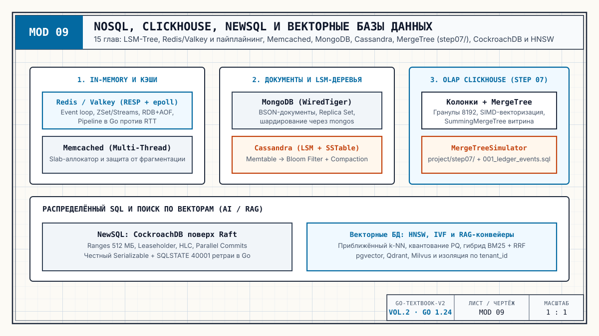

*Пятнадцать глав о мире за пределами классических реляционных СУБД: от LSM-деревьев, Redis/Valkey и Memcached до MongoDB, Cassandra, аналитического ClickHouse (`project/step07/`), CockroachDB и векторных баз.*

> «Сложность мультипликативна: решая задачу за счёт усложнения одной части системы, вы медленно, но верно добавляете сложность во все остальные.»  
> — Роб Пайк *(приведено у А. Донована и Б. Кернигана, The Go Programming Language)*

## Что нужно знать до старта

* **Модули 1–8:** реляционное моделирование, индексы B+ Tree, WAL, MVCC, репликация, шардирование, кворумы $R + W > N$, согласованность и CAP/PACELC.

## Что вы соберёте в этом разделе

* **Устройство быстрых Key-Value и кэш-систем** — поймёте однопоточный event loop и протокол `RESP` в Redis/Valkey, пайплайнинг и пулы соединений из Go, а также многопоточный slab-аллокатор Memcached.
* **Движки документных и колоночных NoSQL-систем** — разберёте моделирование документов в MongoDB (`WiredTiger`, Replica Set) и модель «от запросов» в Cassandra (`LSM-Tree`, `Memtable`, `SSTable`, компактификация и кворумы).
* **OLAP-витрину `LedgerPulse` на ClickHouse (`project/step07/` и `sql/clickhouse/`), NewSQL и векторный поиск** — освоите поколоночное сжатие, `MergeTree` и векторизацию на базе `MergeTreeSimulator`, архитектуру CockroachDB поверх Raft и алгоритмы `HNSW`/`IVF` для поиска по эмбеддингам.

## Карта раздела

1. [[1. Зачем появился NoSQL — компромиссы за пределами реляционной модели]] — отказ от `JOIN` и жёсткой схемы ради горизонтальной записи и предсказуемых задержек.
2. [[2. Key-Value хранилища — от хеш-таблиц в памяти до LSM-деревьев]] — сравнение B+ Tree (in-place update) и LSM-Tree (append-only, Memtable, SSTable, Bloom Filter).
3. [[3. Redis — архитектура, структуры данных, RESP и работа из Go]] — строки, хеши, списки, ZSet, Streams, текстовый протокол RESP и паттерны Go-клиента.
4. [[4. Redis под капотом — однопоточный event loop, RDB, AOF, Cluster и пайплайнинг]] — мультиплексирование `epoll`, персистентность `RDB`/`AOF`, слоты 16384, пайплайнинг и аллокации в Go.
5. [[5. Memcached — slab-аллокатор и многопоточный кэш в памяти]] — классы памяти, проблема `slab calcification`, LRU и сравнение с Redis.
6. [[6. Valkey — открытый форк Redis и совместимость экосистемы]] — почему индустрия форкнула Redis, многопоточность I/O и миграция `LedgerPulse`.
7. [[7. Документные базы данных — MongoDB и моделирование документов]] — встраивание против ссылок, BSON, агрегационные конвейеры и границы документной модели.
8. [[8. MongoDB под капотом — WiredTiger, Replica Set и шардирование]] — B-Tree и сжатие в WiredTiger, Oplog, `WriteConcern`/`ReadConcern` и `mongos`.
9. [[9. Колоночные NoSQL — Apache Cassandra и моделирование от запросов]] — Wide-Column модель, Partition Key + Clustering Key и антипаттерн `ALLOW FILTERING`.
10. [[10. Архитектура Cassandra — LSM-Tree, SSTable, Memtable и кворумы]] — CommitLog, Memtable, SSTable, Tombstones, Size-Tiered vs Leveled Compaction.
11. [[11. ClickHouse — аналитическая OLAP-база для миллиардов строк]] — why OLAP ≠ OLTP, схема `sql/clickhouse/001_ledger_events.sql` и `SummingMergeTree` + `Materialized View`.
12. [[12. ClickHouse под капотом — колоночное хранение, MergeTree и векторизация]] — сортированные гранулы (`index_granularity = 8192`), слияния частей и разбор `MergeTreeSimulator` в `project/step07/`.
13. [[13. NewSQL и CockroachDB — распределённый SQL поверх Raft]] — диапазоны (Ranges), Raft на каждый диапазон, гибридные логические часы (HLC) и цена геораспределённого SQL.
14. [[14. Векторные базы данных — HNSW, IVF и гибридный поиск]] — косинусное расстояние, приближённый поиск k-NN, многослойные графы HNSW, квантование PQ и `pgvector`.
15. [[15. Поиск по эмбеддингам и инженерные сценарии AI и RAG]] — чанкинг, метаданные и фильтрация до/после поиска, гибрид BM25 + вектор и мостик к практике Go в Модуле 10.
