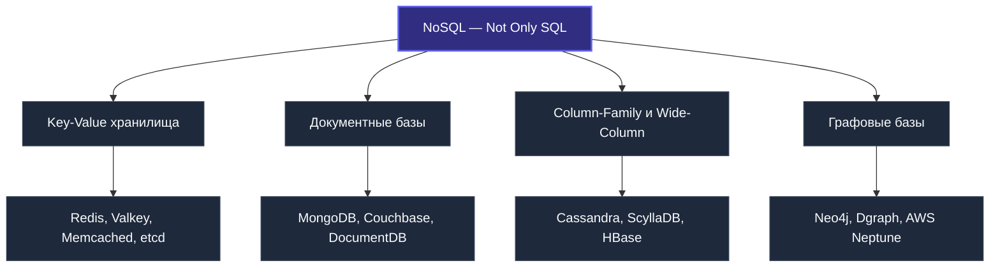
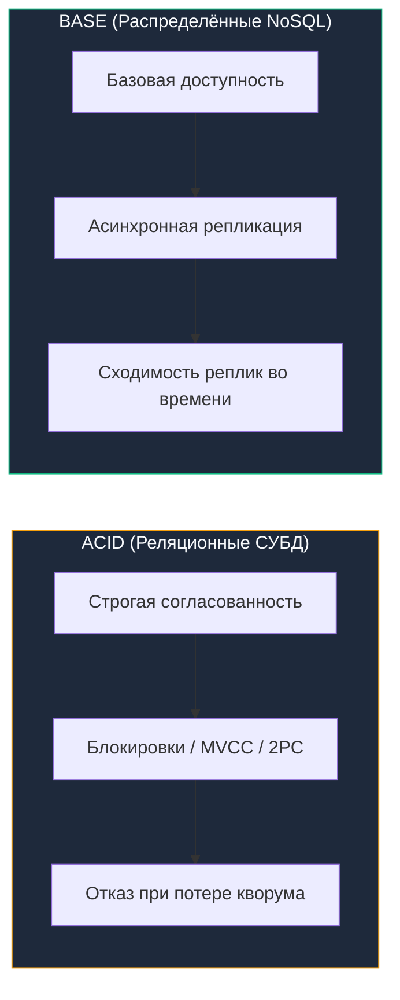

*Почему универсальные реляционные таблицы упираются в пределы масштаба и схемы, чем отличаются четыре семейства NoSQL, как устроены гарантии BASE и как выбор движка нагружает диск, память и Go-драйверы.*

> «Можно уверенно предсказать, что новые языки, делающие программирование проще и безопаснее, будут появляться и дальше. Но столь же уверенно можно сказать, что единого языка не будет никогда: в разработке слишком много компромиссов, чтобы один-единственный язык одинаково хорошо подходил для всех задач.»  
> — Брайан Керниган, *UNIX: A History and a Memoir*

На заре популярности NoSQL многие восприняли аббревиатуру как повод списать реляционную алгебру в архив: зачем проектировать схемы и внешние ключи, если можно сбрасывать сырой JSON как попало? На практике такой подход без дисциплины моделирования обернулся терабайтами несогласованных данных и тяжёлой поддержкой.

Реальный смысл термина — **Not Only SQL** («не только SQL»). Мир данных неоднороден. В ядре финансовой системы `LedgerPulse` таблицы `accounts`, `transactions` и `ledger_entries` в PostgreSQL незаменимы: там нужны внешние ключи, двойная запись и строгий ACID. Но когда рядом появляются сотни тысяч проверок rate limiting в секунду, мгновенные сессии, поток телеметрии аудита или поиск графовых цепочек отмывания средств, одна реляционная модель становится узким горлышком.

---

## Исторический контекст: почему SQL перестал быть единственным

Десятилетиями реляционные СУБД уверенно закрывали задачи [[3. Типы баз данных — OLTP против OLAP|OLTP и OLAP]]. Пока схема стабильна, а нагрузка растёт умеренно, её компенсируют вертикальным масштабированием (Scale-up): ставят более быстрый CPU, наращивают RAM и дисковые массивы.

В середине 2000-х годов веб-гиганты в публикациях **Google Bigtable (2006)**, **Amazon Dynamo (2007)** и **Facebook Cassandra (2008)** зафиксировали три предела этого пути:

1. **Цена Scale-up и переход к Scale-out.** Серверы с десятками терабайт RAM стоят астрономически дорого. Горизонтальный кластер из сотен недорогих машин потребовал ослабить строгие гарантии [[1. ACID — четыре гарантии транзакции без иллюзий|ACID]] — прежде всего глобальную синхронную согласованность.
2. **Темп изменений схемы.** Продуктовые команды меняют атрибуты каждую неделю. На таблицах в сотни миллионов строк блокирующие DDL-операции и миграции тормозят запись и усложняют релизы без простоя.
3. **Разнородные и связные данные.** Сессии, IoT-телеметрия, графы связей, полнотекстовые индексы и матрицы эмбеддингов плохо ложатся в строгую [[9. Нормализация — зачем избавляться от аномалий|нормализацию]]: сборка объекта каскадными `JOIN`-ами сжигает CPU и случайный дисковый ввод-вывод.

Инженеры создали специализированные движки, пожертвовав универсальным SQL ради горизонтального шардирования, доступности и низкой задержки на одном профиле нагрузки. Сегодня маятник качнулся к сближению: в NoSQL появились SQL-диалекты и транзакции, а в PostgreSQL — [[5. JSONB в PostgreSQL — бинарное хранение, операторы и индексы|JSONB]]. Но базовый движок хранения по-прежнему диктует профиль ресурсов.

> [!info] Под капотом
> Классический InnoDB или PostgreSQL оперирует страницами по 8/16 КБ и B-Tree с обновлением на месте. В NoSQL под капотом лежит **LSM-Tree** (*Log-Structured Merge-tree*, как в Cassandra и RocksDB), **инвертированный индекс** (Elasticsearch) или **структуры в RAM** (Redis). Для Go-сервиса это меняет профиль сетевых задержек, аллокаций и системных вызовов.

---

## Четыре семейства NoSQL-баз

Нереляционные хранилища делят на четыре базовые модели данных.



### 1. Key-Value (Ключ-значение)

Предельно простая модель: уникальному ключу сопоставляется произвольное значение (строка, число, BLOB). Движок не вникает в семантику значения и работает как быстрая хеш-таблица.
* **Представители:** [[3. Redis — архитектура, структуры данных, RESP и работа из Go|Redis]], Valkey, Memcached, `etcd` (подробнее о `Memcached` и `Valkey` — в главах 5 и 6 этого раздела).
* **Сценарии в `LedgerPulse`:** кэш лимитов, сессии, rate limiting, распределённые блокировки, pub/sub.
* **Преимущество:** задержка на уровне десятков микросекунд и поиск $O(1)$ (разберём в [[2. Key-Value хранилища — от хеш-таблиц в памяти до LSM-деревьев]]).

### 2. Document (Документные базы)

Хранят самодостаточные иерархические документы (JSON, BSON, XML) с ключом `_id`, вложенными словарями и массивами. Движок индексирует вложенные поля без жёсткой схемы коллекции.
* **Представители:** MongoDB, Couchbase, Amazon DocumentDB (разбор в главах 7–8 этого раздела).
* **Сценарии:** профили мерчантов с разными реквизитами по странам, каталоги товаров, ответы внешних шлюзов. Чтение агрегата целиком заменяет несколько `JOIN`-ов за счёт осознанной [[14. Денормализация — когда и как она оправдана|денормализации]].

### 3. Column-Family (Колоночные / Wide-Column)

Разреженные многомерные матрицы: у строки есть *Row Key*, но набор колонок динамический, а столбцы группируются в семейства (*Column Families*).
* **Представители:** Apache Cassandra, ScyllaDB, HBase (главы 9–10). Близкий аналитический класс — колоночный ClickHouse (главы 11–12), но он имеет строгую схему и ориентирован на OLAP-агрегации.
* **Сценарии и движок:** временные ряды, IoT-телеметрия, ленты событий (в том числе база под *Event Sourcing* — подробнее см. Том 3, раздел о событийных архитектурах). Cassandra пишет в последовательный `CommitLog` и `Memtable`, сбрасывая их в `SSTable` (LSM-Tree) без случайного дискового I/O.

### 4. Graph (Графовые базы)

Сущности первого класса — вершины и направленные рёбра с атрибутами. Вместо тяжёлых рекурсивных `JOIN`-ов графовые СУБД используют **Index-free Adjacency**: каждый узел хранит прямые указатели на смежные узлы, делая переход по ребру $O(1)$.
* **Представители:** Neo4j (Cypher), Dgraph (GraphQL-подобный API, популярен в Go), AWS Neptune (Gremlin, SPARQL).
* **Сценарии в `LedgerPulse`:** антифрод-анализ цепочек подозрительных переводов, социальные графы, графы знаний и рекомендации.

---

## ACID против BASE

Согласно [[7. CAP и PACELC в выборе баз данных|CAP и PACELC]], при сетевом разделении (*Partition*) распределённый кластер выбирает между строгой согласованностью (*CP*) и доступностью (*AP*). Вместо классического ACID для распределённых AP-систем сформулировали модель **BASE**:

* **Basically Available** — узел отвечает на запросы даже при отказе части кластера, пусть и слегка устаревшими данными.
* **Soft state** — состояние реплик меняется в фоне без новых запросов от клиента (асинхронная репликация).
* **Eventual consistency** — без новых записей все реплики через конечное время сходятся к единому состоянию (подробнее см. [[6. Модели согласованности в БД — Strong, Eventual, Read-Your-Writes и Causal]]).



> [!warning] Ловушка: eventual consistency и настройки по умолчанию
> Eventual consistency не означает произвольную потерю записей. Почти все кластеры позволяют задавать уровень согласованности на запрос: например, в Cassandra кворум `QUORUM` ($R + W > N$) через `gocql.Quorum` в Go обеспечивает строгую видимость последней записи. Но настройки по умолчанию часто мягкие (`Consistency.One`), из-за чего сервис теряет гарантию *Read-Your-Writes*.

---

## Физика железа: память, диск и системные вызовы

На шкале задержек железа (RAM ~100 нс, NVMe SSD ~100 мкс, HDD ~10 мс) выбор движка задаёт профиль нагрузки на ОС:

* **In-Memory (Redis, Memcached):** 100% данных в куче процесса. Чтение обходится без дисковых `read`, работая с кэшами L2/L3 одного ядра CPU. Плата — дорогая RAM.
* **Document (MongoDB):** старый движок `MMAPv1` (до v4.0) опирался на `mmap` и при промахах уходил в блокирующий поток *major page fault*. Современный **WiredTiger** держит свой кэш B-Tree страниц в RAM, пишет в WAL с контрольными точками каждые 60 с и активно использует page cache ОС через пул потоков.
* **LSM-Tree (Cassandra, RocksDB):** последовательный append в `CommitLog` и сброс `SSTable`. На NVMe даёт гигабайты в секунду при минимуме `fdatasync` и переключений контекста, расплачиваясь фоновой компактификацией (*compaction*).
* **B-Tree (PostgreSQL, MySQL):** случайные модификации 8/16 КБ страниц через WAL и буферный пул (`shared_buffers` / `innodb_buffer_pool`), требовательные к random IOPS.

| Модель хранения | Работа с диском | Профиль RAM | CPU и системные вызовы |
|---|---|---|---|
| **In-Memory (Redis)** | Только фоновые `AOF`/`RDB` | 100% набора в памяти | Минимум дисковых syscall на чтении |
| **Document (WiredTiger)** | WAL + checkpoint каждые 60 с | Кэш B-Tree страниц | Пул потоков, десериализация BSON, page cache ОС |
| **LSM-Tree (Cassandra)** | Последовательный `CommitLog` + `SSTable` | `Memtable` + Bloom-фильтры | Высокая утилизация NVMe, фоновый compaction |
| **B-Tree (PostgreSQL/InnoDB)** | Случайные правки 8/16 КБ страниц + WAL | `Shared Buffers` / `Buffer Pool` | Высокие требования к random IOPS и блокировкам |

> [!tip] Собеседование [Middle]
> **Вопрос:** Почему MongoDB способна обогнать PostgreSQL на одном запросе и проиграть на другом при правильно настроенных индексах?
>
> **Ответ:** MongoDB хранит агрегат как один BSON-документ. Запрос полного профиля мерчанта с адресами и реквизитами читается одним обращением, тогда как нормализованный SQL потребует нескольких `JOIN`-ов и случайных чтений страниц. Но если нужен только один столбец (`email` или `status`), MongoDB поднимет и распарсит весь документ целиком, а PostgreSQL отдаст данные из узкого [[6. Покрывающие (Covering) индексы, INCLUDE и Index-Only Scan|покрывающего индекса]] через `Index-Only Scan`.

---

## Go и NoSQL: нативные драйверы вместо `database/sql`

Пакет `database/sql` (практику работы с ним разберём в Модуле 10) заточен под табличный `Scan` и `BEGIN/COMMIT`. Для NoSQL в Go используют нативные драйверы с собственными пулами соединений, протоколами сериализации (`RESP`, MongoDB Wire Protocol, `CQL`, `Bolt`) и кластерной маршрутизацией:
* **Redis / Valkey:** `github.com/redis/go-redis/v9`
* **MongoDB:** `go.mongodb.org/mongo-driver/v2`
* **Cassandra / ScyllaDB:** `github.com/gocql/gocql`
* **ClickHouse:** `github.com/ClickHouse/clickhouse-go/v2`
* **Neo4j:** `github.com/neo4j/neo4j-go-driver/v5`

Пример для `LedgerPulse`: храним оперативный суточный лимит счёта в Redis (`int64` в копейках) и динамический профиль мерчанта в MongoDB.

```go
package main

import (
	"context"
	"fmt"
	"log"
	"time"

	"github.com/redis/go-redis/v9"
	"go.mongodb.org/mongo-driver/v2/bson"
	"go.mongodb.org/mongo-driver/v2/mongo"
	"go.mongodb.org/mongo-driver/v2/mongo/options"
)

type MerchantProfile struct {
	AccountID    int64             `bson:"_id"`
	LegalName    string            `bson:"legal_name"`
	DailyLimit   int64             `bson:"daily_limit_minor"`
	ExtraDetails map[string]string `bson:"extra_details"`
}

func main() {
	ctx, cancel := context.WithTimeout(context.Background(), 5*time.Second)
	defer cancel()

	rdb := redis.NewClient(&redis.Options{Addr: "localhost:6379", PoolSize: 20, MinIdleConns: 5})
	defer rdb.Close()

	if err := rdb.Set(ctx, "limit:account:1042", int64(5_000_000), 15*time.Minute).Err(); err != nil {
		log.Fatalf("redis set: %v", err)
	}
	remaining, _ := rdb.Get(ctx, "limit:account:1042").Int64()
	fmt.Printf("Redis daily limit: %d minor units\n", remaining)

	mClient, err := mongo.Connect(options.Client().ApplyURI("mongodb://localhost:27017").SetMaxPoolSize(50))
	if err != nil {
		log.Fatalf("mongo connect: %v", err)
	}
	defer func() { _ = mClient.Disconnect(context.Background()) }()

	profile := MerchantProfile{
		AccountID:    1042,
		LegalName:    "Acme Payments LLC",
		DailyLimit:   5_000_000,
		ExtraDetails: map[string]string{"country": "DE", "vat_id": "DE123456789"},
	}
	coll := mClient.Database("ledgerpulse").Collection("merchants")
	_, err = coll.UpdateOne(ctx, bson.M{"_id": profile.AccountID}, bson.M{"$set": profile}, options.UpdateOne().SetUpsert(true))
	if err != nil {
		log.Fatalf("mongo upsert: %v", err)
	}
	fmt.Printf("MongoDB profile saved: account_id=%d\n", profile.AccountID)
}
```

Вывод при запущенных локальных инстансах:

```text
Redis daily limit: 5000000 minor units
MongoDB profile saved: account_id=1042
```

---

## Когда выбирать NoSQL, а когда оставаться на SQL

* **Выбирайте NoSQL:** схема быстро меняется; нужен огромный поток последовательной записи (Cassandra, ClickHouse); доступ строго по ключу (Redis); агрегат читается целиком (MongoDB); доступность при сетевом разрыве важнее строгой согласованности.
* **Выбирайте PostgreSQL / MySQL:** строгая целостность и финансы (`accounts`, `ledger_entries`); многотабличные ACID-транзакции; сложные ad-hoc `JOIN`-ы и оконные функции; команда не готова отлаживать *eventual consistency*.

В продакшене доминирует гибрид: PostgreSQL хранит бухгалтерский источник истины `LedgerPulse`, Redis обслуживает кэш и лимиты, ClickHouse считает аналитику, а Elasticsearch закрывает полнотекстовый поиск.

---

## Упражнения

### Упражнение 1 (Базовое)
Сопоставьте четыре задачи `LedgerPulse` с оптимальным семейством БД (реляционная, Key-Value, Document, Graph):
1. Главная книга проводок `ledger_entries` с гарантией сходимости дебета и кредита.
2. Минутный счётчик запросов к API на одного пользователя.
3. Поиск цепочек переводов длиной до 6 шагов в антифроде.
4. Сырые анкеты мерчантов из 15 стран с разными полями.

> [!solution] Показать решение
> 1. **Реляционная (PostgreSQL)** — строгие ACID, внешние ключи, `CHECK`-ограничения и атомарность двойной записи.
> 2. **Key-Value (Redis/Valkey)** — доступ $O(1)$ по ключу `ratelimit:user:42`, сотни тысяч инкрементов в секунду, автоматический TTL в RAM.
> 3. **Graph (Neo4j/Dgraph)** — *Index-free Adjacency* обходит связи за $O(1)$ на ребро без тяжёлых рекурсивных `JOIN`-ов.
> 4. **Document (MongoDB)** — динамическая схема по странам и чтение анкеты целиком как одного агрегата.

### Упражнение 2 (Практическое)
Балансы `LedgerPulse` перенесли в распределённую AP-базу с фактором репликации `N = 3` и дефолтными `Write = ONE`, `Read = ONE`. Опишите аномалию, если клиент пополнит счёт и через 5 мс запросит баланс или перевод. Как вернуть *Read-Your-Writes* и какова цена по CAP/PACELC?

> [!solution] Показать решение
> **Аномалия:** запись с `W = 1` подтвердится на Узле A до завершения асинхронной репликации на B и C. Чтение с `R = 1` попадёт на Узел B и вернёт старый баланс — нарушится *Read-Your-Writes*, что вызовет ложный отказ в переводе.
>
> **Исправление:** задать кворумы `QUORUM` ($W = 2$, $R = 2$ при $N = 3$), чтобы выполнялось $R + W > N$. Цена по CAP/PACELC: при сетевом разделении теряется доступность меньшинства (*CP*), а в штатной работе растёт задержка ответа (*Latency*) на ожидание второй реплики.

### Упражнение 3 (Со звёздочкой *)
Сервис аудита пишет 150 000 событий в секунду по 500 байт (~75 МБ/с) с произвольными UUID-ключами. Почему движок **B-Tree** упрётся в диск гораздо раньше **LSM-Tree** на том же NVMe?

> [!solution] Показать решение
> В **B-Tree** вставка случайных UUID бьёт по разрозненным страницам 8/16 КБ. Если индекс не влезает в RAM, каждое обновление требует случайного чтения страницы с диска и сброса целой изменённой страницы плюс записи в WAL (*write amplification*). В **LSM-Tree** поток 75 МБ/с дописывается строго последовательно в `CommitLog` и в оперативный `Memtable`, а на диск уходят уже отсортированные крупные блоки `SSTable` на гигабайтных скоростях NVMe; платой остаётся лишь фоновая компактификация.

---

## Мостик к следующей главе

Самая быстрая модель NoSQL — **Key-Value** — отказалась от SQL-парсера и сложных схем ради доступа за микросекунды. В главе [[2. Key-Value хранилища — от хеш-таблиц в памяти до LSM-деревьев]] мы разберём оба полюса KV-архитектур: хеш-таблицы в памяти с безударным рехэшированием и дисковые LSM-деревья с `Memtable`, `SSTable` и фильтрами Блума. Как именно KV-движок решает коллизии и переполнения памяти без просадки задержек — выясним дальше.
