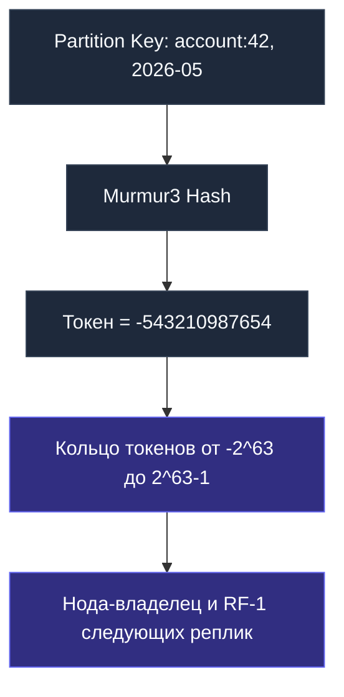
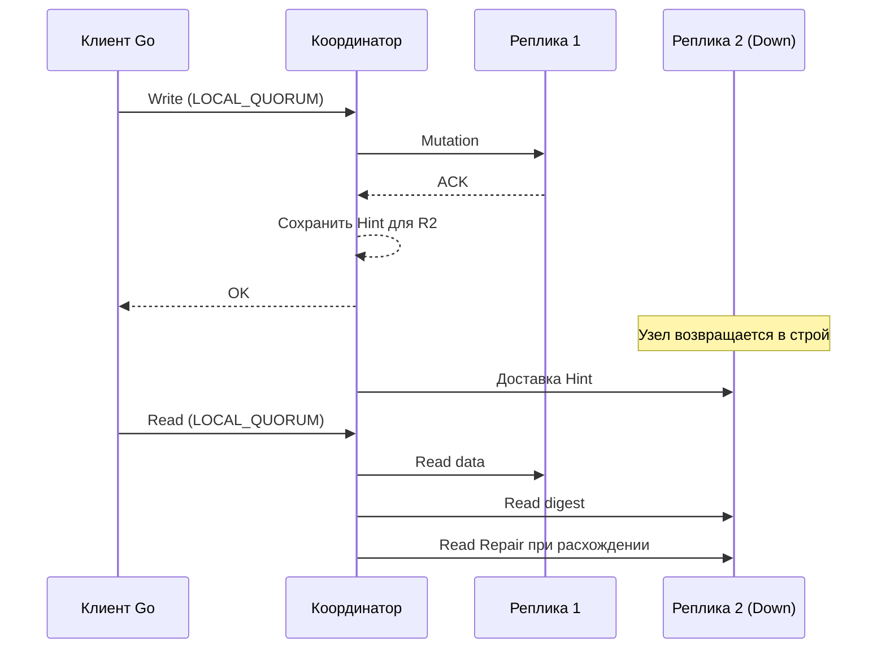
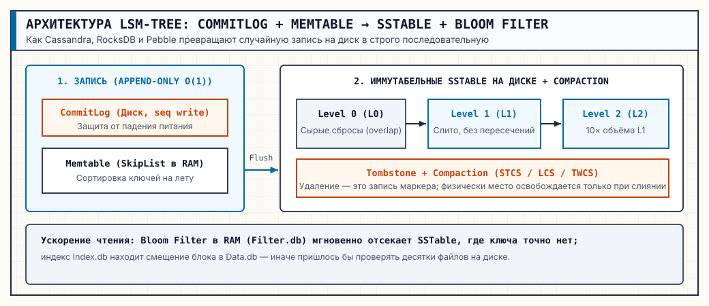
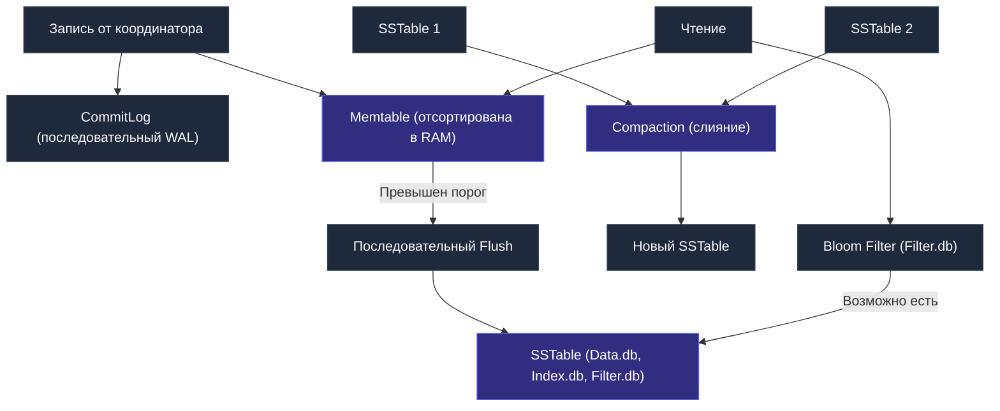

*Кольцо токенов, vnodes, Gossip и Phi Accrual, CommitLog, Memtable, SSTable, надгробия (Tombstones), стратегии компактификации и Paxos LWT.*

> «Мы пишем, а позже читаем. Сохраняем, а позже извлекаем. Храним, а позже обращаемся к сохранённому. Назначение памяти — уберечь информацию без искажений между двумя этими событиями. Стоит отключить питание — и энергозависимая память забывает всё, что когда-либо знала.»  
> — Чарльз Петцольд, *Code: The Hidden Language of Computer Hardware and Software* (2nd ed.)

В главе [[9. Колоночные NoSQL — Apache Cassandra и моделирование от запросов]] мы проектировали таблицы от запросов и настраивали `gocql`. Но в эксплуатации возникают сбои, которые не лечатся переписыванием CQL: `SELECT` падает с `TombstoneOverwhelmingException` после массового удаления, ночная компактификация съедает весь SSD или при живых узлах один из них внезапно помечается как `DOWN`. Причины кроются в распределённом кольце и физике LSM-Tree.

---

## Кольцо токенов и виртуальные узлы (vnodes)

В Cassandra нет лидера: все узлы равноправны и расположены на логическом кольце хеш-пространства. По умолчанию **Murmur3Partitioner** вычисляет 64-битный хеш от `Partition Key` в диапазоне от $-2^{63}$ до $2^{63} - 1$.



Каждый узел отвечает за диапазон от предыдущего токена до собственного включительно. Чтобы добавление новой машины не требовало ручного пересчёта границ и не создавало перекосов нагрузки, используют **виртуальные узлы (vnodes)**: один физический сервер владеет множеством небольших диапазонов по всему кольцу (исторически по умолчанию 256, в современных конфигурациях часто 16 ради ускорения Gossip). Новая нода забирает мелкие отрезки сразу у всех соседей.

Драйвер `gocql` скачивает карту токенов из системных таблиц и через `TokenAwareHostPolicy` отправляет запрос **напрямую на нужную реплику**, избегая лишнего сетевого прыжка через случайного координатора.

---

## Репликация, Gossip и Phi Accrual

Размещение копий задаётся стратегией Keyspace (`replication_factor`, RF):

* **`SimpleStrategy`** — размещает первую реплику по токену, а остальные $RF - 1$ на следующих узлах по часовой стрелке. Годится только для тестового одного дата-центра.
* **`NetworkTopologyStrategy`** — стандарт для продакшена: задаёт RF отдельно на каждый дата-центр (`'dc1': 3, 'dc2': 2`) и разносит копии по разным стойкам (racks).

Состояние кластера распространяет протокол **Gossip** (вариант Scuttlebutt). Каждую секунду каждый узел обменивается `EndpointState` (жив/мёртв, версия схемы, карта токенов) с 1–3 случайными соседями.

Отказы выявляет **Phi Accrual Failure Detection**. Вместо бинарного таймаута «не ответил за 2 секунды» алгоритм собирает распределение интервалов между последними heartbeat-пакетами (`HeartBeatState`) и вычисляет вероятность отказа $\phi$. Когда $\phi$ превышает порог `phi_convict_threshold` (по умолчанию 8), узел помечается как `DOWN`, а `gocql` по событию топологии исключает его из пула соединений.

---

## Hinted Handoff, Read Repair и кворумы

При записи с `LOCAL_QUORUM` и `RF = 3` координатор ждёт подтверждения от 2 реплик из 3 (подробнее о кворумах $W + R > N$ см. [[3. Multi-Leader и Leaderless репликация — конфликты записи и кворумы]]). Если третья нода временно недоступна, кластер восстанавливает согласованность тремя механизмами:

1. **Hinted Handoff.** Координатор сохраняет локальную подсказку (**hint**) на свой диск (окно `max_hint_window_in_ms` по умолчанию 3 часа) и доставляет запись, как только нода возвращается. Мониторинг `pending_hints` обязателен: долгое падение реплики генерирует лишний дисковый I/O и может забить диск координатора.
2. **Read Repair.** При чтении координатор сравнивает ответы или дайджесты реплик; при расхождении по `writetime` отдаёт клиенту свежую версию и подтягивает отставшие узлы.
3. **Anti-Entropy Repair.** Плановая фоновая сверка диапазонов через деревья Меркла (`nodetool repair`).



---

## Путь записи и чтения в LSM-Tree: CommitLog, Memtable и SSTable



В отличие от B-Tree с перезаписью случайных 8-килобайтных страниц, Cassandra построена на **LSM-Tree** (см. [[2. Key-Value хранилища — от хеш-таблиц в памяти до LSM-деревьев]]). В сравнении с масштабами задержек (RAM ~100 нс, NVMe ~100 мкс, HDD ~10 мс) профиль работы такой:



1. **Запись (`CommitLog` + `Memtable`).** Мутация дописывается в последовательный `CommitLog` (аналог [[8. WAL — журнал упреждающей записи и долговечность на диске|WAL]]) с пакетным сбросом `fsync` (group commit) и вставляется в отсортированную `Memtable` в памяти (ноль дискового поиска).
2. **Flush в `SSTable`.** При заполнении `Memtable` сбрасывается единым последовательным потоком в неизменяемый набор файлов **SSTable**: `Data.db` (отсортированные партиции и строки), `Index.db` / `Summary.db` (смещения) и `Filter.db` (**Bloom Filter** в RAM).
3. **Чтение.** Движок проверяет `Memtable`, а по фильтрам Блума мгновенно отсекает большинство SSTable без системных вызовов `pread`, затем объединяет совпадающие версии по `writetime`.

---

## Tombstones (надгробия) и зомби-данные

Так как SSTable неизменяемы, `DELETE` или явная вставка `NULL` не стирают байты на диске, а дописывают маркер удаления — **надгробие (Tombstone)** с меткой времени.

Надгробие нельзя выкинуть сразу при первом слиянии: если одна из трёх реплик была выключена в момент `DELETE`, а две другие тут же удалят и строку, и надгробие, то после возвращения третьей ноды её старая версия строки при `Read Repair` распространится заново (**zombie data**). Поэтому надгробия живут минимум `gc_grace_seconds` (по умолчанию **864 000 с = 10 дней**), пока оператор успеет прогнать `nodetool repair`.

> [!warning] Ловушка: Шторм Tombstones при `SELECT`
> При частых удалениях или передаче `nil` вместо пропуска пустых колонок в `INSERT` на диске скапливаются десятки тысяч надгробий. При `SELECT` движок обязан прочитать и отфильтровать все мёртвые ячейки. По умолчанию на 1 000 надгробий пишется предупреждение (`tombstone_warn_threshold`), а при 100 000 (`tombstone_failure_threshold`) **запрос прерывается с ошибкой**. Для данных со сроком жизни используйте `TTL` и `TWCS` вместо массовых `DELETE`.

---

## Стратегии компактификации (Compaction)

Чтобы десятки накопившихся SSTable не вызывали **read amplification**, фоновый процесс **Compaction** сливает их и удаляет старые версии:

| Стратегия | Механика | Плюсы | Минусы и риски |
| :--- | :--- | :--- | :--- |
| **STCS** (`SizeTiered`) | Сливает 4+ близких по размеру SSTable | Минимум write amplification, высокий поток записи | До 50% резерва диска на слияния, высокий read amplification |
| **LCS** (`Leveled`) | Уровни $L_0, L_1, L_2$ ($\times 10$) без пересечения ключей на уровне | Предсказуемо быстрое чтение, малый резерв диска | Высокий write amplification (износ SSD), уступает при пиковой записи |
| **TWCS** (`TimeWindow`) | Группирует SSTable по временным окнам (например, 1 день) | Окна с истёкшим TTL удаляются целиком без слияния | Не подходит при частых обновлениях/удалениях задним числом |

Отставание фоновых слияний (`pending compactions`) приводит к росту `p99 latency` в Go-сервисах с миллисекунд до секунд.

---

## Вторичные индексы и Paxos LWT

Помимо встроенного первичного индекса (сортировка внутри партиции), Cassandra поддерживает локальные **Secondary Index (`2i`)** и привязанные к SSTable **SASI / SAI** (в Cassandra 5.0 `SAI` заменил `SASI`). Но без `Partition Key` такие индексы всё равно провоцируют scatter-gather по всем нодам, поэтому основной путь — денормализация под запрос.

Для точечной строгой атомарности (`IF NOT EXISTS`, `IF status = 'PENDING'`) работают **легковесные транзакции (LWT)** на базе протокола **Paxos**. Они требуют четырёх сетевых раундов между репликами и в 3–10 раз медленнее обычной записи, поэтому подходят для редкой идемпотентной регистрации, а не для горячих проводок:

```go
func RegisterIdempotencyKey(ctx context.Context, s *gocql.Session, key string, txID int64) (bool, error) {
	const cql = `INSERT INTO idempotency_keys (key, tx_id) VALUES (?, ?) IF NOT EXISTS USING TTL 86400`
	var existingKey string
	var existingTxID int64

	applied, err := s.Query(cql, key, txID).
		WithContext(ctx).
		SerialConsistency(gocql.LocalSerial).
		ScanCAS(&existingKey, &existingTxID)
	if err != nil {
		return false, fmt.Errorf("paxos lwt failed: %w", err)
	}
	return applied, nil
}
```

> [!tip] Собеседование [Senior/Staff]
> **Вопрос:** Почему для LWT Cassandra выбрала Paxos вместо двухфазного коммита (2PC)?
>
> **Ответ:** 2PC (см. [[9. Двухфазный коммит (2PC) — протокол, блокировки и отказ координатора]]) зависит от выделенного координатора и удерживает блокировки между фазами Prepare и Commit: его падение подвешивает участников. Paxos не требует постоянного лидера и достигает консенсуса кворумом живых реплик даже при отказе инициатора, сохраняя архитектуру без единой точки отказа.

---

## Влияние на Go-сервис

С точки зрения железа и рантайма Go критичны три настройки: пул соединений `gocql` (по умолчанию 2 TCP-соединения на ноду с мультиплексированием стримов), уровень согласованности (`LOCAL_QUORUM` против межрегионального `QUORUM`) и `PageSize`, защищающий кучу и GC Go от гигантских слайсов. Кроме того, при массовой вставке нельзя передавать `nil` для пустых полей — колонки нужно просто опускать, чтобы не плодить надгробия.

---

## Упражнения

1. **Базовое.** В таблице `events_by_account` с `default_time_to_live = 7776000` (90 дней) данные приходят равномерно по 500 ГБ в месяц без обновлений задним числом. Сейчас стоит `STCS`, и слияния упёрлись в нехватку свободного места на SSD. Какую стратегию выбрать и почему?

> [!solution] Показать решение
> Выбирайте **TimeWindowCompactionStrategy (TWCS)** с окном `1 day`. Данные добавляются последовательно по времени и имеют единый TTL 90 дней. Прошедшие суточные окна больше не переписываются, а по истечении TTL удаляются файловой системой целиком (`unlink`) без чтения, слияния, шторма tombstones и без 2x резерва диска, требуемого в `STCS`.

2. **Практическое.** В функции ниже при пустом `comment` в CQL передаётся `nil`, создавая tombstone в каждой строке. Исправьте её так, чтобы при пустой строке надгробие не создавалось.

```go
func InsertAuditBroken(ctx context.Context, s *gocql.Session, id gocql.UUID, accountID int64, comment string) error {
	var c any
	if comment != "" {
		c = comment
	}
	return s.Query(
		`INSERT INTO audit_notes (account_id, note_id, comment) VALUES (?, ?, ?)`,
		accountID, id, c,
	).WithContext(ctx).Exec()
}
```

> [!solution] Показать решение
> ```go
> func InsertAuditClean(ctx context.Context, s *gocql.Session, id gocql.UUID, accountID int64, comment string) error {
> 	if comment == "" {
> 		return s.Query(
> 			`INSERT INTO audit_notes (account_id, note_id) VALUES (?, ?)`,
> 			accountID, id,
> 		).WithContext(ctx).Exec()
> 	}
> 	return s.Query(
> 		`INSERT INTO audit_notes (account_id, note_id, comment) VALUES (?, ?, ?)`,
> 		accountID, id, comment,
> 	).WithContext(ctx).Exec()
> }
> ```
> Для таблиц со множеством опциональных полей также применяют маркер `gocql.UnsetValue` (протокол CQL v4+), который инструктирует сервер пропустить ячейку без записи tombstone.

3. **Со звёздочкой (\*).** В кластере с `RF = 3` и `gc_grace_seconds = 864000` (10 дней) одна нода простояла выключенной 14 дней. Инженер починил контроллер, оставил старый диск и запустил Cassandra обратно. Почему это опасно и как правильно вернуть ноду в кластер?

> [!solution] Показать решение
> За 14 дней на живых репликах истёк 10-дневный `gc_grace_seconds`, и компактификация удалила надгробия записей, стёртых во время простоя. На старом диске третьей ноды эти строки остались живыми. При возврате в кольцо чтение с `QUORUM` или `nodetool repair` увидит на третьей ноде живую строку, а на двух других не найдёт даже надгробия — удалённые данные **воскреснут во всём кластере (zombie data)**.
>
> Ноду после простоя дольше `gc_grace_seconds` нельзя поднимать со старыми данными: нужно очистить каталоги данных/логов и ввести её заново с флагом замены (`-Dcassandra.replace_address_first_boot=<IP>`), чтобы она получила чистые диапазоны с живых реплик.

---

Мы разобрали беслидерную запись и чтение по партициям в Cassandra. Но когда аналитикам `LedgerPulse` нужно посчитать агрегаты по всем счетам и валютам сразу за три года, сканировать миллионы партиций бессмысленно. Переходим к аналитическим колоночным базам в главе [[11. ClickHouse — аналитическая OLAP-база для миллиардов строк]].
