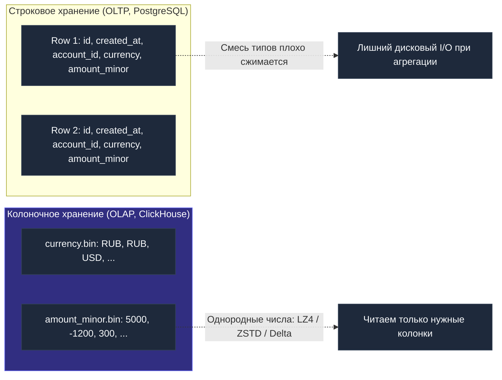
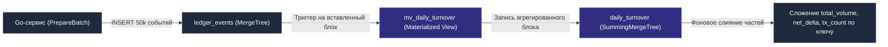

*Поколоночное хранение против строкового, аналитика `LedgerPulse` в `001_ledger_events.sql`, движки `MergeTree` и `SummingMergeTree`, материализованные представления и пакетная вставка из Go.*

> «Цель вычислений — понимание сути, а не числа.»  
> — Ричард Хэмминг *(цитируется в Б. Керниган, UNIX: A History and a Memoir)*

В транзакционном ядре `LedgerPulse` на PostgreSQL операции перевода и проверки баланса отрабатывают за миллисекунды: строковый движок по B-Tree индексу находит нужные несколько страниц по 8 КБ и фиксирует проводки с полным `ACID`. Но как только продуктовая или финансовая команда запрашивает аналитику по всей истории («покажи дневной оборот и чистую дельту по каждой валюте за последние три года по сотням миллионов проводок»), PostgreSQL упирается в потолок `Sequential Scan` (см. [[3. Типы баз данных — OLTP против OLAP]]). Чтение миллиарда строковых кортежей с диска ради суммы по двум колонкам вымывает `shared_buffers`, нагружает диск и длится минуты.

Для такой нагрузки используют **ClickHouse** — поколоночную СУБД, созданную для **OLAP (Online Analytical Processing)**. Если PostgreSQL — это точный скальпель для единичных транзакций, то ClickHouse — поточный аналитический конвейер, перемалывающий миллиарды строк в секунду за счёт иного способа укладки байтов на диск и обработки в CPU.

---

## Поколоночное хранение против строкового

Фундаментальная разница между PostgreSQL и ClickHouse кроется в физической раскладке таблицы на диске (см. [[2. Движок хранения PostgreSQL — 8 КБ страницы, Heap, TOAST и Visibility Map]]).

В строковых СУБД (Row-oriented: PostgreSQL, MySQL) значения всех колонок одной записи лежат подряд внутри 8-килобайтной или 16-килобайтной страницы. Чтобы просуммировать только `amount_minor` и сгруппировать по `currency`, процессу приходится поднимать с диска полные строки со всеми идентификаторами, описаниями и служебными заголовками кортежей.

В поколоночных СУБД (Column-oriented: ClickHouse) **каждая колонка хранится в отдельном наборе файлов**. Все значения `currency` лежат плотным массивом в `currency.bin`, а все `amount_minor` — в `amount_minor.bin`.



Почему такой формат ускоряет аналитику на 1–3 порядка:

1. **Экономия дискового и сетевого I/O.** Если в таблице 50 колонок, а отчёт использует только 3, ClickHouse считывает с NVMe исключительно файлы этих 3 колонок. Объём чтения с диска сокращается в десятки раз.
2. **Высокая степень сжатия.** Внутри одной колонки лежат значения одного типа с высокой повторяемостью: подряд идут коды валют (`RUB`, `USD`), монотонно растущие таймстемпы `DateTime64` или небольшие целые суммы. Это позволяет алгоритмам `LZ4`, `ZSTD`, `Delta`, `DoubleDelta` и `Gorilla` сжимать данные в 10–100 раз эффективнее, чем при строковом хранении.
3. **Векторное исполнение и кэш процессора.** Данные колонки обрабатываются не по одной строке, а крупными блоками (векторами) в плотных массивах, что позволяет задействовать SIMD-инструкции процессора (`SSE 4.2`, `AVX2`, `AVX-512`) и минимизировать промахи кэш-линий CPU.

---

## Движок `MergeTree` и схема `LedgerPulse` (`001_ledger_events.sql`)

Основное семейство движков в ClickHouse — **MergeTree**. По идее неизменяемых отсортированных сегментов и фоновых слияний он перекликается с LSM-деревьями (см. [[10. Архитектура Cassandra — LSM-Tree, SSTable, Memtable и кворумы]]), но оптимизирован не под точечный `GET/PUT` по ключу, а под массовую пакетную запись и аналитические диапазоны.

Разберём реальную DDL-миграцию аналитической витрины `LedgerPulse` из файла `project/sql/clickhouse/001_ledger_events.sql`:

```sql
CREATE DATABASE IF NOT EXISTS ledgerpulse;

CREATE TABLE IF NOT EXISTS ledgerpulse.ledger_events
(
    event_date     Date,
    created_at     DateTime64(3, 'UTC'),
    transaction_id UInt64,
    account_id     UInt64,
    currency       LowCardinality(FixedString(3)),
    kind           LowCardinality(String),
    amount_minor   Int64,
    is_credit      UInt8
)
ENGINE = MergeTree
PARTITION BY toYYYYMM(event_date)
ORDER BY (currency, account_id, created_at, transaction_id)
SETTINGS index_granularity = 8192;
```

Каждая строчка этого определения опирается на внутреннее устройство движка:

* **`LowCardinality(FixedString(3))` и `LowCardinality(String)`.** Вместо хранения повторяющихся строк `'RUB'`, `'USD'`, `'transfer'` миллионы раз в `Data.bin`, ClickHouse строит компактный словарь и хранит в колонке плотные числовые индексы (1–2 байта на строку). Это экономит память и ускоряет `GROUP BY` по строковым полям.
* **`amount_minor Int64`.** Как и в транзакционном ядре `LedgerPulse`, суммы хранятся строго в целых минорных единицах (копейках или центах), исключая ошибки округления `Float64`.
* **`PARTITION BY toYYYYMM(event_date)`.** Таблица физически бьётся на месячные партиции (отдельные наборы каталогов на диске, см. [[5. Партиционирование (Partitioning) — Range, List, Hash и управление таблицами]]). Запрос за последний месяц отсекает файлы всех предыдущих месяцев без чтения их индексов, а удаление архивных данных за прошлый год превращается в мгновенный `ALTER TABLE ... DROP PARTITION '202501'`.
* **`ORDER BY (currency, account_id, created_at, transaction_id)`.** Задаёт физический порядок сортировки строк внутри каждого куска данных (part). Если `PRIMARY KEY` явно не указан, он совпадает с выражением `ORDER BY`.
* **`SETTINGS index_granularity = 8192`.** Вместо B-Tree индекса на каждую строку (который на миллиардах записей занял бы сотни гигабайт), `MergeTree` строит **разреженный индекс (Sparse Index)** — одну индексную засечку на каждые 8 192 строки (одну гранулу). Такой индекс занимает считанные мегабайты, целиком живёт в RAM и позволяет мгновенно отсечь 99% ненужных гранул до обращения к диску.

> [!warning] Ловушка: `PRIMARY KEY` в ClickHouse не гарантирует уникальность
> В PostgreSQL и MySQL `PRIMARY KEY` запрещает вставку дубликатов. В ClickHouse `PRIMARY KEY` и `ORDER BY` определяют **только порядок сортировки на диске и разреженный индекс**. Вы можете вставить 10 строк с одинаковым `transaction_id`, и ClickHouse без ошибки сохранит все 10. Если нужна фоновая дедупликация при ретраях доставки, выбирают движок `ReplacingMergeTree` (с поправкой на то, что до слияния дубли могут временно оставаться и для точного ответа требуют `FINAL` или `argMax`).

---

## Предагрегация: `SummingMergeTree` и `Materialized View`

Даже при скорости ClickHouse в гигабайты в секунду пересчитывать ежедневный дашборд оборотов по миллиарду сырых событий каждый раз, когда финансовый директор открывает страницу, расточительно. В том же файле `project/sql/clickhouse/001_ledger_events.sql` показан канонический паттерн предагрегации в ClickHouse — связка **целевой таблицы `SummingMergeTree`** и **материализованного представления `mv_daily_turnover`**:

```sql
CREATE TABLE IF NOT EXISTS ledgerpulse.daily_turnover
(
    event_date   Date,
    currency     LowCardinality(FixedString(3)),
    account_id   UInt64,
    total_volume UInt64,
    net_delta    Int64,
    tx_count     UInt64
)
ENGINE = SummingMergeTree
PARTITION BY toYYYYMM(event_date)
ORDER BY (event_date, currency, account_id);

CREATE MATERIALIZED VIEW IF NOT EXISTS ledgerpulse.mv_daily_turnover
TO ledgerpulse.daily_turnover
AS
SELECT
    event_date,
    currency,
    account_id,
    sum(abs(amount_minor)) AS total_volume,
    sum(amount_minor)      AS net_delta,
    count()                AS tx_count
FROM ledgerpulse.ledger_events
GROUP BY event_date, currency, account_id;
```

Обратите внимание на две принципиальные детали, отличающие ClickHouse от PostgreSQL (см. [[12. Представления (VIEW) и материализованные представления]]):

1. **`Materialized View` в ClickHouse — это потоковый триггер на вставку.** Он не пересчитывает всю исходную таблицу целиком по команде `REFRESH`. В момент каждого `INSERT` в `ledger_events` ClickHouse применяет `SELECT ... GROUP BY` **только к только что вставленному блоку (part)** в оперативной памяти и дописывает уже сжатые дневные итоги в целевую таблицу `daily_turnover`. Если в исходную таблицу зашло 50 000 событий за один день по 1 000 счетов, в витрину `daily_turnover` ляжет максимум 1 000 строк.
2. **`SummingMergeTree` складывает числа при фоновых слияниях.** По мере поступления новых батчей за тот же день в `daily_turnover` появляются новые части с тем же ключом `(event_date, currency, account_id)`. Во время фоновых слияний (merges) движок автоматически заменяет строки с одинаковым ключом сортировки на одну строку, суммируя все числовые неключевые столбцы (`total_volume`, `net_delta`, `tx_count`).



> [!warning] Ловушка: Чтение `SummingMergeTree` без повторного `GROUP BY`
> Фоновое слияние частей в `SummingMergeTree` происходит асинхронно, а не в момент вставки. Поэтому на диске в `daily_turnover` могут одновременно лежать две ещё не слитые строки для пары `('2026-05-01', 'RUB', 42)`: утренний батч и дневной батч. Если написать `SELECT total_volume FROM ledgerpulse.daily_turnover WHERE account_id = 42`, запрос вернёт две неполные строки вместо одной. Запрос к `SummingMergeTree` **всегда обязан** делать финальную свёртку `SELECT sum(total_volume), sum(net_delta), sum(tx_count) ... GROUP BY event_date, currency, account_id` (или использовать модификатор `FINAL`, который дороже по CPU и I/O).

---

## Когда ClickHouse подходит, а когда нет

ClickHouse — узкоспециализированный аналитический инструмент. Попытка использовать его как замену OLTP-базе ломает систему.

| Задача | ClickHouse | Причина |
| :--- | :--- | :--- |
| Логи, аудит, телеметрия сервисов Go | Отлично | Append-only поток, сжатие 10x+, быстрые фильтры по времени |
| Продуктовая, рекламная и финансовая аналитика (`LedgerPulse`) | Отлично | Векторные агрегации `SUM`, `COUNT`, `quantile` по миллиардам строк |
| Частые точечные `UPDATE` / `DELETE` отдельных строк | Не подходит | Мутации переписывают целые части (parts) на диске |
| Многошаговые транзакции и строгие балансы | Не подходит | Нет полноценного ACID, блокировок строк и изоляции MVCC как в PostgreSQL |
| Высокочастотный точечный `SELECT` одной строки по `id` | Плохо | Разреженный индекс читает минимум целую гранулу (8 192 строки); в OLTP быстрее B-Tree |

> [!tip] Собеседование [Junior]
> **Вопрос:** Можно ли использовать ClickHouse как единственную базу данных для хранения текущих балансов пользователей и проведения переводов?
>
> **Ответ:** Нет. Балансы требуют строгой транзакционной целостности `ACID`, изоляции конкурентных списаний и быстрых точечных обновлений одной строки. ClickHouse спроектирован под неизменяемые (append-only) аналитические данные, не поддерживает строчные блокировки и многошаговые транзакции, а любое изменение существующей строки вызывает тяжёлую асинхронную перезапись целого куска данных на диске.

---

## Пакетная обработка в Go: правило Batching и `clickhouse-go/v2`

Для работы с ClickHouse из Go используют нативный драйвер `github.com/ClickHouse/clickhouse-go/v2` (он общается по бинарному протоколу на порту `9000` вместо HTTP `8123` и передаёт колоночные блоки с минимальными накладными расходами).

Главное инженерное правило интеграции: **никогда не делайте одиночные `INSERT` на каждое событие**.

Каждый `INSERT` создаёт на диске отдельную директорию-часть (part). При 1 000 одиночных вставок в секунду ClickHouse захлебнётся в метаданных файловой системы, фоновые слияния не будут успевать, и сервер начнёт отклонять запись с ошибкой `Too many parts`.

Идиоматичный паттерн в Go — **асинхронный буфер с батчингом**: горутины отправляют события в канал, а фоновый воркер накапливает пачку и сбрасывает её одним вызовом `PrepareBatch` каждые 1–5 секунд либо при достижении порога в 10 000–50 000 строк:

```go
package olapwriter

import (
	"context"
	"fmt"
	"time"

	"github.com/ClickHouse/clickhouse-go/v2/lib/driver"
)

type LedgerEvent struct {
	EventDate     time.Time
	CreatedAt     time.Time
	TransactionID uint64
	AccountID     uint64
	Currency      string
	Kind          string
	AmountMinor   int64
	IsCredit      uint8
}

// SaveBatch отправляет срез событий в ledgerpulse.ledger_events одним сетевым пакетом и одним партом.
func SaveBatch(ctx context.Context, conn driver.Conn, events []LedgerEvent) error {
	if len(events) == 0 {
		return nil
	}
	batch, err := conn.PrepareBatch(ctx, `
		INSERT INTO ledgerpulse.ledger_events
			(event_date, created_at, transaction_id, account_id, currency, kind, amount_minor, is_credit)`)
	if err != nil {
		return fmt.Errorf("prepare clickhouse batch: %w", err)
	}
	defer batch.Abort()

	for _, ev := range events {
		if err := batch.Append(
			ev.EventDate,
			ev.CreatedAt,
			ev.TransactionID,
			ev.AccountID,
			ev.Currency,
			ev.Kind,
			ev.AmountMinor,
			ev.IsCredit,
		); err != nil {
			return fmt.Errorf("append event tx=%d: %w", ev.TransactionID, err)
		}
	}

	if err := batch.Send(); err != nil {
		return fmt.Errorf("send clickhouse batch: %w", err)
	}
	return nil
}
```

> [!info] Под капотом: учёт устройства железа в ClickHouse
> В C++-ядре ClickHouse нет блокировок читателей, так как части неизменяемы. Вместо стандартного `malloc` для критических буферов применяются собственные аллокаторы, а вычисления выполняются векторно под кэш-линии процессора с инструкциями `SSE 4.2`, `AVX2` и `AVX-512`. За счёт компактного размера сжатых колонок ядро ОС удерживает горячие файлы в page cache в RAM (~100 нс на доступ против ~100 мкс на NVMe).

---

## Упражнения

1. **Базовое.** Отчёт по витрине `ledgerpulse.daily_turnover` периодически показывает завышенные или раздвоенные строки за сегодняшний день, если выполнять запрос:
   ```sql
   SELECT event_date, currency, total_volume, net_delta
   FROM ledgerpulse.daily_turnover
   WHERE event_date = today() AND account_id = 42;
   ```
   Объясните причину такого поведения `SummingMergeTree` и перепишите запрос так, чтобы он всегда возвращал точные, свежие суммы без модификатора `FINAL`.

> [!solution] Показать решение
> `SummingMergeTree` суммирует строки с одинаковым ключом `(event_date, currency, account_id)` **не при вставке, а асинхронно во время фоновых слияний частей**. Пока сегодняшние батчи лежат в разных неслитых частях, запрос без агрегации читает по одной строке из каждой части.
>
> Корректный запрос всегда доагрегирует неслитые остатки на лету:
> ```sql
> SELECT
>     event_date,
>     currency,
>     sum(total_volume) AS total_volume,
>     sum(net_delta)    AS net_delta,
>     sum(tx_count)     AS tx_count
> FROM ledgerpulse.daily_turnover
> WHERE event_date = today() AND account_id = 42
> GROUP BY event_date, currency;
> ```
> Поскольку `daily_turnover` уже на порядки меньше сырой `ledger_events` (в ней всего по одной строке на счёт и валюту на каждый неслитый батч), дополнительный `GROUP BY` отрабатывает за миллисекунды.

2. **Практическое.** Реализуйте на Go потокобезопасный буфер-воркер `BatchBuffer`, который принимает `LedgerEvent` из канала и вызывает переданную функцию сброса `flushFn(ctx, batch)` при выполнении любого из двух условий: в буфере накопилось `maxBatchSize` событий или с последнего сброса прошёл интервал `flushInterval` (а также сбрасывает остаток при отмене `ctx` и завершении работы).

> [!solution] Показать решение
> ```go
> package olapwriter
>
> import (
> 	"context"
> 	"time"
> )
>
> type FlushFunc func(ctx context.Context, batch []LedgerEvent) error
>
> func RunBatchWorker(
> 	ctx context.Context,
> 	in <-chan LedgerEvent,
> 	maxBatchSize int,
> 	flushInterval time.Duration,
> 	flushFn FlushFunc,
> 	onError func(error),
> ) {
> 	buf := make([]LedgerEvent, 0, maxBatchSize)
> 	ticker := time.NewTicker(flushInterval)
> 	defer ticker.Stop()
>
> 	flush := func(flushCtx context.Context) {
> 		if len(buf) == 0 {
> 			return
> 		}
> 		if err := flushFn(flushCtx, buf); err != nil && onError != nil {
> 			onError(err)
> 		}
> 		buf = buf[:0] // Переиспользуем backing array слайса без новых аллокаций.
> 	}
>
> 	for {
> 		select {
> 		case ev, ok := <-in:
> 			if !ok {
> 				flush(context.Background())
> 				return
> 			}
> 			buf = append(buf, ev)
> 			if len(buf) >= maxBatchSize {
> 				flush(ctx)
> 			}
> 		case <-ticker.C:
> 			flush(ctx)
> 		case <-ctx.Done():
> 			// Даём короткий graceful таймаут на сброс накопленного хвоста.
> 			shutdownCtx, cancel := context.WithTimeout(context.Background(), 3*time.Second)
> 			flush(shutdownCtx)
> 			cancel()
> 			return
> 		}
> 	}
> }
> ```
> Приём `buf = buf[:0]` сохраняет выделенный массив слайса в памяти воркера, избавляя сборщик мусора Go от лишних аллокаций при каждом батче.

3. **Со звёздочкой (\*).** В `LedgerPulse` события из PostgreSQL доставляются в ClickHouse через брокер сообщений с гарантией **at-least-once**, поэтому при сетевом ретрае воркера одно и то же событие `transaction_id` может попасть в `ledger_events` дважды. Почему в текущей схеме `001_ledger_events.sql` это исказит `daily_turnover`, и как изменится поведение, если поменять движок сырой таблицы или подход к витрине?

> [!solution] Показать решение
> 1. **Почему исказится `daily_turnover`:** `mv_daily_turnover` — это триггер на каждый `INSERT`-блок. Если батч из 1 000 событий вставился в `ledger_events` повторно, `Materialized View` сработает **второй раз** и отправит в `daily_turnover` повторные дельты. Даже если заменить `ledger_events` на `ReplacingMergeTree`, это **не спасёт** `daily_turnover`, потому что `mv_daily_turnover` срабатывает в момент `INSERT` до будущей фоновой дедупликации сырой таблицы.
> 2. **Инженерные способы защиты:**
>    - **Встроенная дедупликация блоков в ClickHouse (ReplicatedMergeTree):** при вставке идентичного по составу и порядку строк батча `ReplicatedMergeTree` хранит хеши последних 100 блоков (`insert_deduplication_token` или авто-хеш блока) и отбрасывает точный повтор целиком, тогда `Materialized View` на дубль не сработает. Важно: это работает только для детерминированных (одинаковых по строкам) повторных батчей.
>    - **Идемпотентный расчёт из `ReplacingMergeTree` или `AggregatingMergeTree`:** если дубли приходят в разных батчах (например, с разным составом), для точного финансового учёта отчёт строят по запросу вида `SELECT currency, sum(amount_minor) FROM (SELECT transaction_id, account_id, any(currency) AS currency, any(amount_minor) AS amount_minor FROM ledger_events GROUP BY transaction_id, account_id)` либо используют дедупликацию до записи / периодическое перестроение суточной партиции (`INSERT OVERWRITE` / `REPLACE PARTITION`).

---

Мы разобрали модель ClickHouse на уровне SQL-витрин `LedgerPulse` и пакетного клиента Go. Но за счёт чего именно `MergeTree` проглатывает гигабайты в секунду, как устроены файлы `.bin`, `.mrk2` и `primary.idx` на диске, и как перенести ту же колоночную модель на структуры Go? Откроем капот ClickHouse и разберём `MergeTreeSimulator` из `project/step07/` в главе [[12. ClickHouse под капотом — колоночное хранение, MergeTree и векторизация]].
