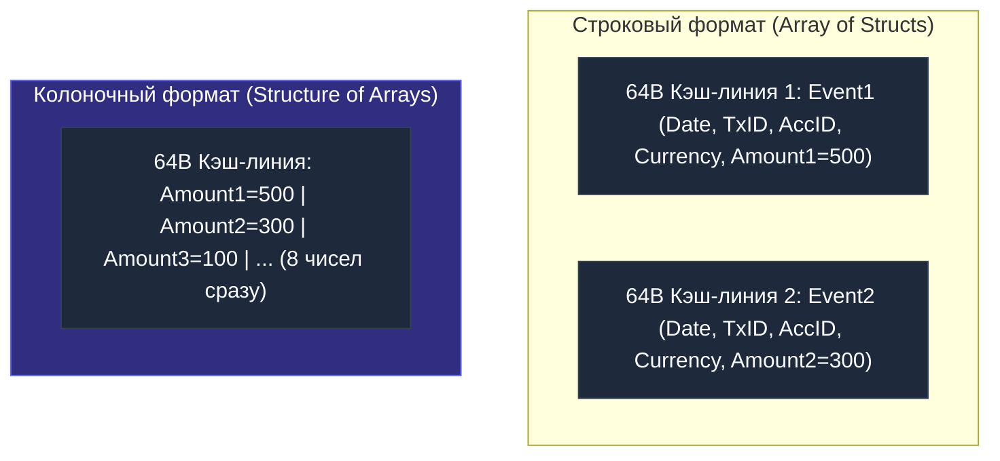
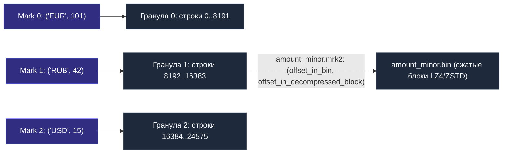

*Физика колоночного хранения и кэш-линий CPU, разреженный индекс по гранулам (`primary.idx` и `.mrk2`), кодеки сжатия, векторное исполнение и разбор `MergeTreeSimulator` из `project/step07/`.*

> «Go поощряет понимание устройства современных компьютеров — и прежде всего важности локальности данных в памяти. Его встроенные типы и большинство структур стандартной библиотеки спроектированы так, чтобы естественно работать без явной инициализации и скрытых конструкторов, поэтому в коде спрятано сравнительно мало лишних аллокаций и записей в память. Составные типы Go (структуры и массивы) хранят элементы напрямую, требуя меньше памяти, меньше выделений и меньше переходов по указателям, чем языки с косвенными полями.»  
> — Алан Донован и Брайан Керниган, *The Go Programming Language*

В главе [[11. ClickHouse — аналитическая OLAP-база для миллиардов строк]] мы описали схему `LedgerPulse` на ClickHouse и увидели, почему поколоночная модель быстрее строковой при агрегации миллиардов строк. Теперь опустимся на уровень байтов, кэш-линий процессора и системных вызовов: посмотрим, какие файлы лежат внутри каталога части `MergeTree`, как работает разреженный индекс с гранулами по 8 192 строки, почему сжатие *ускоряет* чтение и как тот же колоночный принцип реализован на чистом Go в `project/step07/cache_olap.go`.

---

## Локальность данных и кэш-линии процессора

Чтобы понять скорость ClickHouse, сравним иерархию задержек современного сервера:
* Кэш L1 процессора: ~1 нс;
* Кэш L2: ~4 нс;
* Оперативная память (RAM): ~100 нс;
* Последовательное или точечное чтение с NVMe SSD: ~100 мкс (в 1 000 раз медленнее RAM);
* Случайный поиск на HDD: ~10 мс (в 100 000 раз медленнее RAM).

Процессор никогда не читает из RAM по одному байту или одному полю структуры: контроллер памяти всегда подтягивает в кэш целую **кэш-линию размером 64 байта**.

Допустим, в памяти лежит строковый массив структур (**AoS — Array of Structs**), как при чтении кортежей в OLTP-базе: одна запись `LedgerEvent` занимает 64 байта, из которых 8 байт — нужное нам поле `AmountMinor`, а остальные 56 байт — даты, идентификаторы, строковые заголовки. Когда цикл суммирует `AmountMinor`, в каждую 64-байтную кэш-линию L1 попадает **только одно полезное число**, а 87.5% пропускной способности шины памяти тратится впустую.

В поколоночном формате (**SoA — Structure of Arrays**) все значения `AmountMinor` (`int64`, по 8 байт) лежат в непрерывном массиве подряд. Одна кэш-линия L1 сразу приносит **8 последовательных сумм**, а аппаратный префетчер процессора заранее подгружает следующие линии до того, как ядро до них доберётся.



---

## Внутреннее устройство `MergeTree`: парты, гранулы и метки

Когда Go-сервис отправляет батч через `PrepareBatch` в таблицу `ledgerpulse.ledger_events`, ClickHouse сортирует строки этого батча в памяти согласно выражению `ORDER BY (currency, account_id, created_at, transaction_id)` и записывает на диск новую неизменяемую директорию — **парт (Part)**.

Внутри широкого (wide) формата парта лежат такие файлы:
* `<col>.bin` — сжатые блоки колонки (обычно блоками от 64 КБ до 1 МБ до сжатия);
* `<col>.mrk2` — файл меток (**marks**), задающий отображение логических гранул на физические байты;
* `primary.idx` — разреженный первичный индекс;
* `minmax_event_date.idx` — минимальное и максимальное значение ключа партиционирования;
* `count.txt` — общее число строк в парте.

### Гранулы (`index_granularity = 8192`) и поиск по `primary.idx`

Таблица логически разрезана на **гранулы (granules)** по `index_granularity = 8192` строк (именно эта настройка указана в `project/sql/clickhouse/001_ledger_events.sql`). В отличие от B-Tree в PostgreSQL, файл `primary.idx` не содержит указателей на каждую строку. В нём сохраняется значение ключа сортировки **только для первой строки каждой гранулы** (строки 0, 8192, 16384 и так далее).



Для таблицы на 1 миллиард строк при шаге 8 192 в `primary.idx` окажется всего около 122 070 записей — несколько мегабайт, которые полностью помещаются в RAM.

Как отрабатывает запрос `SELECT sum(amount_minor) FROM ledgerpulse.ledger_events WHERE currency = 'RUB' AND account_id = 42`?
1. По `minmax`-индексу партиций отсекаются ненужные месяцы (если в `WHERE` есть `event_date`).
2. Движок делает бинарный поиск по `primary.idx` в оперативной памяти и находит узкий диапазон номеров гранул, в которых может встречаться пара `('RUB', 42)`. Остальные 99% гранул вообще не читаются с диска (**granule pruning**).
3. Для найденных номеров гранул движок заглядывает только в файлы `currency.mrk2`, `account_id.mrk2` и `amount_minor.mrk2`. Каждая метка хранит пару смещений: `(позиция сжатого блока в .bin, смещение начала гранулы внутри распакованного блока)`.
4. ClickHouse через `pread` забирает с NVMe только нужные сжатые куски трёх колоночных файлов, распаковывает их в память и фильтрует внутри отобранных гранул.

### Фоновые слияния партов (Background Merges)

Каждый `INSERT` порождает отдельный парт. Если партов становится много, каждому `SELECT` приходится проверять десятки независимых файлов `primary.idx`, а производительность чтения падает. Поэтому в фоне работают потоки слияния: они берут несколько соседних небольших партов внутри одной партиции, выполняют многопутевое слияние отсортированных потоков (**k-way merge sort**), формируют один укрупнённый парт и атомарно переключают активное множество партов, удаляя старые файлы. Читатели не блокируются: начавший работу запрос дочитывает свой снимок партов, пока новые парты готовятся в фоне.

> [!warning] Ловушка: Лимит партов (`Too many parts`)
> По умолчанию ClickHouse разрешает не более 300 активных неслитых партов в одной партиции (`parts_to_throw_insert = 300`, замедление начинается раньше — со 150 партов). Если Go-сервис или десяток воркеров шлют микроскопические `INSERT` каждую миллисекунду, фоновые потоки слияния не успевают склеивать файлы, и база начинает возвращать ошибку `Too many parts (301). Merges are processing significantly slower than inserts`. Лекарство одно — агрегировать события в батчи по 10 000–100 000 строк на стороне Go или буфера перед вставкой.

---

## Сжатие и векторное исполнение

Кажется парадоксом, но **сжатие колонок на CPU не замедляет, а ускоряет аналитические запросы**. Пропускная способность шины памяти и ядер современного CPU при декомпрессии `LZ4` достигает нескольких гигабайт в секунду *на одно ядро*, тогда как дисковая подсистема и PCIe ограничены гораздо сильнее. Прочитать с диска 150 МБ в `LZ4` и распаковать их в кэше L2/L3 быстрее, чем прочитать 1 ГБ несжатых данных.

Помимо универсальных `LZ4` и `ZSTD`, для числовых колонок применяют специализированные кодеки:
* **`Delta` и `DoubleDelta`** — вместо 8-байтного числа `DateTime64` пишется только разница (или вторая производная разницы) между соседними строками, которая умещается в 1–2 байта;
* **`Gorilla`** — XOR-сжатие для плавающих чисел `Float64`, где соседние значения меняются плавно;
* **`LowCardinality`** — словарное кодирование для повторяющихся строк вроде `currency` или `kind`.

Вторая составляющая скорости — **векторное исполнение запросов (Vectorized Query Execution)**. В классической модели Volcano (PostgreSQL, MySQL) каждый узел плана вызывает виртуальный метод `Next()` по одной строке: миллион строк означает миллион косвенных вызовов, переключение контекста внутри интерпретатора выражений и постоянные промахи предсказателя переходов CPU (`branch misprediction`). ClickHouse оперирует блоками по 8 192–65 536 значений: фильтр или арифметическая операция (`abs(amount_minor)`) прокручивается в плоском C++-цикле по смежному массиву, который компилятор разворачивает в векторные SIMD-инструкции (`SSE 4.2`, `AVX2`, `AVX-512`), обрабатывающие по 4–16 чисел за один такт процессора.

---

## Разбор на практике: `MergeTreeSimulator` в `project/step07/`

В учебном репозитории проекта `LedgerPulse` (`project/step07/cache_olap.go` и `cache_olap_test.go`) модель колоночного движка `MergeTree` сведена к прозрачной реализации на Go 1.24. Разберём её построчно, чтобы увидеть, как идеи ClickHouse выражаются на уровне структур памяти Go.

Сравните строковую структуру входного события `OLAPEvent` и колоночную структуру части `ColumnPart`:

```go
// Строковое представление одного события (удобно для API и батча)
type OLAPEvent struct {
	Day       string
	Currency  string
	AccountID uint64
	Amount    int64
}

// Колоночное представление части (Structure of Arrays): каждая колонка — отдельный слайс
type ColumnPart struct {
	Days       []string
	Currencies []string
	AccountIDs []uint64
	Amounts    []int64
}
```

Ключевые методы `MergeTreeSimulator` повторяют три базовые операции настоящего движка:

1. **Пакетная вставка с сортировкой (`InsertBatch`).** Когда приходит срез `events`, симулятор не добавляет строки по одной в общий массив. Он клонирует батч, сортирует его по ключу `(Currency, AccountID)` через `slices.SortFunc`, раскладывает данные по четырём независимым слайсам в новый иммутабельный `ColumnPart` и добавляет его в список частей `m.parts`:

```go
func (m *MergeTreeSimulator) InsertBatch(events []OLAPEvent) {
	if len(events) == 0 {
		return
	}
	part := buildColumnPart(events) // внутри: slices.Clone + slices.SortFunc по (Currency, AccountID)

	m.mu.Lock()
	m.parts = append(m.parts, part)
	m.mu.Unlock()
}
```

2. **Фоновое слияние частей (`CompactParts`).** Когда мелких частей накопилось несколько, `CompactParts` собирает строки из всех активных `ColumnPart`, пересортировывает их в единую укрупнённую часть и заменяет срез `m.parts` одним элементом:

```go
func (m *MergeTreeSimulator) CompactParts() int {
	m.mu.Lock()
	defer m.mu.Unlock()
	if len(m.parts) <= 1 {
		return len(m.parts)
	}
	var all []OLAPEvent
	for _, p := range m.parts {
		for i := range p.Amounts {
			all = append(all, OLAPEvent{
				Day:       p.Days[i],
				Currency:  p.Currencies[i],
				AccountID: p.AccountIDs[i],
				Amount:    p.Amounts[i],
			})
		}
	}
	part := buildColumnPart(all)
	m.parts = []ColumnPart{part}
	return len(m.parts)
}
```

3. **Колоночное чтение без лишнего I/O (`SumByCurrency`).** При подсчёте оборота по валюте метод обращается **только к двум слайсам** — `p.Currencies` и `p.Amounts`. Поля `p.Days` и `p.AccountIDs` вообще не попадают в кэш процессора:

```go
func (m *MergeTreeSimulator) SumByCurrency(currency string) int64 {
	m.mu.Lock()
	defer m.mu.Unlock()
	var sum int64
	for _, p := range m.parts {
		for i, c := range p.Currencies {
			if c == currency {
				sum += p.Amounts[i]
			}
		}
	}
	return sum
}
```

Проверим работу симулятора тестом `TestSingleflightCacheAndMergeTree` из `project/step07/cache_olap_test.go`, где в две вставки попадают события по `RUB` и `USD`, затем вызывается `CompactParts()` (сворачивающий 2 части в 1) и `SumByCurrency("RUB")` возвращает `1000`:

```text
$ go test -v ./step07/...
=== RUN   TestSingleflightCacheAndMergeTree
--- PASS: TestSingleflightCacheAndMergeTree (0.02s)
PASS
ok  	github.com/UnrealTemplier/go-textbook-v2-vol2/project/step07	0.017s
```

Важно честно видеть границу между учебным симулятором и промышленным движком ClickHouse:
* В `CompactParts()` используется полная сортировка пересобранного массива вместо потокового **k-way merge sort** (который в ClickHouse сливает уже отсортированные части за линейное время без удвоения всей памяти на сортировку).
* В `ColumnPart` пока нет **разреженного индекса гранул (`primary.idx`)**, поэтому `SumByCurrency` сканирует весь слайс `p.Currencies` целиком вместо бинарного поиска гранулы (во втором упражнении ниже вы сами устраните это ограничение).
* Нет словарного кодирования (`LowCardinality`) и сжатия `LZ4`/`Delta`, а также отдельного гранульного разбиения на диске.

> [!tip] Собеседование [Senior/Staff]
> **Вопрос:** В `001_ledger_events.sql` таблица `ledger_events` имеет `ORDER BY (currency, account_id, created_at, transaction_id)`. Что произойдёт с I/O при запросе `SELECT sum(amount_minor) FROM ledgerpulse.ledger_events WHERE account_id = 42` без указания `currency`?
>
> **Ответ:** Индекс пропуска гранул по `primary.idx` станет почти бесполезным. По правилу левого префикса отсортированного ключа `account_id = 42` встречается внутри **каждой** валюты (`EUR`, `RUB`, `USD`...), разбросанных по разным участкам парта. Движку придётся прочитать колонку `account_id.bin` почти целиком (если не настроен вторичный skipping index вроде `bloom_filter` или дополнительная `PROJECTION` с порядком `(account_id, created_at)`). Поэтому порядок колонок в `ORDER BY` всегда выстраивают от самых частых предикатов фильтрации (и от меньшей кардинальности к большей при совместном использовании) к более детальным полям сортировки.

---

## Упражнения

1. **Базовое.** В таблице `ledgerpulse.ledger_events` накопилось 2 миллиарда строк, размер `index_granularity` равен 8 192. В `ORDER BY (currency, account_id, created_at, transaction_id)` значения занимают в среднем: `currency` — 3 байта, `account_id` — 8 байт, `created_at` — 8 байт, `transaction_id` — 8 байт. Оцените ориентировочный размер разреженного индекса `primary.idx` в оперативной памяти (без учёта заголовков) и сравните его с B-Tree индексом на каждую строку.

> [!solution] Показать решение
> 1. **Число гранул:** $2 \times 10^9 / 8192 \approx 244\,141$ гранулы (индексных засечек).
> 2. **Размер одной засечки:** $3 + 8 + 8 + 8 = 27$ байт.
> 3. **Размер `primary.idx`:** $244\,141 \times 27 \approx 6.59$ МБ.
>
> Весь первичный индекс таблицы на 2 миллиарда строк занимает **меньше 7 мегабайт** и без труда живёт в RAM. Для сравнения: классический B-Tree индекс в PostgreSQL по тем же четырём полям на 2 миллиарда строк с учётом заголовков кортежей и указателей страниц занял бы порядка **100+ гигабайт**.

2. **Практическое.** Модифицируйте модель `MergeTreeSimulator` из `project/step07/cache_olap.go`: добавьте в `ColumnPart` разреженный индекс `Marks []string` с размером гранулы `granuleSize = 4` (индекс хранит первое значение `Currency` каждой гранулы) и реализуйте метод `SumByCurrencyIndexed(currency string) int64`, который с помощью бинарного поиска (`slices.BinarySearch` или `sort.Search`) находит диапазон подходящих гранул и сканирует только их вместо полного обхода `p.Currencies`.

> [!solution] Показать решение
> ```go
> package step07
>
> import "sort"
>
> const granuleSize = 4
>
> type IndexedColumnPart struct {
> 	ColumnPart
> 	Marks []string // Разреженный индекс: Currency первой строки каждой гранулы
> }
>
> func BuildIndexedPart(events []OLAPEvent) IndexedColumnPart {
> 	base := buildColumnPart(events)
> 	var marks []string
> 	for i := 0; i < len(base.Currencies); i += granuleSize {
> 		marks = append(marks, base.Currencies[i])
> 	}
> 	return IndexedColumnPart{ColumnPart: base, Marks: marks}
> }
>
> // SumByCurrencyIndexed отсекает неподходящие гранулы по разреженному индексу.
> func SumByCurrencyIndexed(parts []IndexedColumnPart, currency string) int64 {
> 	var sum int64
> 	for _, p := range parts {
> 		if len(p.Marks) == 0 {
> 			continue
> 		}
> 		// Ищем первую гранулу, в которой уже может встречаться currency:
> 		// первая гранула с Marks[g] >= currency могла не включать начало серии,
> 		// поэтому стартуем с g - 1 (если g > 0), где Marks[g-1] < currency.
> 		g := sort.Search(len(p.Marks), func(i int) bool {
> 			return p.Marks[i] >= currency
> 		})
> 		startGranule := max(0, g-1)
>
> 		for gi := startGranule; gi < len(p.Marks); gi++ {
> 			// Если начало следующей гранулы уже строго больше искомой валюты, дальше значений нет.
> 			if p.Marks[gi] > currency {
> 				break
> 			}
> 			startRow := gi * granuleSize
> 			endRow := min(len(p.Currencies), startRow+granuleSize)
> 			for i := startRow; i < endRow; i++ {
> 				if p.Currencies[i] == currency {
> 					sum += p.Amounts[i]
> 				}
> 			}
> 		}
> 	}
> 	return sum
> }
> ```
> Обратите внимание на тонкий момент разреженного индекса: если `RUB` началась внутри гранулы `0` (где `Marks[0] = "EUR"`), а `Marks[1] = "RUB"` или `"USD"`, бинарный поиск по `>= "RUB"` вернёт индекс `1`, поэтому мы обязаны начать чтение с `g - 1` (гранулы `0`), иначе потеряем хвост предыдущей гранулы. Именно так устроен поиск диапазона гранул в настоящем `MergeTree`.

3. **Со звёздочкой (\*).** Сравните два ключа сортировки из `project/sql/clickhouse/001_ledger_events.sql`:
   - В сырой таблице `ledger_events`: `ORDER BY (currency, account_id, created_at, transaction_id)`.
   - В витрине `daily_turnover`: `ORDER BY (event_date, currency, account_id)`.
   Почему у сырой таблицы на первом месте стоит `currency`, а у витрины `daily_turnover` — `event_date`, и какие два следствия возникнут, если при текущей схеме `ledger_events` массово пойдут аналитические запросы вида `WHERE created_at >= now() - INTERVAL 1 HOUR` (без `currency` и `event_date`)?

> [!solution] Показать решение
> 1. **Почему разные ключи:**
>    - В `ledger_events` таблица уже партиционирована по месяцу (`PARTITION BY toYYYYMM(event_date)`). Постановка низкокардинального поля `currency` на первое место внутри месяца позволяет `primary.idx` сгруппировать все строки одной валюты и одного счёта в непрерывный диапазон на диске — идеально для расчёта выписки по счёту в конкретной валюте.
>    - В `daily_turnover` основная масса дашбордов строит графики за последние $K$ дней по всем валютам и счетам, поэтому `event_date` на первом месте позволяет по `primary.idx` моментально вырезать срез за последние сутки, а не сканировать весь месяц по всем валютам.
> 2. **Последствия фильтрации только по `created_at` в `ledger_events`:**
>    - Во-первых, в запросе отсутствует `event_date`, поэтому ClickHouse не сможет отсечь даже ненужные месячные партиции (если не включена оптимизация через `minmax` или пользователь явно не передал `event_date >= toDate(...)`), хотя за один час могли бы читаться данные только текущего дня.
>    - Во-вторых, `created_at` стоит на третьей позиции в `ORDER BY`. Внутри текущего месяца пары `(currency, account_id)` повторяются для тысяч счетов, и строки за последний час **разбросаны** по всем гранулам всего парта. Бинарный поиск по `primary.idx` не отсечёт ни одной гранулы — ClickHouse прочитает весь месячный парт целиком. Решение: либо вынести `toStartOfHour(created_at)` или `event_date` выше в `ORDER BY` (если частые запросы строятся по времени), либо добавить в `ledger_events` пропускающий индекс `INDEX idx_created_at created_at TYPE minmax GRANULARITY 1`, позволяющий пропустить гранулы с устаревшими таймстемпами.

---

Мы рассмотрели оба класса специализированных колоночных систем: оперативную **Cassandra** (для линейного масштабирования записи и точечных чтений по партициям) и аналитический **ClickHouse** (для поколоночного сканирования миллиардов строк с векторной обработкой). В мире распределённых данных остаётся ещё один важный вопрос: можно ли объединить привычный реляционный SQL и строгие ACID-транзакции с горизонтальным масштабированием без единой точки отказа в стиле NoSQL? В следующей главе мы перейдём к классу **NewSQL** и разберём архитектуру **CockroachDB** поверх протокола консенсуса **Raft**.
