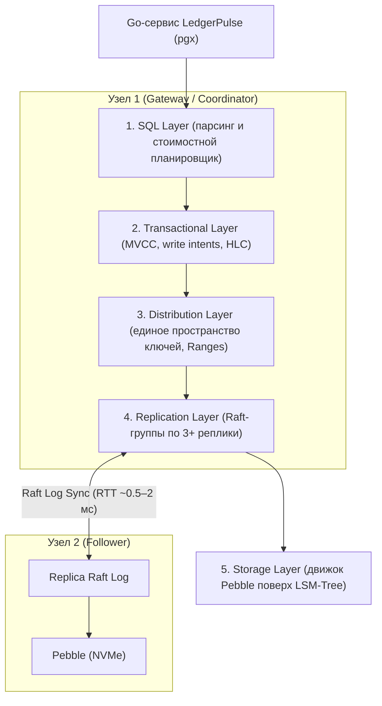

*Как устроены распределённые SQL-базы: архитектура CockroachDB, отображение таблиц на LSM-ключи, консенсус Raft, гибридные логические часы и повторы транзакций в Go*

> «Любая функция ввода-вывода обязана считаться с вероятностью сбоя, и лишь наивный программист верит, что простое чтение или запись не могут завершиться ошибкой. Именно тогда, когда внезапно отказывают самые надёжные операции, нам нужнее всего знать почему.»  
> — Алан Донован и Брайан Керниган, *The Go Programming Language*

Инженерная команда `LedgerPulse` столкнулась с потолком вертикального масштабирования: один первичный узел PostgreSQL перестал справляться с пиковым потоком проводок. Разнесение счетов по разным серверам с помощью ручного шардирования ([[4. Шардирование (Sharding) — ключи, консистентное хеширование и перебалансировка]]) мгновенно породило другую проблему: межаккаунтный перевод между счётом `#10` на первом шарде и счётом `#9000` на втором потребовал координации на уровне приложения или тяжёлого двухфазного коммита ([[9. Двухфазный коммит (2PC) — протокол, блокировки и отказ координатора]]). Переход на классический NoSQL вроде Cassandra ([[9. Колоночные NoSQL — Apache Cassandra и моделирование от запросов]]) решает задачу линейного роста записи, но ценой отказа от реляционной схемы, `JOIN` и строгой транзакционной изоляции ([[1. Зачем появился NoSQL — компромиссы за пределами реляционной модели]]).

Класс систем **NewSQL** родился как попытка преодолеть этот раскол: сохранить декларативный SQL, строгие гарантии `ACID` и уровень изоляции `Serializable`, но распределить хранение и вычисления по кластеру обычных серверов так же эластично, как в Key-Value или колоночных движках. Наиболее яркий представитель этого семейства — **CockroachDB (CRDB)**, говорящая с приложением на привычном сетевом протоколе PostgreSQL, но устроенная внутри как единое распределённое и отсортированное Key-Value хранилище.

---

## Зачем нужен NewSQL: от Google Spanner к CockroachDB

В 2012 году исследователи Google опубликовали статью о **Spanner** — глобально распределённой базе данных, которая обеспечивала внешнюю согласованность и распределённые транзакции поверх шардов с репликацией Paxos. Главным секретом Spanner стал сервис времени **TrueTime**, опиравшийся на атомные часы и GPS-приёмники в каждом дата-центре Google, что позволяло ограничивать рассинхронизацию часов между серверами единицами миллисекунд.

В 2014 году бывшие инженеры Google Спенсер Кимболл, Питер Маттис и Бен Дарнелл запустили открытый проект **CockroachDB** с целью перенести архитектуру Spanner на стандартное серверное железо без специализированных атомных часов. Название («Таракан») подчёркивало главную цель проектирования — выживаемость кластера при внезапной потере отдельных дисков, серверов или целых зон доступности. По теореме **CAP/PACELC** ([[7. CAP и PACELC в выборе баз данных]]) система выбирает модель **CP/PC**: при сетевом разделении она защищает согласованность ценой отказа меньшинства, а в штатном режиме платит за консенсус сетевой задержкой.

---

## Слоеный пирог: пять уровней архитектуры CockroachDB

В отличие от монолитного процесса PostgreSQL ([[1. Архитектура PostgreSQL — процессы, общая память и бэкенды]]), где парсер SQL и менеджер страниц разделяют общую память на одной машине, каждый узел CockroachDB симметричен и состоит из пяти чётких слоёв. Любой узел способен принять подключение клиента и выступить **координатором (Gateway Node)** для запроса, даже если нужные данные физически хранятся на других машинах кластера.



Разберём ответственность каждого слоя:

1. **SQL Layer** — поддерживает wire-протокол PostgreSQL (порт по умолчанию `26257`), выполняет лексический анализ, строит логический план, применяет стоимостной оптимизатор и распределённо исполняет операции (включая векторное исполнение и распределённый `JOIN`).
2. **Transactional Layer** — обеспечивает атомарность и изоляцию транзакций, затрагивающих произвольное число ключей на разных узлах. Здесь создаются временные намерения записи (`write intents`), разрешаются конфликты блокировок и назначаются временные метки.
3. **Distribution Layer** — представляет всю базу данных как единый отсортированный массив пар «ключ — значение», нарезанный на смежные куски — **диапазоны (Ranges)** размером по умолчанию до 512 МиБ. Для быстрого поиска нужного узла поддерживаются системные мета-диапазоны (`meta1` и `meta2`).
4. **Replication Layer** — объединяет реплики каждого `Range` (обычно 3 или 5 на разных узлах и в разных стойках) в независимую консенсусную группу **Raft**. Запись подтверждается только после сохранения в журнал большинства участников (кворума). На один из узлов группы назначается **Leaseholder** — держатель временной аренды, через которого проходят чтения без лишнего сетевого кворума. *(Подробную механику выбора лидера, термов и защиты от split-brain в Raft см. в Томе 4, раздел о распределённом консенсусе.)*
5. **Storage Layer** — локальный движок **Pebble**, написанный на Go по принципам RocksDB. Он хранит отсортированные ключи в **LSM-дереве** (`Memtable` в памяти + `WAL` + `SSTable` на NVMe; устройство LSM подробно разобрано в [[2. Key-Value хранилища — от хеш-таблиц в памяти до LSM-деревьев]]).

---

## Локальность данных: как SQL-таблицы превращаются в ключи

Внутри CockroachDB нет привычных файлов кучи (Heap) и 8-килобайтных страниц PostgreSQL. Все таблицы, вторичные индексы и системные каталоги отображаются в единое лексикографически отсортированное пространство байтовых ключей:

* **Ключ:** `/TableID/IndexID/PrimaryKeyColumns.../ColumnFamilyID`
* **Значение:** закодированные значения столбцов семейства (`ColumnFamily`) с суффиксом MVCC-метки времени.

Возьмём таблицу счетов `accounts` из `LedgerPulse`: допустим, у неё `TableID = 104`, первичный индекс `IndexID = 1`, и мы сохраняем строку `id = 10, currency = 'RUB', balance_minor = 50000`. В слое хранения это превратится в запись примерно такого вида:

```text
Key:   /104/1/10/0  -> Value: [currency='RUB', balance_minor=50000] @ ts=1732419200.000000000,0
Key:   /104/1/11/0  -> Value: [currency='USD', balance_minor=12000] @ ts=1732419201.000000000,0
```

Из этой физической раскладки следуют три важных инженерных вывода:

1. **Последовательные диапазонные сканы.** Ключи отсортированы байт за байтом, поэтому запрос `WHERE id BETWEEN 100 AND 200` превращается в один последовательный проход по смежным блокам `SSTable` на диске NVMe (~100 мкс на чтение блока из хранилища при промахе мимо блочного кэша в RAM, где доступ стоит ~100 нс), а не в сотни случайных прыжков по кластеру.
2. **Вторичный индекс — это тоже пары KV.** Индекс по `currency` просто создаёт ключи с другим `IndexID`, например `/104/2/'RUB'/10`, где в значении лежит ссылка на первичный ключ (или включённые столбцы `STORING`).
3. **Автоматический Split и Rebalance.** Когда диапазон `Range` разрастается сверх 512 МиБ или нагрузка по QPS на него превышает порог, слой распределения делит диапазон по медианному ключу пополам (`Range Split`) и переносит одну из реплик (или переводит `Leaseholder`) на менее нагруженный сервер.

---

## Согласованность, HLC и цена строгого Serializable

В PostgreSQL по умолчанию действует уровень `Read Committed`, и защита от фантомов или аномалии `Write Skew` ([[4. Аномалии — Dirty Read, Phantom Read, Lost Update и Write Skew]]) требует явного повышения изоляции или блокировок. CockroachDB работает исключительно на уровне **`Serializable`** — самом строгом уровне стандарта SQL ([[3. Read Committed, Repeatable Read и Serializable]]).

Для упорядочения событий без атомных часов TrueTime используется **Hybrid Logical Clock (HLC)** — пара `(physical_time, logical_counter)`. Физическая часть берётся от локальных часов ОС (синхронизируемых по NTP/Chrony), а логический счётчик гарантирует монотонность при одновременных событиях или передаче сообщений между узлами: если узел А с часами `10:00:00.100` получает сообщение с меткой `10:00:00.150`, он немедленно подтягивает свои логические часы вперёд.

Однако у серверов в кластере всегда есть допустимый предел расхождения физических часов — параметр `max_offset` (по умолчанию `500 мс`). Если транзакция `T1` читает данные на метке `t_read`, а на диске обнаруживается версия, записанная в интервале неопределённости `(t_read, t_read + max_offset]`, система не может гарантировать, какая транзакция произошла раньше в реальном времени. В этот момент транзакция выполняет **Read Restart** (поднимает свою временную метку чтения и пытается выполниться заново), а при невозможности прозрачного сдвига возвращает клиенту ошибку сериализации.

> [!info] Под капотом: Write Intents и Parallel Commits
> Чтобы не держать дорогой двухфазный коммит с двумя полными сетевыми проходами (RTT), CockroachDB использует оптимизацию **Parallel Commits**: координатор записывает специальную запись состояния транзакции (Transaction Record в статусе `STAGING`) одновременно с записью всех временных намерений (`write intents`) в задействованные `Ranges`. Как только оба действия подтверждены кворумом Raft, транзакция считается зафиксированной за один сетевой раунд до кворума (~0.5–2 мс внутри одной зоны доступности, ~30–100 мс между континентами).

---

## Практика в Go 1.24: клиентский цикл повторов

Поскольку CockroachDB поддерживает протокол PostgreSQL, к нему подключаются стандартным драйвером `pgx/v5`. Однако привычный код без повторов сломается под конкурентной нагрузкой: при конфликте двух транзакций или выходе за окно неопределённости HLC база откатит одну из них с кодом **`SQLSTATE 40001`** (`serialization_failure`).

```go
package main

import (
	"context"
	"errors"
	"fmt"
	"log"
	"math/rand/v2"
	"time"

	"github.com/jackc/pgx/v5"
	"github.com/jackc/pgx/v5/pgconn"
	"github.com/jackc/pgx/v5/pgxpool"
)

func transferWithRetry(ctx context.Context, pool *pgxpool.Pool, fromID, toID, amountMinor int64) error {
	const maxAttempts = 5
	for attempt := 0; attempt < maxAttempts; attempt++ {
		err := runTx(ctx, pool, func(tx pgx.Tx) error {
			// Запрос затрагивает два счёта, которые могут лежать в разных Range и на разных узлах.
			tag, err := tx.Exec(ctx,
				`UPDATE accounts SET balance_minor = balance_minor - $1
				 WHERE id = $2 AND balance_minor >= $1`,
				amountMinor, fromID)
			if err != nil {
				return err
			}
			if tag.RowsAffected() == 0 {
				return errors.New("недостаточно средств или счёт не найден")
			}
			_, err = tx.Exec(ctx,
				`UPDATE accounts SET balance_minor = balance_minor + $1 WHERE id = $2`,
				amountMinor, toID)
			return err
		})
		if err == nil {
			return nil
		}
		if !isRetryable40001(err) {
			return err // Нарушение CHECK/FK или нехватка баланса повторять бессмысленно.
		}
		backoff := time.Duration(10*(1<<attempt)) * time.Millisecond
		jitter := time.Duration(rand.IntN(15)) * time.Millisecond
		log.Printf("attempt=%d: sqlstate=40001, retry after %v", attempt+1, backoff+jitter)
		select {
		case <-time.After(backoff + jitter):
		case <-ctx.Done():
			return ctx.Err()
		}
	}
	return fmt.Errorf("транзакция не зафиксирована после %d попыток", maxAttempts)
}

func runTx(ctx context.Context, pool *pgxpool.Pool, fn func(pgx.Tx) error) error {
	tx, err := pool.BeginTx(ctx, pgx.TxOptions{IsoLevel: pgx.Serializable})
	if err != nil {
		return err
	}
	if err := fn(tx); err != nil {
		_ = tx.Rollback(ctx)
		return err
	}
	return tx.Commit(ctx)
}

func isRetryable40001(err error) bool {
	var pgErr *pgconn.PgError
	return errors.As(err, &pgErr) && pgErr.Code == "40001"
}
```

Для продакшена вместо ручного цикла можно подключить официальный хелпер `crdbpgx.ExecuteTx` из пакета `github.com/cockroachdb/cockroach-go/v2/crdb/crdbpgx`, который вдобавок использует оптимизацию с точками сохранения `SAVEPOINT cockroach_restart` для сокращения сетевых пересылок.

При конкурентном запуске двух переводов с одного счёта вывод сервиса выглядит так:

```text
2026/11/24 04:20:11 worker-A: commit ok (1.84ms)
2026/11/24 04:20:11 worker-B: attempt=1: sqlstate=40001, retry after 17ms
2026/11/24 04:20:11 worker-B: commit ok (2.11ms)
```

> [!warning] Ловушка: побочные эффекты внутри повторяемого замыкания
> Замыкание, передаваемое в `runTx`, может исполниться два, три или пять раз. Никогда не отправляйте внутри него HTTP-вызовы во внешний платёжный шлюз, не публикуйте события в брокер и не накапливайте значения во внешних слайсах без сброса. Для согласованной публикации событий опирайтесь на транзакционный Outbox в той же БД (подробнее паттерн Outbox со стороны сервисной архитектуры см. в Томе 3).

---

## Когда выбирать CockroachDB и какие у неё границы

> [!tip] Собеседование [Senior/Staff]
> **Вопрос:** Почему для первичного ключа высоконагруженной таблицы в CockroachDB плохи как классический монотонный `SERIAL / INT8`, так и наивный переход на случайный `UUIDv4` без оговорок, и как решают эту дилемму?  
> **Ответ:** Монотонный автоинкремент (`SERIAL`) при высокой частоте вставок направляет все новые строки строго в последний «правый» `Range`, создавая горячую точку (hotspot) на одном узле-Leaseholder и сводя на нет горизонтальное масштабирование записи. Напротив, полностью случайный `UUIDv4` (или `gen_random_uuid()`) равномерно размазывает вставки по всему кластеру, но разрушает локальность данных: каждый новый батч затрагивает десятки разных `SSTable` и вытесняет горячие страницы из `Block Cache` в Pebble, повышая Write Amplification. В CockroachDB применяют три рабочих приёма: 1) стандартный `UUIDv4` оправдан, когда важна пропускная способность вставок по всему кластеру и хватает RAM под кэш; 2) монотонный `unordered_unique_rowid()` (содержит время + ID узла) или `UUIDv7` дают локальность для последовательных выборок, если ID узла или хеш-префикс разносит нагрузку между серверами; 3) **Hash-sharded indexes** (`USING HASH`), которые добавляют перед монотонным ключом детерминированный хеш-бакет и расщепляют одну горячую точку на $N$ равномерно нагруженных диапазонов.

**CockroachDB оправдана, когда:**
* нужна единая реляционная база с `Serializable ACID`, переживающая падение целого дата-центра без ручного переключения мастера;
* требуется геораспределённое размещение строк (`LOCALITY REGIONAL BY ROW`), чтобы профили европейских пользователей хранились на серверах во Франкфурте, а азиатских — в Сингапуре по требованиям регуляторов;
* проект перерос один узел PostgreSQL, а поддержание логики ручного шардирования и распределённых транзакций в Go-коде дороже кластера NewSQL.

**CockroachDB не лучший выбор, когда:**
* весь проект умещается на одном мощном сервере PostgreSQL (задержка локального коммита на NVMe с кэшем записи или синхронной локальной репликой всегда ниже геораспределённого кворума Raft);
* нагрузка преимущественно аналитическая по миллиардам событий (здесь эффективнее колоночный OLAP вроде ClickHouse, см. [[11. ClickHouse — аналитическая OLAP-база для миллиардов строк]]).

---

## Упражнения

### Упражнение 1 (Базовое). Отображение строк `LedgerPulse` в KV-ключи
Таблица `ledger_entries` имеет `TableID = 108`, первичный ключ `PRIMARY KEY (account_id, created_at, id)` (`IndexID = 1`), и хранит три поля в одном семействе столбцов (`ColumnFamily = 0`): `amount_minor`, `direction`, `tx_id`. Запишите пример логического представления двух смежных ключей в слое Distribution Layer для `account_id = 42` и объясните, почему выборка истории операций одного счёта за последний месяц читается с диска последовательно.

> [!solution] Показать решение
> ```text
> Key: /108/1/42/2026-11-24T04:00:00Z/9001/0 -> Value: [amount_minor=1500, direction='DEBIT', tx_id=501]
> Key: /108/1/42/2026-11-24T04:05:12Z/9002/0 -> Value: [amount_minor=2400, direction='CREDIT', tx_id=502]
> ```
> Все ключи в Pebble отсортированы лексикографически. Поскольку `account_id` стоит первым компонентом ключа, а `created_at` — вторым, все проводки конкретного счёта за месяц лежат в одном узком непрерывном диапазоне (обычно внутри одного `Range` и одних и тех же файлов `SSTable`). Запрос `WHERE account_id = 42 AND created_at >= ...` сводится к операции `Seek` на начало диапазона и последовательному сканированию без прыжков по разным узлам.

### Упражнение 2 (Практическое). Диагностика и исправление цикла повторов
Посмотрите на фрагмент кода:
```go
func badDebit(ctx context.Context, pool *pgxpool.Pool, accID, amount int64) error {
	for i := 0; i < 3; i++ {
		tx, err := pool.Begin(ctx)
		if err != nil {
			return err
		}
		_, err = tx.Exec(ctx, "UPDATE accounts SET balance_minor = balance_minor - $1 WHERE id = $2", amount, accID)
		if err != nil {
			_ = tx.Rollback(ctx)
			continue
		}
		if err := tx.Commit(ctx); err == nil {
			return nil
		}
	}
	return errors.New("failed")
}
```
Найдите три ошибки в этом коде применительно к CockroachDB и исправьте его.

> [!solution] Показать решение
> 1. `continue` срабатывает на **любую** ошибку (например, на нарушение `CHECK (balance_minor >= 0)` или обрыв контекста), хотя повторять нужно только ошибки сериализации (`SQLSTATE 40001`).
> 2. Ошибка при `tx.Commit(ctx)` игнорируется и транзакция не откатывается (а цикл повторяется без экспоненциальной задержки и джиттера, провоцируя повторное столкновение).
> 3. Уровень изоляции не указан явно (`pgx.TxOptions{IsoLevel: pgx.Serializable}`); хотя в CRDB он и так `Serializable`, явная передача делает код самодокументируемым и совместимым со строгими тестами на PostgreSQL.
>
> Исправленная версия использует проверку `isRetryable40001(err)` из листинга урока, вызывает `_ = tx.Rollback(ctx)` перед повтором и добавляет задержку с джиттером перед следующей попыткой.

### Упражнение 3 (\*). Проектирование ключа для горячего счёта комиссий
В `LedgerPulse` каждый платёж пользователя зачисляет комиссию `100` минорных единиц на единый системный счёт `account_id = 1`. При потоке 20 000 переводов в секунду попытка обновлять строку `id = 1` в CockroachDB упрётся в непрерывные конфликты `40001` на одном ключе в одном `Range`. Предложите схему таблицы и способ записи комиссий, которые уберут горячую точку и сохранят строгую согласованность.

> [!solution] Показать решение
> Для распараллеливания записи используют шардирование счётчика на уровне схемы (split-balance / sub-buckets):
> ```sql
> CREATE TABLE fee_buckets (
>     account_id BIGINT NOT NULL,
>     bucket_id  INT2   NOT NULL, -- от 0 до 63
>     balance_minor BIGINT NOT NULL DEFAULT 0,
>     PRIMARY KEY (account_id, bucket_id)
> );
> ```
> Либо для append-only учёта комиссий в `ledger_entries` делают вставки с составным первичным ключом `(bucket_id, id)` или с `USING HASH`, где `bucket_id = rand.IntN(64)` размазывает 20 000 RPS на 64 независимых строки (около 312 обновлений/с на корзину) или на несколько `Range`. Итоговый баланс комиссионного счёта вычисляется запросом `SELECT SUM(balance_minor) FROM fee_buckets WHERE account_id = 1`, который при `Serializable` видит согласованный срез всех корзин.

---

Мы прошли путь от классических Key-Value и документных NoSQL до аналитического `ClickHouse` и распределённого SQL в `CockroachDB`. Однако все эти движки ищут точные значения, диапазоны или агрегаты по числам, строкам и датам. Когда в базе `LedgerPulse` нужно найти транзакции или правила комплаенса «близкие по смыслу», привычные `B-Tree` и `LSM-Tree` бессильны — на сцену выходят многомерные векторы и приближённые индексы: [[14. Векторные базы данных — HNSW, IVF и гибридный поиск]].
