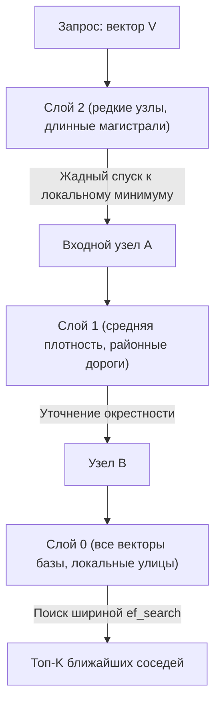

*Поиск смысла в многомерном пространстве: метрики расстояний, проклятие размерности, упор в пропускную способность памяти и SIMD, приближённые индексы IVF и HNSW, квантование PQ и гибридный поиск в pgvector из Go*

> «Go поощряет понимание устройства современных компьютеров — и прежде всего важности локальности данных в памяти. Составные типы Go (структуры и массивы) хранят элементы напрямую, требуя меньше памяти, меньше выделений и меньше переходов по указателям, чем языки с косвенными полями.»  
> — Алан Донован и Брайан Керниган, *The Go Programming Language*

Служба поддержки и антифрод-аналитики `LedgerPulse` ежедневно разбирают тысячи назначений платежей и обращений клиентов. Классические реляционные индексы (`B-Tree` и `Hash`) и даже полнотекстовый поиск PostgreSQL через `tsvector` ([[6. Полнотекстовый поиск (Full-Text Search) — tsvector, tsquery и pg_trgm]]) идеально находят точные совпадения и словоформы: запрос по слову `аренда` вернёт строки с `арендой` или `арендовать`. Но если клиент написал в назначении платежа «оплата квартиры за март», а аналитик ищет «жильё и коммунальные расходы», лексический индекс вернёт пустоту.

С развитием языковых и мультимодальных моделей научились переводить текст, изображения и поведенческие профили в **эмбеддинги (embeddings)** — плотные числовые векторы размерностью от 384 до 1536 и более компонент `float32`. Семантическая близость объектов превратилась в геометрическую близость точек в многомерном пространстве. Так возникла новая задача: найти $k$ ближайших соседей (**k-Nearest Neighbors, k-NN**) среди десятков миллионов векторов за единицы миллисекунд.

---

## Метрики близости и проклятие размерности

Прежде чем строить индекс, движок должен уметь измерять расстояние между двумя векторами $a$ и $b$ размерности $d$:

1. **Евклидово расстояние ($L_2$):** $\sqrt{\sum_{i=1}^d (a_i - b_i)^2}$. Измеряет прямую дистанцию между точками и учитывает длину (норму) векторов. В `pgvector` обозначается оператором `<->`.
2. **Косинусное расстояние (Cosine Distance):** $1 - \frac{a \cdot b}{\|a\|\|b\|}$. Сравнивает только угол между направлениями и не зависит от масштаба длины. Это стандарт для текстовых эмбеддингов. Оператор в `pgvector` — `<=>`.
3. **Отрицательное скалярное произведение (Negative Inner Product):** $-(a \cdot b) = -\sum_{i=1}^d a_i b_i$. Быстрее косинуса, поскольку не тратит время на деление на нормы. Если векторы заранее нормализованы до единичной длины ($\|v\| = 1$), сортировка по скалярному произведению математически совпадает с косинусным сходством. Оператор в `pgvector` — `<#>`.

Почему для многомерных векторов не работают привычные пространственные деревья вроде `k-d tree` или `R-Tree` ([[8. PostGIS — геопространственные данные и R-Tree поверх GiST]])? Причина — **проклятие размерности (Curse of Dimensionality)**. В 2D- или 3D-пространстве (координаты на карте) прямоугольник отсекает 99% лишних точек. Но при росте размерности $d$ до сотен и тысяч измерений объём многомерного пространства взрывается экспоненциально, а расстояния между любыми двумя случайными точками начинают выравниваться. Отношение дистанции до ближайшего соседа и до самого дальнего стремится к единице, поэтому уже при $d > 20$ пространственные деревья вынуждены просматривать почти все ветви и деградируют до полного перебора.

---

## Физика железа: SIMD и стена памяти (Memory Wall)

Допустим, в базе `LedgerPulse` накоплено $10^7$ векторов размерностью $d = 1536$ (`float32`, 4 байта на элемент). Один вектор занимает $1536 \times 4 = 6144$ байта (6 КиБ), а весь массив — около **57,2 ГиБ**.

Чтобы выполнить точный перебор (**Flat Search / Exact k-NN**), процессор на каждый поисковый запрос должен вычислить $10^7$ скалярных произведений по 1536 умножений и сложений. Современные ядра CPU справляются с самой арифметикой благодаря векторным инструкциям **SIMD (Single Instruction, Multiple Data)** — например, `AVX2` (256 бит = 8 чисел `float32` за такт), `AVX-512` (16 чисел за такт) или `ARM NEON`.

Узким горлом становится не частота ядра, а **Memory Wall** — пропускная способность подсистемы памяти:
* доступ к кэшу L1/L2 CPU стоит **~1–4 нс**, но весь кэш процессора составляет единицы мегабайт;
* чтение из оперативной памяти (RAM) занимает **~100 нс**, а пропускная способность шины памяти типичного сервера ограничена ~50–100 ГБ/с;
* при чтении 57 ГиБ на один запрос сканирование займёт больше полусекунды даже на идеальном C-коде без накладных расходов СУБД, а нагрузка в 10 RPS полностью забьёт шину памяти;
* если массив вытеснен на диск NVMe (~100 мкс на блок и единицы ГБ/с), задержка вырастает до десятков секунд.

Единственный способ уложиться в 5–15 мс при миллионах векторов — отказаться от гарантии 100% точного ответа и перейти к **приближённому поиску ближайших соседей (Approximate Nearest Neighbors, ANN)**. Инженер сознательно разменивает 1–3% полноты ответа (**Recall@k**) на ускорение в 100–1000 раз.

---

## Алгоритмы индексации ANN: IVF и HNSW

### IVFFlat (Inverted File Index)

Идея **IVF** напоминает разбиение данных на бакеты. На этапе построения индекса алгоритм кластеризации `k-means` делит пространство на $nlist$ областей (ячеек Вороного), каждая из которых представлена своим центром — **центроидом**. Векторы записываются в инвертированные списки, привязанные к ближайшему центроиду.

При поиске движок сначала сравнивает запрос с $nlist$ центроидами (их обычно от сотен до нескольких тысяч), выбирает $nprobe$ ближайших кластеров и делает точный перебор только внутри них. Если кластеров 1000, а $nprobe = 10$, объём сканирования падает в 100 раз. Слабое место IVF — граничные векторы: если целевая точка лежит у кромки ячейки, её истинный ближайший сосед может оказаться в соседнем кластере, не попавшем в `nprobe`. Кроме того, при сильном изменении распределения данных центроиды устаревают и индекс приходится переобучать.

### HNSW (Hierarchical Navigable Small World)

Сегодня **HNSW** — фактический стандарт индустрии для векторного поиска с низкой задержкой. В основе лежит многослойный навигационный граф, совмещающий идею «мира тесных связей» (Navigable Small World) и иерархических списков с пропусками (**Skip List**).



* На верхних слоях находится лишь малая доля узлов, соединённых длинными рёбрами — по ним поиск быстро перепрыгивает через всё пространство в нужную область за несколько шагов.
* На каждом шаге жадный обход переходит к соседу, который ближе всего к запросу, и спускается на уровень ниже.
* Слой 0 содержит все векторы и плотные короткие связи для точной доводки результата.

Поиск в HNSW выполняется в среднем за **$O(\log N)$** сравнений. Поведение индекса регулируют три ключевых параметра:
* `m` (обычно 16–32) — максимальное число исходящих рёбер на узел в слое; больше `m` повышает точность и расход RAM;
* `ef_construction` (обычно 64–200) — ширина списка кандидатов при построении графа; влияет на качество связей и время индексации;
* `ef_search` (обычно 40–200) — размер динамической очереди кандидатов при чтении; чем он выше, тем ближе Recall к 100%, но тем дольше запрос.

Расплата за скорость HNSW — **оперативная память**. Помимо самих векторов (57 ГиБ для $10^7 \times 1536$), граф связей и заголовки узлов добавляют 50–200% накладных расходов. HNSW раскрывается только тогда, когда весь рабочий граф помещается в RAM: случайные переходы по указателям графа на SSD/NVMe превращаются в десятки тысяч случайных чтений по ~100 мкс вместо ~100 нс в памяти. *(Для работы поверх NVMe существуют специализированные дисковые графовые индексы вроде DiskANN в Milvus.)*

---

## Сжатие памяти: Scalar и Product Quantization

Чтобы уместить сотни миллионов векторов в оперативную память сервера и ускорить сравнение в кэшах CPU, применяют **квантование (Quantization)** — сжатие с контролируемой потерей точности:

* **Scalar Quantization (`halfvec` / `SQ8`):** каждый 32-битный `float32` округляется до `float16` (вдвое меньше памяти) или квантуется в 8-битное целое `int8` (вчетверо меньше).
* **Product Quantization (PQ):** длинный вектор размерностью $d = 1536$ разрезается на $M$ равных подвекторов (например, 96 кусков по 16 компонент). Для каждого куска алгоритмом `k-means` заранее обучается словарь (кодовая книга) из $K = 256$ центроидов. Теперь вместо 16 чисел `float32` (64 байта) хранится всего один 1-байтовый индекс центроида. Весь вектор сжимается с 6144 байт до **96 байт** (сжатие в 64 раза).

Благодаря PQ расстояния между запросом и сжатыми векторами считаются через предвычисленную таблицу подстановок без декодирования, помещаясь в кэши L2/L3. На практике применяют двухступенчатую схему (**oversampling + re-scoring**): сначала по сжатым PQ-векторам быстро отбирают топ-100 кандидатов, а затем пересчитывают для них точное расстояние по исходным `float32` векторам с диска.

---

## Vector-native против расширений и гибридный поиск (RRF)

На практике команды выбирают между двумя лагерями хранилищ:
* **Vector-native СУБД** (`Qdrant`, `Milvus`, `Weaviate`, `Pinecone`): написаны на Rust или C++ специально под векторную математику, SIMD, распределённый шардинг и фильтруемый HNSW.
* **Расширения классических баз** (`pgvector` для PostgreSQL, `Elasticsearch`/`OpenSearch` k-NN, `Redis Stack` с модулем RediSearch): встраивают векторный тип в существующий движок, сохраняя `ACID`, `JOIN` и привычную эксплуатацию.

Однако даже идеальный векторный индекс в продакшене проваливается на точных токенах. Если в `LedgerPulse` оператор ищет «платёж по счёту ACC-90412», векторная модель увидит общий смысл «банковский платёж», и косинусное расстояние до `ACC-90412` и `ACC-11005` будет почти одинаковым.

Решение — **гибридный поиск (Hybrid Search)**: параллельный запуск классического лексического поиска (`BM25` или `tsvector` + `ts_rank_cd` в PostgreSQL) и семантического векторного поиска (`HNSW`). Поскольку шкалы оценок двух алгоритмов несопоставимы (ранг BM25 не ограничен сверху, а косинусное расстояние лежит в $[0, 2]$), результаты объединяют не по сырым баллам, а по позициям с помощью формулы **Reciprocal Rank Fusion (RRF)**:

$$\text{RRF}(d) = \frac{1}{k + \text{rank}_{\text{lex}}(d)} + \frac{1}{k + \text{rank}_{\text{vec}}(d)}$$

Константа сглаживания $k$ обычно равна `60` — она не даёт первой позиции одного списка полностью подавить документ, стабильно попавший в первую пятёрку обоих поисков.

---

## Практика: pgvector, гибридный запрос в Go 1.24 и EXPLAIN

Настроим таблицу базы знаний транзакций в `LedgerPulse` с расширением `pgvector` (PostgreSQL 16+):

```sql
CREATE EXTENSION IF NOT EXISTS vector;

CREATE TABLE tx_knowledge (
    id          BIGSERIAL PRIMARY KEY,
    code        TEXT NOT NULL,
    description TEXT NOT NULL,
    tsv         TSVECTOR GENERATED ALWAYS AS (to_tsvector('russian', code || ' ' || description)) STORED,
    embedding   VECTOR(1536) NOT NULL
);

CREATE INDEX idx_tx_knowledge_tsv ON tx_knowledge USING GIN (tsv);
CREATE INDEX idx_tx_knowledge_hnsw ON tx_knowledge
    USING hnsw (embedding vector_cosine_ops)
    WITH (m = 16, ef_construction = 64);
```

Реализуем в Go 1.24 гибридный поиск с использованием драйвера `pgx/v5` и пакета `github.com/pgvector/pgvector-go`:

```go
package main

import (
	"context"
	"fmt"

	"github.com/jackc/pgx/v5/pgxpool"
	"github.com/pgvector/pgvector-go"
)

type KnowledgeHit struct {
	ID          int64
	Code        string
	Description string
	RRFScore    float64
}

func HybridSearch(ctx context.Context, pool *pgxpool.Pool, textQuery string, vec []float32, limit int) ([]KnowledgeHit, error) {
	const sqlQuery = `
WITH lex AS (
    SELECT id, ROW_NUMBER() OVER (ORDER BY ts_rank_cd(tsv, websearch_to_tsquery('russian', $1)) DESC) AS r
    FROM tx_knowledge
    WHERE tsv @@ websearch_to_tsquery('russian', $1)
    LIMIT 40
),
vec AS (
    SELECT id, ROW_NUMBER() OVER (ORDER BY embedding <=> $2) AS r
    FROM tx_knowledge
    ORDER BY embedding <=> $2
    LIMIT 40
),
fused AS (
    SELECT COALESCE(lex.id, vec.id) AS id,
           COALESCE(1.0 / (60 + lex.r), 0.0) + COALESCE(1.0 / (60 + vec.r), 0.0) AS score
    FROM lex
    FULL OUTER JOIN vec ON lex.id = vec.id
)
SELECT k.id, k.code, k.description, f.score
FROM fused f
JOIN tx_knowledge k ON k.id = f.id
ORDER BY f.score DESC
LIMIT $3;`

	rows, err := pool.Query(ctx, sqlQuery, textQuery, pgvector.NewVector(vec), limit)
	if err != nil {
		return nil, fmt.Errorf("hybrid search query: %w", err)
	}
	defer rows.Close()

	var hits []KnowledgeHit
	for rows.Next() {
		var h KnowledgeHit
		if err := rows.Scan(&h.ID, &h.Code, &h.Description, &h.RRFScore); err != nil {
			return nil, fmt.Errorf("scan hit: %w", err)
		}
		hits = append(hits, h)
	}
	return hits, rows.Err()
}
```

Проверим, что векторная ветка действительно использует `HNSW`, через `EXPLAIN (ANALYZE, BUFFERS)` ([[10. План выполнения запроса — читаем EXPLAIN ANALYZE BUFFERS]]):

```text
Limit  (cost=42.10..68.45 rows=40 width=16) (actual time=1.420..1.615 rows=40 loops=1)
  Buffers: shared hit=118
  ->  Index Scan using idx_tx_knowledge_hnsw on tx_knowledge  (cost=42.10..2150.00 rows=500000 width=16) (actual time=1.418..1.602 rows=40 loops=1)
        Order By: (embedding <=> '[0.021,-0.044,...]'::vector)
        Buffers: shared hit=118
Planning Time: 0.214 ms
Execution Time: 1.664 ms
```

На таблице из 500 000 строк запрос коснулся всего 118 страниц в разделяемых буферах и уложился в 1,7 мс.

> [!warning] Ловушка: несовпадение оператора и класса индекса
> Индекс `USING hnsw (embedding vector_cosine_ops)` обслуживает **только** оператор косинусного расстояния `<=>`. Если в запросе ошибочно написать `ORDER BY embedding <-> $1` (евклидово расстояние $L_2$), планировщик PostgreSQL молча проигнорирует индекс и перейдёт на полный последовательный перебор `Seq Scan`. Вдобавок при массовой загрузке данных сначала заливайте строки через `COPY` ([[16. Пакетные (Batch) запросы, UNNEST и COPY]]), выставляйте `maintenance_work_mem = '2GB'` и только потом создавайте HNSW-индекс: вставка по одной строке в готовый граф и обновление индексов на лету многократно медленнее, а частые `UPDATE` векторного столбца ускоряют фрагментацию графа и нагружают `VACUUM` ([[10. VACUUM, Autovacuum, ANALYZE и борьба с раздуванием]]).

> [!tip] Собеседование [Middle]
> **Вопрос:** В чём разница между `IVFFlat` и `HNSW` в `pgvector` и когда каждый из них уместнее?  
> **Ответ:** `IVFFlat` делит пространство на кластеры через `k-means`: он требует в разы меньше оперативной памяти и быстрее строится, но даёт худший компромисс между точностью (Recall) и задержкой, а также теряет качество при изменении распределения данных после обучения центроидов (или при создании индекса на пустой таблице). `HNSW` строит многослойный граф без предварительного обучения, обеспечивает логарифмическое время поиска $O(\log N)$ и высокий Recall при 1–5 мс задержки, а также допускает вставку новых данных без полного перестроения. Его цена — в 2–3 раза больший расход RAM и долгое построение. Для продакшена с живыми вставками и бюджетом в RAM почти всегда выбирают `HNSW` (при нехватке памяти — с `halfvec` или `PQ` в специализированных векторных БД).

---

## Упражнения

### Упражнение 1 (Базовое). Бюджет памяти под HNSW
В базе `LedgerPulse` хранятся 4 000 000 векторов размерностью 768 (`float32`), а индекс `HNSW` добавляет в среднем 120% накладных расходов поверх сырых векторов. Оцените минимальный объём RAM для удержания векторов и графа в памяти и посчитайте, во сколько раз снизится объём при переходе на половинную точность `halfvec` (`float16`, 2 байта на компоненту).

> [!solution] Показать решение
> 1. Один вектор `float32`: $768 \times 4 = 3072$ байта (3 КиБ).
> 2. Массив из $4 \times 10^6$ векторов: $4\,000\,000 \times 3072 \approx 12,29 \times 10^9$ байт $\approx 11,44$ ГиБ.
> 3. С учётом +120% на граф HNSW (коэффициент $2,2$): $11,44 \times 2,2 \approx 25,2$ ГиБ оперативной памяти (плюс запас под OS page cache / `shared_buffers`).
> 4. Переход на `halfvec` (`float16`) уменьшает размер каждого вектора вдвое (1536 байт на вектор, ~5,72 ГиБ на сырые векторы). Поскольку структура связей графа (идентификаторы вершин и рёбра) от точности компонент не зависит, суммарная память на векторы + граф сократится с ~25,2 ГиБ примерно до $5,72 + 13,73 \approx 19,5$ ГиБ (экономия ~5,7 ГиБ), а если применить `Product Quantization` или бинарное квантование, размер самих векторов ужимается ещё сильнее.

### Упражнение 2 (Практическое). Поиск пороговых параметров `ef_search`
Индекс `idx_tx_knowledge_hnsw` создан со стандартным `hnsw.ef_search = 40`. При запросе `LIMIT 50` планировщик вернул только 40 строк или просел по Recall. Почему так происходит в `pgvector` и как исправить это на уровне конкретной транзакции в Go?

> [!solution] Показать решение
> По умолчанию параметр `hnsw.ef_search = 40` ограничивает размер списка кандидатов в очереди обхода графа сорока элементами. В `pgvector` (до включения итеративного сканирования) обход возвращает не больше `ef_search` узлов, поэтому `LIMIT 50` либо обрежется, либо не сможет эффективно компенсировать отброшенные кандидаты.
> Чтобы поднять точность и лимит только для тяжёлых аналитических запросов без перенастройки всего кластера, в Go внутри транзакции задают локальный параметр `SET LOCAL`:
> ```go
> tx, err := pool.Begin(ctx)
> if err != nil {
>     return nil, err
> }
> defer tx.Rollback(ctx)
>
> if _, err := tx.Exec(ctx, "SET LOCAL hnsw.ef_search = 150"); err != nil {
>     return nil, err
> }
> // Далее выполняем SELECT ... ORDER BY embedding <=> $1 LIMIT 50 через tx.Query(...)
> ```

### Упражнение 3 (\*). Формула RRF в гибридном ранжировании
Два документа попали в выдачу по запросу `«списание комиссии по овердрафту»`:
* документ `D1`: место `#1` в лексическом поиске (`tsvector`), место `#25` в векторном поиске (`HNSW`);
* документ `D2`: место `#4` в лексическом поиске, место `#2` в векторном поиске.
Вычислите итоговые оценки RRF при $k = 60$ и определите, какой документ поднимется выше, а затем объясните смысл константы $k$.

> [!solution] Показать решение
> * Для `D1`: $\text{RRF}(D1) = \frac{1}{60 + 1} + \frac{1}{60 + 25} = \frac{1}{61} + \frac{1}{85} \approx 0,01639 + 0,01176 = 0,02815$.
> * Для `D2`: $\text{RRF}(D2) = \frac{1}{60 + 4} + \frac{1}{60 + 2} = \frac{1}{64} + \frac{1}{62} \approx 0,01563 + 0,01613 = 0,03176$.
>
> Выше поднимется `D2` (`0,03176 > 0,02815`), поскольку он стабильно силён в обоих контурах поиска. Константа $k = 60$ сглаживает кривую $1 / \text{rank}$: без неё (`k = 0`) первое место в одном списке давало бы `1.0` и безнадёжно перевешивало бы второе место (`0.5`), игнорируя вклад второго поискового движка.

---

Мы разобрали математику расстояний, физику SIMD и кэшей, устройство графа HNSW и гибридное ранжирование. Но стоит перенести векторный индекс в реальный продукт с мультитенантностью, длинными документами и строгими фильтрами `WHERE tenant_id = ...`, как HNSW начинает выдавать пустые результаты. Как строить надёжные AI- и RAG-пайплайны в продакшене на Go — тема следующей главы: [[15. Поиск по эмбеддингам и инженерные сценарии AI и RAG]].
