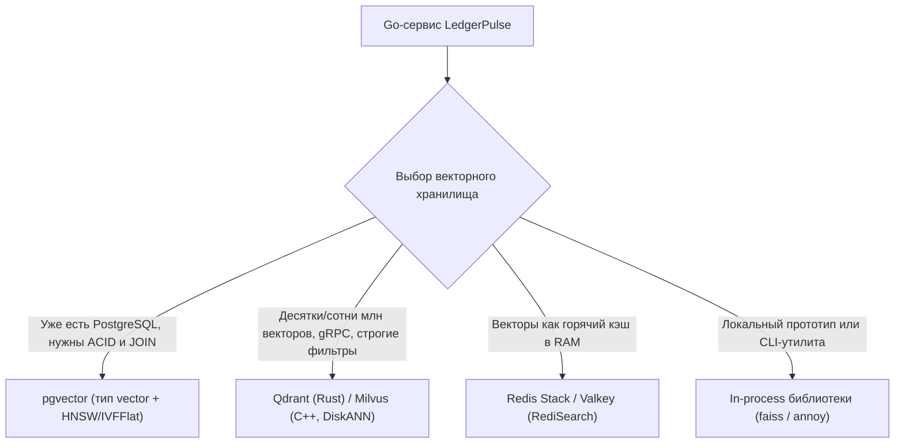

*Чанкинг документов, фильтрация метаданных до и после векторного поиска, архитектура RAG-пайплайна на Go, управление памятью и выбор хранилища*

> «Сборка мусора — огромное подспорье при написании корректных программ, но она не избавляет вас от необходимости думать о памяти. Вам не нужно выделять и освобождать память вручную, однако для написания эффективного кода всё равно приходится понимать время жизни переменных.»  
> — Алан Донован и Брайан Керниган, *The Go Programming Language*

В предыдущей главе ([[14. Векторные базы данных — HNSW, IVF и гибридный поиск]]) мы разобрали граф HNSW, квантование и формулу RRF на чистой таблице коротких описаний транзакций. Но при переносе этой схемы в реальный продакшен `LedgerPulse` возникают три инженерные проблемы, о которые разбиваются наивные прототипы:

1. **Потеря смысла на длинных текстах.** Если пропустить через embedding-модель 40-страничный регламент валютного контроля целиком, все 1536 чисел усреднятся по документу. Конкретный абзац о лимите SWIFT растворится, и запрос клиента не найдёт нужную норму.
2. **Исчезающие результаты при `WHERE`-фильтрации.** В мультитенантной базе у корпоративного клиента `#42` всего 120 регламентов среди 10 миллионов записей в таблице. Запрос `WHERE tenant_id = 42 ORDER BY embedding <=> $1 LIMIT 5` при классическом пост-фильтрующем обходе HNSW сначала находит 5 ближайших векторов по всей таблице (все чужие), а затем фильтр `WHERE` их отбрасывает — пользователь получает 0 ответов.
3. **Давление на память и приватность.** Под высоким RPS тысячи временных слайсов `[]float32` нагружают сборщик мусора Go, а отправка текстов с персональными данными (PII) во внешний облачный API нарушает требования банковской безопасности.

Чтобы векторный поиск стал надёжным промышленным компонентом, инженеру нужен полный пайплайн: от нарезки данных (chunking) и стратегии фильтрации до контроля памяти в Go и версионирования моделей.

---

## Эмбеддинги и стратегии чанкинга

**Эмбеддинг** — это проекция фрагмента текста, изображения или профиля пользователя в плотный вектор фиксированной размерности (обычно 384, 768, 1536 или 4096 чисел `float32`). У каждой модели есть жёсткое окно контекста (например, 512 или 8192 токенов) и оптимальная плотность информации: чем длиннее входной текст, тем сильнее сглаживается вектор.

Поэтому документы перед индексацией режут на **чанки (chunks)**:

* **Фиксированное окно с перекрытием (Fixed-size with overlap):** текст делится на блоки по 300–512 токенов с перекрытием 50–80 токенов. Перекрытие гарантирует, что фраза, оказавшаяся на границе двух фрагментов, целиком попадёт хотя бы в один из них.
* **Структурный чанкинг:** документ режется по логическим границам — заголовкам Markdown, пунктам договора или классам кода, чтобы не смешивать разные разделы.
* **Parent-Child (иерархический поиск):** вектор строится по мелкому точному чанку (150–200 токенов) для высокой точности поиска, но в базу сохраняется ссылка на родительский раздел (1000–1500 токенов). При совпадении Go-сервис передаёт языковой модели полный родительский контекст.

---

## Фильтрация по метаданным: Pre-filtering, Post-filtering и Iterative Scan

На практике поиск почти никогда не идёт по всей базе без ограничений. В `LedgerPulse` нужно отбирать документы с `tenant_id = 42`, `status = 'active'` и датой свежее `2026-01-01`. Сочетание индекса HNSW и скалярных фильтров `WHERE` — одна из самых тонких тем векторных СУБД:

| Стратегия | Как работает | Где ломается |
|---|---|---|
| **Post-filtering** | Сначала граф HNSW возвращает топ-$k$ (или `ef_search`) кандидатов, затем применяется `WHERE` | При селективности фильтра 1% из 40 кандидатов выживают 0–1 строка |
| **Pre-filtering** | Сначала B-Tree или Bitmap-скан по `tenant_id` отбирает разрешённые ID, затем идёт точный перебор векторов | Отлично для 1 000 строк у клиента, но при 2 млн строк у крупного клиента HNSW не работает — перебор занимает сотни мс |
| **In-graph / Iterative Scan** | Во время обхода HNSW движок проверяет фильтр на каждом узле и продолжает поиск по графу, пока не наберёт $k$ подходящих строк | Дороже по CPU при очень редких фильтрах, но не теряет результаты |

В `Qdrant` фильтруемый HNSW встроен в сам граф (с добавлением дополнительных связей внутри сегментов по часто используемым полям). В `pgvector` начиная с версии `0.8.0` появилась настройка `SET LOCAL hnsw.iterative_scan = relaxed_order;` — при нехватке отфильтрованных строк сканер автоматически расширяет обход графа вместо возврата пустой выборки. А для изоляции крупных клиентов в PostgreSQL надёжнее всего работает **партиционирование по `tenant_id`** ([[5. Партиционирование (Partitioning) — Range, List, Hash и управление таблицами]]): каждая партиция получает собственный компактный HNSW-индекс без смешивания чужих данных.

---

## Выбор хранилища: карта экосистемы

Разнообразие векторных решений распадается на три архитектурных класса:



Краткое сравнение популярных решений для продакшена:

| Критерий | `pgvector` (PostgreSQL) | `Qdrant` | `Milvus` / `Zilliz` | `Redis Stack` |
|---|---|---|---|---|
| **Транзакции ACID** | Полные (MVCC, WAL) | Нет (конечная согласованность шардов) | Нет | Нет |
| **Гибрид + JOIN с бизнес-данными** | Нативный SQL (`WHERE`, `JOIN`, `tsvector`) | JSON-фильтры, BM25 (sparse vectors) | Свои выражения, гибрид | RediSearch-запросы |
| **Фильтрация при поиске** | `iterative_scan` / партиции | Встроенный фильтруемый HNSW | Partition Key + bitmask | Префильтры в графе |
| **Масштаб и задержка** | До десятков млн векторов (пока граф в RAM) | Высочайшая на Rust, gRPC, шардинг | До миллиардов векторов, GPU и DiskANN | Суб-миллисекундный поиск в RAM |
| **Операционный порог** | Нулевой, если уже есть PostgreSQL | Отдельный stateful-кластер | Сложный кластер (etcd, MinIO/S3, ноды) | Низкий, если есть Redis ([[3. Redis — архитектура, структуры данных, RESP и работа из Go]]) |

Отдельно стоят облачный `Pinecone` (SaaS), `Weaviate` (GraphQL + гибрид), `MongoDB Atlas Vector Search` (векторные индексы рядом с JSON-документами, см. [[7. Документные базы данных — MongoDB и моделирование документов]]), `Elasticsearch`/`OpenSearch` (k-NN + BM25), а также встраиваемые C++ библиотеки `faiss` и `annoy` для вычислений прямо в адресном пространстве процесса.

---

## Архитектура AI-сценариев в бэкенде на Go

На базе векторных хранилищ Go-бэкенды реализуют пять типовых сценариев:

### 1. RAG (Retrieval-Augmented Generation)

Языковые модели склонны к галлюцинациям и не знают закрытых данных компании. Архитектура RAG превращает базу данных во внешний проверяемый источник фактов:


### 2. Семантический поиск и категоризация
В `LedgerPulse` клиентский запрос «перевод за стоматологию» находит платежи по клиникам и аптекам, даже если слова в выписке сокращены или написаны транслитом.

### 3. Рекомендации и антифрод
Поведенческий профиль счёта кодируется в вектор: близость к кластеру подтверждённых мошеннических схем служит быстрым сигналом риска до запуска тяжёлых правил комплаенса.

### 4. Мультимодальный поиск
Модели семейства CLIP проецируют в единое векторное пространство и изображения, и текст: чек или скан паспорта можно искать текстовым запросом без ручной разметки тегами.

### 5. Долгосрочная память AI-агентов
Вместо перегрузки контекстного окна LLM всей перепиской за год, диалоговый сервис сохраняет сжатые факты о клиенте с эмбеддингами и подтягивает на каждом шаге только релевантные воспоминания.

---

## Практика в Go 1.24: пул буферов, `iterative_scan` и пакетная загрузка

Векторные сервисы на Go легко теряют производительность из-за лишних аллокаций: при 2 000 RPS создание и копирование слайсов `[]float32` длиной 1536 (по 6 КиБ каждый) генерирует 12 МБ/с временного мусора в куче только на нормализацию запросов. Переиспользуя буферы через `sync.Pool`, сервис убирает лишнее давление на сборщик мусора.

Ниже показан идиоматичный слой поиска на Go 1.24 с `pgx/v5` (драйвер `pgvector-go`), защитой от пропадания отфильтрованных результатов и нормализацией входного вектора без аллокаций на горячем пути:

```go
package main

import (
	"context"
	"fmt"
	"math"
	"sync"

	"github.com/jackc/pgx/v5"
	"github.com/jackc/pgx/v5/pgxpool"
	"github.com/pgvector/pgvector-go"
)

const embeddingDim = 1536

var vecPool = sync.Pool{
	New: func() any {
		buf := make([]float32, embeddingDim)
		return &buf
	},
}

type DocChunk struct {
	ID       int64
	DocTitle string
	Body     string
	Distance float64
}

func SearchTenantRAG(ctx context.Context, pool *pgxpool.Pool, tenantID int64, rawQuery []float32, limit int) ([]DocChunk, error) {
	if len(rawQuery) != embeddingDim {
		return nil, fmt.Errorf("ожидалась размерность %d, получено %d", embeddingDim, len(rawQuery))
	}

	bufPtr := vecPool.Get().(*[]float32)
	norm := *bufPtr
	defer vecPool.Put(bufPtr)

	normalizeL2(norm, rawQuery)

	tx, err := pool.BeginTx(ctx, pgx.TxOptions{AccessMode: pgx.ReadOnly})
	if err != nil {
		return nil, fmt.Errorf("begin read tx: %w", err)
	}
	defer func() { _ = tx.Rollback(ctx) }()

	// Включаем итеративный обход HNSW (pgvector 0.8+), чтобы фильтр tenant_id не обнулял выдачу.
	if _, err := tx.Exec(ctx, "SET LOCAL hnsw.iterative_scan = relaxed_order"); err != nil {
		return nil, fmt.Errorf("set iterative_scan: %w", err)
	}

	const q = `
		SELECT id, doc_title, body, embedding <=> $1 AS distance
		FROM compliance_chunks
		WHERE tenant_id = $2 AND model_version = 'bge-m3-v1'
		ORDER BY embedding <=> $1
		LIMIT $3`

	rows, err := tx.Query(ctx, q, pgvector.NewVector(norm), tenantID, limit)
	if err != nil {
		return nil, fmt.Errorf("query chunks: %w", err)
	}
	defer rows.Close()

	chunks := make([]DocChunk, 0, limit)
	for rows.Next() {
		var c DocChunk
		if err := rows.Scan(&c.ID, &c.DocTitle, &c.Body, &c.Distance); err != nil {
			return nil, fmt.Errorf("scan chunk: %w", err)
		}
		chunks = append(chunks, c)
	}
	return chunks, rows.Err()
}

func normalizeL2(dst, src []float32) {
	var sum float64
	for _, v := range src {
		sum += float64(v) * float64(v)
	}
	inv := float32(1.0 / math.Sqrt(sum+1e-12))
	for i, v := range src {
		dst[i] = v * inv
	}
}
```

Сравним вывод профилировщика и плана выполнения при поиске для редкого клиента (`tenant_id = 42`, доля в таблице 0,02%):

```text
Без iterative_scan:  returned=0 rows, execution_time=0.9ms  (все 40 узлов HNSW отброшены WHERE)
С relaxed_order:     returned=5 rows, execution_time=6.4ms  (граф дообследован до набора LIMIT 5)
```

Если нужен чистый C/SIMD расчёт прямо внутри памяти Go-сервиса без сетевых походов (например, для переранжирования 500 кандидатов), используют `cgo`-обёртки над `faiss`, поскольку скалярное произведение на чистом Go без ассемблерных SIMD-вставок уступает оптимизированному C++ в несколько раз.

---

## Безопасность, приватность и версионирование моделей

Работа с эмбеддингами в финансовом домене несёт специфические риски безопасности (подробно тема защиты приложений и данных разбирается в Томе 3, раздел AppSec):

1. **Утечка PII во внешние API.** Отправляя тексты платежей или договоров в облачный сервис генерации эмбеддингов, вы передаёте конфиденциальные данные за периметр. Для чувствительных контуров разворачивают локальные модели инференса (через `Ollama`, `vLLM`, `HuggingFace TGI` или `ONNX Runtime`) внутри приватной сети.
2. **Необратимость удаления в весах модели.** Удалить вектор клиента из `pgvector` или `Qdrant` легко, но если персональные данные попали в обучающую выборку самой нейросети, модель способна воспроизвести их фрагменты.
3. **Изоляция арендаторов и SQL-инъекции.** В RAG-системе ошибка в `WHERE tenant_id = $2` приведёт к тому, что LLM зачитает клиенту текст чужого договора из контекста промпта. Вектор передавайте исключительно через параметризованный запрос (`$1`), а метаданные фильтров проверяйте белым списком разрешённых полей.

> [!warning] Ловушка: дрейф моделей эмбеддингов (Model Drift)
> Векторные пространства разных моделей (и даже разных версий одной модели) несовместимы: координаты от `text-embedding-3-small` и от `bge-m3` нельзя сравнивать через `<=>` в одном индексе, даже если у них совпадает размерность. Всегда храните столбец `model_version` рядом с вектором. При переходе на новую модель создавайте отдельный столбец (или новую таблицу/коллекцию), пересчитывайте эмбеддинги фоновым воркером через пакетную загрузку (`COPY` / батчи), стройте индекс и только потом переключайте флаг чтения в Go-сервисе.

> [!tip] Собеседование [Senior/Staff]
> **Вопрос:** В мультитенантном RAG на базе `pgvector` у одного клиента 5 миллионов документов, а у десяти тысяч других — по 500 документов. Обычный HNSW с `WHERE tenant_id = $1` либо падает по полноте выдачи у мелких клиентов, либо тормозит на `iterative_scan`. Как вы спроектируете схему хранения?  
> **Ответ:** Для такого перекоса распределения данных лучше всего скомбинировать декларативное партиционирование и гибридную стратегию индексов: 1) выделить крупных клиентов (или группы мелких клиентов по `HASH(tenant_id)`) в отдельные партиции PostgreSQL, чтобы у каждого крупного арендатора был собственный компактный HNSW-индекс без «шума» чужих векторов; 2) для мелких клиентов в общей партиции включить `hnsw.iterative_scan = relaxed_order`, а если доля клиента в партиции совсем ничтожна (менее нескольких тысяч строк), выносить поиск в pre-filtering по B-Tree-индексу `tenant_id` с точным перебором векторов — на 500 строках точный перебор с SIMD займёт доли миллисекунды быстрее любого обхода графа.

---

## Упражнения

### Упражнение 1 (Базовое). Оценка числа чанков и размера таблицы
У компании в базе знаний `LedgerPulse` 20 000 регламентов со средним объёмом 6 000 токенов каждый. Тексты режут на чанки по 400 токенов с перекрытием (`overlap`) 80 токенов. Вектор имеет размерность 1024 (`float32`), а текст чанка в среднем весит 1,5 КиБ. Посчитайте итоговое количество строк в таблице `compliance_chunks` и сырой объём данных (текст + векторы) до построения индекса.

> [!solution] Показать решение
> 1. Шаг окна при длине чанка 400 и перекрытии 80 равен $400 - 80 = 320$ токенов.
> 2. Число чанков на один документ: $\lceil (6000 - 80) / 320 \rceil = \lceil 5920 / 320 \rceil = 19$ чанков.
> 3. Всего строк в таблице: $20\,000 \times 19 = 380\,000$ строк.
> 4. Размер одного вектора: $1024 \times 4 = 4096$ байт (4 КиБ). С текстом (1,5 КиБ) и заголовками кортежа (~100 байт) строка занимает около 5,6 КиБ.
> 5. Сырой объём таблицы: $380\,000 \times 5,6\text{ КиБ} \approx 2,13$ ГиБ (для `HNSW` в RAM потребуется ещё порядка 2,5–3,5 ГиБ на граф и векторы).

### Упражнение 2 (Практическое). Защита RAG от пустой выдачи и утечки данных
В коде коллеги обнаружен запрос:
```go
query := fmt.Sprintf(
    "SELECT body FROM compliance_chunks WHERE category = '%s' ORDER BY embedding <=> $1 LIMIT 5",
    userCategory,
)
rows, err := pool.Query(ctx, query, pgvector.NewVector(vec))
```
Назовите три проблемы в этом фрагменте и перепишите его безопасно с учётом мультитенантности и защиты от пустой выдачи HNSW.

> [!solution] Показать решение
> 1. **SQL-инъекция:** `userCategory` подставляется через `fmt.Sprintf` напрямую в SQL-строку. Нужно передавать её как позиционный параметр `$2`.
> 2. **Отсутствие изоляции `tenant_id`:** выборка идёт по всем арендаторам сразу, что грозит утечкой чужих документов в промпт LLM.
> 3. **Риск пустого результата при редкой категории:** без `SET LOCAL hnsw.iterative_scan = relaxed_order` фильтр `WHERE` может отбросить всех кандидатов, возвращённых графом HNSW.
>
> Безопасный вариант внутри `ReadOnly`-транзакции:
> ```go
> _, err := tx.Exec(ctx, "SET LOCAL hnsw.iterative_scan = relaxed_order")
> // ...
> const safeQuery = `
>     SELECT body
>     FROM compliance_chunks
>     WHERE tenant_id = $1 AND category = $2
>     ORDER BY embedding <=> $3
>     LIMIT 5`
> rows, err := tx.Query(ctx, safeQuery, tenantID, userCategory, pgvector.NewVector(vec))
> ```

### Упражнение 3 (\*). Бесшовная миграция при смене модели эмбеддингов
Команда переводит `LedgerPulse` с модели `model-v1` (размерность 768) на `model-v2` (размерность 1024) без остановки продакшена (Zero-Downtime Migration). Таблица содержит 5 миллионов чанков. Спроектируйте пошаговый план миграции схемы БД, пересчёта векторов и переключения Go-кода.

> [!solution] Показать решение
> 1. **Расширение схемы:** добавляем новую таблицу `compliance_chunk_embeddings_v2 (chunk_id BIGINT PRIMARY KEY, embedding VECTOR(1024))` или nullable-колонку `embedding_v2 VECTOR(1024)` (отдельная таблица предпочтительнее, так как не раздувает основную кучу `VACUUM`-ом и позволяет построить HNSW изолированно).
> 2. **Двойная запись (Dual Write):** Go-сервис при добавлении новых чанков продолжает писать `model-v1` и асинхронно/синхронно дописывает вектор `model-v2`.
> 3. **Фоновый backfill без индекса:** воркер батчами по 1000 строк (идемпотентно по `chunk_id`) прогоняет старые чанки через `model-v2` и заливает их через `COPY` / `UNNEST` в таблицу `v2` (пока HNSW на ней **не** создан, чтобы не тормозить запись).
> 4. **Построение индекса онлайн:** после завершения backfill поднимаем `maintenance_work_mem` и строим `CREATE INDEX CONCURRENTLY ... USING hnsw (embedding vector_cosine_ops)` на `v2`.
> 5. **Канареечное переключение:** через feature flag переключаем 5% -> 50% -> 100% поисковых запросов в Go на чтение из `v2`, контролируя Recall и p99 latency.
> 6. **Очистка:** после периода стабилизации удаляем старый индекс и колонку/таблицу `v1`.

---

Модуль 9 завершает большой архитектурный обзор движков хранения: от однопоточного `event loop` в Redis/Valkey и `slab`-аллокатора Memcached до документной модели MongoDB, LSM-кворумов Cassandra, поколоночной векторизации в ClickHouse, распределённого `Serializable` SQL в CockroachDB и многослойных графов `HNSW` для AI-поиска. Теперь вы умеете выбирать подходящее хранилище под физику нагрузки и не смешивать классы систем вслепую.

Но выбрать движок — лишь половина дела: даже идеальная база падает, если Go-сервис открывает соединения без пула, пропускает контекст отмены, забывает про миграции схем и не видит метрики медленных запросов. Как соединить все изученные технологии в надёжный продакшен-код на Go — разберём в заключительном Модуле 10 «Практика БД в Go и HighLoad-эксплуатация».
