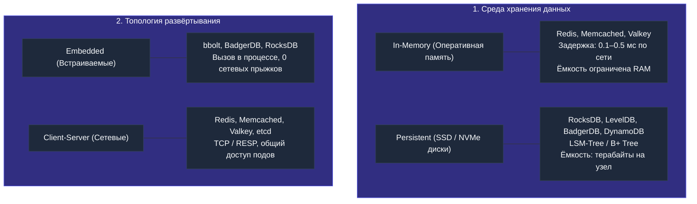
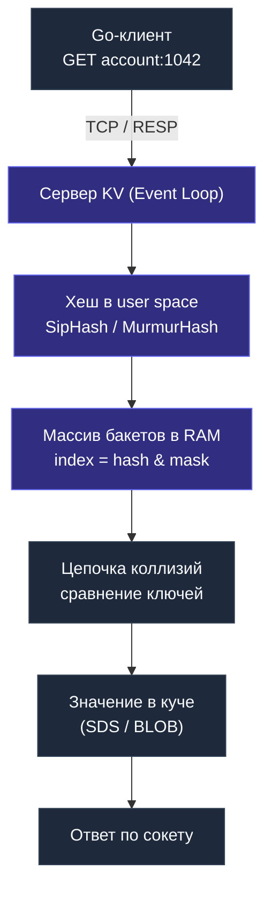
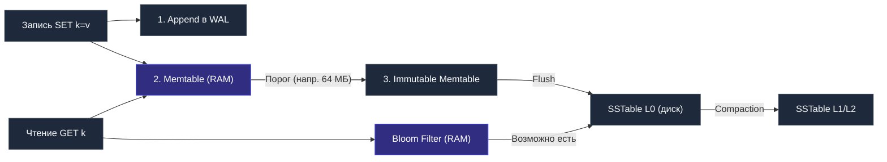

*Почему отказ от SQL-парсера ускоряет доступ в десятки раз, как устроены хеш-таблицы в памяти, чем LSM-Tree (Memtable, SSTable, Bloom Filter) отличается от B+ Tree и как Go работает с KV-движками через пайплайнинг и netpoll.*

> «Мы пишем, а позже читаем. Сохраняем, а позже извлекаем. Храним, а позже обращаемся к сохранённому. Назначение памяти — уберечь информацию без искажений между двумя этими событиями.»  
> — Чарльз Петцольд, *Code: The Hidden Language of Computer Hardware and Software*

На горячем пути `LedgerPulse` перед каждым переводом проверяется суточный лимит счёта. Запрос по первичному ключу в PostgreSQL занимает 3–5 мс: драйвер передаёт SQL, парсер строит AST, планировщик проверяет статистику, исполнитель спускается по страницам B-Tree и проверяет видимость MVCC. На 200 000 проверок в секунду эти миллисекунды перегружают CPU и пул соединений.

**Key-Value (KV) хранилище** сводит задачу к элементарному контракту: по уникальному ключу атомарно сохранить или прочитать значение. Нет таблиц, внешних ключей, синтаксического анализатора SQL и оптимизатора `Hash Join` / `Merge Join` / `Nested Loops`. Движок вычисляет хеш от ключа и обращается в RAM за наносекунды либо пишет данные в компактную дисковую структуру без случайных перезаписей.

---

## Модель данных и две оси классификации

Математически KV-база — это ассоциативный массив:
* **Ключ (`Key`)** — уникальный идентификатор (последовательность байт, например `account:1042:limit`).
* **Значение (`Value`)** — непрозрачный набор байт (*opaque BLOB*). Движок не валидирует его структуру: схема (*schema-on-read*) и сериализация лежат на клиенте.

В Go ментальная модель простейшего KV — это `map[string][]byte`:

```go
store := make(map[string][]byte)
store["account:1042:limit"] = []byte(`{"daily_minor":5000000,"currency":"RUB"}`)
```

Физически KV-движки делятся по двум осям: **среде хранения** и **топологии развёртывания**.



1. **In-Memory против Persistent.** В оперативных базах ([[3. Redis — архитектура, структуры данных, RESP и работа из Go|Redis]], Valkey, Memcached) весь активный набор лежит в DRAM. Персистентность опциональна (`RDB`/`AOF`) и без `fsync` на каждую запись не гарантирует мгновенной долговечности. Дисковые движки (`RocksDB`, `LevelDB`, `BadgerDB`, `bbolt`, `DynamoDB`) опираются на `LSM-Tree` или `B+ Tree`, используя RAM как буфер записи и блочный кэш. Они в сотни раз медленнее DRAM (~100 мкс на NVMe против ~100 нс в RAM), зато вмещают терабайты.
2. **Embedded против Client-Server.** Встраиваемые библиотеки (`bbolt` в основе `etcd`, `badger` на чистом Go, C++ `RocksDB`) компилируются в бинарник Go-сервиса: никаких TCP-сокетов и сериализации, прямой вызов функции. Сетевые демоны (Redis, Memcached, Valkey) добавляют сетевой RTT и системные вызовы сокетов, но дают общее состояние для всех подов `LedgerPulse` и независимое масштабирование памяти.

---

## Под капотом In-Memory KV: хеш-таблица и O(1)

В основе быстрых KV-серверов в памяти лежит хеш-таблица с цепочками коллизий (*chaining*) или открытой адресацией.



Четыре инженерных элемента этой скорости:
1. **Быстрые некриптографические хеши.** Применяют **SipHash** (в Redis), **MurmurHash**, **CityHash** — они вычисляются в user space без syscall за десятки тактов CPU. `SipHash` использует случайное секретное зерно и защищает от атак **HashDoS** (намеренного подбора коллизий для деградации $O(1)$ в $O(N)$).
2. **Локальность массива бакетов.** Бакеты — непрерывный массив указателей. Индекс вычисляется маской `hash & (size - 1)` и чтением `base_addr + index * sizeof(pointer)`. Попадание в L1d-кэш (~1 нс) делает обращение почти мгновенным.
3. **Инкрементальное рехэширование.** Когда коэффициент заполнения (*load factor*) переходит порог (обычно 1.0), таблицу нужно расширять вдвое. Чтобы не остановить сервер на миллионы переносов (*stop-the-world*), в структуре словаря `dictht` Redis держит две таблицы (`ht[0]` и `ht[1]`): новые записи идут в `ht[1]`, поиск проверяет обе, а перенос выполняется маленькими порциями при каждом запросе.
4. **Структуры значений и сериализация в Go.** Memcached хранит только плоские строки байт, тогда как Redis и Valkey поддерживают внутри значения типизированные структуры (`SDS`, `quicklist`/`listpack`, `intset`, `SkipList`). В Go сложный объект перед отправкой сериализуют в JSON, MessagePack или Protobuf. Поскольку частая сериализация нагружает кучу Go и сборщик мусора, буферы на горячем пути переиспользуют через `sync.Pool`.

---

## Под капотом Persistent KV: B+ Tree против LSM-Tree

Дисковые KV-хранилища (`RocksDB`, `BadgerDB`, `Cassandra`) не помещают всю базу в RAM. Здесь сталкиваются два фундаментально разных движка:

* **B+ Tree (`in-place update`).** Как мы разбирали в [[2. B-Tree индекс под капотом — страницы, ветвление и page split|главе о B-Tree]], дерево хранит ключи в страницах 4–16 КБ и обновляет их на месте. При случайном потоке ключей запись заставляет читать старую страницу, менять несколько байт, сбрасывать всю страницу обратно на диск и дублировать правку в [[8. WAL — журнал упреждающей записи и долговечность на диске|WAL]]. Возникают `page split` и сильное усиление записи (*write amplification*).
* **LSM-Tree (*Log-Structured Merge-tree*, `append-only`).** Заменяет случайные перезаписи последовательной дозаписью неизменяемых файлов:



1. **WAL и `Memtable`.** Запись идёт в конец последовательного WAL на диске и в отсортированный буфер в памяти — **Memtable** (обычно *SkipList* или красно-чёрное дерево).
2. **`SSTable` (*Sorted String Table*).** При заполнении `Memtable` замораживается (*immutable*) и фоном сбрасывается на диск как неизменяемый отсортированный файл `SSTable`. Удаление пишется специальным маркером-надгробием (*tombstone*), не затирая старые файлы.
3. **`Bloom Filter`.** При чтении проверяют `Memtable`, а затем файлы `SSTable` от свежих к старым. Чтобы не дёргать SSD по десяткам файлов, перед каждым `SSTable` в RAM держат **фильтр Блума** (*Bloom Filter*). Ответ «ключа нет» точен на 100% — чтение файла пропускается; «возможно есть» (с настраиваемой долей ложных срабатываний ~1%) ведёт к чтению индекса `SSTable`.
4. **Компактификация (`Compaction`).** Фоновый процесс сливает файлы `SSTable`, удаляя перезаписанные версии и `tombstones`.

| Критерий | B+ Tree (`in-place update`) | LSM-Tree (`append-only`) |
|---|---|---|
| **Запись на диск** | Случайная перезапись страниц 4–16 КБ + WAL | Последовательный WAL + сброс `SSTable` |
| **Случайная запись** | Упирается в random IOPS и `page split` | Максимальная скорость последовательной шины |
| **Точечное чтение** | Предсказуемое $O(\log N)$ по высоте дерева | Проверка `Memtable` + нескольких `SSTable` (смягчается Bloom Filter) |
| **Усиление записи / места** | Высокое при мелких случайных вставках; фрагментация | Ниже при пакетной записи; дубликаты до завершения compaction |

---

## Протоколы, пулы и Pipelining в Go

Сетевой протокол Redis и Valkey — **RESP**. Он текстовый по разделителям, но бинарно-безопасный за счёт префиксов длины. Команда `GET account:42` выглядит так:

```text
*2\r\n$3\r\nGET\r\n$10\r\naccount:42\r\n
```

Здесь `*2` — массив из 2 аргументов, `` `$3\r\nGET\r\n` `` и `` `$10\r\naccount:42\r\n` `` — строки с явной длиной в байтах. В ответ приходят bulk strings (`` `$7\r\n5000000\r\n` ``), целые числа (`` `:1\r\n` ``) или ошибки (`` `-ERR ...\r\n` ``). Протокол Memcached проще (`get key\r\n`, `set key flags exptime length\r\n<data>\r\n`) и рассчитан на плоские значения.

Драйвер `github.com/redis/go-redis/v9` управляет собственным пулом сокетов через каналы и атомарные счётчики. Чтобы не платить сетевой RTT на каждую команду при пакетных операциях `LedgerPulse`, применяют **Pipelining**: отправку пачки команд за один системный вызов `write()`:

```go
package main

import (
	"context"
	"errors"
	"fmt"
	"log"
	"time"

	"github.com/redis/go-redis/v9"
)

func syncAccountLimits(ctx context.Context, rdb *redis.Client) error {
	pipe := rdb.Pipeline()
	getCmd := pipe.Get(ctx, "limit:account:1042")
	setCmd := pipe.Set(ctx, "limit:account:1043", int64(2_500_000), 10*time.Minute)
	incrCmd := pipe.Incr(ctx, "stats:checks:total")

	if _, err := pipe.Exec(ctx); err != nil && !errors.Is(err, redis.Nil) {
		return fmt.Errorf("pipeline exec: %w", err)
	}

	if val, err := getCmd.Int64(); err == nil {
		fmt.Printf("limit:account:1042 -> %d\n", val)
	} else if errors.Is(err, redis.Nil) {
		fmt.Println("limit:account:1042 -> miss")
	}
	fmt.Printf("SET 1043 -> %s, total checks -> %d\n", setCmd.Val(), incrCmd.Val())
	return nil
}

func main() {
	rdb := redis.NewClient(&redis.Options{Addr: "localhost:6379"})
	defer rdb.Close()

	ctx, cancel := context.WithTimeout(context.Background(), 2*time.Second)
	defer cancel()

	if err := syncAccountLimits(ctx, rdb); err != nil {
		log.Fatal(err)
	}
}
```

Вывод при отсутствии ключа `limit:account:1042`:

```text
limit:account:1042 -> miss
SET 1043 -> OK, total checks -> 1
```

---

## Паттерны в Go, `netpoll` и ограничения KV

* **Кэширование и `netpoll`.** Вместо 3–5 мс в PostgreSQL с возможным дисковым `preadv`, Redis отвечает за 0.1–0.3 мс. Пока горутина ждёт сокет, планировщик Go паркует её в `netpoll` (`epoll_wait`), не занимая поток ОС.
* **Распределённые блокировки.** Атомарное `SET lock:key token NX PX 5000` (`SetNX`) исключает гонку наивной пары `GET` + `SET`. Границы таких блокировок с `fencing tokens` разобраны в [[11. Распределённые блокировки (Distributed Locks) и fencing tokens]].
* **Rate Limiting и очереди.** `INCR` + `EXPIRE` выдерживают сотни тысяч проверок квот в секунду без строчных блокировок БД. Связка `LPUSH`/`BRPOP` годится для лёгких очередей, но для гарантированной доставки в продакшене выбирают выделенные брокеры (подробнее см. Том 3, раздел об асинхронных брокерах).

**Компромиссы:** нет ad-hoc поиска (`LIKE '%...'`), дорогая RAM (100 млн ключей по 200 байт = 20 ГБ + метаданные), нет многоключевых ACID-транзакций с откатом (см. [[3. Read Committed, Repeatable Read и Serializable]]) и ослабленная согласованность в кластере (см. [[6. Модели согласованности в БД — Strong, Eventual, Read-Your-Writes и Causal]]).

> [!tip] Собеседование [Middle]
> **Вопрос:** Что делает Redis при заполнении RAM до `maxmemory` на 100%, и что должен делать Go-сервис?
>
> **Ответ:** Поведение задаёт `maxmemory-policy`:
> 1. `noeviction` (по умолчанию): все команды записи (`SET`, `HSET`) падают с ошибкой `OOM command not allowed when used memory > 'maxmemory'`, а чтение работает. Go-код обязан обрабатывать ошибку без паники.
> 2. `allkeys-lru` / `volatile-lru`: вытеснение давно не использовавшихся ключей среди всех или только ключей с TTL.
> 3. `allkeys-lfu` / `volatile-lfu`: вытеснение по наименьшей частоте обращений.
> Для кэшей обязательно задавайте TTL и LRU/LFU-политику, а блокировки изолируйте в отдельный инстанс.

---

## Упражнения

### Упражнение 1 (Базовое)
В Redis лежат 50 млн ключей: ключ — 32 байта, значение — 128 байт, накладные расходы словаря и метаданных — ~80 байт на запись. Оцените минимальный объём RAM и объясните, почему при `noeviction` упадут записи сессий, но продолжатся чтения.

> [!solution] Показать решение
> 1. $50\,000\,000 \times (32 + 128 + 80) = 12 \times 10^9 \text{ байт} \approx 11.2 \text{ ГБ}$ (плюс память на массив бакетов и запас под `fork`/рехэш).
> 2. При `noeviction` и достижении `maxmemory` сервер отклоняет любые выделяющие память команды записи ошибкой `OOM command not allowed...`, тогда как `GET` и `DEL` не требуют новой памяти и продолжают выполняться.

### Упражнение 2 (Практическое)
Перепишите проблемный Go-фрагмент `LedgerPulse` с циклом одиночных `Get` и небезопасным `Get + Set` на `Pipeline` и атомарную блокировку `SetNX`:

```go
for _, id := range accountIDs {
    _, _ = rdb.Get(ctx, fmt.Sprintf("limit:account:%d", id)).Result()
}
if v, _ := rdb.Get(ctx, "lock:settlement").Result(); v == "" {
    _ = rdb.Set(ctx, "lock:settlement", "worker-1", 30*time.Second).Err()
}
```

> [!solution] Показать решение
> ```go
> func checkLimitsAndLock(ctx context.Context, rdb *redis.Client, accountIDs []int64, workerID string) (map[int64]string, bool, error) {
> 	pipe := rdb.Pipeline()
> 	cmds := make(map[int64]*redis.StringCmd, len(accountIDs))
> 	for _, id := range accountIDs {
> 		cmds[id] = pipe.Get(ctx, fmt.Sprintf("limit:account:%d", id))
> 	}
> 	if _, err := pipe.Exec(ctx); err != nil && !errors.Is(err, redis.Nil) {
> 		return nil, false, fmt.Errorf("pipeline exec: %w", err)
> 	}
> 	res := make(map[int64]string, len(accountIDs))
> 	for id, cmd := range cmds {
> 		if val, err := cmd.Result(); err == nil {
> 			res[id] = val
> 		}
> 	}
> 	acquired, err := rdb.SetNX(ctx, "lock:settlement", workerID, 30*time.Second).Result()
> 	if err != nil {
> 		return nil, false, fmt.Errorf("setnx: %w", err)
> 	}
> 	return res, acquired, nil
> }
> ```

### Упражнение 3 (Со звёздочкой *)
Во встроенном **LSM-Tree** (`BadgerDB`/`RocksDB`) каждую секунду обновляются 5 000 ключей и удаляются 4 500 старых. Через неделю чтение несуществующих ключей замедлилось втрое, а диск вырос вдвое. Объясните причины и решение через Bloom-фильтр и компактификацию.

> [!solution] Показать решение
> 1. **Накопление `tombstones` и старых версий:** неизменяемые `SSTable` на диске не стираются при удалении/перезаписи до фоновой **компактификации (*compaction*)**, что раздувает место (*space amplification*). Ускорение/настройка Leveled Compaction удаляет мёртвые версии.
> 2. **Деградация поиска отсутствующих ключей:** без настроенного **Bloom Filter** (или при переполнении уровня `L0`) поиск несуществующего ключа проверяет множество `SSTable` на SSD. Фильтр Блума в RAM отсекает отсутствующие ключи со 100% точностью без дисковых чтений.

---

## Мостик к следующей главе

Мы рассмотрели два полюса KV-хранилищ: дисковые LSM-деревья и сверхбыстрые хеш-таблицы в RAM. Самый популярный представитель второго класса — **Redis** — пошёл дальше плоских байт и вынес богатые структуры данных прямо в оперативную память сервера.

В главе [[3. Redis — архитектура, структуры данных, RESP и работа из Go]] разберём, как однопоточный цикл событий держит 100k+ RPS без мьютексов, как устроен протокол `RESP2`/`RESP3` и как правильно настроить пул `go-redis` поверх `netpoll`. Но как один поток успевает обслуживать десятки тысяч клиентов без взаимных блокировок — с этого и начнём.
