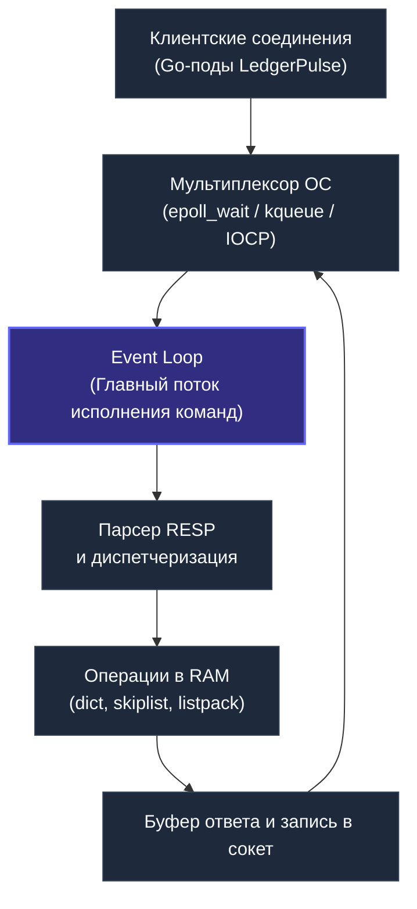

*Почему Сальваторе Санфилиппо отказался от пула потоков, как устроен протокол RESP2/RESP3, какие структуры данных заменяют плоские BLOB-ы и как настроить пул `go-redis` поверх `netpoll`.*

> «В идеальном мире прикладному программисту достаточно знать только API — без того, как этот API реализован и к какому железу он обращается. В реальности же чуть более глубокие знания порой оказываются весьма кстати.»  
> — Чарльз Петцольд, *Code: The Hidden Language of Computer Hardware and Software*

В 2009 году Сальваторе Санфилиппо (*antirez*) создал **Redis** (*Remote Dictionary Server*), следуя принципу предельного минимализма. Вместо пулов рабочих потоков и тяжёлых транзакционных блокировок он построил сервер структур данных в оперативной памяти вокруг одного неблокирующего цикла событий поверх мультиплексора `epoll`.

Операции над хеш-таблицами и списками стали занимать доли миллисекунды на одном ядре CPU. Но в этой модели кроется риск для Go-бэкенда: одна тяжёлая $O(N)$-команда вроде `KEYS *` замораживает цикл событий Redis, и тысячи лёгких горутин мгновенно выстраиваются в очередь к перегруженному сокету.

В главе [[2. Key-Value хранилища — от хеш-таблиц в памяти до LSM-деревьев]] мы разобрали общую модель ключ-значение. Теперь сосредоточимся на практике Redis в задачах `LedgerPulse`.

---

## Однопоточный event loop: почему один поток держит 100 000+ RPS

Секрет производительности однопоточного ядра Redis лежит в физике памяти и стоимости синхронизации потоков.



1. **Ожидание без расхода CPU.** Главный поток регистрирует сокеты в `epoll` (Linux), `kqueue` (BSD/macOS) или `IOCP` (Windows) и засыпает на `epoll_wait`.
2. **Ноль блокировок.** Поскольку команды исполняет один поток, Redis не нужны мьютексы (`pthread_mutex`), спинлоки, CAS и затраты на когерентность кэшей процессора (*протокол MESI*). Вся память активно прогрета в L1d/L2 кэше ядра.
3. **Быстрее переключения контекста.** Поиск в хеш-таблице занимает 50–200 наносекунд, тогда как переключение контекста потоков ОС стоит 1–2 микросекунды — на порядок дороже самой команды.

> [!info] Под капотом: многопоточный I/O (Redis 6.0+)
> Когда узким местом становится сетевой трафик, начиная с Redis 6.0 сервер умеет разносить чтение сокетов и запись ответов по нескольким I/O-потокам. Само выполнение команд остаётся строго однопоточным, сохраняя полную атомарность без гонок.

---

## Протокол RESP2 и RESP3

Redis использует текстовый, но бинарно-безопасный протокол **RESP** (*REdis Serialization Protocol*). Префикс первого байта задаёт тип: `+` (простая строка), `-` (ошибка), `:` (целое число), `$` (bulk string с явной длиной), `*` (массив). Команда `GET user:1` уходит в TCP-сокет так:

```text
*2\r\n$3\r\nGET\r\n$6\r\nuser:1\r\n
```

В **RESP3** (включённом по умолчанию в `go-redis/v9`) добавили явные типы для словарей (`%`), множеств (`~`), `null` (`_`) и push-уведомлений (`>`), избавив клиент от гадания над плоскими массивами. Библиотека `github.com/redis/go-redis/v9` разбирает поток через переиспользуемые буферы `[]byte`, снижая количество промежуточных аллокаций.

---

## Структуры данных Redis в `LedgerPulse`

В отличие от Memcached, Redis модифицирует сложные структуры прямо в памяти сервера, не гоняя весь объект по сети.

* **`Strings`:** бинарно-безопасные буферы до 512 МБ. Поддерживают атомарные `INCR`, `DECR`, `INCRBY`, `INCRBYFLOAT` — удобно для суточных счётчиков и остатков лимита в копейках.
* **`Hashes`:** `map[string]string` под одним ключом (`HSET`, `HGET`, `HINCRBY`). Позволяет обновить счётчик `tx_today` у мерчанта без перезаписи всего JSON.
* **`Lists`:** двусвязные списки на базе `quicklist` (`LPUSH`, `RPOP`, `BRPOP`, `LTRIM`) для очередей задач и лент последних событий.
* **`Sets`:** неупорядоченные уникальные множества с проверкой за $O(1)$ (`SISMEMBER`) и операциями `SUNION`, `SINTER`, `SDIFF` (например, проверка санкционных списков).
* **`Sorted Sets (ZSet)`:** элементы со скором `float64` (внутри — `SkipList` + хеш-таблица). Идеальны для лидербордов, отложенных задач и скользящих окон:

```go
now := float64(time.Now().UnixNano())
rdb.ZAdd(ctx, "rl:window:account:1042", redis.Z{Score: now, Member: reqID})
```

* **`Streams`:** append-only лог в RAM (`XADD`, `XREADGROUP`, `XACK`) с группами потребителей, используемый, например, в Go-библиотеке `watermill`.
* **`Bitmaps`, `HyperLogLog`, `Geospatial` и `Redis Stack`:** побитовые маски (`SETBIT`, `BITCOUNT`), вероятностный подсчёт кардинальности `HyperLogLog` (`PFADD`/`PFCOUNT`, ~0.81% ошибки в фиксированных 12 КБ RAM), геоиндексы (`GEOADD`, `GEORADIUS` поверх ZSet с Geohash) и модули `RedisJSON`, `RediSearch`, `TimeSeries`.

---

## Обзор персистентности и топологий

Детали устройства памяти, диска и кластера мы разберём в следующей главе, а здесь зафиксируем три уровня конфигурации:
* **Персистентность (`RDB` и `AOF`):** `RDB` снимает снимок `dump.rdb` через `fork()` и Copy-on-Write; `AOF` (*Append-Only File*) пишет журнал команд на диск по аналогии с [[8. WAL — журнал упреждающей записи и долговечность на диске|WAL]]. Важно: в дефолтных конфигурациях сохранность часто ослаблена — всегда выбирайте режим под роль инстанса.
* **Master-Replica и Sentinel:** репликация по умолчанию асинхронна (для ожидания реплик есть `WAIT`, замедляющий запись). **Sentinel** отслеживает отказ мастера и проводит failover, оповещая `go-redis`.
* **Redis Cluster:** распределяет ключи по **16 384 хеш-слотам** на N нод. Драйвер `go-redis` кэширует карту слотов и поддерживает опции `RouteByLatency` / `RouteRandomly` для чтения с реплик.

---

## Работа из Go: пул, `netpoll` и паттерны

В отличие от `database/sql`, пул в `go-redis/v9` работает через каналы и атомарные счётчики, минимизируя блокировки при высокой конкурентности горутин.


При вызове `net.Conn.Read/Write` горутина переходит в состояние `_Gwaiting` внутри сетевого поллера `netpoll` (обёртки над `epoll`), освобождая поток ОС другим горутинам. Когда сокет готов к чтению ответа, `epoll` будит горутину и планировщик возвращает её в очередь `P`. Так один поток ОС держит десятки тысяч параллельных запросов к Redis за доли миллисекунды.

### Паттерны: клиент, Cache-Aside, блокировка и Pub/Sub

```go
package cache

import (
	"context"
	"encoding/json"
	"errors"
	"fmt"
	"time"

	"github.com/redis/go-redis/v9"
)

type AccountSummary struct {
	ID           int64  `json:"id"`
	Currency     string `json:"currency"`
	BalanceMinor int64  `json:"balance_minor"`
}

func NewRedisClient(addr string) *redis.Client {
	return redis.NewClient(&redis.Options{
		Addr:            addr,
		PoolSize:        50,
		MinIdleConns:    10,
		ConnMaxIdleTime: 10 * time.Minute,
		ConnMaxLifetime: 30 * time.Minute,
		ReadTimeout:     200 * time.Millisecond,
		WriteTimeout:    200 * time.Millisecond,
	})
}

func GetAccountSummary(
	ctx context.Context,
	rdb *redis.Client,
	accountID int64,
	loadFromPG func(context.Context, int64) (*AccountSummary, error),
) (*AccountSummary, error) {
	key := fmt.Sprintf("account:%d:summary", accountID)
	raw, err := rdb.Get(ctx, key).Bytes()
	if err == nil {
		var s AccountSummary
		if err := json.Unmarshal(raw, &s); err != nil {
			return nil, fmt.Errorf("unmarshal account %d: %w", accountID, err)
		}
		return &s, nil
	}
	if !errors.Is(err, redis.Nil) {
		return nil, fmt.Errorf("redis get: %w", err)
	}

	s, err := loadFromPG(ctx, accountID)
	if err != nil {
		return nil, err
	}
	if payload, err := json.Marshal(s); err == nil {
		_ = rdb.Set(ctx, key, payload, 5*time.Minute).Err()
	}
	return s, nil
}
```

Для распределённой блокировки захватываем ключ через `SetNX` с TTL и освобождаем Lua-скриптом по токену владельца (см. [[11. Распределённые блокировки (Distributed Locks) и fencing tokens]]; в бою используют `redislock` или `go-redsync`):

```go
var unlockScript = redis.NewScript(`
if redis.call("GET", KEYS[1]) == ARGV[1] then
	return redis.call("DEL", KEYS[1])
end
return 0
`)

func WithLock(ctx context.Context, rdb *redis.Client, key, token string, ttl time.Duration, fn func() error) error {
	ok, err := rdb.SetNX(ctx, key, token, ttl).Result()
	if err != nil || !ok {
		return fmt.Errorf("acquire lock failed: ok=%v err=%w", ok, err)
	}
	defer func() { _, _ = unlockScript.Run(context.Background(), rdb, []string{key}, token).Result() }()
	return fn()
}
```

Для уведомлений в реальном времени и инвалидации локальных кэшей между подами используют `Pub/Sub` (`pubsub := rdb.Subscribe(ctx, "ledger:invalidate")`), читая канал `pubsub.Channel()` в фоновой горутине.

| Аспект | PHP (`phpredis`) | Java (`Jedis` / `Lettuce`) | Python (`redis-py`) | Go (`go-redis/v9`) |
|---|---|---|---|---|
| **Конкурентность** | Синхронный, блокирует PHP-FPM | `Jedis` (sync); `Lettuce` (async Netty) | `GIL` / `asyncio` | Горутины + `netpoll`, без блокировки тредов ОС |
| **Пул соединений** | Нет общего пула | `Apache Commons Pool` | Потокобезопасный `ConnectionPool` | Пул на каналах и атомиках |
| **Pipelining** | `pipeline()` (sync) | `pipeline()` (async) | `pipeline()` (sync buffer) | `Pipeline()` / `TxPipeline()` |
| **Накладные расходы** | Низкие, но блокирующий I/O | JVM GC, Netty | `GIL`, аллокации Python | Низкие; аллокации в парсинге и JSON |

> [!tip] Собеседование [Middle]
> **Вопрос:** Зачем выносить кэш в Redis, если можно хранить `sync.Map` в памяти самого Go-процесса?
>
> **Ответ:** Локальный кэш в каждом поде `LedgerPulse` дублирует память и рассинхронизируется между репликами. Кроме того, десятки гигабайт объектов со ссылками в куче Go перегружают сборщик мусора (GC) при сканировании указателей, поднимая хвостовую задержку `p99`. Redis на C без GC хранит данные в компактных структурах и изолирует жизненный цикл кэша от рестартов подов.

---

## Ловушки продакшена

> [!warning] Шесть частых ошибок в продакшене
> 1. **`KEYS *` в бою:** линейно блокирует весь однопоточный сервер. Заменяйте на `SCAN` с курсором и `COUNT`.
> 2. **Блокирующие команды в основном пуле:** `BLPOP`, `BRPOP`, `XREAD BLOCK` держат сокет на время ожидания и исчерпывают `PoolSize`. Выделяйте под них отдельный `*redis.Client`.
> 3. **Иллюзия отмены по `context.Context`:** при таймауте контекста `go-redis` закрывает сокет на клиенте (`bad conn`), но команда на сервере Redis не прерывается и дорабатывает до конца.
> 4. **Гонка при инвалидации Cache-Aside:** параллельное обновление PostgreSQL и сброс кэша допускают запись устаревшего значения другой горутиной. Помогают короткие TTL, версионирование ключей или [[14. Денормализация — когда и как она оправдана|асинхронная денормализация]].
> 5. **Отсутствие `maxmemory` и фрагментация:** без лимита Redis съест всю RAM, а при массовых удалениях растёт `mem_fragmentation_ratio > 1.5`.
> 6. **Блокировки без TTL и слабая репликация:** забытый TTL оставляет вечный лок при падении пода; асинхронная репликация теряет последние записи при отказе мастера, если не вызывать `WAIT`.

---

## Упражнения

### Упражнение 1 (Базовое)
Выберите структуру данных Redis и команды для трёх задач `LedgerPulse`:
1. Оценка числа уникальных IP за сутки при лимите 20 КБ памяти.
2. Профиль конфигурации мерчанта с атомарным счётчиком `tx_today`.
3. Очередь отложенных webhook-повторов с выборкой по времени запуска.

> [!solution] Показать решение
> 1. **HyperLogLog** (`PFADD`, `PFCOUNT`) — ровно 12 КБ памяти и ~0.81% погрешности на любом масштабе.
> 2. **Hash** (`HSET`, `HGET`, `HINCRBY`) — точечное обновление отдельных полей без перезаписи объекта.
> 3. **Sorted Set** (`ZADD` со `score = next_retry_unix`, `ZRANGEBYSCORE`, `ZREM`) — встроенная сортировка по времени.

### Упражнение 2 (Практическое)
Реализуйте скользящее окно rate limiting `AllowRequest(ctx, rdb, accountID, limit, window) (bool, error)` на `Sorted Set` в `LedgerPulse` с очисткой старых меток, добавлением новой, подсчётом `ZCard` и `Expire` за один сетевой проход через `TxPipeline`.

> [!solution] Показать решение
> ```go
> func AllowRequest(ctx context.Context, rdb *redis.Client, accountID, limit int64, window time.Duration) (bool, error) {
> 	key := fmt.Sprintf("rl:sliding:%d", accountID)
> 	now := time.Now()
> 	nowNano := now.UnixNano()
> 	minScore := fmt.Sprintf("%d", now.Add(-window).UnixNano())
>
> 	pipe := rdb.TxPipeline()
> 	pipe.ZRemRangeByScore(ctx, key, "0", minScore)
> 	pipe.ZAdd(ctx, key, redis.Z{Score: float64(nowNano), Member: fmt.Sprintf("%d", nowNano)})
> 	countCmd := pipe.ZCard(ctx, key)
> 	pipe.Expire(ctx, key, window)
>
> 	if _, err := pipe.Exec(ctx); err != nil {
> 		return false, fmt.Errorf("sliding window: %w", err)
> 	}
> 	return countCmd.Val() <= limit, nil
> }
> ```

### Упражнение 3 (Со звёздочкой *)
При `PoolSize = 20` и `ReadTimeout = 100ms` сервис запустил 20 горутин с `BRPop(ctx, 5*time.Second, "webhooks:queue")` на одном клиенте, после чего HTTP-ручки `GET /balance` упали с `redis: connection pool timeout` при 2% CPU Redis. Объясните причину и решение.

> [!solution] Показать решение
> **Причина:** каждая `BRPop` удерживает TCP-соединение до 5 секунд в ожидании через `netpoll`. Все 20 сокетов пула оказались заняты блокирующими воркерами, и HTTP-запросы не могут получить соединение из пула.
>
> **Решение:** вынести блокирующие команды (`BRPOP`, `BLPOP`, `XREAD BLOCK`) в отдельный `*redis.Client` с достаточным `PoolSize` и `ReadTimeout > 5s`, оставив основной пул только под быстрые неблокирующие команды.

---

## Мостик к следующей главе

Мы разобрали внешний контур Redis: однопоточный цикл событий, протокол `RESP`, структуры данных и пул `go-redis` поверх `netpoll`. Но остаются вопросы физического уровня: почему при `BGSAVE` память контейнера внезапно удваивается, как работают 16 384 слота кластера и почему `encoding/json` при обмене с Redis бьёт по `p99` через сборщик мусора Go.

В главе [[4. Redis под капотом — однопоточный event loop, RDB, AOF, Cluster и пайплайнинг]] мы разберём внутренности процесса: от аллокатора `jemalloc` и `listpack` до `fork()` Copy-on-Write, пайплайнинга и снижения давления на GC. Как Redis упаковывает мелкие коллекции без единого 8-байтового указателя — с этого и начнём.
