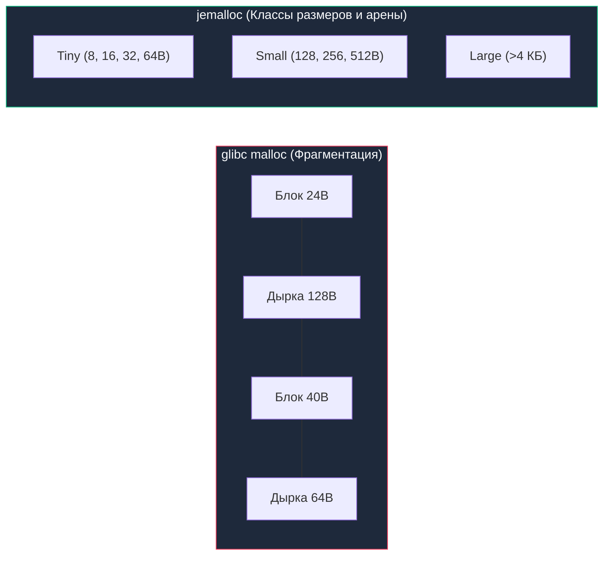
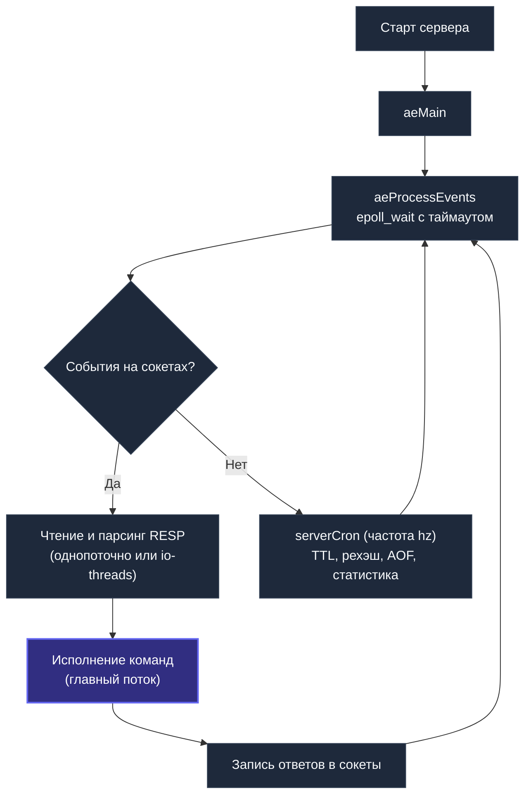

*Как аллокатор `jemalloc` и компактные структуры `listpack`/`intset` экономят RAM, что происходит при `fork()` и Copy-on-Write в RDB/AOF, как устроены 16 384 слота Cluster и как пайплайнинг и сериализация влияют на GC в Go.*

> «Память часто была самым дорогим компонентом компьютера. Когда на счету был каждый байт, этот дефицит навязывал программистам особую дисциплину: приходилось постоянно отдавать себе отчёт, сколько памяти занимает программа, а порой и прибегать к ухищрениям и рискованным приёмам, чтобы втиснуть её в доступный объём.»  
> — Брайан Керниган, *UNIX: A History and a Memoir*

В главе [[3. Redis — архитектура, структуры данных, RESP и работа из Go]] мы увидели Redis снаружи: однопоточный event loop, `RESP` и структуры данных. Но в продакшене всплывают загадки, которые не объяснить документацией API: почему при ночном `BGSAVE` контейнер в Kubernetes падает с `OOMKilled`, почему добавление одного элемента резко увеличивает память хеша и почему `p99` в Go растёт при 150-микросекундных ответах Redis. Ответы лежат на уровне аллокатора `jemalloc`, системного вызова `fork()`, хеш-слотов и буферов драйвера Go.

---

## Память и аллокатор `jemalloc`

Redis постоянно выделяет и освобождает миллионы мелких объектов. Стандартный `glibc malloc` при такой нагрузке фрагментирует страницы памяти, оставляя неиспользуемые «дырки». Поэтому в Linux Redis собирается с **jemalloc**.



`jemalloc` нарезает память на классы размеров (*size classes*) и арены с локальным кэшем `tcache`, мгновенно переиспользуя освобождённые блоки того же размера без внешней фрагментации. Соотношение выделенной у ОС памяти и реально занятой данными показывает метрика `mem_fragmentation_ratio` в `INFO MEMORY`: рост выше `1.5` при активном удалении ключей сигнализирует о фрагментации (лечится `MEMORY PURGE` или `activedefrag yes`, а не со стороны Go).

---

## Типы данных под микроскопом

Redis применяет **полиморфное внутреннее кодирование**, переключая представление ключа в зависимости от его размера.

* **`SDS` (*Simple Dynamic String*):** строки хранятся не как `char*`, а в структуре `sdshdr8`/`sdshdr16`/`sdshdr32`/`sdshdr64` с полями `len`, `alloc`, `flags` и гибким буфером `buf[]`. Это даёт $O(1)$ получение длины, бинарную безопасность (внутри допустимы нули), защиту от переполнения и плотное попадание в 1–2 кэш-линии CPU.
* **Словарь `dict` и инкрементальное рехэширование:** глобальная таблица `server.db[i].dict` хранит две хеш-таблицы `ht_table[2]` и индекс `rehashidx`. При расширении `rehashidx != -1`, и каждый вызов чтения, записи или `SCAN` переносит один бакет (`_dictRehashStep`), а фоновый цикл дорабатывает порциями по миллисекунде — без пауз *stop-the-world* ценой временного двойного расхода памяти.
* **`ziplist`, `listpack`, `intset`, `quicklist`:** на 64-битном CPU два указателя `prev`/`next` весят 16 байт. Для мелких коллекций (до `hash-max-listpack-entries = 512`) Redis упаковывает элементы подряд в единый байтовый массив без указателей. В старом `ziplist` каждый элемент хранил длину предыдущего (риск каскадных обновлений при вставке в середину); в **`listpack`** (с Redis 7.0) каждый элемент хранит только собственную длину. Для чисто целочисленных множеств до 512 элементов используется отсортированный массив **`intset`** (`int16`/`int32`/`int64`, поиск $O(\log N)$). Списки строятся поверх **`quicklist`** — связного списка узлов `ziplist`/`listpack`.
* **`Sorted Set` (`skiplist` + `dict`):** для крупных рейтингов держит одновременно список с пропусками (для диапазонов по `score`) и хеш-таблицу (для $O(1)$ поиска по имени). Расплата — около 64 байт накладных расходов на каждый элемент (три указателя `skiplist`, `dictEntry` и `score`).

---

## Event Loop `ae`, `serverCron` и многопоточный I/O

Сетевой цикл построен на собственной библиотеке **`ae`**, оборачивающей `epoll` (Linux), `kqueue` (BSD/macOS) или `/dev/poll`.



Периодическая функция **`serverCron`** с частотой `hz` удаляет просроченные ключи, двигает рехэш и запускает переписывание AOF. С версии Redis 6.0 чтение запросов и запись ответов можно вынести в несколько `io-threads`, но само исполнение команд всегда остаётся однопоточным.

> [!tip] Собеседование [Middle]
> **Вопрос:** Почему одна команда `KEYS *` или долгий Lua-скрипт замораживают весь сервер Redis?
>
> **Ответ:** Цикл `aeProcessEvents` выполняет команды последовательно в единственном потоке без вытеснения. Пока идёт линейный обход миллионов ключей или цикл в Lua VM, ядро не возвращается к `epoll_wait` и не отвечает ни одному клиенту. Решение — курсорный `SCAN` и переход с длинных скриптов на `Redis Functions` (Redis 7.0+) с поддержкой прерывания (`yield`).

---

## Персистентность: `fork()` и Copy-on-Write

Оба механизма сохранения на диск — **RDB** и **AOF** — завязаны на системный вызов `fork()`.

1. **RDB (`BGSAVE`):** родительский процесс делает `fork()`. Ядро Linux разделяет физические страницы между родителем и дочерним процессом в режиме **Copy-on-Write (CoW)**. Дочерний процесс пишет `dump.rdb` на SSD, но каждая модификация ключа родителем вызывает page fault и копирование 4 КБ страницы. При активной записи память вырастает в **1.5–2 раза** — контейнер без двойного запаса в Kubernetes получит `OOMKilled`.
2. **AOF (*Append-Only File*):** команды пишутся в буфер `aof_buf` и сбрасываются политикой `appendfsync`:
   * `always` — `fsync()` на каждую запись (сохранность ценой падения производительности на порядок из-за миллионов системных вызовов);
   * `everysec` — фоновый `fsync()` раз в секунду (компромисс: потеря до 1 с);
   * `no` — сброс на усмотрение ОС.
   Сжатие разросшегося журнала (`BGREWRITEAOF`) также запускает `fork()`.

---

## Репликация, Cluster, Pub/Sub, Streams и Lua

* **Репликация:** при старте (`PSYNC ? -1`) мастер делает `fork()`, пересылает RDB-снимок и догоняет изменения из циклического буфера **replication backlog** (подробнее о лаге репликации — в [[1. Репликация — синхронная, полусинхронная и асинхронная]]). Для подтверждения записи репликами служит `WAIT`.
* **Redis Cluster:** 16 384 хеш-слота (`CRC16(key) mod 16384`), обмен топологией по протоколу **gossip**. Ответы `MOVED` (постоянный перенос слота) и `ASK` (текущая миграция) автоматически отрабатывает `go-redis`. Для мультиключевых операций и Lua-скриптов ключи привязывают к одному слоту через **hash tags** `{account:1042}:balance` и `{account:1042}:limit`.
* **Pub/Sub, Streams и Lua:** в `Pub/Sub` сервер буферизует сообщения в `pubsub_channels`; медленных клиентов рвёт лимит `client-output-buffer-limit` (*backpressure*). В `Streams` ID лежат в префиксном дереве `rax`, данные — в `listpack`, а `XACK` очищает pending lists. Скрипты крутятся в одной Lua VM; с Redis 7+ реплицируются сгенерированные команды записи вместо случайных/временных вызовов (ранее применяли `redis.replicate_commands()`).

---

## Go-рантайм, RESP, пайплайнинг и давление на GC

Путь одного `rdb.Get(ctx, "account:1042:limit")` в Go:
1. Горутина берёт TCP-сокет из пула `go-redis` (каналы и атомики).
2. Драйвер пишет `RESP`-кадр (`*2\r\n$3\r\nGET\r\n...`) в сокет (`write` syscall).
3. Горутина паркуется в `_Gwaiting` в `netpoll` (`epoll`), не блокируя тред ОС.
4. Redis по `epoll_wait` находит ключ в `dict` и отвечает.
5. `netpoll` возвращает горутину в очередь `P`, парсер разбирает `RESP`.

Так как 90% времени уходит на сеть и системные вызовы, **пайплайнинг (`Pipeline`)** и **мультиплексирование** упаковывают $N$ команд в один вызов `write()` (один TCP-сегмент) и читают ответы за минимум `read()`, сокращая число syscall с $2N$ до $2$ и оставляя один RTT вместо $N$:

```go
package main

import (
	"context"
	"fmt"
	"log"
	"time"

	"github.com/redis/go-redis/v9"
)

type AccountBatchItem struct {
	ID         int64
	LimitMinor int64
}

func BatchSetAccountLimits(ctx context.Context, rdb *redis.Client, items []AccountBatchItem) error {
	pipe := rdb.Pipeline()
	for _, item := range items {
		key := fmt.Sprintf("{account:%d}:daily_limit", item.ID)
		pipe.Set(ctx, key, item.LimitMinor, 15*time.Minute)
	}
	if _, err := pipe.Exec(ctx); err != nil {
		return fmt.Errorf("pipeline exec: %w", err)
	}
	return nil
}

func main() {
	rdb := redis.NewClient(&redis.Options{Addr: "localhost:6379"})
	defer rdb.Close()

	ctx, cancel := context.WithTimeout(context.Background(), 2*time.Second)
	defer cancel()

	items := []AccountBatchItem{{ID: 1042, LimitMinor: 5_000_000}, {ID: 1043, LimitMinor: 2_500_000}}
	if err := BatchSetAccountLimits(ctx, rdb, items); err != nil {
		log.Fatal(err)
	}
	fmt.Printf("Batch updated %d account limits\n", len(items))
}
```

### Сериализация, аллокации и давление на GC

На высоких RPS `encoding/json` с рефлексией порождает поток временных структур в куче Go. Это быстрее доводит память до триггера `GOGC`, чаще запускает *Concurrent Mark* и включает *GC Mark Assist* на рабочих горутинах, задирая хвосты `p99`.

Чтобы снизить давление на GC:
1. Используйте `.Scan(&target)` для плоских хешей и примитивов.
2. Заменяйте JSON на `msgpack` или `protobuf` (на 30–50% быстрее и меньше аллокаций).
3. Переиспользуйте буферы через `sync.Pool`, а при чтении через `.Bytes()` помните о времени жизни буфера и *Escape Analysis*:

```go
func ReadRawSafe(ctx context.Context, rdb *redis.Client, key string) ([]byte, error) {
	raw, err := rdb.Get(ctx, key).Bytes()
	if err != nil {
		return nil, err
	}
	// Копируем срез, если он переживёт текущий обработчик, исключая гонки с буфером парсера
	out := make([]byte, len(raw))
	copy(out, raw)
	return out, nil
}
```

> [!tip] Собеседование [Senior/Staff]
> **Вопрос:** Чем отличаются `Pipeline`, `MULTI/EXEC` и Lua `EVALSHA`, и как убрать всплески `p99` в Go-сервисе при активном кэшировании в Redis?
>
> **Ответ:** `Pipeline` — сетевой батчинг без изоляции (другие клиенты могут вклиниться между командами). `MULTI/EXEC` (`TxPipeline`) выполняет очередь атомарно, но **не делает rollback** при ошибках выполнения вроде `WRONGTYPE`. `EVALSHA` исполняет закэшированный Lua-скрипт целиком как одну неделимую команду с условной логикой. Для снижения `p99` на стороне Redis убирают Big Keys, `KEYS *` и swap, а в Go заменяют `encoding/json` на бинарные протоколы, включают пайплайнинг и `sync.Pool`, снимая `GC Mark Assist`.

---

## Опасности продакшена

> [!warning] Big Keys и свопинг ОС
> * **Big Keys:** команды `HGETALL` или `LRANGE 0 -1` на миллионах элементов выделяют гигантский буфер ответа и вешают event loop для всех клиентов. Используйте `HSCAN` или разбивайте ключи на бакеты.
> * **Свопинг ОС (`swap`):** вытеснение страниц Redis на диск замедляет ответы с микросекунд до десятков миллисекунд. Всегда отключайте swap на узлах с Redis и отслеживайте `mem_fragmentation_ratio`.

---

## Упражнения

### Упражнение 1 (Базовое)
В Redis Cluster Lua-скрипт для `{...}` не использовался и обратился к `account:1042:balance` и `account:1042:daily_limit`, упав с `CROSSSLOT`. Объясните ошибку и исправьте имена ключей.

> [!solution] Показать решение
> Разные имена дают разные значения `CRC16(key) mod 16384` и попадают на разные шарды кластера. Выделение общей части в **hash tag** — `{account:1042}:balance` и `{account:1042}:daily_limit` — заставит кластер считать CRC16 только от `account:1042`, поместив оба ключа в один слот.

### Упражнение 2 (Практическое)
В Kubernetes под Redis с 6 ГБ данных и лимитом `8Gi` при активной записи падает с `OOMKilled` во время ночного `RDB` (`save 60 1000`). Объясните физику и предложите два решения.

> [!solution] Показать решение
> `BGSAVE` вызывает `fork()`. Пока дочерний процесс читает снимок, активная запись в родителе триггерит **Copy-on-Write (CoW)**: ядро копирует изменённые 4 КБ страницы, раздувая память к 9–10 ГБ за пределы лимита `8Gi`. Решения: (1) увеличить лимит памяти минимум в 2 раза относительно `maxmemory` (`14Gi`); (2) выключить RDB на мастере и снимать снимки с реплики (или перейти на `AOF`, оставив запас под CoW для `BGREWRITEAOF`).

### Упражнение 3 (Со звёздочкой *)
При 40 000 RPS к Redis за 2 КБ JSON-объектами профиль `pprof` показывает 28% CPU в `encoding/json` и `gcAssistAlloc`, а `p99` улетает к 45 мс при среднем 2 мс. Опишите три шага оптимизации в Go и Redis.

> [!solution] Показать решение
> 1. Перевести сериализацию с `encoding/json` на `Protobuf`/`MessagePack` (или на `Redis Hash` + `.Scan()`), убрав рефлексию и снизив аллокации на 30–50%.
> 2. Объединить пакетные чтения/записи через `Pipeline` или `MGET`, сократив syscall и время жизни буферов запроса.
> 3. Использовать `sync.Pool` для буферов сериализации и `.Bytes()` без лишних конвертаций в `string`, чтобы разгрузить `GC Mark Assist` и стабилизировать `p99`.

---

## Мостик к следующей главе

Мы изучили Redis от `jemalloc` и `fork()` CoW до слотов кластера и давления на сборщик мусора Go. Богатый функционал Redis требует своей цены: однопоточного исполнения команд и аккуратного контроля памяти. А что, если структурами данных и персистентностью можно пожертвовать ради чистого многопоточного кэша на все 32 ядра CPU? В следующей главе этого модуля мы разберём **Memcached** — его `slab`-аллокатор, проблему *slab calcification* и честное сравнение с Redis.
