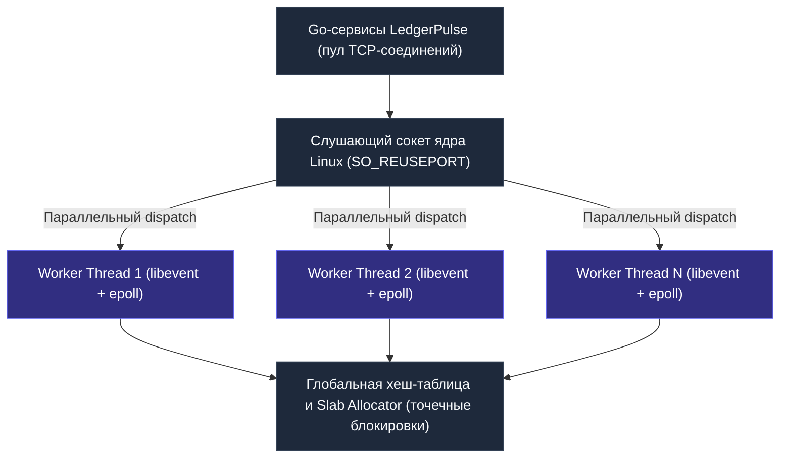
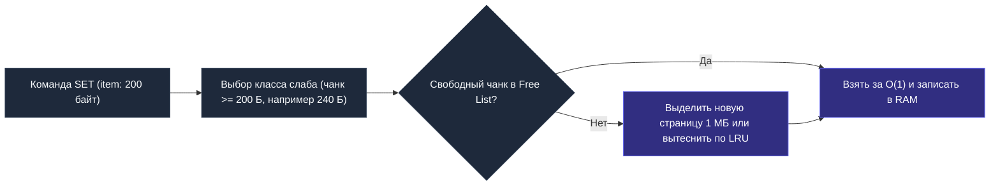

*Многопоточный event loop, классы памяти без внешней фрагментации, ловушка slab calcification, алгоритм LRU и работа из Go с консистентным хешированием.*

> «Пусть каждая программа хорошо делает одно дело. Для новой задачи пишите новую программу с нуля, а не усложняйте старую добавлением новых "фич".»  
> — Дуг Макилрой *(предисловие к «Bell Labs Technical Journal on Unix», июль 1978 г.; цитируется у Б. Кернигана в UNIX: A History and a Memoir)*

Сервис `LedgerPulse` разгружает PostgreSQL от десятков тысяч чтений профилей счетов, лимитов и курсов валют. Пока поток укладывается в десятки тысяч запросов в секунду, однопоточный цикл команд [[3. Redis — архитектура, структуры данных, RESP и работа из Go|Redis]] справляется с запасом. Но на 32-ядерном сервере при приближении к миллиону коротких `GET` в секунду главный поток Redis упирается в одно ядро CPU. Если приложению не нужны ни ZSet, ни списки, ни снимки на диск, держать сложную обвязку невыгодно.

Для таких нагрузок создан **Memcached**. Если Redis — швейцарский нож, то Memcached — узкий скальпель: только плоские байтовые значения, операции за $O(1)$, ноль дисковой персистентности и параллельная работа на всех ядрах CPU. Его написал в 2003 году Брэд Фитцпатрик для LiveJournal — инженер, который позже стал одним из ключевых авторов Go и `net/http`.

---

## Многопоточная архитектура

В отличие от классического Redis, Memcached заложил **настоящий параллелизм** в фундамент. Конкурентность отвечает за управление множеством соединений, а параллелизм — за их одновременное исполнение на разных ядрах. При старте процесс создаёт управляющий поток (`master`) и пул рабочих потоков (`worker threads`, по умолчанию 4, флаг `-t`).



Рабочие потоки принимают соединения на порту `11211` (через `SO_REUSEPORT` в Linux или распределение от `master`), и каждое соединение закрепляется за своим worker'ом с циклом событий `libevent` (`epoll`). Поиск в хеш-таблице, проверка TTL и чтение памяти идут прямо в этом потоке без центрального координатора. Разделяемые структуры защищены короткими спин-блокировками (`pthread_spinlock_t`) и мьютексами на классы памяти; тяжёлые операции вынесены за пределы блокировок. В терминах Go это похоже на `GOMAXPROCS > 1`, только каждый worker здесь — отдельный системный поток ОС.

---

## Slab allocator: память без внешней фрагментации

В [[4. Redis под капотом — однопоточный event loop, RDB, AOF, Cluster и пайплайнинг|Redis]] память выделяется через `jemalloc`. При миллионах частых `set` и `delete` разного размера обычная куча страдает от **внешней фрагментации**: суммарно байты свободны, но непрерывного блока нужной длины нет. Memcached устраняет её через **slab-аллокатор**:

1. **Страница (Page)** — неделимый блок физической памяти, запрашиваемый у ОС (по умолчанию **1 МБ**).
2. **Класс слаба (Slab Class)** — группа страниц, нарезанная на ячейки одинакового размера. Размеры растут геометрически с фактором `-f` (по умолчанию `1.25`: например, 96, 120, 152, 192 байта и так далее до 1 МБ).
3. **Чанк (Chunk)** — ячейка внутри страницы под ровно один объект `item` (заголовок, ключ, флаги, значение).



С точки зрения устройства железа slab даёт четыре плюса: нулевую внешнюю фрагментацию, локальность в кэшах L1/L2 (~1–4 нс против ~100 нс RAM) за счёт непрерывных страниц, аллокацию за десятки тактов CPU (взятие из `free list`) и независимые мьютексы на каждый класс.

> [!warning] Внутренняя фрагментация и Slab Calcification
> **Внутренняя фрагментация:** элемент 200 байт в 240-байтовом чанке теряет 40 байт. На 50 млн ключей это ~2 ГБ впустую — подбирайте `-f` (например, `-f 1.1`) под профиль объектов.
>
> **Slab Calcification:** страница, отданная классу, по умолчанию не возвращается другим классам. Если ночью загрузили объекты по 50 КБ, а днём идут 200-байтовые токены, малый класс начнёт вытеснять горячие ключи при гигабайтах пустых чанков в крупном классе. Включайте фоновую ребалансировку `-o slab_automove=1`, хотя при резких скачках размеров она срабатывает не мгновенно.

---

## Структура `item`, хеш-таблица и вытеснение

Memcached укладывает метаданные, ключ и значение в **один непрерывный чанк** (в отличие от Redis, где ключ в `SDS` и значение в `robj` лежат по разным указателям):

```c
typedef struct _stritem {
    struct _stritem *next, *prev; // двойной связный список LRU
    struct _stritem *h_next;      // цепочка коллизий в хеш-таблице
    rel_time_t      time, exptime;// последнее обращение и время истечения
    int             nbytes;       // длина значения
    unsigned short  refcount;
    uint8_t         nsuffix, it_flags, slabs_clsid, nkey;
    union { uint64_t cas; char end; } data[]; // следом: ключ, суффикс, данные
} item;
```

Один блок памяти означает меньше промахов кэша процессора при сравнении ключа и чтении значения.

### Хеш-таблица и рехэширование

Глобальная хеш-таблица — массив бакетов со связными списками (`h_next`), хеш-функция по умолчанию — Jenkins one-at-a-time или MurmurHash3 (`-o hash_algorithm=murmur3`). При переполнении таблицы расширением занимается поток `assoc_maintenance_thread`:

> [!tip] Собеседование [Middle]
> **Вопрос:** Чем рехэширование в Memcached отличается от Redis и как это влияет на задержки?
>
> **Ответ:** Redis рехэширует **инкрементально** — держит две таблицы и переносит по бакету на каждую операцию без пауз. В Memcached поток расширения переносит элементы пачками, удерживая блокировки бакетов и таблицы (ранее блокировал весь кэш). На сотнях миллионов ключей это даёт кратковременные скачки p99-задержки. Поэтому в устойчивом режиме Memcached быстрее за счёт простого кода, а при взрывном росте числа ключей Redis предсказуемее по хвостовым задержкам.

### TTL, Crawler и сегментированный LRU

Просроченные ключи удаляются двумя способами: **лениво** при обращении `get` (проверка `exptime`) и фоновым потоком **`lru_crawler`** (с версии 1.4.25), который периодически чистит хвосты списков. Вытеснение идёт строго **внутри своего класса слабов** через сегментированный LRU (`HOT`, `WARM`, `COLD`, `TEMP`): одноразовые чтения не вымывают горячие ключи из `WARM`.

---

## Zero Persistence, протокол и Go 1.24

Memcached **не сохраняет данные на диск**: нет ни RDB, ни AOF, ни `fork()`. Отсутствие дискового I/O (~100 мкс NVMe, ~10 мс HDD) даёт стабильную скорость в RAM (~100 нс), но перезапуск полностью обнуляет кэш. Сервис `LedgerPulse` обязан переживать холодный старт деградацией к PostgreSQL без потери бизнес-логики (стратегии защиты от лавины промахов вроде `singleflight` разберём в Модуле 10).

Физический путь `GET` из Go-сервиса выглядит так: горутина отправляет ASCII-команду `get key\r\n` через `write()` и паркуется в `netpoller` (поток ОС свободен); `epoll_wait` в worker'е Memcached находит `item`, обновляет LRU и пишет ответ `VALUE ...` из непрерывного чанка в сокет; `netpoller` пробуждает горутину. Поездка по локальной сети укладывается в ~200–400 мкс.

Memcached поддерживает текстовый протокол (`get`, `set`, `add`, `cas`, `incr`, `delete`), устаревший бинарный и новый компактный Meta-протокол (`mg`, `ms`). Сервер не умеет ни кластеризации, ни репликации — клиент на Go (`github.com/bradfitz/gomemcache/memcache`) сам распределяет ключи по пулу серверов через консистентное хеширование ([[4. Шардирование (Sharding) — ключи, консистентное хеширование и перебалансировка]]).

Пример атомарного уменьшения суточного лимита в `LedgerPulse` через оптимистичный `CAS` (Check-and-Set):

```go
func DecrementDailyLimit(mc *memcache.Client, accountID, deltaCents int64) (int64, error) {
	key := fmt.Sprintf("acct:limit:%d", accountID)
	for range 5 {
		item, err := mc.Get(key) // возвращает item вместе с 64-битным casid
		if err != nil {
			return 0, err // memcache.ErrCacheMiss или сетевая ошибка
		}
		cur, err := strconv.ParseInt(string(item.Value), 10, 64)
		if err != nil || cur < deltaCents {
			return 0, errors.New("invalid or exceeded daily limit")
		}
		next := cur - deltaCents
		item.Value = []byte(strconv.FormatInt(next, 10))
		item.Expiration = 300 // 5 минут

		if err = mc.CompareAndSwap(item); err == nil {
			return next, nil
		}
		if !errors.Is(err, memcache.ErrCASConflict) {
			return 0, err
		}
	}
	return 0, errors.New("cas conflict limit reached")
}
```

Вывод при конкурентном запуске двух горутин с исходным лимитом `50000`:

```text
goroutine-1: gets acct:limit:42 -> val=50000, casid=9104 -> cas -> STORED (new=45000)
goroutine-2: gets acct:limit:42 -> val=50000, casid=9104 -> cas -> EXISTS (ErrCASConflict, retry #1)
goroutine-2: gets acct:limit:42 -> val=45000, casid=9105 -> cas -> STORED (new=40000)
```

---

## Memcached против Redis

| Характеристика | Memcached | Redis |
|---|---|---|
| **Потоковая модель** | Многопоточная (`libevent` на каждом worker) | Однопоточный цикл команд (+ I/O-потоки) |
| **Типы данных** | Плоские байты (Opaque Blobs) | Строки, хеши, списки, множества, ZSet, Streams |
| **Аллокатор памяти** | Slab allocator (без внешней фрагментации) | `jemalloc` (динамическая куча) |
| **Персистентность** | Нет | RDB и AOF |
| **Кластер и репликация** | Шардинг на клиенте | Cluster (16 384 слота) + Sentinel |
| **Очистка TTL** | Ленивая + `lru_crawler` | Ленивая + активная (`serverCron`) |
| **Серверные скрипты** | Нет | Lua и Redis Functions |
| **Лимит значения** | 1 МБ по умолчанию (флаг `-I`) | 512 МБ |
| **Целевой сценарий** | Простой кэш на многоядерном железе | Кэш + структуры, очереди, блокировки |

> [!tip] Собеседование [Junior]
> **Вопрос:** Можно ли хранить пользовательские сессии в Memcached вместо Redis?
>
> **Ответ:** Можно, если бизнес допускает принудительный перелогин пользователей при перезапуске или падении узла кэша. В отличие от Redis с AOF и репликацией, Memcached не сохраняет сессии на диск и не реплицирует их.

> [!warning] Типовые ловушки продакшена
> 1. **Лимит 1 МБ:** при превышении сервер возвращает `SERVER_ERROR object too large for cache`.
> 2. **Открытый порт 11211:** нет встроенного пароля по умолчанию — изолируйте сетью или включайте SASL/TLS и отключайте UDP (защита от DDoS-амплификации).
> 3. **Slab Calcification:** мониторьте `evictions` по каждому классу через `stats slabs`, а не только общий объём свободной RAM.
> 4. **Потеря обновлений:** `mc.Set` перезаписывает ключ вслепую; для счётчиков используйте `CompareAndSwap` или `Increment`/`Decrement`.
> 5. **Мультигет и таймауты:** запрос сотен ключей одним `GetMulti` чувствителен к `Timeout` клиента — падение одного шарда задерживает ответ.

---

## Упражнения

1. **Базовое.** Элемент `item` (ключ + заголовок + снимок счёта) весит `360` байт. При факторе роста `-f 1.25` соседние классы слабов имеют чанки `304` и `384` байта. Сколько мегабайт уйдёт на внутреннюю фрагментацию для `10 000 000` ключей и как повлияет переход на `-f 1.1`?

> [!solution] Показать решение
> Элемент `360` байт попадает в чанк `384` байта, теряя `384 - 360 = 24` байта на ключ. На 10 млн ключей это $10\,000\,000 \times 24\text{ Б} \approx 228.9\text{ МБ}$ впустую. При факторе `-f 1.1` сетка размеров станет плотнее (ближайший чанк около `368` байт), снижая потери до ~76 МБ ценой большего числа классов слабов.

2. **Практическое.** Напишите метод на Go `GetOrLoadAccount(ctx context.Context, id int64) ([]byte, error)` поверх `memcache.Client`, который при `memcache.ErrCacheMiss` читает байты из `loadFromDB(ctx, id)` и сохраняет их через `mc.Add` с TTL `120` секунд. Объясните, почему здесь `Add` безопаснее `Set`.

> [!solution] Показать решение
> ```go
> func (s *Service) GetOrLoadAccount(ctx context.Context, id int64) ([]byte, error) {
> 	key := fmt.Sprintf("acct:snap:%d", id)
> 	if item, err := s.mc.Get(key); err == nil {
> 		return item.Value, nil
> 	} else if !errors.Is(err, memcache.ErrCacheMiss) {
> 		return nil, err
> 	}
> 	data, err := s.loadFromDB(ctx, id)
> 	if err != nil {
> 		return nil, err
> 	}
> 	_ = s.mc.Add(&memcache.Item{Key: key, Value: data, Expiration: 120})
> 	return data, nil
> }
> ```
> Если две горутины поймали промах, но первая прочитала старые данные и задержалась, пока вторая уже обновила БД и кэш, слепой `Set` первой горутины затрёт свежую запись. `Add` срабатывает только при отсутствии ключа.

3. **Со звёздочкой (\*).** В продакшене на сервере Memcached (16 ГБ RAM) занято лишь 6 ГБ из 16 ГБ, но в `slab 6` (304 Б) метрика `evictions` выросла до 5 000/с. Объясните причину и план лечения без перезапуска процесса.

> [!solution] Показать решение
> Это **slab calcification**: оставшиеся 10 ГБ страниц ранее забрали другие классы, и после удаления их ключей страницы не перераспределились.
> 1. Проверить `stats slabs` (найти классы с высоким `total_pages` и низким `used_chunks`).
> 2. Передать пустые страницы горячему классу на лету: `slabs reassign <src> <dst>` или включить автобалансировку `slabs automove 1`.
> 3. Проверить приложение на изменение размера сериализуемых ключей и закрепить `-o slab_automove=1,lru_crawler` в конфиге.

---

Memcached выжимает максимум из многоядерного железа для плоских кэшей. Но если `LedgerPulse` нужны структуры данных Redis, Lua-скрипты и репликация без ограничений новой лицензии Redis 7.4+, переходим к открытому форку в следующей главе: [[6. Valkey — открытый форк Redis и совместимость экосистемы]].
