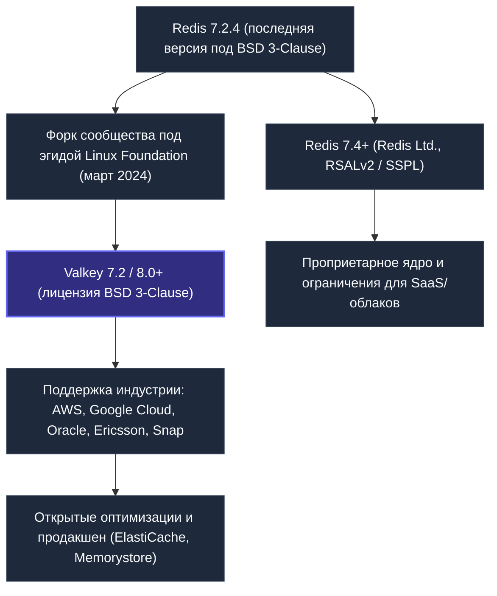

*Смена лицензии Redis в 2024 году, рождение Valkey под эгидой Linux Foundation, архитектурные оптимизации и бесшовная миграция сервисов Go.*

> «Решения, определившие развитие этой технологии и путь, по которому мы пошли, принимали живые люди — под давлением и в жёстких ограничениях своего времени.»  
> — Брайан Керниган, *UNIX: A History and a Memoir*

Весна 2024 года принесла инфраструктурным командам неприятный сюрприз. Сервис `LedgerPulse` годами опирался на Redis для ключей идемпотентности, rate limiting и скользящих окон антифрода. В марте компания Redis Ltd. объявила, что начиная с версии 7.4 ядро Redis больше не выходит под свободной лицензией BSD 3-Clause, а переходит на двойное лицензирование RSALv2 / SSPL. Для компаний, предоставляющих облачные сервисы и SaaS-платформы, SSPL создаёт жёсткие юридические ограничения вплоть до требования открыть исходный код обвязки, а ведущие дистрибутивы Linux (Debian, Fedora, Ubuntu, Red Hat) закрыли новым релизам Redis путь в официальные репозитории.

Переписывать код на Go под принципиально другую СУБД — вроде перехода на [[5. Memcached — slab-аллокатор и многопоточный кэш в памяти|Memcached]] с потерей структур данных и Lua-скриптов — слишком дорого. Ответом индустрии стал **Valkey**: прямой открытый форк Redis под управлением Linux Foundation, сохранивший 100% совместимость по сетевому протоколу и экосистеме Go.

---

## История развилки: почему появился Valkey

Redis создавался итальянским инженером Сальваторе Санфилиппо (`antirez`) как классический open-source проект под лицензией BSD. В 2020 году автор отошёл от руководства проектом, и развитие репозитория полностью сосредоточилось в руках коммерческой компании Redis Ltd.

Сначала ограничения коснулись дополнительных модулей (`RedisJSON`, `RediSearch`, `RedisGraph`), которые перевели под проприетарную лицензию RSAL. Кульминация наступила **20 марта 2024 года**: ядро Redis с версии 7.4 утратило статус свободного ПО по определению OSI (Open Source Initiative) и перешло на связку RSALv2 и SSPL v1.

Последствия для рынка оказались мгновенными:

* **Облачные провайдеры** (AWS, Google Cloud, Oracle) столкнулись с невозможностью обновлять управляемые сервисы вроде Amazon ElastiCache и Google Cloud Memorystore новыми версиями Redis без сложных лицензионных соглашений.
* **Мейнтейнеры Linux** исключили Redis 7.4+ из свободных веток пакетов.
* **Независимые контрибьюторы** потеряли интерес развивать код, права на который контролирует одна корпорация с правом менять правила игры в любой момент.

Уже **28 марта 2024 года** некоммерческая организация Linux Foundation официально запустила проект **Valkey** на базе последней свободной версии **Redis 7.2.4** под лицензией **BSD 3-Clause**. В проект вошли ведущие мейнтейнеры ядра Redis прошлых лет при поддержке AWS, Google Cloud, Oracle, Ericsson и Snap.



---

## Архитектурная преемственность и полная совместимость

Valkey 7.2 и последующие мажорные ветки (Valkey 8.0+) выросли из кодовой базы, которую мы разобрали в главах [[3. Redis — архитектура, структуры данных, RESP и работа из Go]] и [[4. Redis под капотом — однопоточный event loop, RDB, AOF, Cluster и пайплайнинг]]. На уровне фундамента сохранены все ключевые механизмы:

* **Модель исполнения:** главный поток с циклом событий (`epoll`/`kqueue`) для атомарного исполнения команд над структурами в памяти, дополненный рабочими I/O-потоками для сетевого обмена.
* **Структуры данных в RAM:** строки `SDS`, компактные списки `listpack`/`quicklist`, целочисленные множества `intset`, упорядоченные множества `skiplist + dict` и потоки `Streams` поверх `radix tree`.
* **Память и сохранность:** аллокатор `jemalloc`, снимки `RDB`, журнал `AOF`, механизм `fork()` с Copy-on-Write, классическая репликация, `Sentinel` и `Cluster` с 16 384 хеш-слотами.

### Совместимость по проводам и конфигурации

Для прикладных сервисов Valkey выступает **drop-in заменой** Redis 7.2:

1. **Протокол RESP2 и RESP3** сохранён без расхождений в форматах фреймов и кодах ошибок.
2. **Семантика команд** (включая транзакции `MULTI`/`EXEC` и Lua-скрипты) остаётся идентичной.
3. **Файлы конфигурации** (`redis.conf` / `valkey.conf`) и команды администрирования (`CONFIG SET`, `CONFIG GET`) взаимозаменяемы.
4. **Go-драйверы** (`github.com/redis/go-redis/v9`, `github.com/redis/rueidis`, `redigo`) работают с Valkey без переписывания бизнес-логики — достаточно поменять адрес подключения в конфигурации.

Ниже показан минимальный клиент `LedgerPulse` на Go 1.24, который проверяет идемпотентность входящего платежа и читает метку движка через `INFO server`:

```go
package main

import (
	"context"
	"fmt"
	"log"
	"strings"
	"time"

	"github.com/redis/go-redis/v9"
)

func main() {
	ctx, cancel := context.WithTimeout(context.Background(), 3*time.Second)
	defer cancel()

	// Стандартный клиент go-redis работает с Valkey по протоколу RESP3 без изменений
	rdb := redis.NewClient(&redis.Options{
		Addr:         "127.0.0.1:6379",
		Protocol:     3, // включаем RESP3
		PoolSize:     32,
		MinIdleConns: 8,
	})
	defer rdb.Close()

	if err := rdb.Ping(ctx).Err(); err != nil {
		log.Fatalf("ошибка подключения к Valkey: %v", err)
	}

	// Запись ключа идемпотентности для защиты от дубля платежа в LedgerPulse
	idemKey := "idem:tx:9f8c2a1b"
	acquired, err := rdb.SetNX(ctx, idemKey, "processing", 15*time.Minute).Result()
	if err != nil {
		log.Fatalf("ошибка SetNX: %v", err)
	}
	fmt.Printf("Ключ идемпотентности %s захвачен: %v\n", idemKey, acquired)

	// Проверяем метаданные сервера через INFO server
	info, err := rdb.Info(ctx, "server").Result()
	if err != nil {
		log.Fatalf("ошибка INFO: %v", err)
	}
	for line := range strings.SplitSeq(info, "\r\n") {
		if strings.HasPrefix(line, "valkey_version:") || strings.HasPrefix(line, "redis_version:") {
			fmt.Println("Сервер:", line)
		}
	}
}
```

Типичный вывод при запуске против Valkey 8.0:

```text
Ключ идемпотентности idem:tx:9f8c2a1b захвачен: true
Сервер: redis_version:7.2.4
Сервер: valkey_version:8.0.1
```

Обратите внимание на строку `redis_version:7.2.4`: Valkey намеренно оставляет это поле в `INFO` (наряду с `valkey_version`), чтобы старые клиенты, панели мониторинга и операторы автоматизации не ломали парсеры при переходе.

---

## Что Valkey уже улучшил под капотом

Хотя проект стартовал как точный клон Redis 7.2.4, открытое управление быстро сняло накопленные заторы в приёме патчей. В релизе **Valkey 8.0** и последующих обновлениях инженеры сосредоточились на пропускной способности, локальности памяти и репликации:

* **Переработанный многопоточный ввод-вывод:** в Redis 6/7 I/O-потоки помогали только читать и писать сокеты. Valkey 8.0 расширил разгрузку: дополнительные потоки берут на себя парсинг протокола `RESP`, подготовку буферов ответов и даже предварительную выборку данных (prefetching) в кэши CPU до передачи управления главному потоку. За счёт этого единичный узел Valkey на 32–64 ядрах при включённых `io-threads` пробивает отметку **1+ млн RPS** (втрое выше классической однопоточной конфигурации при активном пайплайнинге), сохраняя строгую атомарность команд.
* **Уплотнение структур хеш-таблицы в памяти:** в Valkey 8.0 оптимизирована внутренняя запись `dictEntry` и хранение сроков жизни (`expire`). Ключ и метаданные TTL укладываются компактнее, уменьшая накладные расходы RAM примерно на 10–20 байт на ключ и сокращая число косвенных переходов по указателям (меньше промахов в кэше L3 CPU при доступе в ~100 нс к основной памяти).
* **Оптимизация репликации (Dual-Channel RDB):** передача RDB-снимка и буфера репликации при первичной синхронизации разделена на параллельные потоки, что заметно сокращает задержку восстановления новой реплики и снижает нагрузку на главный поток Primary.
* **Более агрессивный возврат памяти ОС:** доработана интеграция с `jemalloc`, чтобы после массового удаления ключей свободные страницы быстрее возвращались ядру Linux.
* **Современный сетевой стек:** полноценная поддержка IPv6 и расширенная поддержка `TLS`/`mTLS` как между Go-клиентами и узлом, так и на межузловых каналах кластера.
* **Открытые модули:** сообщество развивает открытые BSD-совместимые модули `valkey-json`, `valkey-search` (включая векторный поиск, о котором речь пойдёт в главе 14) и `valkey-bloom`.

### Физика взаимодействия Valkey и Go-рантайма

Снижение числа копирований при сборке ответов `RESP` и оптимизация `epoll` внутри Valkey напрямую экономят время на обеих сторонах соединения. На 32-ядерной машине сервис на Go держит пул соединений (`PoolSize`) из десятков или сотен горутин, отправляющих батчи команд через пайплайнинг. Сетевой цикл внутри ЦОД занимает около 200–400 мкс, обработка команды в RAM Valkey — единицы микросекунд, а у Go-приложения благодаря `netpoller` потоки ОС не простаивают в ожидании сокета. Чем быстрее Valkey выгружает ответы из сокетных буферов, тем меньше активных соединений нужно держать открытыми и тем реже горутины выстраиваются в очередь на чтение.

> [!tip] Собеседование [Middle]
> **Вопрос:** Придётся ли переписывать код Go-сервиса при миграции кластера с Redis 7.2 на Valkey 8.0?
>
> **Ответ:** Если сервис использует только стандартные команды Redis (строки, хеши, ZSet, Streams, Lua) через `go-redis`, `rueidis` или `redigo`, менять бизнес-логику не нужно — протокол RESP2/RESP3 и семантика полностью совместимы. Но проверку перед переключением провести необходимо в двух точках: во-первых, в коде мониторинга и healthcheck'ов, которые могут парсить `INFO server` и ожидать строго одного поля версии; во-вторых, в списке модулей — если сервис вызывал проприетарные команды вроде `JSON.GET` или `FT.SEARCH` из Redis Stack, нужно заранее подключить открытые аналоги (`valkey-json`, `valkey-search`) и прогнать интеграционные тесты на совместимость синтаксиса.

---

## Сравнение Valkey, Redis 7.4+ и Memcached

| Критерий | Valkey (8.0+) | Redis (7.4+) | Memcached |
|---|---|---|---|
| **Лицензия** | BSD 3-Clause (одобрена OSI) | RSALv2 / SSPL (несвободная) | BSD |
| **Управление проектом** | Linux Foundation, открытый комитет | Единолично Redis Ltd. | Открытое сообщество |
| **Сетевой протокол** | RESP2 / RESP3 (совместим с Redis) | RESP2 / RESP3 | Текстовый / Meta / бинарный |
| **Структуры данных** | Все структуры Redis + открытые модули | Все структуры + коммерческие модули | Только плоские байты |
| **Персистентность** | RDB, AOF | RDB, AOF | Нет |
| **Репликация и кластер** | Полная (ускоренный sync, Sentinel, Cluster) | Полная (часть enterprise-фич платная) | Нет (клиентский шардинг) |
| **Модель потоков** | Главный поток команд + расширенные I/O-потоки | Главный поток команд + I/O-потоки | Полная многопоточность (libevent) |
| **Интеграция с Go** | Нативная через `go-redis` / `rueidis` | Нативная, но есть лицензионные риски | Нативная через `gomemcache` |

---

## Ловушки при выборе и миграции

> [!warning] Подводные камни перехода на Valkey
> 1. **Лицензионный риск SSPL в облаке и SaaS.** Если ваша компания продаёт продукт по модели SaaS или строит управляемую инфраструктуру для сторонних клиентов, использование Redis 7.4+ под SSPL требует юридической экспертизы — открытый Valkey полностью снимает этот риск.
> 2. **Откат по версиям протокола RDB при миграции с Redis 7.4+.** Прямая репликация и загрузка RDB-дампа работают гладко с Redis ≤ 7.2. Если вы уже успели обновиться до Redis 7.4 и сменили формат RDB-снимка (поднялась версия RDB), простой подкладкой файла в Valkey не обойтись — потребуется миграция на уровне команд через `SCAN` + `DUMP`/`RESTORE` или утилиты вроде `RIOT`.
> 3. **Прямая зависимость от проприетарных модулей.** Команды Redis Stack (`RediSearch`, `RedisTimeSeries`, `RedisJSON`) не входят в базовый бинарник Valkey без установки отдельных плагинов. Проверьте список модулей командой `MODULE LIST` до начала переезда.
> 4. **Конфигурация `io-threads` на малых инстансах.** Включать 8–16 I/O-потоков на 2-ядерной виртуальной машине бессмысленно: потоки будут конкурировать за одни и те же ядра и ухудшат задержки из-за переключений контекста. Число `io-threads` всегда выбирают меньше числа физических ядер CPU и включают при высокой сетевой нагрузке.

---

## Упражнения

1. **Базовое.** Команда `LedgerPulse` разворачивает новый сервис в AWS. Нагрузка — 80 тыс. RPS, требуются сортированные множества `ZSet` для скользящих временных окон антифрода, сохранение состояния при перезапуске (`AOF`) и отсутствие лицензионных ограничений для коммерческого SaaS. Сравните Redis 7.4+, Memcached и Valkey 8.0 и обоснуйте выбор одной системы.

> [!solution] Показать решение
> **Оптимальный выбор — Valkey 8.0.**
> * **Memcached не подходит:** в нём нет ни `ZSet` для скользящих окон, ни персистентности на диск.
> * **Redis 7.4+ не подходит по лицензии:** переход на RSALv2/SSPL несёт юридические риски при коммерческой облачной эксплуатации и блокирует получение обновлений в дистрибутивах Linux.
> * **Valkey 8.0** предоставляет `ZSet`, `AOF`, готовую поддержку в управляемых облаках (ElastiCache) и свободную лицензию BSD 3-Clause без изменения Go-кода.

2. **Практическое.** Напишите функцию на Go 1.24 `DetectKVEngine(ctx context.Context, rdb *redis.Client) (engine string, version string, err error)`, которая выполняет `INFO server`, корректно определяет, работает ли приложение с Valkey или классическим Redis (учитывая, что Valkey выводит оба поля — `valkey_version` и `redis_version`), и возвращает имя движка (`"valkey"` или `"redis"`) и его точную версию.

> [!solution] Показать решение
> ```go
> func DetectKVEngine(ctx context.Context, rdb *redis.Client) (string, string, error) {
> 	info, err := rdb.Info(ctx, "server").Result()
> 	if err != nil {
> 		return "", "", fmt.Errorf("info server: %w", err)
> 	}
>
> 	var redisVer, valkeyVer string
> 	for line := range strings.SplitSeq(info, "\n") {
> 		line = strings.TrimSpace(line)
> 		if v, ok := strings.CutPrefix(line, "valkey_version:"); ok {
> 			valkeyVer = v
> 		} else if v, ok := strings.CutPrefix(line, "redis_version:"); ok {
> 			redisVer = v
> 		}
> 	}
>
> 	if valkeyVer != "" {
> 		return "valkey", valkeyVer, nil
> 	}
> 	if redisVer != "" {
> 		return "redis", redisVer, nil
> 	}
> 	return "", "", errors.New("unknown server version in INFO output")
> }
> ```
> **Разбор:** важно проверять `valkey_version` **первым**, поскольку ради обратной совместимости Valkey включает в `INFO` и строку `redis_version`. Использование `strings.SplitSeq` и `strings.CutPrefix` (идиомы Go 1.24) позволяет обойти строки без выделения лишнего слайса.

3. **Со звёздочкой (\*).** В продакшене `LedgerPulse` крутится кластер из трёх узлов Redis 7.2 (1 Primary + 2 Replica под управлением Sentinel) с 24 ГБ данных в памяти. Простой сервиса при переключении недопустим. Спроектируйте пошаговый план миграции на Valkey 8.0 без потери данных и без остановки записи.

> [!solution] Показать решение
> Переезд выполняется по схеме **поэтапной репликации (Rolling Replication Migration)**, так как формат протокола репликации и RDB в Valkey 8.0 совместим с Redis 7.2:
> 1. **Подготовка:** поднимаем новый узел `valkey-1` (Valkey 8.0) и подключаем его как реплику к текущему `redis-primary` (`REPLICAOF <redis-primary-ip> 6379`). На время первичной синхронизации проверяем лимит `client-output-buffer-limit replica`, чтобы дамп 24 ГБ не оборвал канал.
> 2. **Проверка и прогрев:** дожидаемся состояния `master_link_status:up` и нулевого лага (`offset` догнал Primary), проверяем контрольные метрики и читаем тестовые ключи с `valkey-1` (в режиме read-only).
> 3. **Второй и третий узлы:** аналогично разворачиваем `valkey-2` и привязываем к кластеру либо подключаем Sentinel к новой топологии.
> 4. **Переключение записи (Failover):** в окно минимальной нагрузки переводим `redis-primary` в режим `CONFIG SET min-replicas-to-write` / паузы записи на секунду (`CLIENT PAUSE WRITE` в Redis 7.2), ждём выравнивания `offset` на `valkey-1`, делаем `REPLICAOF NO ONE` на `valkey-1`, переключаем DNS / Sentinel на `valkey-1` как новый Primary и перецепляем `valkey-2` к нему.
> 5. **Откат:** старый `redis-primary` остаётся холодным резервом в течение нескольких часов после переключения.

---

Мы закрыли семейство быстрых in-memory хранилищ: от плоских байтов Memcached до богатых структур Redis и его открытого преемника Valkey. Но оперативная память стоит дорого, а далеко не все данные ограничиваются ключами и небольшими структурами. Что делать, когда в `LedgerPulse` появляются сложные профили клиентов со вложенными адресами, анкетами комплаенса и произвольным набором полей, которые меняются каждую неделю? Переходим к документной модели данных в следующей главе: [[7. Документные базы данных — MongoDB и моделирование документов]].
