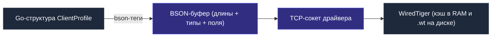
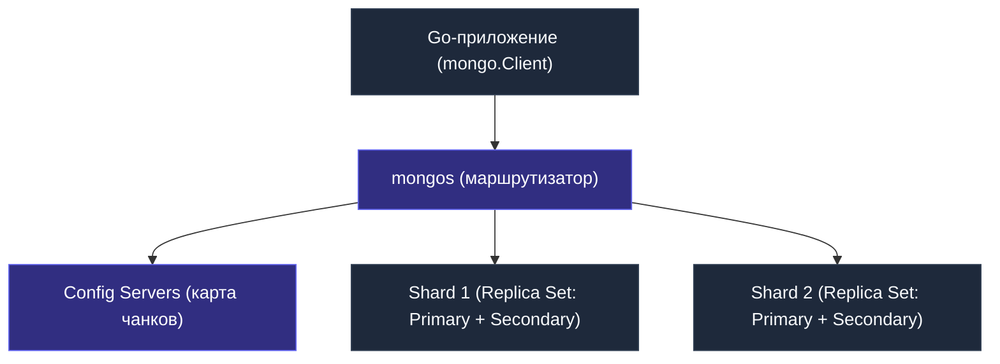

*Иерархические документы и формат BSON, встраивание против ссылок, индексы, мультидокументные транзакции, агрегационный конвейер и работа в Go без перегрузки GC.*

> «Сборка мусора — огромное подспорье при написании корректных программ, но она не избавляет вас от необходимости думать о памяти. Вам не нужно выделять и освобождать память вручную, однако для написания эффективного кода всё равно приходится понимать время жизни переменных.»  
> — Алан Донован и Брайан Керниган, *The Go Programming Language*

В ядре `LedgerPulse` счета и двойные проводки (`accounts`, `ledger_entries`) живут в строгом PostgreSQL. Но рядом растёт модуль проверки клиентов (KYC) и настроек интеграций: у физлица в анкете паспорт и адреса, у юрлица — бенефициары, уставные документы и правила вебхуков. В реляционной модели такие разнородные сущности превращаются либо в десяток разреженных таблиц с постоянными `ALTER TABLE`, либо в столбец [[5. JSONB в PostgreSQL — бинарное хранение, операторы и индексы|JSONB]].

Когда полуструктурированных профилей становятся сотни миллионов и требуется встроенное горизонтальное шардирование без ручной нарезки таблиц, выбирают **документные базы данных** и их флагмана — **MongoDB**. Если в [[2. Key-Value хранилища — от хеш-таблиц в памяти до LSM-деревьев|key-value хранилищах]] значение — непрозрачный массив байтов, то документная СУБД понимает внутреннюю иерархию JSON, индексирует вложенные поля с массивами и выполняет агрегации на сервере.

---

## Модель данных: документы, коллекции и `ObjectId`

* **Документ** — иерархическая запись из пар «ключ–значение» (включая вложенные объекты и массивы), хранимая в бинарном формате **BSON** (Binary JSON). Максимальный размер документа жёстко ограничен **16 МБ**.
* **Коллекция** — аналог таблицы без обязательной схемы: документы в одной коллекции могут иметь разные поля (опционально включается валидация `$jsonSchema`).
* **База данных** — контейнер коллекций.

Каждый документ содержит уникальное проиндексированное поле `_id`. Если оно не задано, драйвер генерирует 12-байтовый **`ObjectId`**: 4 байта UNIX-времени (грубая хронологическая сортировка), 5 байт идентификатора машины/процесса и 3 байта счётчика. Клиентская генерация избавляет от единого координатора ключей при шардировании.

```go
type ClientProfile struct {
	ID            bson.ObjectID `bson:"_id,omitempty"`
	AccountID     int64         `bson:"account_id"`
	Kind          string        `bson:"kind"` // "individual" или "corporate"
	Country       string        `bson:"country"`
	Status        string        `bson:"status"`
	SchemaVersion int           `bson:"schema_version"`
	Addresses     []Address     `bson:"addresses,omitempty"`
	UpdatedAt     time.Time     `bson:"updated_at"`
}

type Address struct {
	Type   string `bson:"type"`
	City   string `bson:"city"`
	Street string `bson:"street"`
}
```

### Денормализация: встраивание против ссылок

В реляционной модели мы нормализуем таблицы ([[9. Нормализация — зачем избавляться от аномалий]]), а в MongoDB осознанно применяем [[14. Денормализация — когда и как она оправдана|денормализацию]]: данные, читаемые вместе, хранятся в одном документе и загружаются за один поход на диск (~100 мкс на NVMe) без `JOIN`. Выбор между **встраиванием (embedding)** и **ссылками (referencing)** диктуется мощностью связи:

| Критерий | Встраивание (Embedding) | Ссылки (Manual References) |
|---|---|---|
| **Мощность связи** | `1:1` или ограниченное `1:N` (адреса, 2–5 бенефициаров) | Неограниченное `1:N` и `M:N` (миллионы проводок) |
| **Атомарность** | Изменение документа атомарно без транзакций | Требует отдельных запросов или транзакций |
| **Размер документа** | Риск упереться в **16 МБ** при росте массива | Размер родителя стабилен |

Правило для `LedgerPulse`: адреса встраиваются в `ClientProfile`, но история проводок никогда не помещается в массив внутри профиля.

---

## BSON, архитектура кластера и индексы

**BSON** — бинарный формат со строгой типизацией (`int32`, `int64`, `decimal128` для точных денег, `datetime`, `ObjectId`) и префиксами длины перед каждым документом и массивом. Префикс длины позволяет движку пропустить ненужный вложенный блок без парсинга его полей.



В Go `mongo-go-driver` сериализует данные через рефлексию: `bson.M` (`map[string]any`) не сохраняет порядок ключей и выделяет мапы в куче, усиливая давление на GC. `bson.D` (слайс пар) сохраняет порядок полей, а типизированные Go-структуры с тегами `` `bson:"..."` `` обеспечивают плотную раскладку и минимальное число аллокаций.

### От `mongod` к кластеру

Серверный процесс **`mongod`** опирается на многопоточный движок **WiredTiger** (подробно разберём в следующей главе). Для надёжности узлы объединяются в **Replica Set** (`Primary` + `Secondary`, репликация через `oplog`, выборы лидера по Raft-адаптации). Для горизонтального роста строится **Sharded Cluster**: маршрутизатор **`mongos`** направляет запросы в нужный Replica Set шард по карте из **`Config Servers`**.



Go-драйвер сам отслеживает топологию командой `hello` (ранее `isMaster`), держит пул соединений и автоматически переключается при смене `Primary`.

### Индексы MongoDB

Без индекса выполняется полное сканирование коллекции (`COLLSCAN`). Индексы строятся в B-деревьях WiredTiger (ср. [[2. B-Tree индекс под капотом — страницы, ветвление и page split]]):

* **Single Field / Compound** — по одному или нескольким полям, включая вложенные (`addresses.city`).
* **Multikey** — автоматически индексирует каждый элемент массива как отдельную запись B-Tree.
* **TTL** — фоново удаляет документы после истечения поля типа `Date`.
* **Text** (инвертированный для полнотекста), **Wildcard** (`"$**"` для динамических полей), **Hashed** (равномерный шардинг), **`2dsphere`** (геопоиск).

---

## Мультидокументные транзакции и потоки в Go

Базовая единица атомарности MongoDB — один документ. Начиная с 4.0 (Replica Set) и 4.2 (шарды) добавлены **мультидокументные ACID-транзакции** ([[1. ACID — четыре гарантии транзакции без иллюзий]], Snapshot Isolation из [[7. MVCC — многоверсионный контроль конкурентности]]). Они ограничены таймаутом (по умолчанию 60 с) и несут накладные расходы распределённой координации, поэтому применяются только там, где встраивание невозможно.

```go
func TransferBonusPoints(ctx context.Context, client *mongo.Client, fromAcc, toAcc, pts int64) error {
	session, err := client.StartSession()
	if err != nil {
		return err
	}
	defer session.EndSession(ctx)

	col := client.Database("ledgerpulse").Collection("loyalty_wallets")
	_, err = session.WithTransaction(ctx, func(sc context.Context) (any, error) {
		res, err := col.UpdateOne(sc,
			bson.D{{Key: "account_id", Value: fromAcc}, {Key: "points", Value: bson.D{{Key: "$gte", Value: pts}}}},
			bson.D{{Key: "$inc", Value: bson.D{{Key: "points", Value: -pts}}}},
		)
		if err != nil || res.MatchedCount == 0 {
			return nil, errors.New("debit loyalty failed")
		}
		_, err = col.UpdateOne(sc,
			bson.D{{Key: "account_id", Value: toAcc}},
			bson.D{{Key: "$inc", Value: bson.D{{Key: "points", Value: pts}}}},
		)
		return nil, err
	})
	return err
}
```

### Работа с железом, курсоры и агрегация

WiredTiger держит собственный кэш в RAM (~100 нс), сжимает страницы на диске алгоритмом `snappy` (меньше I/O ценой CPU) и сбрасывает `journal` (аналог [[8. WAL — журнал упреждающей записи и долговечность на диске|WAL]]) через `fsync` каждые 100 мс.

На стороне Go вызов `cursor.All()` загружает все документы сразу в большой слайс в куче — риск взрывного роста GC и OOM. Читайте большие выборки потоково через `cursor.Next(ctx)` с переиспользованием структуры:

```go
cursor, err := col.Find(ctx, bson.D{{Key: "status", Value: "verified"}}, options.Find().SetBatchSize(500))
if err != nil {
	return err
}
defer cursor.Close(ctx)

var profile ClientProfile
for cursor.Next(ctx) {
	if err := cursor.Decode(&profile); err != nil {
		return err
	}
	// обработка profile без накопления слайса в куче
}
return cursor.Err()
```

Подсчёты и группировки перекладывайте на сервер через **Aggregation Pipeline** (`$match`, `$group`, `$sort`, `$lookup`, `$project`), чтобы не гонять сырые документы по сети:

```go
pipeline := mongo.Pipeline{
	{{Key: "$match", Value: bson.D{{Key: "status", Value: "verified"}}}},
	{{Key: "$group", Value: bson.D{{Key: "_id", Value: "$country"}, {Key: "total", Value: bson.D{{Key: "$sum", Value: 1}}}}}},
	{{Key: "$sort", Value: bson.D{{Key: "total", Value: -1}}}},
}
// Вывод агрегации: {"_id": "DE", "total": 48120}, {"_id": "NL", "total": 19450}
```

Отсутствие DDL переносит эволюцию схемы в код (подробнее миграции разберём в Модуле 10): в документ добавляют `schema_version` и преобразуют старые версии при чтении либо фоновыми батчами.

---

## MongoDB против PostgreSQL и Redis/Valkey

| Критерий | MongoDB | PostgreSQL | Redis / Valkey |
|---|---|---|---|
| **Гибкая схема** | Нативно (BSON) | Через `ALTER` или `JSONB` | Неструктурированные байты |
| **ACID-транзакции** | Есть, дороже в кластере | Базовый стандарт | Только `MULTI`/`EXEC` и Lua |
| **Сложные JOIN и SQL** | Ограниченный `$lookup` и pipeline | Полноценный SQL, CTE, окна | Нет |
| **Шардинг из коробки** | Встроен (`mongos`) | Через расширения (`Citus`) | Встроенный Cluster |
| **Драйвер в Go** | `mongo-go-driver/v2` | `pgx`, `database/sql`, `sqlc` | `go-redis`, `rueidis` |

> [!warning] Четыре ловушки MongoDB
> 1. **NoSQL-инъекции:** подстановка сырого JSON от клиента в BSON-фильтр позволяет передать оператор вроде `{"$ne": ""}` и обойти авторизацию (тему безопасности БД разберём в Модуле 10 и Томе 4). Всегда декодируйте ввод в строгие Go-структуры.
> 2. **Потеря данных при `w: 0`:** отключает ожидание подтверждения — запись может потеряться молча.
> 3. **Безразмерный массив и лимит 16 МБ:** растущие массивы событий внутри документа тормозят кэш, репликацию и падают на 16 МБ.
> 4. **Проблема N+1 при ссылках:** цикл с `FindOne` заменяйте на `$in` или серверный `$lookup`.

> [!tip] Собеседование [Middle]
> **Вопрос:** Чем транзакции в MongoDB отличаются от транзакций в PostgreSQL и когда их стоит применять?
>
> **Ответ:** Оба движка обеспечивают ACID поверх Snapshot Isolation (MVCC). В PostgreSQL транзакции вокруг нормализованных таблиц — базовая дешёвая операция. В MongoDB первичная атомарность строится вокруг одного документа, а мультидокументные транзакции требуют сетевой координации (особенно в шардах) и имеют таймаут по умолчанию 60 с. Поэтому в MongoDB сначала проектируют встраивание документов, оставляя транзакции для редких многодокументных инвариантов.

---

## Упражнения

1. **Базовое.** Для модуля комплаенса `LedgerPulse` есть три сущности: (а) реквизиты мерчанта, (б) 1–5 расчётных счетов вывода, (в) история до 10 млн проверок платежей. Что нужно встроить, а что вынести в отдельную коллекцию?

> [!solution] Показать решение
> Реквизиты и 1–5 счетов встраиваются в `MerchantProfile`: размер ограничен, они читаются вместе и меняются редко. Журнал до 10 млн проверок выносится в отдельную коллекцию `compliance_checks` с полем `merchant_id` и индексом `{merchant_id: 1, created_at: -1}`, иначе документ превысит 16 МБ.

2. **Практическое.** Напишите Go-функцию `CountVerifiedByCountry(ctx context.Context, col *mongo.Collection) (map[string]int64, error)`, выполняющую `$match` + `$group` + `$sort` с потоковым чтением курсора.

> [!solution] Показать решение
> ```go
> func CountVerifiedByCountry(ctx context.Context, col *mongo.Collection) (map[string]int64, error) {
> 	pipeline := mongo.Pipeline{
> 		{{Key: "$match", Value: bson.D{{Key: "status", Value: "verified"}}}},
> 		{{Key: "$group", Value: bson.D{
> 			{Key: "_id", Value: "$country"},
> 			{Key: "total", Value: bson.D{{Key: "$sum", Value: 1}}},
> 		}}},
> 		{{Key: "$sort", Value: bson.D{{Key: "total", Value: -1}}}},
> 	}
> 	cursor, err := col.Aggregate(ctx, pipeline)
> 	if err != nil {
> 		return nil, err
> 	}
> 	defer cursor.Close(ctx)
>
> 	res := make(map[string]int64)
> 	var row struct {
> 		Country string `bson:"_id"`
> 		Total   int64  `bson:"total"`
> 	}
> 	for cursor.Next(ctx) {
> 		if err := cursor.Decode(&row); err != nil {
> 			return nil, err
> 		}
> 		res[row.Country] = row.Total
> 	}
> 	return res, cursor.Err()
> }
> ```

3. **Со звёздочкой (\*).** В коллекции из 80 млн анкет `schema_version: 1` нужно разбить строку `full_name` на `first_name` и `last_name` без простоя и без единой гигантской блокирующей команды. Опишите план миграции.

> [!solution] Показать решение
> Применяем двухэтапный **Expand-and-Contract** с версионированием:
> 1. Выкатываем Go-сервис, который при чтении поддерживает обе версии (`1` и `2`), а при записи сохраняет оба новых поля и `schema_version: 2`.
> 2. Фоновый воркер с rate limiter выбирает батчи по 500–1 000 `_id` с `{schema_version: 1}` и обновляет через неупорядоченный `BulkWrite`, контролируя лаг `oplog`.
> 3. Когда документов с версией `1` не остаётся, убираем код поддержки старого формата и при необходимости очищаем `full_name` через `$unset`.

---

Теперь, когда модель документов ясна, спустимся внутрь движка хранения и кластерной механики в главе [[8. MongoDB под капотом — WiredTiger, Replica Set и шардирование]].
