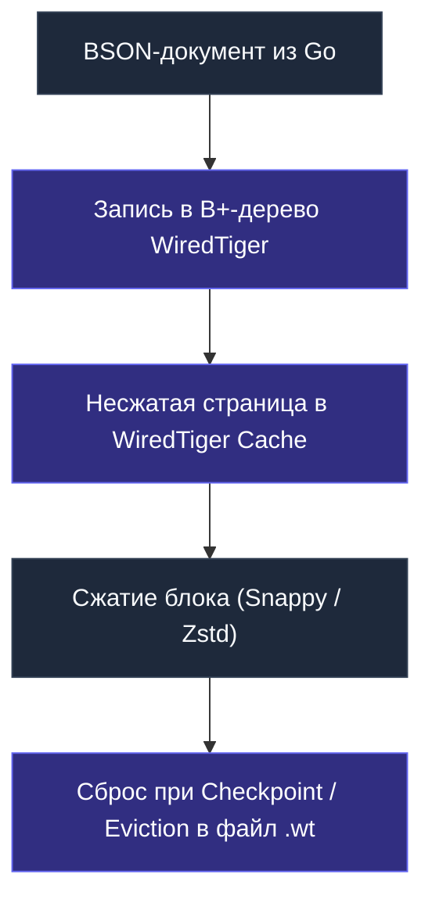
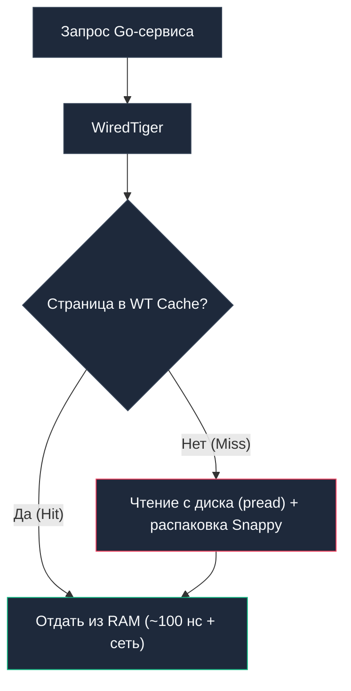

*Страницы и сжатие в WiredTiger, собственный кэш и лаги вытеснения, MVCC на цепочках версий, идемпотентный oplog, WriteConcern/ReadConcern и архитектура шардинга.*

> «В идеальном мире прикладному программисту достаточно знать только API — без того, как этот API реализован и к какому железу он обращается. В реальности же чуть более глубокие знания порой оказываются весьма кстати.»  
> — Чарльз Петцольд, *Code: The Hidden Language of Computer Hardware and Software* (2-е изд.)

В [[7. Документные базы данных — MongoDB и моделирование документов|предыдущей главе]] мы работали с MongoDB на уровне документов и драйвера. На тестовом стенде `LedgerPulse` отвечает за 1–2 мс, но под нагрузкой в продакшене происходят странные вещи: при удвоении базы latency `FindOne` прыгает до 300 мс, вставки замирают волнами, а при внезапном сбое `Primary` исчезают только что подтверждённые записи.

Чтобы предсказывать поведение базы, заглянем под капот стандартного движка **WiredTiger** (используется по умолчанию с MongoDB 3.2 вместо устаревшего `MMAPv1`), а также разберём механику `oplog`, гарантий записи и шардирования.

---

## WiredTiger: B+-деревья, страницы и сжатие

WiredTiger оптимизирован под конкурентные OLTP-нагрузки. Каждая коллекция и каждый индекс хранятся в отдельном файле `.wt` как самостоятельное **B+-дерево**. Файл состоит из непрерывных блоков (**extents**), нарезанных на страницы:

* **Internal pages** — ключи и указатели маршрутизации;
* **Leaf pages** — сами документы или записи индекса (по умолчанию 4–32 КБ; настраиваются через `leaf_page_max`, `internal_page_max`, `allocation_size`);
* **Overflow pages** — выносные страницы под крупные значения, не поместившиеся в листовую страницу.



Чтобы снизить дисковый I/O (~100 мкс на NVMe, ~10 мс на HDD), WiredTiger сжимает блоки на диске алгоритмом **Snappy** (по умолчанию, быстрый) или **Zstd** (сильнее сжимает ценой CPU). Для индексов в памяти применяется префиксное сжатие ключей. Go-приложение получает по сети уже распакованный BSON, но серверу MongoDB требуется запас CPU на сжатие при интенсивной записи.

---

## WiredTiger Cache, Eviction и Journal

В отличие от PostgreSQL, который опирается и на `Shared Buffers`, и на page cache ОС, MongoDB держит **собственный кэш WiredTiger** размером по умолчанию `max(256 МБ, 50% × (RAM - 1 ГБ))` (параметр `cacheSizeGB`). На хосте с 64 ГБ RAM под кэш уйдёт 31.5 ГБ, а остаток останется ядру Linux под сжатый файловый кэш `.wt` и сетевые буферы. В самом кэше WiredTiger страницы хранятся **в несжатом виде** для быстрого доступа из RAM (~100 нс).



### Откуда берутся паузы записи

При заполнении кэша включается вытеснение (**eviction**). Пока доля изменённых («грязных») страниц не превышает ~5% (`eviction_dirty_target`), их сбрасывают фоновые потоки. Но если запись быстрее диска и грязные страницы достигают ~20% (`eviction_dirty_trigger`, или кэш забит на 95%), **клиентские рабочие потоки сами блокируются на вытеснении страниц** — отсюда резкие скачки latency.

> [!warning] Кэш MongoDB против кэша Redis
> Redis при нехватке памяти вытесняет ключи. MongoDB при промахе кэша читает блок с диска через `pread` — задержки растут с наносекунд до миллисекунд. Рабочий набор индексов и горячих документов обязан помещаться в `cacheSizeGB`.

### Journal и Checkpoints

Долговечность опирается на две ступени, близкие к [[8. WAL — журнал упреждающей записи и долговечность на диске|WAL]] и [[9. Контрольные точки (Checkpointing) и сброс грязных страниц|контрольным точкам]]:

1. **Journal** — сжатый Snappy журнал предзаписи, сбрасываемый через `fsync` каждые **100 мс** (или немедленно при `j: true`).
2. **Checkpoints** — согласованный срез B+-деревьев в `.wt`-файлах каждые **60 секунд**. При сбое база загружает последний checkpoint и доигрывает journal.

---

## MVCC под капотом: цепочки версий

Изоляция снимков ([[7. MVCC — многоверсионный контроль конкурентности]], [[12. Snapshot Isolation и Serializable Snapshot Isolation (SSI)]]) реализована в WiredTiger без блокировки читателей: обновление документа добавляет новую запись с временной меткой в **цепочку версий (`update list`)** на странице в памяти. Читатель в рамках своего снимка находит последнюю зафиксированную версию до старта его транзакции. После завершения всех активных читателей фоновая очистка сливает старую историю.

Если Go-сервис держит транзакцию открытой десятки секунд, движок вынужден удерживать старые версии страниц в кэше (`cache pinning`), ускоряя переполнение памяти и жёсткий eviction.

---

## Replica Set, `oplog` и гарантии согласованности

Узлы Replica Set синхронизируются через ограниченную коллекцию (`capped collection`) **`local.oplog.rs`** (см. [[1. Репликация — синхронная, полусинхронная и асинхронная]]). `Primary` пишет туда все изменения, а `Secondary` непрерывно читают их по сети.

Ключевые свойства `oplog`:

* **Идемпотентность:** вместо относительной команды вроде `$inc: {balance: 100}` в `oplog` пишется вычисленное состояние `$set: {balance: 1500}`, поэтому повторное применение при восстановлении безопасно.
* **Конечное окно (`oplogSizeMB`):** когда кольцо переполняется, старые записи затираются. Отставший сверх окна `Secondary` выпадает в `RECOVERING` и требует полной переливки с нуля (`initial sync`).

### `WriteConcern` и `ReadConcern`

Уровень гарантий ([[6. Модели согласованности в БД — Strong, Eventual, Read-Your-Writes и Causal]]) задаётся явно:

* `w: 1` — подтверждает только `Primary`. Если он упадёт до отправки записи репликам, при смене лидера запись **откатится (rollback)**.
* `w: "majority"` + `j: true` — ждёт записи в `journal` большинства голосующих узлов.
* `readConcern: "local"` может прочитать ещё не подтверждённые кворумом данные; `readConcern: "majority"` читает только зафиксированное большинством; при чтении с реплик Go-драйвер учитывает `maxStalenessSeconds` (минимум 90 с).

> [!tip] Собеседование [Senior/Staff]
> **Вопрос:** Как именно `writeConcern: "majority"` защищает данные при краше `Primary`?
>
> **Ответ:** `Primary` фиксирует изменение в своём `journal`/`oplog` и ждёт подтверждения от кворума голосующих `Secondary` о записи в их `oplog` и `journal`, прежде чем ответить клиенту. При падении `Primary` оставшиеся узлы выбирают нового лидера по Raft-адаптации: по свойству пересечения кворумов хотя бы одна реплика из нового большинства содержит свежую запись и благодаря большему `optime` победит на выборах.

---

## Индексы и шардинг под капотом

Индексные B+-деревья хранят ключи с `RecordId` документа. Если запрос укладывается в поля индекса (**Covered Query**), движок не обращается к `.wt`-файлу коллекции (аналогично [[6. Покрывающие (Covering) индексы, INCLUDE и Index-Only Scan]]). `Multikey`-индексы на массивах создают запись на каждый элемент массива, усиливая write amplification.

В шардированном кластере ([[4. Шардирование (Sharding) — ключи, консистентное хеширование и перебалансировка]]) коллекция делится по **`shard key`** на **чанки** (обычно 128 МБ), их карта хранится на `Config Servers`, а маршрутизирует трафик **`mongos`**:

* **Range Sharding** хорош для диапазонов, но на монотонных ключах (`ObjectId`, `created_at`) отправляет все новые вставки в последний чанк одного сервера (**Hot Shard**).
* **Hashed Sharding** равномерно размазывает вставки по шардам, но диапазонные запросы вынуждены опрашивать все шарды (**Scatter–Gather**).
* **Balancer** в фоне переносит чанки онлайн при перекосах, нагружая сеть и диски.

---

## Путь запроса из Go 1.24 и диагностика плана

Пример конфигурации `mongo.Client` для строгих записей `LedgerPulse`:

```go
func NewLedgerMongoClient(uri string) (*mongo.Client, error) {
	opts := options.Client().
		ApplyURI(uri).
		SetMaxPoolSize(64).
		SetMinPoolSize(8).
		SetServerSelectionTimeout(3 * time.Second).
		SetWriteConcern(writeconcern.Majority()).
		SetReadConcern(readconcern.Majority())
	return mongo.Connect(opts)
}

func RecordAuditEvent(ctx context.Context, col *mongo.Collection, accountID int64, action string) error {
	doc := bson.D{
		{Key: "account_id", Value: accountID},
		{Key: "action", Value: action},
		{Key: "created_at", Value: time.Now().UTC()},
	}
	_, err := col.InsertOne(ctx, doc)
	return err
}
```

Физически вызов `InsertOne` сериализует `bson.D` в байты, берёт сокет из пула и отправляет `OP_MSG` через `write()`, паркуя горутину в `netpoller` (поток ОС не блокируется). `mongod` через `epoll_wait` обновляет страницу в `WiredTiger Cache`, пишет в `journal` и `oplog`, дожидается кворума реплик (RTT ЦОД ~0.2–0.5 мс + `fsync` на NVMe ~100 мкс) и отвечает клиенту. При массовом разборе ответов в Go переиспользуйте структуры декодирования или `sync.Pool`, снижая нагрузку на GC.

Для проверки эффективности индексов используйте `explain("executionStats")`:

```text
winningPlan: { stage: "FETCH", inputStage: { stage: "IXSCAN", indexName: "account_id_1_status_1_created_at_-1" } }
executionStats: { nReturned: 25, totalKeysExamined: 25, totalDocsExamined: 25, executionTimeMillis: 0 }
```

Равенство `totalDocsExamined == nReturned` и `IXSCAN` вместо `COLLSCAN` показывают идеальный индекс, построенный по правилу **ESR (Equality → Sort → Range)**: сначала поля точного равенства, затем сортировки, и в конце диапазона.

---

## Ловушки эксплуатации

> [!warning] Пять проблем в продакшене MongoDB
> 1. **Нехватка `oplog`:** при массовой миграции старые записи затираются раньше, чем отставшая реплика их скачает — держите окно `oplog` на 24–72 часа.
> 2. **Лаги TTL-индексов:** фоновая очистка раз в 60 секунд удаляет миллионы истекших документов одной волной, нагружая диск и кэш. Для массовых временных данных лучше удалять суточные коллекции через `drop()`.
> 3. **Крупные документы (под 16 МБ):** вытесняют тысячи мелких записей из кэша WiredTiger.
> 4. **Потеря транзакций при `w: 1`:** для финансовых записей всегда задавайте `WriteConcern: majority`.
> 5. **Нарушение правила ESR в индексах:** диапазон перед равенством ломает сортировку и увеличивает `totalKeysExamined`.

---

## Упражнения

1. **Базовое.** На сервере MongoDB с `64 ГБ` RAM какой объём `WiredTiger Cache` выделится по умолчанию и почему опасно поднимать `cacheSizeGB` до `58`?

> [!solution] Показать решение
> По умолчанию: `50% × (64 - 1) = 31.5 ГБ` под WiredTiger Cache, а `32.5 ГБ` остаются ядру Linux под сжатый page cache файлов `.wt`, `journal` и TCP-буферы. При `cacheSizeGB: 58` ОС останется меньше 6 ГБ — при всплеске подключений и агрегаций процесс `mongod` будет убит OOM Killer.

2. **Практическое.** Дополните `RecordAuditEvent` проверкой ошибок в Go 1.24: обработайте дубликат ключа (`mongo.IsDuplicateKeyError`) как идемпотентный успех, а таймаут (`mongo.IsTimeout`) и `WriteConcernError` верните с понятным контекстом.

> [!solution] Показать решение
> ```go
> func RecordAuditEventSafe(ctx context.Context, col *mongo.Collection, id string, accID int64) error {
> 	_, err := col.InsertOne(ctx, bson.D{{Key: "_id", Value: id}, {Key: "account_id", Value: accID}})
> 	if err == nil || mongo.IsDuplicateKeyError(err) {
> 		return nil
> 	}
> 	if mongo.IsTimeout(err) {
> 		return fmt.Errorf("mongo timeout: %w", err)
> 	}
> 	var we mongo.WriteException
> 	if errors.As(err, &we) && we.WriteConcernError != nil {
> 		return fmt.Errorf("majority write failed (%d): %w", we.WriteConcernError.Code, err)
> 	}
> 	return err
> }
> ```

3. **Со звёздочкой (\*).** В шардированной коллекции `audit_events` (4 млрд записей) ищут последние 50 событий по `account_id`, `event_type` и интервалу `created_at` с сортировкой `created_at DESC`. Почему `Shard Key` `{_id: 1}` (`ObjectId`) разрушит запись, и какие `Shard Key` и индекс ESR решат задачу?

> [!solution] Показать решение
> Первые 4 байта `ObjectId` — монотонный timestamp: при range-шардинге все вставки ударят в один последний чанк (**Hot Shard**).
> Оптимально выбрать `Shard Key` `{account_id: "hashed"}` (или `{account_id: 1, created_at: 1}` при равномерных счетах) для таргетированных запросов без Scatter–Gather, а индекс построить по правилу **ESR**: `{account_id: 1, event_type: 1, created_at: -1}` — равенства, затем уже отсортированный диапазон без отдельной стадии `SORT`.

---

MongoDB с WiredTiger сильна в иерархических документах и вторичных индексах, но B+-дерево обновляет страницы на месте, а запись в каждом шарде идёт через одного лидера. Когда системе нужна максимальная линейная скорость записи без единого узла-лидера, переходят к колоночным базам. В следующей главе мы разберём Apache Cassandra, модель «от запросов» и движок LSM-Tree.
