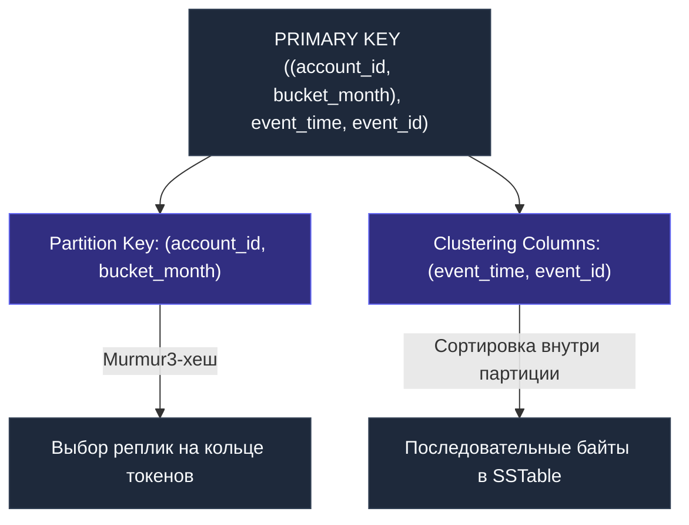
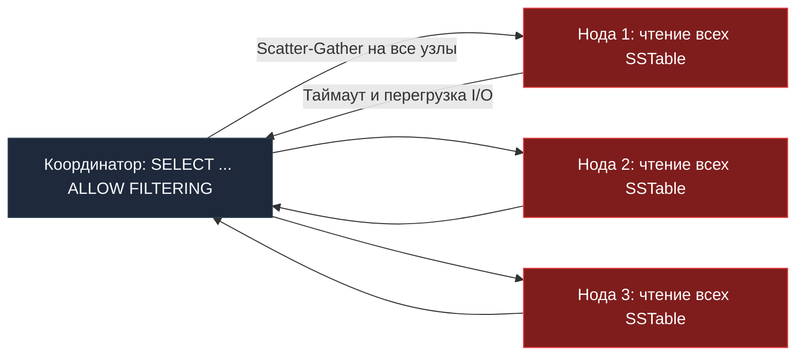

*Wide-Column модель данных, составной первичный ключ, проектирование от запросов, антипаттерн `ALLOW FILTERING` и работа из Go через `gocql`.*

> «Можно уверенно предсказать, что новые языки, делающие программирование проще и безопаснее, будут появляться и дальше. Но столь же уверенно можно сказать, что единого языка не будет никогда: в разработке слишком много компромиссов, чтобы один-единственный язык одинаково хорошо подходил для всех задач.»  
> — Брайан Керниган, *UNIX: A History and a Memoir*

В предыдущих главах вы увидели два полюса NoSQL: пары ключ-значение в [[2. Key-Value хранилища — от хеш-таблиц в памяти до LSM-деревьев]] и вложенные JSON/BSON-документы в [[7. Документные базы данных — MongoDB и моделирование документов]]. Оба класса решают свои задачи, но уступают, когда в систему льются сотни тысяч структурированных событий в секунду, а читать нужно не весь объект целиком, а узкие временные диапазоны по идентификатору.

В `LedgerPulse` балансы и двойные проводки (`accounts`, `transactions`, `ledger_entries`) остаются в PostgreSQL, так как требуют строгих транзакций `ACID`. Но рядом работает аудит платёжного шлюза: каждый вызов API, проверка антифрода и ответ банка-эквайера порождают событие. За сутки набегают сотни миллионов записей. На одном сервере PostgreSQL такой поток перегружает B-Tree индексы и `VACUUM`. Для линейной масштабируемости записи при предсказуемом чтении по ключу используют **ширококолоночные (wide-column) базы данных** и их флагман — **Apache Cassandra**.

---

## Исторический контекст и модель Wide-Column

В 2006 году Google опубликовала статью о **Bigtable** — распределённой разреженной отсортированной карте, а в 2007 году Amazon описала **Dynamo** — беслидерное кольцо узлов, принимающее запись при сбоях. В 2008 году инженеры Facebook Авинаш Лакшман и Прашант Малик объединили обе идеи в **Cassandra** для поиска по входящим сообщениям, а затем передали проект в Apache Software Foundation.

От Bigtable Cassandra взяла модель **семейств столбцов (Column Family)** и сортировку внутри партиций, от Dynamo — консистентное хеширование и кворумную репликацию без единой точки отказа.

Основные понятия **CQL (Cassandra Query Language)**:

* **Keyspace** — пространство имён (аналог БД), где задаются стратегия и фактор репликации (`replication_factor`).
* **Таблица (Column Family)** — контейнер партиций и строк.
* **Строка и `PRIMARY KEY`** — первичный ключ состоит из **Partition Key** (определяет узел на кольце) и нуля или более **Clustering Columns** (задают физический порядок строк внутри партиции).
* **Ячейка (Cell)** — пара имя/значение плюс временная метка `writetime`. Строки разрежены: незаполненные колонки физически не пишутся на диск.



Внутри одной партиции строки отсортированы по `Clustering Columns`. Чтение последних 50 событий аккаунта превращается в **последовательное чтение (sequential scan)** отсортированного отрезка SSTable — при скорости NVMe ~100 мкс на поиск и гигабайтах в секунду на линейный поток это даёт единицы миллисекунд задержки.

---

## Моделирование от запросов (Query-First Design)

В [[14. Денормализация — когда и как она оправдана|реляционном проектировании]] сначала строят схему в 3NF, затем пишут произвольные `JOIN` и подбирают индексы. В Cassandra такой путь не работает: **в CQL нет `JOIN` и нет дешёвых произвольных фильтров**.

Таблицы проектируют **от запросов (Query-First Modeling)**:

1. Выписывают все сценарии чтения (`Q1`, `Q2`, ...).
2. Под каждый сценарий создают отдельную денормализованную таблицу, чей `PRIMARY KEY` точно покрывает `WHERE` и `ORDER BY`.
3. При записи Go-сервис сохраняет событие сразу во все нужные таблицы.

Пусть в `LedgerPulse` аудит поддерживает два запроса:
* `Q1`: лента событий по `account_id` за месяц (`ORDER BY event_time DESC`).
* `Q2`: все события по конкретной транзакции `transaction_id`.

```sql
CREATE KEYSPACE IF NOT EXISTS ledger_audit
WITH replication = {'class': 'NetworkTopologyStrategy', 'dc1': 3};

-- Таблица под Q1: лента по счёту с ограничением партиции по месяцам
CREATE TABLE IF NOT EXISTS ledger_audit.events_by_account (
    account_id     bigint,
    bucket_month   text,      -- например, '2026-05'
    event_time     timeuuid,
    event_id       uuid,
    transaction_id bigint,
    event_type     text,
    amount_minor   bigint,
    PRIMARY KEY ((account_id, bucket_month), event_time, event_id)
) WITH CLUSTERING ORDER BY (event_time DESC, event_id ASC)
  AND default_time_to_live = 7776000; -- TTL 90 дней

-- Таблица под Q2: поиск событий по transaction_id
CREATE TABLE IF NOT EXISTS ledger_audit.events_by_tx (
    transaction_id bigint,
    event_time     timeuuid,
    event_id       uuid,
    account_id     bigint,
    event_type     text,
    amount_minor   bigint,
    PRIMARY KEY (transaction_id, event_time, event_id)
) WITH CLUSTERING ORDER BY (event_time ASC, event_id ASC);
```

Составной ключ партиции `(account_id, bucket_month)` защищает от **широких партиций (wide partitions > 100 МБ)**: если оставить один `account_id`, активный мерчант за год перегрузит одну реплику и компактификацию.

---

## Антипаттерн `ALLOW FILTERING`

Попытка выполнить фильтрацию без `Partition Key`:

```sql
SELECT account_id, event_type, amount_minor
FROM ledger_audit.events_by_account
WHERE event_type = 'ANTI_FRAUD_DECLINE';
```

вызовет отказ сервера:

```text
InvalidRequest: Error from server: code=2200 [Invalid query]
message="Cannot execute this query as it might involve data filtering and
thus may have unpredictable performance. If you want to execute this query
despite the performance unpredictability, use ALLOW FILTERING"
```

Дописывание `ALLOW FILTERING` заставляет координатор делать **scatter-gather по всем узлам и всем партициям кольца**: читать гигабайты SSTable с диска и отбрасывать ненужные строки в памяти. На продакшене такой запрос упирается в таймаут и ломает latency соседей. Единственное допустимое исключение — фильтрация по явно указанному `Partition Key` внутри крошечной известной партиции.



---

## Архитектура, LSM-Tree и настраиваемая консистентность

Подробно внутренности узла разберём в [[10. Архитектура Cassandra — LSM-Tree, SSTable, Memtable и кворумы]], а здесь зафиксируем ключевые свойства:

1. **Равноправные узлы и Consistent Hashing.** В кластере нет мастера; любой узел может выступить координатором, вычислить 64-битный хеш `Murmur3` от Partition Key и направить запрос репликам (см. [[4. Шардирование (Sharding) — ключи, консистентное хеширование и перебалансировка]]). Узлы общаются по **Gossip**, пропущенные мутации досылаются через **Hinted Handoff**, а расхождения при чтении чинятся через **Read Repair**.
2. **Путь записи в LSM-Tree.** Мутация ложится в последовательный `CommitLog` на диске и отсортированный `Memtable` в RAM, затем сбрасывается крупным потоком в неизменяемый `SSTable` с `Bloom Filter` для отсечения лишних чтений и фоновой процедурой `Compaction`.
3. **Настраиваемая консистентность (Tunable Consistency).** Уровень задаётся на каждый запрос (см. [[6. Модели согласованности в БД — Strong, Eventual, Read-Your-Writes и Causal]] и [[7. CAP и PACELC в выборе баз данных]]):
   * `ONE` — ответ одной реплики, минимальная задержка, риск устаревших данных;
   * `QUORUM` — большинство реплик ($\lfloor RF/2 \rfloor + 1$);
   * `LOCAL_QUORUM` — большинство реплик **в локальном дата-центре** (стандарт для Go-сервисов);
   * `EACH_QUORUM` — кворум в каждом дата-центре;
   * `ALL` — все реплики (любая недоступная нода блокирует запрос);
   * `SERIAL` / `LOCAL_SERIAL` — линеаризуемые легковесные транзакции на Paxos.

> [!tip] Собеседование [Middle]
> **Вопрос:** Когда Cassandra с `QUORUM` обеспечивает строгую согласованность чтения последней записи, а когда возможен нюанс?
>
> **Ответ:** При $W + R > N$ (например, `RF = 3`, запись и чтение с `QUORUM`: $2 + 2 > 3$) кворумы пересекаются минимум в одной реплике, содержащей самую свежую версию по `writetime`. Однако без `SERIAL` (Paxos) при конкурентных записях побеждает больший таймстемп (Last Write Wins), который уязвим к дрейфу часов NTP (см. [[3. Multi-Leader и Leaderless репликация — конфликты записи и кворумы]]). А если запись не добрала кворум `W`, но успела лечь на одну ноду до таймаута, чтение может как увидеть её, так и пропустить до срабатывания Read Repair.

---

## Драйвер `gocql` в Go 1.24

Драйвер `github.com/gocql/gocql` поддерживает пулы соединений, обновление топологии и **Token-Aware маршрутизацию**: вычисляет токен на клиенте и шлёт запрос напрямую на реплику-владельца партиции, экономя сетевой переход.

```go
package auditstore

import (
	"context"
	"fmt"
	"time"

	"github.com/gocql/gocql"
)

type AuditEvent struct {
	AccountID   int64
	BucketMonth string
	EventTime   gocql.UUID
	EventID     gocql.UUID
	TxID        int64
	EventType   string
	AmountMinor int64
}

func NewSession(hosts []string, keyspace string) (*gocql.Session, error) {
	cluster := gocql.NewCluster(hosts...)
	cluster.Keyspace = keyspace
	cluster.Consistency = gocql.LocalQuorum
	cluster.Timeout = 2 * time.Second
	cluster.PoolConfig.HostSelectionPolicy = gocql.TokenAwareHostPolicy(
		gocql.DCAwareRoundRobinPolicy("dc1"),
	)
	return cluster.CreateSession()
}

func ListRecentEvents(ctx context.Context, s *gocql.Session, accountID int64, month string, pageSize int) ([]AuditEvent, error) {
	const cql = `
		SELECT event_time, event_id, transaction_id, event_type, amount_minor
		FROM events_by_account
		WHERE account_id = ? AND bucket_month = ?`

	iter := s.Query(cql, accountID, month).WithContext(ctx).PageSize(pageSize).Iter()
	var out []AuditEvent
	ev := AuditEvent{AccountID: accountID, BucketMonth: month}
	for iter.Scan(&ev.EventTime, &ev.EventID, &ev.TxID, &ev.EventType, &ev.AmountMinor) {
		out = append(out, ev)
	}
	if err := iter.Close(); err != nil {
		return nil, fmt.Errorf("iterate account events: %w", err)
	}
	return out, nil
}
```

> [!warning] Ловушка: Чтение партиций без `PageSize`
> Вычитывание тысяч строк за один раз без `PageSize` (в протоколе CQL `fetchSize`) создаёт всплески аллокаций и нагрузку на сборщик мусора Go. Задавайте `PageSize`, используйте `PageState` для пагинации и всегда проверяйте `iter.Close()`, чтобы не потерять ошибку потока.

---

## Границы применимости Cassandra

| Сценарий | Выбор | Причина |
| :--- | :--- | :--- |
| Временные ряды, IoT, аудит с TTL | Подходит | Последовательная запись в LSM-Tree, быстрый range scan |
| Ленты событий, мульти-ЦОД сервисы | Подходит | Беслидерность, `LOCAL_QUORUM` переживает падение канала |
| Сложные ad-hoc `JOIN` и OLAP | Не подходит | Нет `JOIN`; для аналитики см. [[11. ClickHouse — аналитическая OLAP-база для миллиардов строк]] |
| Частые перезаписи одних строк | Плохо | Копит версии и надгробия (tombstones) |
| Строгие балансы `LedgerPulse` | Не подходит | Нет многострочных ACID-транзакций (зона PostgreSQL) |

---

## Упражнения

1. **Базовое.** В `LedgerPulse` нужны два отчёта: (А) события мерчанта `merchant_id` за последние 7 дней от новых к старым; (Б) все события с `error_code = 'ERR_TIMEOUT'` за сегодня. Почему нельзя обойтись одной таблицей с `PRIMARY KEY (merchant_id, event_time)` и `WHERE error_code = 'ERR_TIMEOUT' ALLOW FILTERING`? Напишите DDL двух таблиц под эти запросы.

> [!solution] Показать решение
> Запрос `WHERE error_code = 'ERR_TIMEOUT' ALLOW FILTERING` не задаёт `Partition Key` (`merchant_id`), поэтому координатор сканирует все партиции на всех узлах кольца.
> ```sql
> CREATE TABLE ledger_audit.events_by_merchant (
>     merchant_id bigint,
>     event_date  date,
>     event_time  timeuuid,
>     error_code  text,
>     PRIMARY KEY ((merchant_id, event_date), event_time)
> ) WITH CLUSTERING ORDER BY (event_time DESC);
>
> CREATE TABLE ledger_audit.events_by_error (
>     error_code  text,
>     event_date  date,
>     event_time  timeuuid,
>     merchant_id bigint,
>     PRIMARY KEY ((error_code, event_date), event_time, merchant_id)
> ) WITH CLUSTERING ORDER BY (event_time DESC);
> ```
> Для запроса А за 7 дней Go-сервис делает 7 точечных запросов по датам (или `event_date IN (...)` по одному `merchant_id`).

2. **Практическое.** Добавьте к выборке `events_by_account` курсорную пагинацию на Go через `iter.PageState()` с возвратом `NextPageToken` в Base64, читая ровно `limit` строк за вызов.

> [!solution] Показать решение
> ```go
> type PageResult struct {
> 	Events        []AuditEvent
> 	NextPageToken string
> }
>
> func ListEventsPage(ctx context.Context, s *gocql.Session, accountID int64, month string, limit int, token string) (PageResult, error) {
> 	const cql = `
> 		SELECT event_time, event_id, transaction_id, event_type, amount_minor
> 		FROM events_by_account WHERE account_id = ? AND bucket_month = ?`
> 	q := s.Query(cql, accountID, month).WithContext(ctx).PageSize(limit)
> 	if token != "" {
> 		state, err := base64.StdEncoding.DecodeString(token)
> 		if err != nil {
> 			return PageResult{}, fmt.Errorf("decode page token: %w", err)
> 		}
> 		q = q.PageState(state)
> 	}
> 	iter := q.Iter()
> 	events := make([]AuditEvent, 0, limit)
> 	ev := AuditEvent{AccountID: accountID, BucketMonth: month}
> 	for len(events) < limit && iter.Scan(&ev.EventTime, &ev.EventID, &ev.TxID, &ev.EventType, &ev.AmountMinor) {
> 		events = append(events, ev)
> 	}
> 	nextState := iter.PageState()
> 	if err := iter.Close(); err != nil {
> 		return PageResult{}, fmt.Errorf("iterate page: %w", err)
> 	}
> 	var nextToken string
> 	if len(nextState) > 0 {
> 		nextToken = base64.StdEncoding.EncodeToString(nextState)
> 	}
> 	return PageResult{Events: events, NextPageToken: nextToken}, nil
> }
> ```
> `PageState` передаёт координатору бинарную позицию в SSTable, поэтому переход на сотую страницу не перечитывает первые 99.

3. **Со звёздочкой (\*).** При сбое банка-эквайера в `events_by_error` за сутки падает 20 млн строк с одним `error_code = 'BANK_503'`. Все 20 млн строк ложатся в одну горячую партицию на одних и тех же трёх репликах. Как изменить `Partition Key` для размазывания записи по кольцу и как перестроить чтение в Go?

> [!solution] Показать решение
> Добавьте искусственный шард-бакет (`shard tinyint`) в `Partition Key`:
> ```sql
> PRIMARY KEY ((error_code, event_date, shard), event_time, merchant_id)
> ```
> При записи Go-сервис вычисляет `shard = int8(merchantID % 16)` (или случайный `0..15`), распределяя нагрузку по 16 разным партициям кольца. При чтении сервис запускает 16 параллельных запросов (`shard = 0..15`) через `errgroup` и сливает результаты в памяти по `event_time DESC`.

---

Мы научились моделировать таблицы Cassandra от запросов и работать с ними через `gocql`. Но что происходит на узле после прихода мутации: как устроено кольцо токенов, почему массовый `DELETE` убивает `SELECT` надгробиями и какая стратегия компактификации спасёт диск? Разберём это в главе [[10. Архитектура Cassandra — LSM-Tree, SSTable, Memtable и кворумы]].
